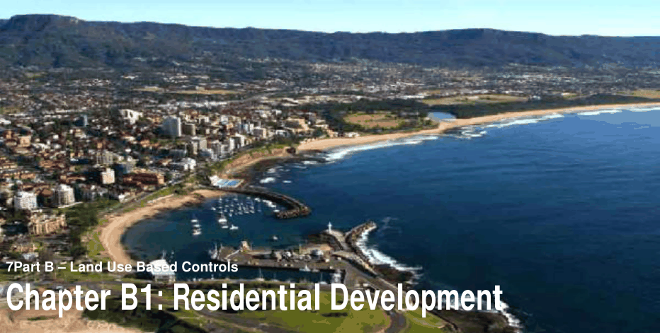

# Wollongong Development Control Plan 2009 - Chapter B1 Residential Development

> This chapter is split into 74 section file(s), one per numbered heading, in the order they appear in the PDF.

Source PDF: [Wollongong-DCP-2009-Chapter-B01-Residential-Development.pdf](https://planfortomorrow.sharepoint.com/sites/Planfortomorrow/Shared%20Documents/00%20NSW-Planning-Resources/dcp/wollongong-development-control-plan-2009/chapter-b1-residential-development/Wollongong-DCP-2009-Chapter-B01-Residential-Development.pdf)

> [Picture on page 1: a picture, saved as a picture (images/chapter-b1-residential-development-page-1-1.gif, 150 dpi).]

#### 7Part B – Land Use Based Controls

### Chapter B1: Residential Development

> The PDF's contents list (page numbers of the printed document) is not repeated here - see Sections below.

i

<!-- sections -->
## Sections

1. [6.6 Visual privacy](01-6-6-visual-privacy.md)
2. [6.7 Acoustic privacy](02-6-7-acoustic-privacy.md)
3. [6.8 Car Parking Requirements](03-6-8-car-parking-requirements.md)
4. [6.9 Basement Car Parking](04-6-9-basement-car-parking.md)
5. [6.10 Access Requirements](05-6-10-access-requirements.md)
6. [6.11 Landscaping Requirements](06-6-11-landscaping-requirements.md)
7. [6.12 Deep Soil Zone](07-6-12-deep-soil-zone.md)
8. [6.13 Communal Open Space](08-6-13-communal-open-space.md)
9. [6.14 Private Open Space](09-6-14-private-open-space.md)
10. [6.16 Access for People with a Disability](10-6-16-access-for-people-with-a-disability.md)
11. [6.17 Apartment Size and Layout Mix for Larger Residential](11-6-17-apartment-size-and-layout-mix-for-larger.md)
12. [6.18 Solar Access](12-6-18-solar-access.md)
13. [6.19 Natural Ventilation](13-6-19-natural-ventilation.md)
14. [1 INTRODUCTION](14-1-introduction.md)
15. [2 OBJECTIVES](15-2-objectives.md)
16. [3 DEFINITIONS](16-3-definitions.md)
17. [4.1 Number of Storeys](17-4-1-number-of-storeys.md)
18. [4.2 Front Setbacks](18-4-2-front-setbacks.md)
19. [4.3 Side and Rear Setbacks](19-4-3-side-and-rear-setbacks.md)
20. [4.4 Site Coverage](20-4-4-site-coverage.md)
21. [4.5 Landscaped Area](21-4-5-landscaped-area.md)
22. [4.6 Private Open Space](22-4-6-private-open-space.md)
23. [4.7 Solar Access](23-4-7-solar-access.md)
24. [4.8 Building Character and Form](24-4-8-building-character-and-form.md)
25. [4.9 Fences](25-4-9-fences.md)
26. [4.10 Car parking and Access](26-4-10-car-parking-and-access.md)
27. [4.11 Storage Facilities](27-4-11-storage-facilities.md)
28. [4.12 Site Facilities](28-4-12-site-facilities.md)
29. [4.13 Fire Brigade Servicing](29-4-13-fire-brigade-servicing.md)
30. [4.14 Services](30-4-14-services.md)
31. [4.15 Development near the Coastline](31-4-15-development-near-the-coastline.md)
32. [4.16 View Sharing](32-4-16-view-sharing.md)
33. [4.17 Retaining Walls](33-4-17-retaining-walls.md)
34. [4.18 Swimming Pools and Spas](34-4-18-swimming-pools-and-spas.md)
35. [4.19 Development Near Railway Corridors and Major Road](35-4-19-development-near-railway-corridors-and.md)
36. [4.20 Additional controls for semi-detached dwellings – alterations and](36-4-20-additional-controls-for-semi-detached.md)
37. [4.21 Additional Controls for Dual Occupancy’s - Minimum Site Width](37-4-21-additional-controls-for-dual-occupancy-s.md)
38. [4.22 Additional Controls for Dual Occupancy’s - Building Character and Form](38-4-22-additional-controls-for-dual-occupancy-s.md)
39. [4.23 Additional Controls for Dual Occupancy’s – Deep Soil Zones](39-4-23-additional-controls-for-dual-occupancy-s.md)
40. [5 ATTACHED DWELLINGS AND MULTI - DWELLING HOUSING](40-5-attached-dwellings-and-multi-dwelling.md)
41. [5.1 Minimum Site Width Requirement](41-5-1-minimum-site-width-requirement.md)
42. [5.2 Number of Storeys](42-5-2-number-of-storeys.md)
43. [5.3 Front Setbacks](43-5-3-front-setbacks.md)
44. [5.4 Side and Rear Setbacks](44-5-4-side-and-rear-setbacks.md)
45. [5.5 Building Character and Form](45-5-5-building-character-and-form.md)
46. [5.6 Access / Driveway Requirements](46-5-6-access-driveway-requirements.md)
47. [5.7 Car Parking Requirements](47-5-7-car-parking-requirements.md)
48. [5.8 Landscaping Requirements](48-5-8-landscaping-requirements.md)
49. [5.9 Deep Soil Planting](49-5-9-deep-soil-planting.md)
50. [5.10 Communal Open Space](50-5-10-communal-open-space.md)
51. [5.11 Private Open Space](51-5-11-private-open-space.md)
52. [5.12 Solar Access Requirements](52-5-12-solar-access-requirements.md)
53. [5.13 Additional Control for Multi Dwelling Housing - Dwelling Mix and](53-5-13-additional-control-for-multi-dwelling.md)
54. [5.14 Additional Control for Multi Dwelling Housing - Adaptable](54-5-14-additional-control-for-multi-dwelling.md)
55. [5.15 Additional Control for Multi Dwelling Housing - Crime Prevention through Environmental Design](55-5-15-additional-control-for-multi-dwelling.md)
56. [6.1 General](56-6-1-general.md)
57. [6.2 Minimum Site Width Requirement](57-6-2-minimum-site-width-requirement.md)
58. [6.3 Front Setbacks](58-6-3-front-setbacks.md)
59. [6.4 Side and Rear Setbacks / Building Separation](59-6-4-side-and-rear-setbacks-building.md)
60. [6.5 Built Form](60-6-5-built-form.md)
61. [6.6 Visual privacy](61-6-6-visual-privacy.md)
62. [6.7 Acoustic privacy](62-6-7-acoustic-privacy.md)
63. [6.8 Car Parking Requirements](63-6-8-car-parking-requirements.md)
64. [6.9 Basement Car Parking](64-6-9-basement-car-parking.md)
65. [6.10 Access Requirements](65-6-10-access-requirements.md)
66. [6.11 Landscaping Requirements](66-6-11-landscaping-requirements.md)
67. [6.12 Deep Soil Zone](67-6-12-deep-soil-zone.md)
68. [6.13 Communal Open Space](68-6-13-communal-open-space.md)
69. [6.14 Private Open Space](69-6-14-private-open-space.md)
70. [6.15 Adaptable and Universally Designed Housing](70-6-15-adaptable-and-universally-designed.md)
71. [6.16 Access for People with a Disability](71-6-16-access-for-people-with-a-disability.md)
72. [6.17 Apartment Size and Layout Mix for Larger Residential Flat](72-6-17-apartment-size-and-layout-mix-for-larger.md)
73. [6.18 Solar Access](73-6-18-solar-access.md)
74. [6.19 Natural Ventilation](74-6-19-natural-ventilation.md)
