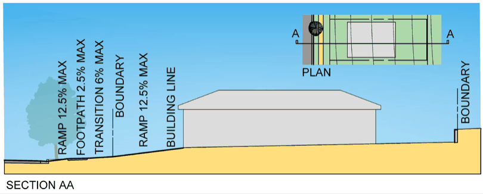
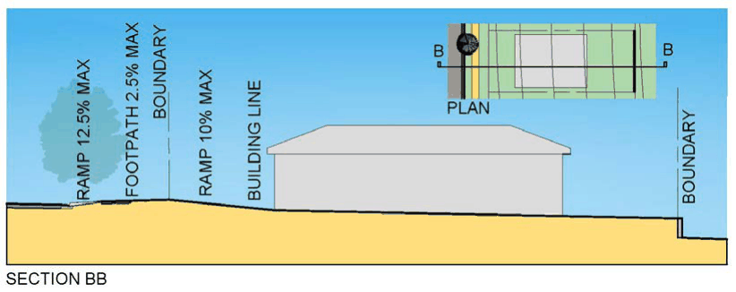
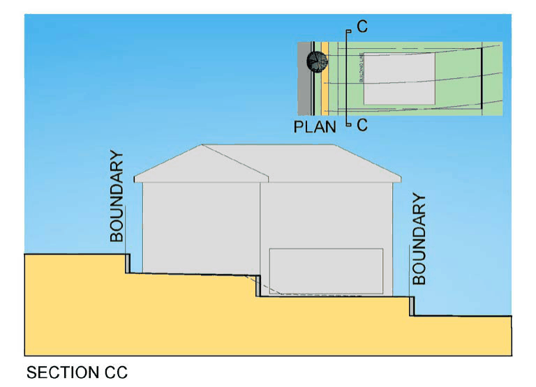

## 5 TOPOGRAPHY, LANDFORM CONSERVATION, CUT AND FILL

Objectives

a) Ensure the design of any subdivision takes into account inherent site constraints, and natural

landform features.

b) Ensure the design of the subdivision responds to the natural topography and landform feature and

minimise, as far as practicable, significant cut / fill and unnecessary reshaping of the site.

c) Retain key characteristics of landforms and encourage individual housing and lot design solutions

to contribute to future street and residential character diversity.

d) Ensure that the design of any residential subdivision takes into account any significant trees or

other vegetation upon the subject site, including any endangered ecological community or

threatened species.

Development Controls

1\. The topography and landform of the site must be taken into consideration as part of the design of

the subdivision layout, to optimise solar access opportunities and maximise views to key natural

features.

2\. The topography and landform of a locality are important place-making elements. Roads should be

designed to respond to such features and work to minimise cut and fill.

3\. The subdivision lot layout should be designed to improve views from public points of interest (such

as parks and hill tops, public facilities, centres) and residential areas to special features such as

the escarpment backdrop, remnant stand of significant trees (ie Spotted Gum forest or stand of

Norfolk Island pine trees) or the coastline.

4\. Where the land slopes at a grade of 6% or greater, the predominant road alignment should be

perpendicular to the contours of the site, wherever practicable.

5\. Roads must be constructed at the natural ground level of the site wherever practical, taking into

account the constraints of the site and road design requirements.

6\. Where natural landform is sloping prior to subdivision works, lots shall be designed to reflect

inherited slopes. Housing products to suit sloping lots, with building envelope platforms,

landscaped sloping solutions and split-level house designs are encouraged (see diagrams below).

7\. All finished lots shall have a minimum 2% fall towards the proposed stormwater drainage system,

in order to allow for suitable stormwater run-off from the site and to help minimise any potential

water ponding.

> [Picture on page 9: a picture, saved as a picture (images/chapter-b2-residential-subdivision-page-9-28.gif, 150 dpi).]

> [Picture on page 9: a picture, saved as a picture (images/chapter-b2-residential-subdivision-page-9-29.gif, 150 dpi).]

Examples of incorporating sloping in lots from front to rear into lot design and related housing designs.

> [Picture on page 10: a picture, saved as a picture (images/chapter-b2-residential-subdivision-page-10-1.gif, 150 dpi).]

Examples of accommodating sloping blocks into lot design and related housing designs.
