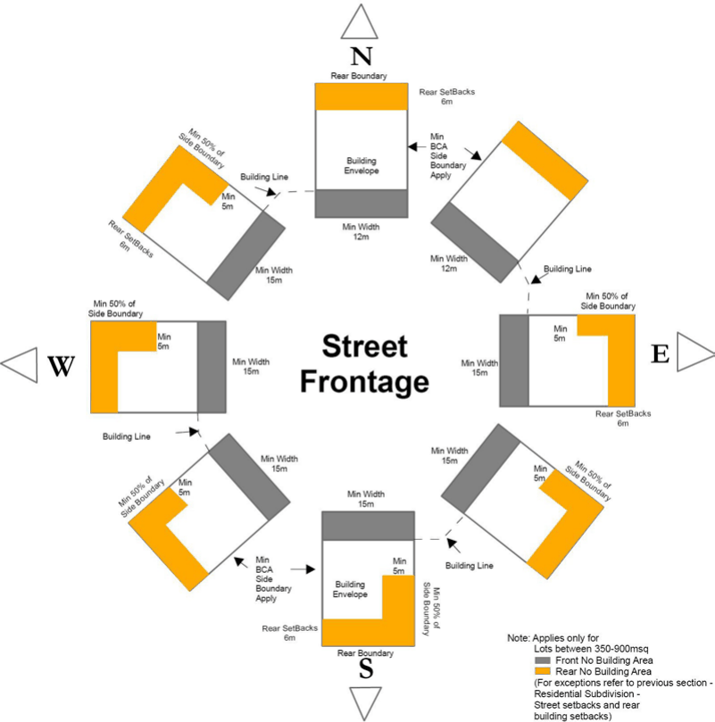

### 6.2 Lot size

1\. The minimum subdivision allotment size requirement for a particular parcel of land shall be in

accordance with the provisions of Wollongong LEP 2009 and the accompany Lot Size Map,

relevant to the land.

2\. Irregular shaped lots shall have a minimum allotment size of 485m2.

3\. Regular shaped corner lots shall have a minimum allotment size of 500m2 as per Table 1 below

and as illustrated in Figure 1 below.

4\. Regular shaped battle axe allotments within residential zones shall have a minimum allotment size

of 550m2, excluding the battle axe access handle. Irregular shaped battle – axe lots shall have a

minimum allotment size of 600m2 (excluding the access handle). Refer to Figure 1 and Table 1

below.

#### Table 1. Minimum allotment sizes

| Allotment Type | Minimum Lot Size | Minimum Lot Size Requirement |
|---|---|---|
|  | Requirement for Regular | for Irregular Shaped Lots |
|  | Shaped Lots |  |
| Standard Lot | Subject to Wollongong Local Environmental Plan 2009 | 485m2 |

|  | (relevant Lot Size Map) |  |
|---|---|---|
| Corner Lot | 500m2 | NA |
| Battle-axe Lot (excluding access handle) | 550m2 | 600m2 |

However, larger allotments may be required in certain circumstances such as lots containing steeply

sloping land or land containing a watercourse or land fronting an arterial road.

> [Picture on page 12: a picture, saved as a picture (images/chapter-b2-residential-subdivision-page-12-4.gif, 150 dpi).]

#### Figure 1. Solar Access Orientation – Minimum Building Envelopes and Lot Widths
