### 13.2 Road hierarchy and design requirements

Objectives

(a) To provide a defined hierarchy of roads, in order to provide an acceptable level of access, safety

and convenience for all road users.

(b) To ensure that the design features of each residential road within a subdivision reflects the role of

the road within the overall road network.

(c) To provide an acceptable level of access, safety and convenience for all road users within existing

urban areas and new release areas, whilst ensuring acceptable levels of amenity and minimising

traffic management issues in the particular locality.

(d) To provide appropriate road access for larger and special purpose vehicles including garbage and

recycling trucks, fire trucks, delivery trucks etc.

(e) Ensure sufficient road carriageway and verge widths are provided for each road type, in order to

enable all roads to perform their designated function within the road network.

(f) Ensure that the road reserve adequately caters for all required functions including safe and

efficient vehicular and pedestrian movement throughout the road network, provision of on-street

parking and the provision of street tree planting and other landscaping, where appropriate.

(g) Ensure road verges are of sufficient width to physically accommodate all necessary infrastructure

assets and utilities.

(h) Provide road geometry that is consistent with the designated function of the specific road as well

as the physical characteristics of the locality.

(i) Ensure the road network is simple and safe for all road users, including motor vehicles,

pedestrians and cyclists.

(j) Ensure that appropriate vehicle speed limits are incorporated into the road design to enhance the

safety of pedestrians and cyclists, the young and people with a disability.

(k) Ensure new release areas are designed to provide for safe, convenient and efficient bus routes.

Development Controls 1 The design of any road as part of a subdivision shall be in accordance with the following Table 3,

Table 4 and Table 5, the Road Type Cross-Sections accompanying this section 14.2 and in

accordance with Council’s Subdivision Policy.

2 Roads should be designed to provide visual interest in the streetscape through kerbs (where

appropriate), landscaping and paving treatments. The road design should be compatible with the

existing road pattern in the locality.

3 The minimum spacing of staggered intersections in a local subdivision road network (Road Types

5 to 8) should be 20 metres.

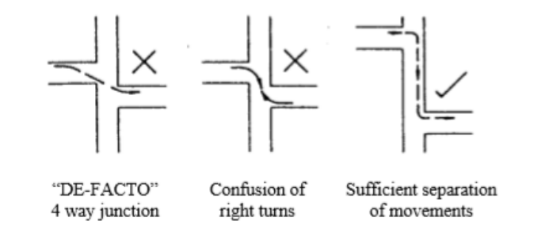

> [Picture on page 21: a picture, saved as a picture (images/chapter-b2-residential-subdivision-page-21-1.gif, 150 dpi).]

4 Street layout and curve radii must make provision for service vehicles to manoeuver. 5 The provisions of the NSW Rural Fire Service publication “Planning for Bushfire Protection” and

the State Government Publication “Fire Safety Guideline – Access for Emergency Vehicles and

Emergency Service Personnel” must be met and will take precedence.

6 The maximum length of cul-de-sacs should not exceed 80 metres. 7 For all roads that permit direct driveway access, a minimum 15 metre lot width may be required at

the street frontage, where Council determines that on-street parking is required.

8 Angled parking may be utilised adjacent to active open space and in town and village centres,

particularly for lower volume roads, provided it does not unduly impact traffic flow or public

transport services. Angled parking must comply with Australian Standards and will be assessed by

Council as to its merits on a case-by-case basis.

#### Table 3. Road network environment

|  |  | Road Environment |  |  |  |  |
|---|---|---|---|---|---|---|
| Street Types Type 1 (entry road with WSUD median strip (4.2m) & Sub-Arterial bus services) Road Type 2 (with bus services) Type 2A (with parking & bus services) |  | Access (driveway) No Access No Access No Access | Indicative Daily Traffic Volume (vpd) 20,000 - 40,000+ 15,000 - 20,000+ 10,000 - 15,000 | Target Speed (km/h) 70 60 60 | Street Pavement Type Asphalt Asphalt Asphalt | Parking No No Yes |
| Major Collector Road | Type 3 (with parking & bus services) | No Access | 3,000 - 15,000 | 60 | Asphalt | Yes |
| Minor Collector Road | Type 4 (with parking & limited bus access) | Access | 3,000 - 9,000 | 50 | Asphalt | Yes |
| Town & Village Centre Road | Type TC | Limited Access | (varies) | 40 | Asphalt | Yes |
| Local Road | Type 5 (with parking) | Access | 1,000 - 3,000 | 40 | Asphalt | Yes |
| Access Street | Type 6 (with residential on both sides, and parking) | Access | 300 - 1,000 | 25 | Asphalt | Yes |
| Access Place | Type 7 (with parking) Type 7A (1-Way, adjacent open space on one side) Type 7B (2-Way, adjacent open space on one side) | Access Access Access | < 300 < 300 < 300 | 25 25 25 | Asphalt Asphalt Asphalt | Yes Yes Yes |
| Laneway | Type 8 (no parking) | Access | < 150 | 10 | Asphalt | No |

#### Table 4. Carriageways and verges

|  |  | Carriageway |  |  | Verge |  |  |  |
|---|---|---|---|---|---|---|---|---|
| Street Types Type 1 (entry road with WSUD median strip (4.2m) & Sub- bus services) Arterial Type 2 Road (with bus services) Type 2A (with parking & bus services) |  | Kerb Lane (m) 3.6 3.5 3.5 | Centre Lane (m) 3.4 3.2 3.2 | Total (m) 18.2 13.4 13.4 | Verge (m) 10.5 (5.25 each side) 9.5 (4.75 each side) 9.5 (4.75 each side) | Total Reserve (m) 28.7 22.9 22.9 | Footpath (m) n/a n/a n/a | Shared Path (m) 5m (2.5m each side) 5m (2.5m each side) 5m (2.5m each side) |
| Major Collector Road | Type 3 (with parking & bus services) | 3.0 | 3.2 | 12.4 | 9.5 (4.75 each side) | 21.9 | n/a | 5m (2.5m each side) |
| Minor Collector Road | Type 4 (with parking & limited bus access) | 2.6 | 3.0 | 11.2 | 9.75m (5.25m one side, 4.5m other side) | 20.95 | 1.5 | 3m |
| Town & Village Centre Road | Type TC | (varies) | (varies) | (varies) | 9m (4.5m each side) or 9.75m (5.25m residential side, 4.5m centre side) | (varies) | 4.5m full width town centre side | 3m provided on one side if residential |
| Local Road | Type 5 (with parking) | 2.1 | 2.8 | 9.8 | 9m (4.5m each side) | 18.8 | 3m (1.5m each side) | n/a |
| Access Street | Type 6 (with residential on both sides, and parking) | 2.3 | 3.5 | 8.1 | 9m (4.5m each side) | 17.1 | 3m (1.5m each side) | n/a |
| Access Place | Type 7 (with parking) Type 7A (1-Way, adjacent open space on one side) Type 7B (2-Way, adjacent open space on one side) | 3.5 2,0 (parking lane) or 3.5 (travel lane) 3.5 | n/a n/a n/a | 7.0 5.5 7.0 | 8m (4m each side) 6.45m (2.45m open space side, 4m other side) 6.45m (2.45m open space side, 4m other side) | 15 11.95 13.45 | n/a n/a n/a | n/a n/a n/a |
| Laneway | Type 8 (no parking) | n/a | n/a | 5.5 | 2.9m (1.45m each side to property boundary) | 8.4 | n/a | n/a |

#### Table 5. Street vegetation

| Street Types Type 1 (entry road with WSUD median strip (4.2m) & Sub-Arterial bus services) Road Type 2 (with bus services) Type 2A (with parking & bus services) |  | Verge Trees 1 every 12m 1 every 12m 1 every 12m | Street Tree Planting n/a n/a 1 every 30-60m via kerb bulges |
|---|---|---|---|
| Major Collector Road | Type 3 (with parking & bus services) | 1 every 12m | 1 every 30-60m via kerb bulges |
| Minor Collector Road | Type 4 (with parking & limited bus access) | 1 per lot or every 15-20m | None – use kerb extensions at intersection |
| Town & Village Centre Road | Type TC | Landscape design or 1 per lot or every 15-20m (residential side) | Kerb extensions can be used mid-block (eg at pedestrian crossings) and intersections |
| Local Road | Type 5 (with parking) | 1 per lot or every 15-20m | None – use kerb extensions at intersection |
| Access Street | Type 6 (with residential on both sides, and parking) | 1 per lot or every 15-20m | None – use kerb extensions at intersection |
| Access Place | Type 7 (with parking) Type 7A (1-Way, adjacent open space on one side) Type 7B (2-Way, adjacent open space on one side) | 1 per lot or every 15-20m 1 per lot or every 15-20m (residential side) 1 per lot or every 15-20m (residential side) | n/a n/a n/a |
| Laneway | Type 8 (no parking) | 1 per lot depending on lane design | n/a |

#### TYPE 1 – Major Sub-arterial road

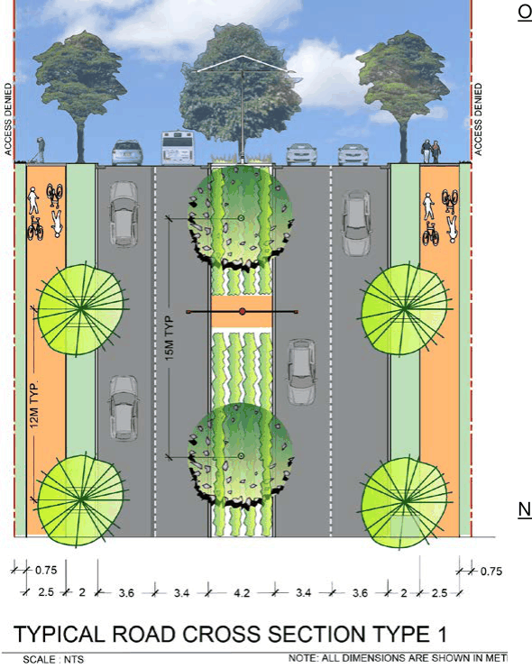

> [Picture on page 25: a picture, saved as a picture (images/chapter-b2-residential-subdivision-page-25-2.gif, 150 dpi).]

Objectives

1\. Provide for high general traffic and heavy

vehicle volumes with 4 travel lanes.

2\. Provide connectivity between

neighbourhoods and local centres/arterial

road network.

3\. Direct access is not permitted (access

denied).

4\. Provide for bus routes and bus stops

(generally indented stops).

5\. Design speed 80km/h, posted speed

70km/h.

6\. Provide legible pedestrian and cycle

network via shared paths on both sides of

road.

7\. Provide improved safety and amenity

through provision of planted median.

8\. Allows for development of right turn lanes

at intersections via the central median

provision.

Notes

1\. The median will include low planting and

incorporate WSUD where appropriate.

2\. The road capacity is considered to

generally cater for greater than 15,000vpd.

3\. Lighting can be provided in the median as

well as within the verge.

4\. A kerbside verge width of 2m has been

provided for an improved buffer for

pedestrians/cyclists to higher speed road

traffic.

5\. Barrier kerb used for kerbside lanes.

6\. Travel lanes wider than other road types

reflective of higher speed limit and

proportion of heavy vehicles.

7\. Bus stops shall be via indented bus bays

where practicable.

8\. Intersections are to be controlled (signals,

roundabouts) and provide appropriate

pedestrian crossing facilities.

9\. Priority controlled intersections will only be

considered for left turns (eg Left-in/Left-

out).

10\. Controlled intersections (signals,

roundabouts) are to be generally spaced a

minimum of 400 metres apart.

11\. Mid-block pedestrian crossings not

permitted (eg refuges, marked crossings,

kerb extensions etc).

#### TYPE 2 - Sub-arterial road with bus service

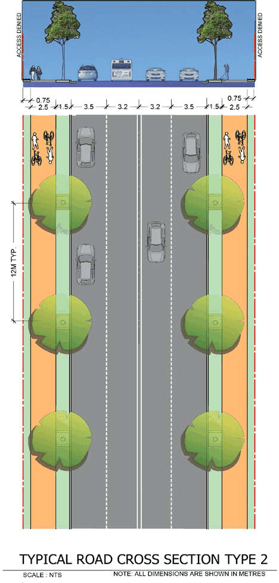

> [Picture on page 26: a picture, saved as a picture (images/chapter-b2-residential-subdivision-page-26-2.gif, 150 dpi).]

Objectives

1\. Provide for high traffic volumes with 4 travel

lanes.

2\. Provide connectivity between neighbourhoods

and local centres/higher order roads.

3\. Direct access is not permitted (access denied).

4\. Provide for bus routes and bus stops.

5\. Design speed 70km/h, posted speed 60km/h.

6\. Provide legible pedestrian and cycle network via

shared paths on both sides of road.

7\. All adjoining lots must provide an active frontage

to the Type 2 road (can be direct frontage or via

secondary parallel internal road).

Notes

1\. The road capacity is considered to generally cater

for greater than 15,000vpd.

2\. Lighting can be provided within the verge.

3\. A kerbside verge width of 1.5m has been

provided to allow for space for trees.

4\. Barrier kerb to be provided.

5\. Bus stops shall be provided in the kerbside lane.

6\. Intersections are to be controlled (signals,

roundabouts) and provide appropriate pedestrian

crossing facilities.

7\. Priority controlled intersections will only be

considered for left turns (eg Left-in/Left-out).

8\. Controlled intersections (signals, roundabouts)

are to be generally spaced a minimum of 400

metres apart.

9\. Mid-block pedestrian crossings not permitted (eg

refuges, marked crossings, kerb extensions etc).

10\. Road reserve may need to be locally widened at

intersections to allow for turn lane requirements.

#### TYPE 2A – Sub-arterial with bus service and parking

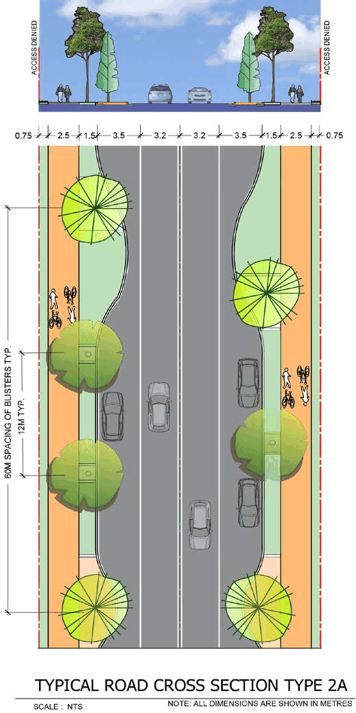

> [Picture on page 27: a picture, saved as a picture (images/chapter-b2-residential-subdivision-page-27-2.gif, 150 dpi).]

Objectives

1\. Provide for moderate traffic volumes with 2

travel lanes and 2 parking lanes, with potential

to provide 4-lane capacity when required.

2\. Provide kerbside parking.

3\. Allow for traffic calming and greening

opportunity through provision of regular kerb

extensions in parking lane.

4\. Provide connectivity between neighbourhoods

and local centres/higher order roads.

5\. Direct access is not permitted (access

denied).

6\. Provide for bus routes and bus stops.

7\. Design speed 70km/h, posted speed 60km/h.

8\. Provide legible pedestrian and cycle network

via shared paths on both sides of road.

9\. All adjoining lots must provide an active

frontage to the Type 2A road (can be direct

frontage or via secondary parallel internal

road).

Notes

1\. The road capacity is considered to generally

cater for 10,000 - 15,000vpd.

2\. Lighting can be provided within the verge.

3\. A kerbside verge width of 1.5m has been

provided to allow for space for trees.

4\. Barrier kerb to be provided.

5\. Bus stops shall be provided in the kerbside

(parking) lane.

6\. Intersections are to be controlled (signals,

roundabouts) and provide appropriate

pedestrian crossing facilities.

7\. Priority controlled intersections will only be

considered for left turns (eg Left-in/Left-out).

8\. Controlled intersections (signals, roundabouts)

are to be generally spaced a minimum of 400

metres apart.

9\. Mid-block pedestrian crossings generally not

permitted (eg refuges, marked crossings, kerb

extensions etc).

10\. Road reserve may need to be locally widened

at intersections to allow for turn lane

requirements.

#### TYPE 3 - Major collector with bus service and parking

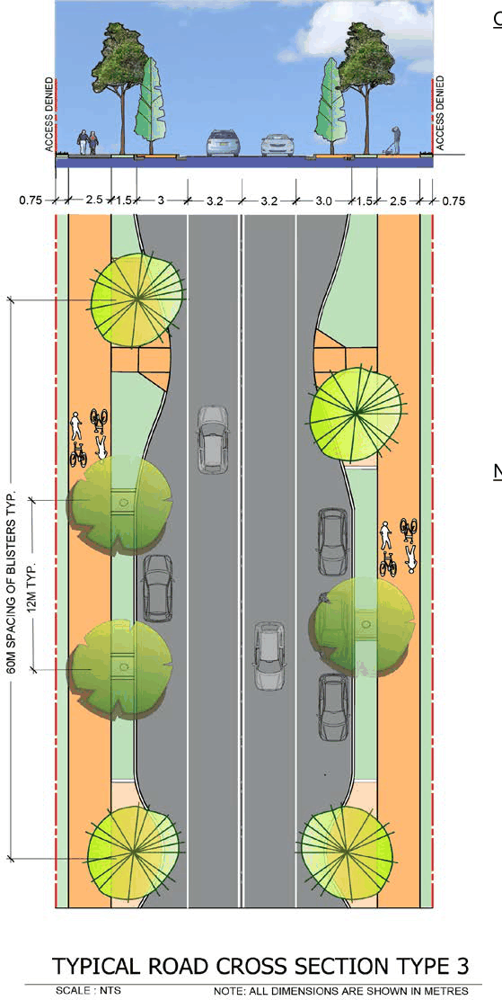

> [Picture on page 28: a picture, saved as a picture (images/chapter-b2-residential-subdivision-page-28-2.gif, 150 dpi).]

Objectives

1\. Provide for moderate traffic volumes with 2 travel

lanes and 2 parking lanes.

2\. Provide kerbside parking.

3\. Allow for traffic calming and greening opportunity

through provision of regular kerb extensions in

parking lane.

4\. Provide connectivity between neighbourhoods

and local centres/higher order roads.

5\. Direct access is generally not permitted (access

denied) but may be considered dependent on

traffic demand.

6\. Provide for bus routes and bus stops.

7\. Design speed 70km/h, posted speed 60km/h.

8\. Provide legible pedestrian and cycle network via

shared paths on both sides of road.

9\. All adjoining lots must provide an active frontage

to the Type 3 road (can be direct frontage or via

secondary parallel internal road).

Notes

1\. The road capacity is considered to generally cater

for 3,000 - 15,000vpd.

2\. Lighting can be provided within the verge.

3\. A kerbside verge width of 1.5m has been

provided to allow for space for trees.

4\. Barrier kerb to be provided.

5\. Bus stops shall be provided in the kerbside

(parking) lane.

6\. Intersections are to be generally controlled

(signals, roundabouts) and provide appropriate

pedestrian crossing facilities.

7\. Priority controlled intersections may be

considered dependant on traffic demand.

8\. Controlled intersections (signals, roundabouts)

are to be generally spaced a minimum of 400

metres apart.

9\. Mid-block pedestrian crossings may be

considered based on traffic demand and location

(eg refuges, marked crossings, kerb extensions

etc).

10\. Road reserve may need to be locally widened at

intersections to allow for turn lane requirements.

#### Road Type 4 – Minor collector with parking and limited bus access

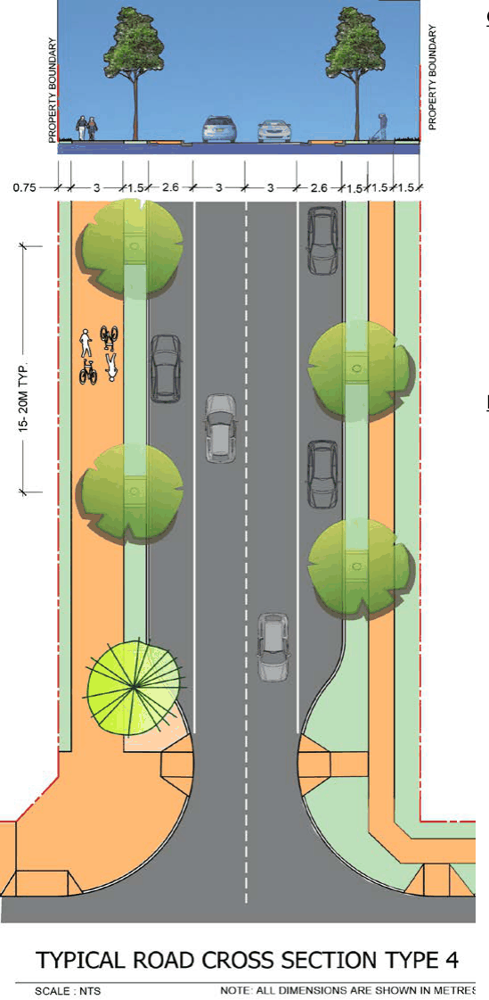

> [Picture on page 29: a picture, saved as a picture (images/chapter-b2-residential-subdivision-page-29-2.gif, 150 dpi).]

Objectives

1\. Provide for low to moderate traffic volumes with 2

travel lanes and 2 parking lanes.

2\. Provide kerbside parking.

3\. Allow for traffic calming, greening opportunity and

improved pedestrian safety through provision of

kerb extensions at intersections.

4\. Provide connectivity between and within

neighbourhoods and to local centres/higher order

roads.

5\. Direct access is permitted.

6\. Limited provision for bus route services in certain

circumstances.

7\. Design speed 60km/h, posted speed 50km/h.

8\. Provide legible pedestrian and cycle network via

shared path on one side and footpath on other.

Notes

1\. The road capacity is considered to generally cater

for 3,000 - 9,000vpd.

2\. Lighting can be provided within the verge.

3\. A kerbside verge width of 1.5m has been provided

to allow for space for trees.

4\. Barrier kerb to be provided.

5\. Where a bus service exists, bus stops shall be

provided in the kerbside (parking) lane.

6\. Intersections with higher order roads to generally

be controlled (signals, roundabouts) and provide

appropriate pedestrian crossing facilities.

7\. Priority controlled intersections may be

considered where not intersecting the same or

higher order road.

8\. Road segment length shall be a maximum of

200m between intersections/bends.

9\. Mid-block pedestrian crossings are generally

acceptable (eg refuges, marked crossings, kerb

extensions etc).

10\. Verge trees are to be provided at one per lot,

located to avoid impacts on utilities, driveways

and drainage infrastructure.

11\. Road reserve may need to be locally widened at

intersections to allow for turn lane requirements.

#### Road Type TC – Town & Village Centre Road

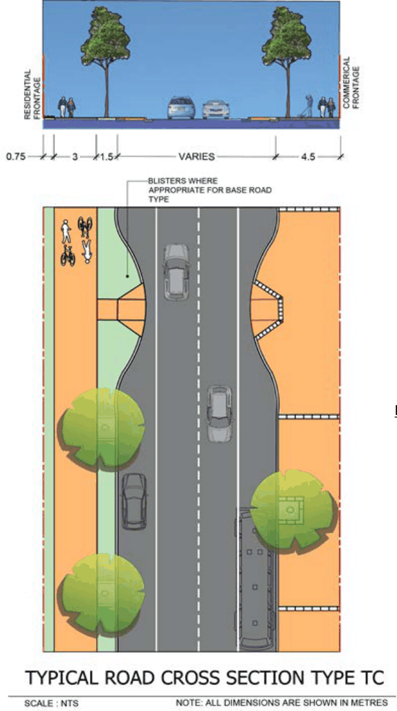

> [Picture on page 30: a picture, saved as a picture (images/chapter-b2-residential-subdivision-page-30-2.gif, 150 dpi).]

Objectives

1\. Provide a variation on Road Types 2-4

specifically for town and village centre

environments.

2\. Provide for low to moderate traffic volumes.

3\. Provide kerbside parking and bus stops.

4\. Allow for traffic calming, greening opportunity and

improved pedestrian safety through provision of

kerb extensions mid-block &/or at intersections.

5\. Provide connectivity to local centres/higher order

roads.

6\. Direct access may be considered on residential

side (where relevant) depending on base road

type and traffic demands.

7\. Consolidation of access points to commercial

development to maintain high level of pedestrian

amenity and safety.

8\. Allows for bus services.

9\. Design speed generally 50km/h however road

design should seek to encourage lower speeds in

these high pedestrian activity areas.

10\. Provide improved pedestrian/cyclist amenity

through provision of full width sealed paths on

commercial frontages and shared path on any

residential frontage.

Notes

1\. The road capacity varies depending on base road

type.

2\. Lighting can be provided within the verge (or

median if provided).

3\. A kerbside verge width of 1.5m has been

provided to allow for space for trees on residential

frontage.

4\. Barrier kerb to be provided.

5\. Verge trees to be provided within paved area on

commercial frontage with tree grates and one tree

per lot on residential side.

6\. Planter boxes, bus shelters and street furniture

will be considered for paved verge adjacent

commercial development.

7\. Bus stops shall be provided in the kerbside

(parking) lane.

8\. Intersections with higher order roads to generally

be controlled (signals, roundabouts) and provide

appropriate pedestrian crossing facilities.

9\. Priority controlled intersections can be considered

depending on base road type and traffic

demands.

10\. Mid-block pedestrian crossings are generally

acceptable (eg refuges, marked crossings, kerb

extensions etc).

11\. Median treatments can be considered however

base road type lane widths must still be provided.

12\. Road reserve may need to be locally widened at

intersections to allow for turn lane requirements.

#### Road Type 5 – Local Road with parking

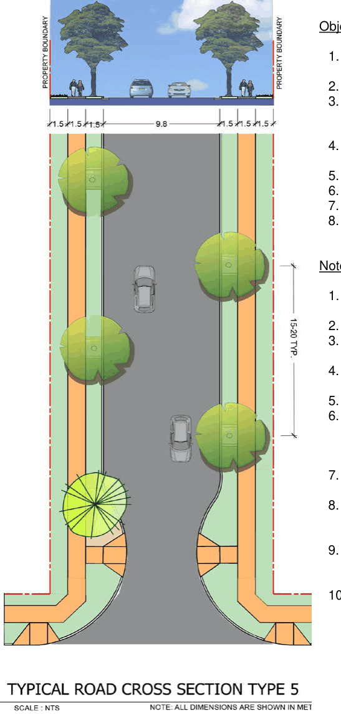

> [Picture on page 31: a picture, saved as a picture (images/chapter-b2-residential-subdivision-page-31-2.gif, 150 dpi).]

Objectives

1\. Provide for low traffic volumes, access to

properties and amenity in residential areas.

2\. Provide kerbside parking.

3\. Allow for traffic calming, greening opportunity

and improved pedestrian safety through

provision of kerb extensions at intersections.

4\. Provide connectivity between and within

neighbourhoods.

5\. Direct access is permitted.

6\. Not intended to cater for bus routes.

7\. Design speed 60km/h, posted speed 50km/h.

8\. Provide legible pedestrian access via footpaths

on both sides of road.

Notes

1\. The road capacity is considered to generally

cater for less than 3,000vpd.

2\. Lighting can be provided within the verge.

3\. A kerbside verge width of 1.5m has been

provided to allow for space for trees.

4\. Road segment length shall be a maximum of

200m between intersections/bends.

5\. Barrier kerb to be provided.

6\. Intersections will generally be priority control

however small roundabouts may be used for

traffic calming (eg to break up long sections of

road) &/or at 4-way intersections.

7\. Traffic calming measures can be used to reduce

the likelihood of through-traffic use (rat running).

8\. Mid-block pedestrian crossings are generally

acceptable (eg refuges, marked crossings, kerb

extensions etc).

9\. Verge trees are to be provided at one per lot,

located to avoid impacts on utilities, driveways

and drainage infrastructure.

10\. Shared path is required (2.5m width) if the street

forms part of a dedicated off-road cycle route

(eg riparian shared path route).

#### Road Type 6 – Access Street

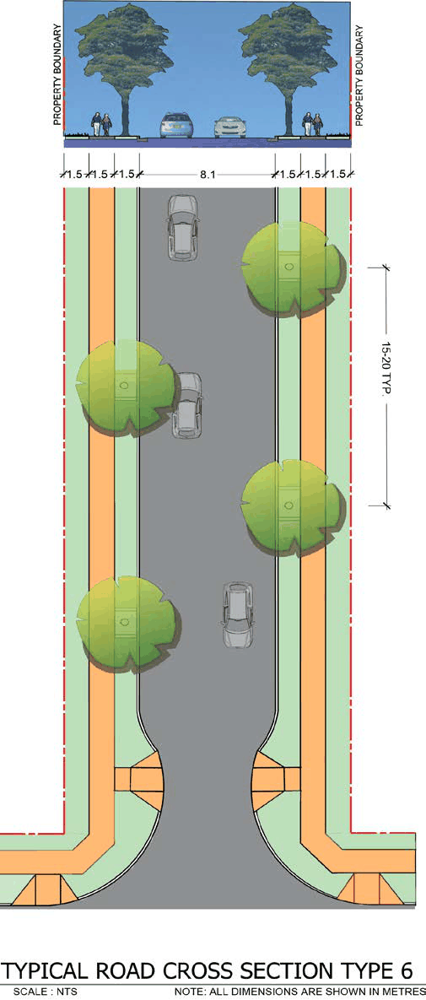

> [Picture on page 32: a picture, saved as a picture (images/chapter-b2-residential-subdivision-page-32-2.gif, 150 dpi).]

Objectives

1\. To provide access to properties and amenity in

residential areas.

2\. Allows for some casual on-street parking.

3\. Allow for traffic calming, greening opportunity and

improved pedestrian safety through provision of kerb

extensions at intersections.

4\. Provide connectivity within

neighbourhoods/subdivisions.

5\. Direct access is permitted.

6\. Does not cater for buses.

7\. Design speed 60km/h, posted speed 50km/h.

8\. Provide legible pedestrian access via footpaths on

both sides of road.

Notes

1\. The road capacity is considered to generally cater for

less than 1,000vpd.

2\. Lighting can be provided within the verge.

3\. A kerbside verge width of 1.5m has been provided to

allow for space for trees.

4\. Road segment length shall be a maximum of 200m

between intersections/bends.

5\. Barrier kerb to be provided.

6\. Intersections will generally be priority control.

7\. Verge trees are to be provided at one per lot, located

to avoid impacts on utilities, driveways and drainage

infrastructure.

8\. Shared path is required (2.5m width) if the street forms

part of a dedicated off-road cycle route (eg riparian

shared path route).

#### Road Type 7 – Access Place

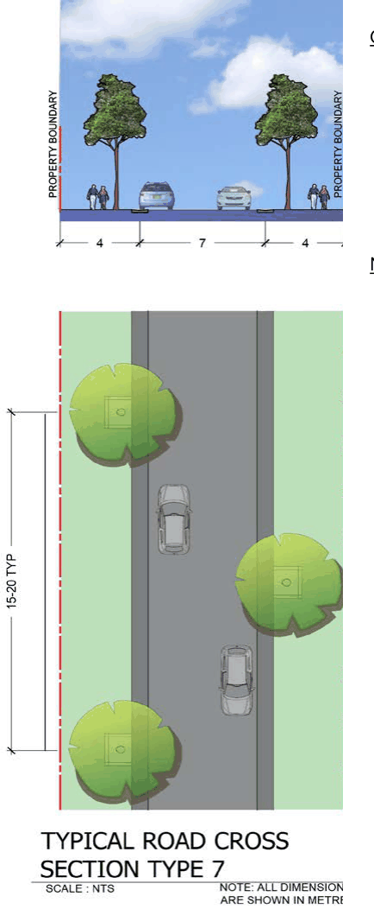

> [Picture on page 33: a picture, saved as a picture (images/chapter-b2-residential-subdivision-page-33-2.gif, 150 dpi).]

Objectives

1\. Provide for access to small sections of properties &

high pedestrian/cyclist amenity in residential areas –

no through traffic.

2\. Allows for some casual on-street parking.

3\. Direct access is permitted.

4\. Does not cater for buses.

5\. Urban default speed limit of 50km/h applies, however

lower speeds maintained through geometry/design.

Notes

1\. The road capacity is considered to generally cater for

up to 300vpd (ie approx. 30 properties).

2\. Lot layout shall be designed to ensure staggered on-

street parking in order to present a clear travel lane

with passing opportunities.

3\. Provides dish drains rather than barrier kerb to

increase pedestrian amenity.

4\. Road segment length shall be a maximum of 100

metres.

5\. Lighting can be provided within the verge.

6\. Verge trees are to be provided at one per lot, located

to avoid impacts on utilities, driveways and drainage

infrastructure.

7\. This road type does not provide kerb and gutter for

builders to connect stormwater into. The applicant will

need to provide a piped stormwater connection point

within each lot (eg stub, or pit) draining to the receiving

stormwater system.

8\. The final method of stormwater collection (ie dish

drain, swale, etc) is subject to Council approval.

9\. Concrete footpath (1.5m width) is required if the street

forms part of a dedicated pedestrian route.

10\. Shared path is required (2.5m width) if the street forms

part of a dedicated off-road cycle route (eg riparian

shared path route).

#### Road Type 7A – Access Place adjacent to open space (one-way traffic)

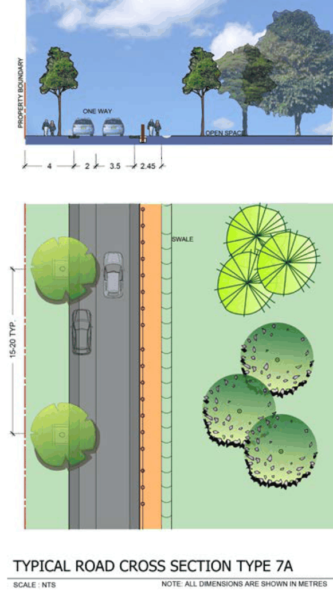

> [Picture on page 34: a picture, saved as a picture (images/chapter-b2-residential-subdivision-page-34-2.gif, 150 dpi).]

Objectives

1\. Provide for access to small sections of

properties & high pedestrian/cyclist amenity in

residential areas – no through traffic.

2\. Provide for informal access to open space,

whilst not generating any more than 300vpd.

3\. Allows for some casual on-street parking.

4\. Direct access is permitted.

5\. Does not cater for buses.

6\. Urban default speed limit of 50km/h applies,

however lower speeds maintained through

geometry/design.

Notes

1\. This road is one-way and only permitted

adjacent to open space and excludes sporting

fields.

2\. The road capacity is considered to generally

cater for up to 300vpd (ie up to approx. 30

properties) and must include any anticipated

traffic from open space component.

3\. Provides dish drains rather than barrier kerb to

increase pedestrian amenity.

4\. Road segment length shall be a maximum of

100 metres.

5\. Lighting can be provided within the verge.

6\. Verge trees are to be provided at one per lot,

located to avoid impacts on utilities, driveways

and drainage infrastructure.

7\. This road type does not provide kerb and gutter

for builders to connect stormwater into. The

applicant will need to provide a piped

stormwater connection point within each lot (eg

stub, or pit) draining to the receiving stormwater

system.

8\. The final method of stormwater collection (ie

dish drain, swale, etc) is subject to Council

approval.

9\. Verge tree planting on open space side is not

required – these requirements will be dealt with

separately to the road section.

10\. Shared path is required (2.5m width) if the street

forms part of a dedicated off-road cycle route

(eg riparian shared path route).

Road Type 7B – Access Place adjacent to

#### open space (two-way traffic)

Objectives

1\. Provide for access to small sections of

properties & high pedestrian/cyclist amenity in

residential areas – no through traffic.

2\. Provide for informal access to open space with

improved parking opportunity, whilst not

generating any more than 300vpd.

3\. Allows for some casual on-street parking.

4\. Direct access is permitted.

5\. Does not cater for buses.

6\. Urban default speed limit of 50km/h applies,

however lower speeds maintained through

geometry/design.

Notes

1\. This road is two-way and only permitted

adjacent to open space and excludes sporting

fields.

2\. The road capacity is considered to generally

cater for up to 300vpd (ie up to approx. 30

properties) and must include any anticipated

traffic from open space component.

3\. Road segment length shall be a maximum of

100 metres.

4\. Provides dish drains rather than barrier kerb to

increase pedestrian amenity.

5\. Lighting can be provided within the verge.

6\. Verge trees are to be provided at one per lot,

located to avoid impacts on utilities, driveways

and drainage infrastructure.

7\. This road type does not provide kerb and

gutter for builders to connect stormwater into.

The applicant will need to provide a piped

stormwater connection point within each lot

(eg stub, or pit) draining to the receiving

stormwater system.

8\. The final method of stormwater collection (ie

dish drain, swale, etc) is subject to Council

approval.

9\. Verge tree planting on open space side is not

required – these requirements will be dealt

with separately to the road section.

10\. Shared path is required (2.5m width) if the

street forms part of a dedicated off-road cycle

route (eg riparian shared path route).

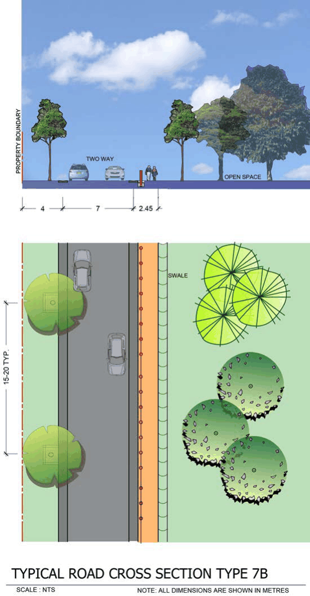

> [Picture on page 35: a picture, saved as a picture (images/chapter-b2-residential-subdivision-page-35-47.gif, 150 dpi).]

#### Road Type 8 – Laneway

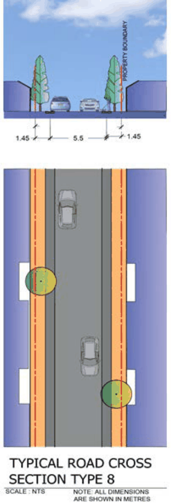

> [Picture on page 36: a picture, saved as a picture (images/chapter-b2-residential-subdivision-page-36-2.gif, 150 dpi).]

Objectives

1\. Provide vehicular access to the rear or side of lots where

front access is restricted or not possible.

2\. To maximise on-street parking and landscaping in residential

street frontages.

3\. Provide housing density, diversity and affordable housing

options.

4\. Reduce vehicular conflict through reduced driveway cross

overs on the main road frontage.

5\. To create a slow speed zone that is distinctly different in

character and materials to residential streets.

6\. Urban default speed limit of 50km/h applies, however lower

speeds maintained through geometry/design.

7\. Does not cater for buses.

8\. Verge design allows space for pedestrians, garbage bins,

planting and lighting, whilst not encouraging casual parking,

storage of boats/trailers etc.

9\. All lots adjoining a laneway are to utilise the laneway for

vehicular/garage access.

Notes

1\. The lane capacity is considered to generally cater for up to

300vpd (ie up to approx. 30 properties).

2\. “C” shaped laneways are to be avoided as they do not

provide good sightlines for passive surveillance.

3\. Lighting can be provided within the verge.

4\. No raised kerb is to be provided in laneways to increase

pedestrian amenity.

5\. Verge trees of appropriate species are to be provided within

the verge area (tree grates may be utilised).

6\. This road type does not provide kerb and gutter for builders

to connect stormwater into. The applicant will need to

provide a piped stormwater connection point within each lot

(eg stub, or pit) draining to the receiving stormwater system.

7\. Any bends or intersections in the laneway must be designed

to permit garbage truck movements.

8\. Passive surveillance along the laneway from upper storey

rooms or balconies of secondary dwellings, studios, lofts

over garages &/or principle dwelling is encouraged.

9\. The intersection of laneways with other roads should not be

designed as a typical street intersection with kerb returns,

but instead as a driveway entrance (ie vehicle crossover).

Any footpath or shared path along the main road frontage is

to be continued across the laneway intersection.
