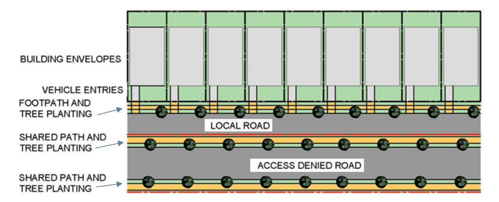
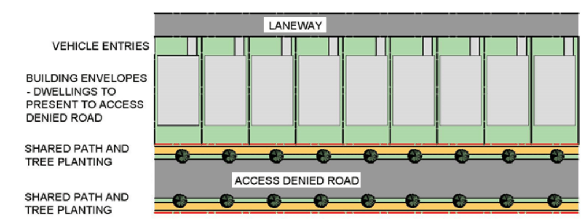

### 13.12 Restricted access to collector or arterial roads

Objectives

(a) Restrict access to any arterial or sub-arterial road to maintain satisfactory traffic flows and safety

along such roads. Design for alternative public road access for lots in subdivisions (see diagrams

below for examples).

(b) When deemed necessary, create legal restrictions prohibiting direct access to designated roads

(Collector or Arterial Roads).

(c) Create temporary access agreements for designated roads (Collector or Arterial Roads).

Development Controls

1\. Direct access to any arterial or sub-arterial road will not be permitted where alternate public road

access is available. However, direct property access to / from an arterial or sub-arterial road will

not be restricted until such time as alternate public road access is available.

2\. Subdivision shall be designed to provide alternative public road access in cases where lot access

to the arterial or sub-arterial roads is restricted.

3\. Council may require as a condition of consent as part of any subdivision or development that a

suitable restriction on the use of land be created pursuant to the provisions of Section 88B of the

Conveyancing Act 1919, in order to legally prohibit direct access to / from any adjoining Arterial or

Sub-Arterial Road where alternative direct public road access is available to / from the subject site.

4\. Temporary access may be granted to a designated road (arterial or sub-arterial road) where

alternate public access has not yet been completed. However, this temporary access arrangement

will be dependent upon the nature of the access arrangement in relation to the arterial or sub-

arterial road. Additionally, the formal concurrence of the NSW Roads and Maritime Services may

be required.

Examples of alternative solutions to lot layouts around restricted access roads.

> [Picture on page 42: a picture, saved as a picture (images/chapter-b2-residential-subdivision-page-42-20.gif, 150 dpi).]

> [Picture on page 42: a picture, saved as a picture (images/chapter-b2-residential-subdivision-page-42-21.gif, 150 dpi).]
