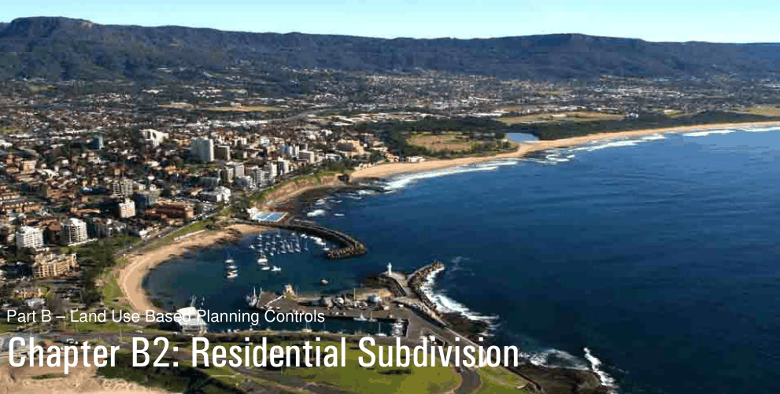

# Wollongong Development Control Plan 2009 - Chapter B2 Residential Subdivision

> This chapter is split into 40 section file(s), one per numbered heading, in the order they appear in the PDF.

Source PDF: [Wollongong-DCP-2009-Chapter-B02-Residential-Subdivisions.pdf](https://planfortomorrow.sharepoint.com/sites/Planfortomorrow/Shared%20Documents/00%20NSW-Planning-Resources/dcp/wollongong-development-control-plan-2009/chapter-b2-residential-subdivision/Wollongong-DCP-2009-Chapter-B02-Residential-Subdivisions.pdf)

> [Picture on page 1: a picture, saved as a picture (images/chapter-b2-residential-subdivision-page-1-1.gif, 150 dpi).]

Part B – Land Use Based Planning Controls

### Chapter B2: Residential Subdivision

> The PDF's contents list (page numbers of the printed document) is not repeated here - see Sections below.

i

13.1 Road connectivity, permeability and legibility ....................................................................................................................................................... 15

13.2 Road hierarchy and design requirements .............................................................................................................................................................. 16

13.3 Road and drainage construction ........................................................................................................................................................................... 33

13.4 Upgrading poorly constructed or unformed roads ................................................................................................................................................. 33

13.5 Half-road construction ......................................................................................................................................................................................... 33

13.6 Bus Routes and public transport .......................................................................................................................................................................... 33

13.7 Cul-de-sacs and turning heads ............................................................................................................................................................................. 34

13.8 Roundabouts and road junctions .......................................................................................................................................................................... 35

13.9 Traffic control measures ..................................................................................................................................................................................... 35

13.10 Splay corners ........................................................................................................................................................................................................ 36

13.11 Street lighting and fire hydrants ............................................................................................................................................................................... 37

13.12 Restricted access to collector or arterial roads .................................................................................................................................................... 37 14 BUSHFIRE PROTECTION ................................................................................................................................................................................. 39 15 STORMWATER DRAINAGE ............................................................................................................................................................................. 39 16 RIPARIAN LAND MANAGEMENT .................................................................................................................................................................... 40 17 SERVICING ARRANGEMENTS ......................................................................................................................................................................... 41 18 ROAD ADDRESSING ........................................................................................................................................................................................ 41 19 SUBDIVISION HANDOVER .............................................................................................................................................................................. 42

ii

> The PDF's contents list (page numbers of the printed document) is not repeated here - see Sections below.

iii

<!-- sections -->
## Sections

1. [1 INTRODUCTION](01-introduction.md)
2. [2 OBJECTIVES](02-objectives.md)
3. [3 DEFINITIONS](03-definitions.md)
4. [4 TYPES OF RESIDENTIAL SUBDIVISION](04-types-of-residential-subdivision.md)
5. [4.1 Torrens Title Subdivision](05-4-1-torrens-title-subdivision.md)
6. [4.2 Strata Title Subdivision](06-4-2-strata-title-subdivision.md)
7. [4.3 Community Title Subdivision](07-4-3-community-title-subdivision.md)
8. [5 TOPOGRAPHY, LANDFORM CONSERVATION, CUT AND FILL](08-5-topography-landform-conservation-cut-and.md)
9. [6 SUBDIVISION DESIGN](09-6-subdivision-design.md)
10. [6.1 Lot layout – Aspect and solar access](10-6-1-lot-layout-aspect-and-solar-access.md)
11. [6.2 Lot size](11-6-2-lot-size.md)
12. [6.3 Lot width and depth](12-6-3-lot-width-and-depth.md)
13. [6.4 Battle-axe lots](13-6-4-battle-axe-lots.md)
14. [6.5 Building envelopes](14-6-5-building-envelopes.md)
15. [6.6 Superlots in residential subdivisions for integrated housing or medium density housing](15-6-6-superlots-in-residential-subdivisions.md)
16. [6.7 Existing easements](16-6-7-existing-easements.md)
17. [7 MAJOR RESIDENTIAL SUBDIVISIONS](17-7-major-residential-subdivisions.md)
18. [8 PUBLIC RESERVES AND OPEN SPACE](18-8-public-reserves-and-open-space.md)
19. [9 PEDESTRIAN AND BICYCLE NETWORKS](19-9-pedestrian-and-bicycle-networks.md)
20. [10 ACOUSTIC ASSESSMENT](20-10-acoustic-assessment.md)
21. [11 STREET TREE PLANTING](21-11-street-tree-planting.md)
22. [12 ENTRY STATEMENTS](22-12-entry-statements.md)
23. [13.1 Road connectivity, permeability and legibility](23-13-1-road-connectivity-permeability-and.md)
24. [13.2 Road hierarchy and design requirements](24-13-2-road-hierarchy-and-design-requirements.md)
25. [13.3 Road and drainage construction](25-13-3-road-and-drainage-construction.md)
26. [13.4 Upgrading poorly constructed or unformed roads](26-13-4-upgrading-poorly-constructed-or-unformed.md)
27. [13.5 Half-road construction](27-13-5-half-road-construction.md)
28. [13.6 Bus Routes and public transport](28-13-6-bus-routes-and-public-transport.md)
29. [13.7 Cul-de-sacs and turning heads](29-13-7-cul-de-sacs-and-turning-heads.md)
30. [13.8 Roundabouts and road junctions](30-13-8-roundabouts-and-road-junctions.md)
31. [13.9 Traffic control measures](31-13-9-traffic-control-measures.md)
32. [13.10 Splay corners](32-13-10-splay-corners.md)
33. [13.11 Street lighting and fire hydrants](33-13-11-street-lighting-and-fire-hydrants.md)
34. [13.12 Restricted access to collector or arterial roads](34-13-12-restricted-access-to-collector-or.md)
35. [14 BUSHFIRE PROTECTION](35-14-bushfire-protection.md)
36. [15 STORMWATER DRAINAGE](36-15-stormwater-drainage.md)
37. [16 RIPARIAN LAND MANAGEMENT](37-16-riparian-land-management.md)
38. [17 SERVICING ARRANGEMENTS](38-17-servicing-arrangements.md)
39. [18 ROAD ADDRESSING](39-18-road-addressing.md)
40. [19 SUBDIVISION HANDOVER](40-19-subdivision-handover.md)
