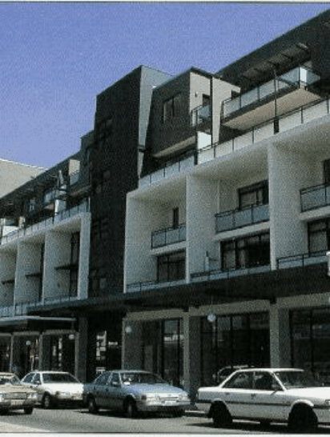
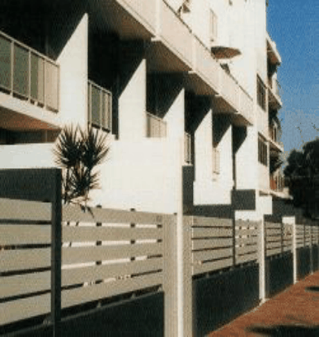
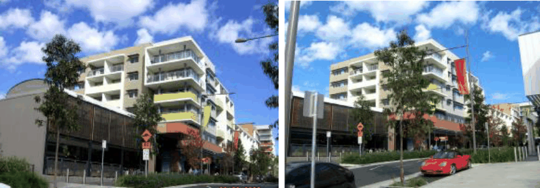
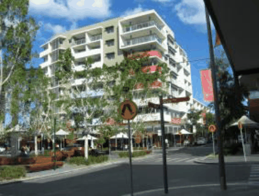
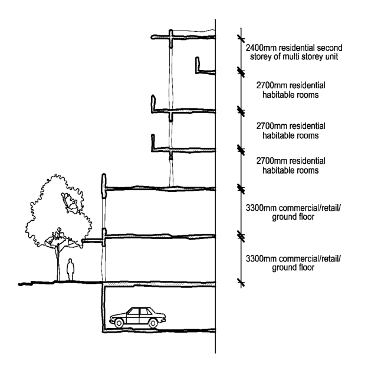
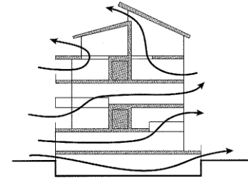

## 4 DESIGN REQUIREMENTS - MIXED USE BUILDINGS

### 4.1 Minimum Site Width

#### 4.1.1 Objectives

(a) To allow for development of sites which are of sufficient width to accommodate the required building envelope, car parking and landscaping requirements.

(b) To allow for development of sites only where the land is not significantly constrained by flood, geotechnical or other environmental hazards.

(c) To promote the efficient utilisation of land.

(d) To encourage amalgamation of allotments to provide for improved design outcomes including greater solar access and amenity.

#### 4.1.2 Development Controls

1\. A minimum site width of 24 metres is required for mixed use developments. The site width must be measured for the full length of the building envelope and perpendicular to the side boundary. Exceptions will only be considered for social housing developments.  Sites may be amalgamated, where required, to achieve the frontage requirements.

2\. Within business centres, mixed use development must not result in the creation of an isolated allotment.  An isolated allotment is ‘a lot which is bounded on both sides by properties (or a property and a second street frontage) which comprise existing development other than a single dwelling house’. Amalgamation of allotments will be required in the circumstance where an isolated allotment would otherwise be created.

3\. Council will only allow development which would result in the creation of an isolated allotment, where it is demonstrated that:

(a) Written negotiations to purchase the isolated allotment have been entered into but have been unsuccessful; and

(b) The isolated allotment has a site width of greater than 20m and is capable of accommodating a similar mixed use development.

### 4.2 Maximum Floor Space Ratio / Density

#### 4.2.1 Objectives

(a) To ensure that the bulk and scale of the building is compatible with surrounding built form and the desired future character of commercial precincts.

(b) To ensure the density is appropriate for the site and its context.

(c) To ensure that density is sustainable in the regional servicing context.

#### 4.2.2 Development Controls

1\. The maximum floor space ratio (FSR) for a mixed used development upon a particular parcel of land will be determined by the relevant LEP and the relevant Floor Space Ratio Map applying to the subject site.

### 4.3 Building Height

#### 4.3.1 Objectives

(a) To encourage buildings which integrate within the existing streetscape or the desired future character in an area which is undergoing transition.

(b) To minimise the potential impacts of overshadowing and overlooking on adjacent dwellings and open space areas.

#### 4.3.2 Development Controls

1\. The maximum permissible building height for a mixed use development upon a particular parcel of land is shown on the relevant Heights Map applying to the subject site as contained in the relevant LEP.

### 4.4 Front Setbacks

#### 4.4.1 Objectives

(a) To reinforce the existing character of the street by acknowledging building setbacks.

(b) To provide a continuous façade along main commercial streets.

(c) To define the spatial proportions of the street and define the street edge.

(d) To provide a transition between the public and private domain.

#### 4.4.2 Development Controls

#### Within the B2 Local Centre zone:

1\. The building should be located on the front property boundary, where a continuous façade along main commercial streets is desired.

#### Within the B1 Neighbourhood Centre zone and B6 Enterprise Corridor zone:

2\.        The following setback requirements apply from the front property boundary to the front façade of the building:

(a) The same distance as one or other of the adjoining buildings, provided the difference between the setbacks of the two adjoining dwellings is less than 2.0m; or

(b) The average of the setbacks of the two adjoining buildings, if the difference between the setbacks of the buildings is greater than 2.0m; unless Council considers that a reduced setback is appropriate in the local context.

> [Picture on page 7: a picture, saved as a picture (images/chapter-b3-mixed-use-development-page-7-9.gif, 150 dpi).]

Figure 1: Provides a continuous facade along main commercial streets at the lower levels (Ref: Residential

#### Flat Design Code

### 4.5 Side and Rear Setbacks / Building Separation

#### 4.5.1 Objectives

(a) To provide adequate setbacks from boundaries and adjoining dwellings to retain privacy levels, views, sunlight and daylight access and to minimise overlooking.

(b) To optimise surveillance of the street at the front of the property.

(c) To control overshadowing of adjacent residential properties and private or shared open space.

(d) To ensure that new development is scaled to support the desired area character with appropriate massing and space between buildings.

#### 4.5.2 Development Controls

#### Within the B2 Local Centre:

1\. A continuous street line / zero side setback is required for the majority of mixed use developments within a B2 Local Centre ,except in cases where a subject site directly abuts

residentially zoned land, in which case the minimum side setback shall be in accordance with Table 1 below.

| Table 1: Side Setbacks |  |
|---|---|
|  | Mixed Use Buildings |
| Building Height | Minimum Side Setback |
| Buildings up to 4 storeys (12 metres) | 6 metres where a habitable room/balcony faces an adjacent property 3.5 metres where a non-habitable room/blank wall faces an adjacent property |
| Buildings of 5 to 8 storeys (up to 25 metres) | 9 metres where a habitable room/balcony faces an adjacent property 4.5 metres where a non-habitable room/blank wall faces an adjacent property |

Note: The setback is measured from the side or rear wall of the building or balcony to the adjacent boundary.

2\. The minimum rear setback for any mixed use / shop top housing development shall be in accordance with Table 2 below:

| Table 2: Side Rear Setbacks |  |
|---|---|
|  | Mixed Use Buildings |
| Building Height | Minimum Rear Setback |
| Buildings up to 4 storeys (12 metres) | 6 metres from the common property bopundary with any directly abutting residentially zoned property 6 metres where a habitable room/balcony faces an adjacent property 3.5 metres where a non-habitable room/blank wall faces an adjacent non-residentially zoned property |
| Buildings of 5 to 8 storeys (up to 25 metres) | 9 metres from the common property boundary with any directly abutting residentially zoned property 9 metres where a habitable room/balcony faces an adjacent property 4.5 metres where a non-habitable room/blank wall faces an adjacent property |

Note: The setback is measured from the rear wall of the building or balcony to the adjacent property boundary.

4\. Council will only consider granting a variation to the setback requirements where the following can be demonstrated:

(a) The development site comprises a narrow infill site, where zero lot lines are appropriate at all levels; and

(b) The development predominantly contains commercial functions and the increased residential setback requirements are inappropriate; and

(c) The recommendations of this DCP have been varied in response to site and context constraints; and

(d) The requirements of daylight access, urban form and visual/acoustic privacy have been satisfactorily achieved; and

(e) The daylight access requirements of this DCP and the Apartment Design Guide 2015 Residential Flat Design Code will be available to buildings and open spaces.

#### Within the B1 Neighbourhood  Centre:

5\. The side and rear building setbacks for any mixed use development upon land zoned B1 Neighbourhood Centre shall be in accordance with the side and rear setback requirements contained in Table 1 in clause 4.5.2.1 and Table 2 in clause 4.5.2.2 above.

#### For mixed use developments on any site which adjoin a residential zone:

6\. The side and rear setbacks for any mixed use development on any site adjoining residentially zoned land shall be in accordance with the side and rear setback requirements contained in Table 1 in clause 4.5.2.1 and Table 2 in clause 4.5.2.2 above.

### 4.6 Built Form

#### 4.6.1 Objectives

(a) To support the integration of appropriate retail and commercial uses with housing.

(b) To provide an identifiable and desirable street address to each building and dwelling.

(c) To create safe and more active lively streets and urban areas, which encourage pedestrian movement, and services to meet the needs of residents.

(d) To ensure that the design of mixed-use developments maintains residential amenity and preserves compatibility between uses.

(e) To allow for outlook and surveillance towards the street and the public domain.

(f) To encourage mixed used development that achieves the principles of ecologically sustainable development.

#### 4.6.2 Development Controls

1\. A mixed use or shop top housing development involving three (3) or more storeys and four (4) or more dwellings must be designed by a qualified designer in accordance with State Environmental Planning Policy No. 65 – Design Quality of Residential Flat Development.

2\. The appearance of new development must be in harmony with the buildings around it and the streetscape character of the locality. New development must contain or respond to the essential elements that make up the character of the surrounding urban environment. This character is created by elements such as building height, setbacks, architectural style, window treatment and placement, materials and landscaping.

3\. The siting, form, height and external appearance of any new building should be sympathetic with adjoining buildings in the surrounding retail and business precinct in addition to any abutting or nearby residential dwellings.

4\. Any mixed use or shop top housing building should feature highly articulated facades, particularly any facades facing road frontages and any abutting residential area, in order to add visual interest to the building.

5\. Any mixed use or shop top housing building must be designed to provide active street frontages on the ground floor level of the building to all street frontages and in some cases, Council may require appropriate pedestrian thoroughfare links.

6\. Within the B1 Neighbourhood Centre and B2 Local Centre zones, commercial office / retail development is required at the ground floor level, as a minimum, within a mixed use or shop top housing building. However, any such use must be designed to minimise any potential adverse noise or amenity impacts upon the upper level residential apartments in the building.

7\. Where residential development is located at the ground floor level, the development must maximise the number of ground floor units which have separate entrances and are accessible from the street. Ground floor apartments must incorporate an internal layout which provides opportunity for home employment.  Only in exceptional circumstances will ground level dwellings and residential apartments be permitted, such as where it can be clearly demonstrated that the proposal will not detrimentally impact the commercial area and where there is no demand for commercial frontage development.

8\. In B2 Local Centre, B1 Neighbourhood Centre and B4 Mixed Use zones, the ground floor and first floor levels of a building must provide for minimum 3.3 metre floor to ceiling height clearances, to maximise the flexibility of in the future use of the buildings.

> [Picture on page 10: a picture, saved as a picture (images/chapter-b3-mixed-use-development-page-10-21.gif, 150 dpi).]

Figure 2: Ground floor residential units with residential entrances directly accessed from the street (Ref:

#### Residential Flat Design Code)

9\. Separate entrances must be provided for retail. The floor layouts of residential apartments and the ceiling heights which are provided within mixed use developments must allow for future adaptive use of the upper residential floors.

10\. The following elements must be incorporated into the building design to define the commercial and retail components of the development:

(a) Servicing of retail and commercial uses must be separated from the servicing of the residential component. Commercial and residential uses.

(b) Residential entrances must directly address the street. The main pedestrian entrance or a foyer must provide for continuous and safe access for all people, including people with a disability.

(c) For those dwellings adjacent to the street frontage, the habitable rooms must face the street.

(d) Active uses are encouraged on the street level and first floor.

(e) Where ground floor residential units are provided they must have separate entrances and be accessible from the street.

(f) Maximise glazing for retail uses but break glazing into sections to avoid large expanses of glass.  Wrap shopfronts around corners.

(g) Orientate commercial and residential uses to the street to provide casual surveillance.

(h) All buildings must express their internal functions in their facades.

(i) Entrances must be visible at eye level from the street and well lit.

(k) Ensure entrances can accommodate the movement of furniture.

(l) Solid roller shutters are not permitted as security devices on shop fronts (windows and doors). Open grille security devices may be used on shop fronts if such devices are necessary but should be unobtrusive and sympathetic to the character of the building and the streetscape, with minimum transparency of 65% to provide light spill to the pavement and create a sense of openness to the street.

(m) Place services such as Automatic Teller Machines (ATMs) and public telephones in highly visible locations to be accessible and well lit at night.

(n) Where developments have a car park or access laneway to a car park, provide windows, lighting or secondary access doors that address the car park.

(o) Avoid building recess, alcoves or dense landscaping in places where concealment is possible.

11\. The horizontal form of any building should also be broken up vertically, in order to provide visual relief and interest to the development. The horizontal and vertical emphasis is especially critical for the middle and upper levels of a building.

12\. The following elements must be considered in the building design:

(a) Define a base, middle and top related to the overall proportion of the building.

(b) Articulate and fragment building walls that address the street and add visual interest.

(c) Highly reflective finishes and curtain wall glazing are not permitted above ground level.

(d) Large areas of flat facade are to be avoided. Facades should be articulated into separate sections, using steps in the facade, expressed entries, panels, bay windows, balconies, pergolas and other architectural elements.

(e) Avoid expanses of any single material.

(f) Provide a balance of horizontal and vertical facade elements to relate to adjacent facades in the streetscape. Avoid simple facade designs containing only horizontal or vertical elements.

(g) Utilise high quality and durable materials and finishes.

(h) The façade of ground floor retail development must be compatible with surrounding facades.

(i) Air conditioning units must not be visible from the street.

(j) Avoid blank or solid walls and the use of dark or obscured glass on street frontages.

13\. The design of roof forms must address the following:

(a) Create a richly patterned skyline and roof scapes when viewed from the street or from the upper levels of other buildings.

(b) The profile of parapets and roof top elements should be integrated in the overall roof design of the building.

(c) The angle of any pitched roof shall be compatible with existing development.

(d) Create interesting and harmonious roof scapes and skylines through the design of roofs.

(e) Lift over runs and service plants must be concealed within the roof, the building or relate to adjacent roof top rooms or open space.

(f) Where flat roofs are proposed, lift overruns and rooftop plant and machinery are to be obscured from view by parapets or designed to be incorporated with rooftop activities/features.

(g) All roof forms and roof top elements are not to exceed the maximum ridge height limit for the site.  This does not include any vent, chimney, flue, antennae or the like.

(h) Landscaped and shaded areas on the roofs of mixed use buildings for private use by residents will be considered, where residential amenity is not unreasonably affected.

(i) The incorporation of green roofs is encouraged however such features must not exceed the maximum height limit for the site.

14\. Mixed use buildings which are located on corner sites must address the following:

(a) Ensure that corner buildings, which by their location are often highly visible, are well designed and respond to the different characteristics of the street which they address.

(b) Emphasise verticality at corners, where possible, by concentrating the tallest portion of the building on the corner itself.  Utilise design devices such as increased wall heights, splayed corner details, increased heights, expression of junction of building planes and other architectural features to reinforce the way finding attributes of street corners.

(c) Design corners to add variety and interest to the street and clarify the street hierarchy.

(d) Present each frontage of a corner building as a main street frontage.

(e) Design building frontages and entries so that they are readily apparent from the street and are well lit.

(f) Avoid blank or solid walls on street frontages.

> [Picture on page 13: a picture, saved as a picture (images/chapter-b3-mixed-use-development-page-13-1.gif, 150 dpi).]

Figures 3 & 4: Mixed use development containing ground floor retail shops and upper residential apartments

> [Picture on page 13: a picture, saved as a picture (images/chapter-b3-mixed-use-development-page-13-3.gif, 150 dpi).]

Figure 5: Mixed use development containing active ground floor retail shops and café / restaurants with

upper level residential apartments

15\. The street corners of any new corner building should be strengthened by massing and building articulation to both street frontages. In this regard, Council may permit a variation to the height limits contained in this DCP (but no greater than the building height limit in the LEP) by permitting an additional 1 – 2 storeys for the corner element of a building where, in the opinion of Council, a strong corner element is necessary for the building. Any such variation to the height limit will only be supported by Council in circumstances where Council is of the opinion that the proposed development will exhibit design excellence, through the provision a strong corner element in the proposed building.

15\. New mixed use buildings should continue the predominant built form character of the locality, including parapets, floor to ceiling heights and roof pitches.

16\. For large multi-storey mixed use buildings, the treatment of the facades should be designed to provide character, visual legibility and human scale and to delineate the distinct uses.

17\. New mixed use buildings should maintain the balance of horizontal and vertical proportions of other existing buildings in the locality.

18\. Any development involving the re-use of existing buildings should reinstate any missing façade elements or other decorative details, wherever practicable.

19\. The external building materials and finishes of any mixed use building should be sympathetic to the existing fabric and character of buildings within that retail and business precinct.

20\. External walls should be constructed of high quality and durable materials and finishes with low maintenance costs.

21\. Highly reflective finishes, reflective glass and curtain wall glazing are not permitted above ground floor level.

22\. The reflectivity of glazing shall be restricted to less than 20%. A reflectivity diagram may be required where in the opinion of Council has the potential to pose future glare impacts upon pedestrians within public domain areas or motorists travelling past the site.

23\. All Development Applications for new buildings or external alterations and additions to existing premises must be accompanied by a schedule of proposed external building materials and finishes (colours) board which shows the proposed building materials and finishes (colours) to be used on the external facades of the building. An A4 sized photograph of the schedule of external building materials and finishes (colours) board is also required.

### 4.7 Active Street Frontages

#### 4.7.1 Objectives

(a) To provide active street frontages to all mixed use buildings, in order to maintain or enhance the vibrancy of local business centres.

(b) To ensure ground floor level retail or business premises provide direct pedestrian access to / from the street with direct visual inspection into each premise.

#### 4.7.2 Development Controls

1\. All new retail, business or mixed use buildings are required to provide ground level active street frontages.

2\. Buildings should contain no more than 5 metres of ground floor wall without a door or window. Windows should make up at least 50% of the ground floor front wall.

3\. Buildings with frontages to retail streets are to contribute to the liveliness and vitality of those streets by:

(a) Providing product retailing and / or food and drink premises within all enclosed shop fronts;

(b) Minimising the extent and visual impact of building entrances, office lobbies, foyers, vehicle entrances and other entries not associated with retail, service areas and fire escapes;

(c) Locating activities that may involve queuing (e.g. automatic teller machines) behind building frontages so that footpaths remain free for pedestrian movement; and

(d) Providing a high standard of finish to retail shopfronts.

4\. All street frontage windows at ground level are to have clear glazing.

5\. Display windows with clear glazing to ground floor retail and business premises are required with a maximum window sill height of 0.7 metres above finished ground level.

6\. Security grilles are to be fitted only within the retail shopfront. Such grilles are to be transparent and not of any roller door type.

7\. Direct pedestrian access and visual inspection should be provided from the front of the building, to encourage active street frontage to retail shops and business premises.

### 4.8 Awnings

#### 4.8.1 Objectives

(a) To provide all weather protection for pedestrians.

(b) To address the streetscape by providing a consistent street frontage within commercial areas.

#### 4.8.2 Development Controls

1\. Provide continuous street front awnings, where required to provide a continuation of existing awnings.

2\. Awning designs should match building frontages.

3\. Wrap awnings around corners where a building is sited on a street corner. Corner awnings must be wrapped for a minimum distance of 6m.

4\. Awnings must have a minimum width of 2.5m.

5\. Cantilever awnings from buildings should be a maximum eave height of 3.3m.

6\. Awnings should be setback from the kerb a minimum of 600 mm.

7\. Awnings should be complimentary to other existing awnings.

8\. Provide under awning lighting to facilitate night use and to improve public safety.

### 4.9 Car Parking

#### 4.9.1 Objectives

(a) To provide an adequate level of on site carparking based upon the anticipated building use.

(b) To ensure that mixed use buildings are designed to be accessible for pedestrians, cyclists and motorists.

(c) To ensure integrated design of car parking facilities to minimise visual impacts.

(d) To provide underground parking, wherever feasible.

(e) To ensure the provision of facilities such as bike racks, which encourage the use of alternative methods of transport.

#### 4.9.2 Development Controls

1\. Parking for cars, motorcycles and bicycles shall be provided in accordance with the requirements contained in the Traffic, Parking, Access and Servicing chapter in Part E of this DCP.

2\. Access driveways to car parking areas must be positioned to minimise impacts on the streetscape. Access driveways to car parking areas must be positioned to minimise impacts on the streetscape.

3\. Car parking for mixed use developments must be provided within one or more basement levels. For mixed use developments within B1 Neighbourhood Centre zones, Council may require the provision of a number of at grade parking spaces for customers to minimise on street parking.

4\. Car parking areas should be designed to conveniently, efficiently and appropriately serve residents and visitors of the site. This can be achieved in the following ways:

(a) Ensuring that visitor car parking areas are located close to entrances and access driveways.

(b) Have clearly defined areas for staff, resident, visitor, customer and disabled parking. Where customer and visitor car parking is located in a secure basement, an intercom system shall be provided to allow for visitor access. A turning bay must also be provided for customer/visitor use to prevent vehicles reversing onto the street in the event that a car parking space is not available.

5\. Car parking spaces must comply with the minimum size requirements:

#### Carparking Dimensions

#### Car space type

#### Minimum car space dimension

Unencumbered open space 2.6m x 5.5m Open space – restricted one side 2.7m x 5.5m Open space – restricted both sides 2.9m x 5.5m Single garages

3.0m x 6.0m

Garage door openings

2.7m

Double garages

6.0m x 6.0m

Garage door openings

5.4m

Disabled Parking

3.2m x 5.5m

6\. Integrate ventilation grills or screening devices of carpark openings into the façade design and landscape design.

7\. Car parking entry doors or façade elements must be setback a minimum of 600mm from the line of the front façade.

8\. Tandem or stacked car parking (one space immediately behind the other) is permitted for resident parking provisions providing both spaces are utilised by the same dwelling and such spaces do not interfere with common manoeuvring areas.  Tandem or stacked parking is not permitted for adaptable housing.

9\. For developments having greater than 10 dwellings, one bicycle rail per ten dwellings must be provided for visitors.

#### 4.9.3 Mechanical Parking Systems

1\. Mechanical parking systems may provide for more space-efficient storage of vehicles than can be achieved with traditional at-grade parking. These systems can be considered for use in residential developments.

2\. Where it is proposed to incorporate a mechanical parking system within a residential development, the developer shall provide the following information as part of a Traffic Report and suitably scaled plan and sectional drawings submitted with the Development Application documentation:

(a) The make and model of the system.

(b) A demonstrated need for the need for the system, including reasons why parking cannot be satisfactorily provided in an at-grade parking arrangement.

(c) Demonstrated compliance with all relevant clauses of AS2890.1

(d) A demonstrated minimum internal headroom clearance of 1.90m in the entry level of the system.

(e) A demonstrated minimum internal vertical clearance of 1.55m on all other levels within the parking system.

(f) Details of security measures restricting the use of the system to permanent residents of the building.

(g) Details of noise and vibration associated with the use of the system.

(h) Details of a waiting bay, demonstrating that vehicles can safely and conveniently wait at the entry level for other vehicles to manoeuvre to or from the parking system.  Waiting bays must be designed so as to not obstruct traffic flow within the parking level. Waiting bays would typically have identical dimensions to parking spaces as per AS2890.1 and are additional to the parking requirement of the development.

(i) An assessment of the likely vehicle queuing impacts associated with system, with reference to the operating times of the system, peak vehicle movements and available queue lengths within the parking area.

(j) Swept path turning templates demonstrating the ability of vehicles to turn into and out of the system in a single movement.

3\. All visitor parking spaces and those spaces associated with adaptable housing must be provided in at-grade positions and;

(a) The system and all associated infrastructure such as pits and ceiling indentations must be clearly shown in the drawings of the car parking area, at development application stage.

### 4.10 Basement Car Parking

#### 4.10.1 Objective

(a) To integrate the siting, scale and design of basement parking into the site and building design.

#### 4.10.2 Development Controls

1\. The scale and siting of the basement carpark must not impact upon the ability of the development to satisfy minimum landscaping requirements.

2\. The roof of any basement podium, measured to the top of any solid wall located on the podium, must not be greater than 1.2 metres above natural or finished ground level, when measured at any point on the outside walls of the building. On sites with a greater slope, a change in level in the basement must be provided to achieve this maximum 1.2 metre height.

3\. Generally variation to this 1.2 metre height will not be supported however Council recognises that there may be occasions where this standard cannot be achieved.  Should such a circumstance arise, the additional portion of the basement podium above 1.2 metre height must be included in the total gross floor area calculation for the development.  In addition, the following must be satisfied:

(a) Landscaped terraces are provided in front of the basement podium to reduce the overall visual impact;

(b) The height of the basement does not result in the building having a bulk and scale which dominates the streetscape; and

(c) The main pedestrian entry to the building is identifiable and readily accessible from the street frontage.

#### Within the B2 Local Centre zone:

1\. Where a continuous street line is required, the basement must be constructed on the side property boundaries (ie zero setbacks).

#### Within the B1 Neighbourhood Centre and B6 Enterprise Corridor zones:

1\. The basement setbacks for residential apartment buildings in Chapter B1: Residential Development shall apply to that boundary which adjoins the residential zone.

#### For mixed use developments on any site which adjoin a residential zone:

1\. The setbacks for residential apartment buildings in Chapter B1: Residential Development shall apply to that boundary which adjoins the residential zone.

2\. Where parking is provided in a basement, ventilation structures for the basement parking and air-conditioning units must be orientated away from windows of habitable rooms and private open space areas. Ventilation grills must be integrated into the design of the façade of the building to minimise their visual impact.

3\. The visual impact of all basement walls must be minimised through the use of various design techniques including well proportioned ground level articulation and relief, mixed finishes and materials, terracing and/or dense landscaping.

4\. Basements must be protected from inundation from the 100-year flood levels (or greater).

### 4.11 Driveways

#### 4.11.1 Objectives

(a) To provide adequate and safe vehicular access to basement carparking areas.

(b) To ensure that all carparking areas have satisfactory manoeuvring areas to enable vehicles to leave the site in a forward direction.

#### 4.11.2 Development Controls

1\. Provide driveways to parking areas from lanes and secondary streets rather than the primary street, wherever practical.

2\. Locate driveways taking into account any services within the road reserve, such as power poles, drainage inlet pits and existing street trees.

3\. All driveways must be located a minimum of 6 metres from the perpendicular of any intersection of any two roads.

4\. Any driveway servicing a residential development is to be setback a minimum of 1.5m from any side property boundary.

5\. The design of driveway and crossovers must be in accordance with Council’s standard vehicle entrance designs.

6\. All vehicles within a mixed use development building must provide vehicular manoeuvring areas to all parking spaces so vehicles do not need to make more than a single point turn to leave the site in a forward direction.

7\. Driveway grades, vehicular ramp width/grades and passing bays must be in accordance with the relevant Australian Standard, being AS 2890.1. Crossover and driveway widths relating to the erection of one or more dwellings must comply with the following:

| No. Units | Crossover Width | Driveway Width |
|---|---|---|
| 1 to 2 | Minimum 2.75m | Minimum 2.75m |
| 3 to 5 | 3 –4m combined | Minimum 3m |
| 6 to 20 | 4 –6m combined to within 6m internally of the front property boundary | Minimum 3m |
| 21 to 50 | 6 –8m combined | 6m |
| > 50 | 3-4m each, separated | Minimum 3m each or 6m when combined |

### 4.12 Landscaping

#### 4.12.1 Objectives

(a) To use landscaping features to define spaces and their intended functions.

(b) To enhance the appearance and amenity through integrated landscape design.

(c) To encourage the use of green roofs and walls in communal open space to enhance the environmental performance of the development.

#### 4.12.2 Development Controls

1\. Landscaping within mixed use developments must be provided on terraces or balconies where required for screening purposes, to minimise overlooking between commercial and residential functions. Landscaping, including deep soil planting, must be provided where mixed use developments are located adjacent residential zones.

2\. Green roofs and walls, landscaping on podiums and on planters must provide sufficient soil depth and area to allow for plant establishment and growth.  The following minimum standards are required:

Minimum soil standards for planting on structures or podiums

| Plant type | Definition | Soil volume | Soil Depth | Soil area |
|---|---|---|---|---|
| Large trees | 12-18m high, up to 16m crown spread at maturity | 150m3 | 1,200mm | 10m x 10m or equivalent |
| Medium trees | 8-12m high, up to 16m crown spread at maturity | 36m3 | 1,000mm | 6 x 6m or equivalent |
| Small trees | 6-8m high, up to 16m crown spread at maturity | 16m3 | 800mm | 4 x 4m or equivalent |

| Plant type | Definition | Soil volume | Soil Depth | Soil area |
|---|---|---|---|---|
| Shrubs |  |  | 500-600mm |  |
| Ground cover |  |  | 300-450mm |  |
| Turf |  |  | 300 mm |  |

\*Sub-surface drainage requirements are in addition to the above minimum soil depths. Source: adapted from Apartment Design Guide (July 2015)

3\. Where a mixed use development is sited on the boundary of a business area and / or is adjacent residential buildings, the residential component of the development must adopt the respective landscape requirements of a residential apartment building.

4\. Within a B1 Neighbourhood Centre zone, the landscaping requirements for a residential flat building or multi dwelling housing also apply, to ensure that the development will integrate within the residential neighbourhood.

5\. The following matters shall be addressed within the submitted landscape plan:

(a) Site landscaping must be integrated with the stormwater management controls.  Select appropriate species that are likely to survive in the specific environmental conditions of the site, orientation and microclimate.

(b) Identify and retain where possible existing mature trees.

6\. Public domain improvements must be provided, where required, in accordance with the relevant Public Domain Master plan.

7\. The use of green walls is encouraged as an avenue to enliven blank facades.

8\. The developer is to provide street trees to street frontages of the development site.  Trees to be minimum container size 100L and must be true to type, of good health and vigour, free from pests and disease, free from injury, be self supporting (tree must not be tied to stakes) and meet the following NATSPEC criteria:

9\. Trees must be planted and adequately established (minimum 12 months) to the satisfaction of WCC Manager of City Works.

10\. The preparation of a landscape plan and accompanying supporting documentation should be in accordance with the Landscaping chapter in Part E of the DCP.

### 4.13 Communal Open Space

#### 4.13.1 Objectives

(a) To ensure that communal open spaces are of adequate size to be functional.

(b) To provide communal open space which is accessible by all residents.

#### 4.13.2 Development Controls

1\. Mixed use developments with more than 10 dwellings must incorporate communal open space.

The minimum size of this open space is to be calculated at the rate of 5m2 per dwelling.  Any area to be included in the open space calculations must have a minimum width of 5 metres.

Variation to this requirement will only be considered where it can be demonstrated that the development has access to a range of recreational opportunities in the immediate vicinity.

2\. Within mixed use developments the communal open space area may be provided as either an internal or external space.  Roof top terraces will not be accepted as communal open space.

3\. The communal open space must be easily accessible and be integrated with landscaping.

### 4.14 Private Open Space

#### 4.14.1 Objectives

(a) To ensure that private open spaces are large enough to accommodate a range of uses and are accessible and connected to indoor spaces where appropriate.

(b) To ensure functionality of private open space by reducing overlooking and overshadowing of such spaces.

#### 4.14.2 Development Controls

1\. Private open space must be provided for each residential dwelling within the development in the form of a balcony, courtyard, terrace and/or roof garden.

2\. Private open space for each dwelling within a residential apartment building must comply with the following:

(a) The courtyard/terrace for the ground level dwellings must have a minimum area of 8m2

and depth of 2m2. Design private open spaces so that they act as direct extensions of the living areas of the dwellings they serve.

(b) Screen private open space where appropriate to ensure privacy.

(c) Provide balconies with operable screens or similar in locations where noise or high winds would otherwise prohibit reasonable outdoor use (ie. next to rail corridors, busy roads and tall towers).

3\. Where private open space is provided in the form of a balcony, the following requirements must also be met:

(a) Avoid locating primary balconies towards side setbacks.

(b) The balcony must have a minimum area of 12m2 open space and a minimum width of 2.4 metres.

(c) The primary balcony of at least 70% of the residential dwellings within a mixed use housing development shall receive a minimum of three hours of direct sunlight between 9.00am and 3.00pm on June 21.

(d) Balconies must be designed and positioned to ensure sufficient light can penetrate into the building at lower levels.

(e) Individual balcony enclosures are not supported since such enclosure would compromise the functionality of a balcony as a private open space area and adversely affect the streetscape/ visual character of the building.

### 4.15 Solar Access

#### 4.15.1 Objectives

(a) To minimise the extent of loss of sunlight to living areas and private open space areas of adjacent dwellings.

(b) To maximise solar access into the habitable areas and private balconies of residential apartments within the mixed used development.

(c) To maximise solar access into any ground floor communal open space area or outdoor restaurant.

(d) To provide appropriate shading devices to windows of habitable rooms on the western façade of buildings.

#### 4.15.2 Development Controls

1\. The design of the development must have regard to the existing and proposed level of sunlight which is received by living areas and private open space areas of adjacent dwellings. Sensitive design must aim to retain the maximum amount of sunlight for adjacent residents. Council will place greatest emphasis on the retention of sunlight within the lower density residential areas.

2\. Living rooms and private courtyards of adjacent residential buildings must receive at least 3 hours of direct sunlight between 9.00am and 3.00pm on June 21.

In determining access to sunlight, overshadowing by fences, roof overhangs and changes in level must be taken into consideration. Overshadowing by vegetation should also be considered, where dense vegetation appears as a solid fence.

3\. In areas undergoing change, the impact of overshadowing on development likely to be built on adjoining sites must be considered, in addition to the impacts on existing development.

4\. Mixed use developments must aim to maximise the number of dwellings having a northern aspect.  Where a northern aspect is available, the living spaces and balconies of such apartments must typically be orientated towards the north.

5\. The development must maximise the number of apartments with a dual orientation.  Single aspect, single storey apartments should preferably have a northerly or easterly aspect and a reduced depth to allow for access of natural light to all habitable spaces.

6\. Shading devices should be utilised where necessary, particularly where windows of habitable rooms are located on the western elevation.

7\. The living rooms and private open space of at least 70% of apartments within the subject development must receive a minimum of three (3) hours direct sunlight between 9.00am and 3.00pm on 21 June.

8\. The number of single aspect apartments with a southerly (south-westerly to south-easterly) aspect shall be limited to a maximum of 10% of the total number of apartments proposed in the development.

9\. Provide vertical shading to eastern and western windows. Shading can take the form of eaves, awnings, colonnades, balconies, pergolas, external louvres and planting.

### 4.16 Visual privacy

#### 4.16.1 General

1\. Visual privacy measures are designed to protect the privacy and amenity of occupants within a residential apartment or serviced apartment. Visual privacy measures allow occupants to carry out private functions within all rooms in the apartment as well as private balconies or open space courtyards, through limiting direct views or overlooking issues from adjoining buildings.

#### 4.16.2 Objectives

(a) To provide reasonable levels of visual privacy externally and internally, during the day and at night.

(b) To maximise outlook and views from principal rooms and private open space without comprosing visual privacy.

#### 4.16.3 Development controls

1\. New buildings should be sited and oriented to maximise visual privacy between buildings through compliance with minimum front, side and rear setback / building separation requirements.

2\. The internal layout of buildings should be designed to minimise any direct overlooking impacts occurring upon habitable rooms and private balcony / open space courtyards, wherever possible by separating communal open space and public domain areas from windows of rooms, particularly sleeping room and living room areas.

3\. Buildings are to be designed to increase privacy without compromising access to sunlight and natural ventilation through the following measures:

(a) Off-setting of windows in new buildings from windows in existing adjoining building(s).

(b) Recessed balconies and / or vertical fin elements between adjoining balconies to improve visual privacy.

(c) Provision of solid, semi-solid or dark tinted glazed balustrading to balconies.

(d) Provision of louvers or screen panels to windows and / or balconies.

(e) Provision of perimeter landscaped screen / deep soil planting.

(f) Incorporating planter boxes onto apartment balconies to improve visual separation between apartments within the development and adjoining buildings.

(g) Provision of pergolas or shading devices to limit overlooking of lower apartments or private open space courtyards / balconies.

### 4.17 Acoustic privacy

#### 4.17.1 General

1\. Acoustic privacy is a measure of sound insulation between residential apartments and between external and internal spaces.

#### 4.17.2 Objective

(a) To ensure a high level of amenity for occupants within residential apartments and / or serviced apartments in the development.

#### 4.17.3 Development Controls

1\. Residential apartments and / or serviced apartments should be arranged in a mixed use building, to minimise noise transition between apartments by:

(a) Locating busy, noisy areas next to each other and quieter areas, next to other quieter areas (eg living rooms with living rooms and bedrooms with bedrooms);

(b) Using storage or circulation zones within an apartment to buffer noise from adjacent apartments, mechanical services or corridors and lobby areas; and

(c) Minimising the amount of party (shared) walls with other apartments.

2\. All residential apartments and / or serviced apartments within a mixed use development should be designed and constructed with double-glazed windows and / or laminated windows, solid walls, sealing of air gaps around doors and windows as well as appropriate insulating building elements for doors, walls, roofs and ceilings etc; to provide satisfactory acoustic privacy and amenity levels for occupants within the residential and / or serviced apartment(s).

3\. Appropriate sound attenuation measures should be considered between for each floor in the development, to minimise potential sound transmission into any residential apartment below.

4\. Any residential apartment which faces towards a major (busy) road must be designed in accordance with the requirements contained in Chapter E4: Development near Railway Corridors and Major (Busy) Roads in this DCP.

5\. The Statement of Environmental Effects (SEE) accompanying the development must demonstrate what acoustic measures will be provided to windows of sleeping areas and living areas for each residential apartment or serviced apartment in the development. The proposed acoustic measures must also be shown on the required architectural floor layout and elevation plans for the development.

Alternatively, the Statement of Environmental Effects (SEE) may include an acoustical impact assessment study which outlines alternative acoustic treatment measures for residential apartment(s) and / or serviced apartment(s) in the development. The acoustic impact assessment study must be carried out by a suitably qualified and experienced acoustic consultant (ie a person who is a Member of the Australian Acoustical Society, the Institution of Engineers or the Association of Australian Acoustical Consultants).

### 4.18 Adaptable and Universally Designed Housing

#### 4.18.1 Objectives

(a) To ensure that dwelling layout is sufficiently flexible for resident’s changing needs over time.

(b) To ensure a sufficient proportion of dwellings include accessible layouts and universally designed features to accommodate changing requirements of residents.

(c) To ensure the provision of housing that will, in its adaptable features, meet the access and mobility needs of any occupant.

#### 4.18.2 Development Controls

1\. Within a mixed use development incorporating more than six (6) dwellings, 10% of all dwellings (or a minimum of 1 dwelling) must be designed to be capable of adaptation for disabled or elderly residents. Dwellings must be designed in accordance with the Australian Adaptable Housing Standard (AS 4299-1995), which includes “pre-adaptation” design details to ensure that visitability is achieved.

2\. Lift access to all adaptable dwellings must be provided. The lift must provide access from the basement to allow access for people with disabilities. Disabled access to the commercial component of the development must also be provided from the footpath level.

3\. Any Development Application for mixed use development must be accompanied by certification from a suitably qualified and experienced Access Consultant confirming that the adaptable dwellings are capable of being modified, when required by the occupant, to comply with the Australian Adaptable Housing Standard (AS 4299-1995).

4\. Car parking and garages allocated to adaptable dwellings must comply with the following requirements:

| Adaptable Dwellings | – Car parking Dimensions |
|---|---|
| Car space type | Minimum car space dimension |
| Open space | 3.2m x 5.5 m |
| Single garage | 3.5m x 6.0m - min. 2.5m headroom |
| Double garage | 6.5 x 6.0m - min. 2.5m headroom |

5\. Within a mixed use development incorporating more than six (6) dwellings, 10% of all dwellings (or at least 1 dwelling) must be designed to achieve the Silver Standards of the Livable Housing Design Guideline (Livable Housing Australia 2015). All proposed livable dwellings must be clearly identified on the submitted DA plans.

### 4.19 Residential Component - Apartment Mix and Layout

#### 4.19.1 Objectives

(a) To provide variety in apartment sizes and layouts to cater for a range of household types.

(b) To provide flexible living/work relationships within dwellings design.

(c) To ensure that building design is sufficiently robust to accommodate mixed use and potential changes in use such as accommodating an office.

#### 4.19.2 Development Controls

1\. Provide a mix of apartment sizes and layouts within larger mixed use developments of ten (10) or more dwellings. This could include both variation in the gross floor areas of apartments, variety in the internal design, together with single or two level apartments to accommodate various resident requirements.

2\. The selection of the number of bedrooms within developments shall be determined having regard to the site context, geographic location and demographic characteristics. For mixed use developments having ten (10) or more dwellings, a minimum of 10% of the apartments must be one bedroom and/or studio apartments, to provide affordable housing opportunities.

3\. Consideration should be given to the design of apartments to encourage future flexibility.  This may include opportunities to combine smaller apartments with adjacent dwellings should resident’s lifestyle change or may include the ability to accommodate home office opportunities, if

required.  Consideration should also be given to the location of one and three bedroom apartments on the ground level where accessibility is more easily achieved for disabled, elderly people or families with children.

4\. Apartments should be designed with internal space, which is flexible and adaptable to resident’s requirements. This should involve the efficient utilisation of available floor space to maximise useable room areas.  Apartment layouts should also respond to the site opportunities, including views and aspect.

5\. Mixed use buildings shall be designed to permit adaptation of residential floors for commercial uses, if appropriate at a future time.

6\. Provide apartments with the following minimum dimensions;

(a) Studio and 1 bedroom apartment              50m2

(b) 2 bedroom apartment                                70m2

(c) 3 bedroom apartment                                95m2

Unless it can be demonstrated that efficient design and room configuration will provide an appropriate level of residential amenity.

7\. Ceiling heights of apartments must be selected to encourage the penetration of natural sunlight into all areas of the dwelling.

8\. Provide the following minimum floor to ceiling heights, as required by the Apartment Design Guide:

(a) Minimum 3.3m for both ground floor retail or commercial and first floor levels of the building, in order to enable future flexibility of potential uses.

(b) For upper residential floors (above the ground and first floors in a mixed use building / shop top housing development) provide the following minimum floor to ceiling heights:

(i) 2.7m minimum for all habitable rooms on all floors.

(ii) 2.25 to 2.4m minimum for non-habitable rooms on all floors.

(iii) For two storey apartments, 2.4m minimum for the second storey if 50% or more of the apartment has 2.7m minimum ceiling heights.

(iv) For 2 storey units with a two storey void space, 2.4m minimum ceiling heights.

(v) Attic spaces, 1.5m minimum wall height at edge of room with a 30 degree minimum ceiling slope.

> [Picture on page 27: a picture, saved as a picture (images/chapter-b3-mixed-use-development-page-27-1.gif, 150 dpi).]

### 4.20 Natural Ventilation

#### 4.20.1 Objectives

(a) To encourage apartment design which allows for natural ventilation of habitable rooms.

(b) To provide natural ventilation in non–habitable rooms, where possible.

(c) To reduce energy consumption by minimising the use of mechanical ventilation.

#### 4.20.2 Development Controls

1\. The site analysis shall be used to determine the prevailing winds and the optimal building orientation. Dwellings must be orientated to take advantage of natural breezes.  The development shall seek to incorporate dual aspect apartments, two storey apartments or apartments with a narrow depth to allow natural airflows to penetrate through habitable rooms.

2\. Mixed use developments may have varied building depths to accommodate the varied functions of the building. The residential component of mixed use developments shall have a building depth of between 10 and 18m. Residential apartments must be a maximum depth of 21m, as measured from the outside of the balcony. Increased building depths are acceptable for the commercial component of the building.

3\. Variation to the maximum depth of the residential component of the building will only be considered where it can be demonstrated that apartments will achieve the minimum requirements with regard to solar access and natural ventilation. This may be achieved where apartments have a wider frontage to allow for greater penetration of natural light. The building depth is measured across the shortest access, excluding the depth of any unenclosed balconies.

4\. A minimum of sixty percent (60%) of all residential apartments must be naturally cross ventilated.

5\. Twenty five (25%) of kitchens within a development must have access to natural ventilation. Where kitchens do not have direct access to a window, the back of the kitchen must be no more than 8m from a window.

6\. To maximise natural ventilation and natural daylight opportunities, upper level residential apartments in a building should include corner apartments, cross over or cross through apartments, split-level apartments or shallow, single aspect apartments only.

7\. Single aspect apartments must be limited in depth to 8 metres from a window.

8\. Crossover or cross through apartments must be no greater than 15 metres deep (excluding balconies or terraces), to avoid deep narrow apartment layouts.

9\. The minimum width for residential apartments should be at least 6 metres in order to avoid relatively narrow apartments and to improve natural ventilation and daylight opportunities. However, Council may in some cases, allow a minimum 4 metre width for cross-over or cross through apartments which are below 12 metres in depth,

> [Picture on page 28: a picture, saved as a picture (images/chapter-b3-mixed-use-development-page-28-15.gif, 150 dpi).]

Figure 4: Good cross ventilation can be achieved with cross over apartments and corner apartments (Ref: Residential Flat Design Code).

### 4.21 Adaptive Re-use

#### 4.21.1 Objectives

(a) To provide flexible living/work relationships within dwelling design.

(b) To encourage the conversion of underutilised office and retail space above street level premises in existing commercial premises to residential uses.

(c) To consider adaptive reuse opportunities in the design of mixed use buildings.

#### 4.21.2 Development Controls

1\. Within appropriately located developments, consider including opportunity for home based employment when designing dwellings. This can be achieved by providing purpose built dwellings at the ground floor level which have separate residential and employment spaces and which have direct access from the adjacent street. Consideration could also be given to the provision of apartment layouts which will allow for future reconfiguration of rooms to allow for home based work opportunities.

2\. Where residential dwelling units are proposed at ground level within a business zone a report must be provided with the development application demonstrating how future commercial uses can be accommodated within the ground level design. The report must address:

(a) Access requirements including access for persons with a disability.

(b) Any upgrading works necessary for compliance with the Building Code of Australia.

3\. Council encourages the adaptive use of underutilised or vacant floor space within the business zones in the City. Shop top housing is encouraged in such situations, to allow adaptive use of such space. To encourage shop top housing the following incentives are offered by Council:

(a) No requirement for additional carparking spaces for existing floor space that is converted to residential uses.

(b) Where a change of use does not involve an increase in floor space, certain controls may not be applied such as building setback and orientation of windows etc....

### 4.22 Crime Prevention Through Environmental Design (Safety and Security)

#### 4.22.1 Objectives

(a) To ensure compliance with relevant legislation in the consideration of security (crime prevention) issues.

(b) To reduce opportunities for crime through the provision of natural and technical surveillance opportunities.

(c) To control access through the provisions of physical or implied barriers which can be used to attract, channel or restrict the movement of people.

(d) To implement territorial reinforcement by encouraging community ownership of public space.

(e) To promote space management by ensuring that public open space is effectively utilised and maintained.

#### 4.22.2 Development Controls

1\. Ensure that the building design allows for casual surveillance of accessways, entries and driveways.

2\. Avoid creating blind corners in pathways, stairwells, hallways and car parks.

3\. Provide entrances which are in prominent positions and which are easily identifiable, with visible numbering.

4\. Where private open space is located within the front building alignment any front fencing must be of a design and/or height which allows for passive surveillance of the street.

5\. The number of dwellings accessible from a single lift or corridor is limited to a maximum of eight

(8) per floor.

6\. Provide adequate lighting of all pedestrian access ways, parking areas and building entries. Such lighting should be on a timer or movement detector to reduce energy consumption.

7\. Avoid the creation of obscure or dark alcoves, which might conceal intruders. Provide clear lines of sight and well-lit routes throughout the development.

8\. Where a pedestrian pathway is provided from the street, allow for casual surveillance of the pathway.  Ensure that pathways do not provide concealment opportunities.
