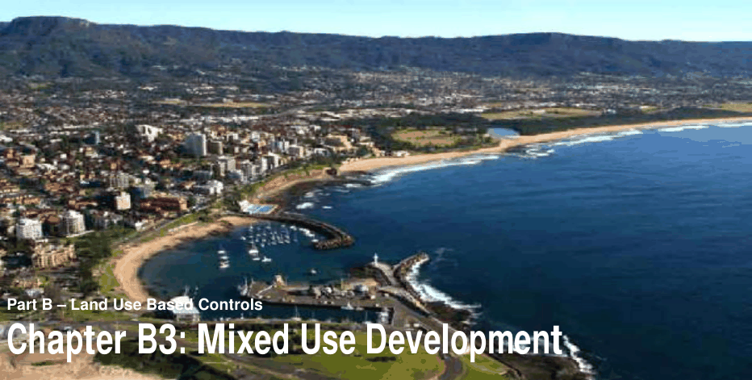

# Wollongong Development Control Plan 2009 - Chapter B3 Mixed Use Development

> This chapter is split into 8 section file(s), one per numbered heading, in the order they appear in the PDF.

Source PDF: [Wollongong-DCP-2009-Chapter-B03-Mixed-Use-Development.pdf](https://planfortomorrow.sharepoint.com/sites/Planfortomorrow/Shared%20Documents/00%20NSW-Planning-Resources/dcp/wollongong-development-control-plan-2009/chapter-b3-mixed-use-development/Wollongong-DCP-2009-Chapter-B03-Mixed-Use-Development.pdf)

> [Picture on page 1: a picture, saved as a picture (images/chapter-b3-mixed-use-development-page-1-1.gif, 150 dpi).]

#### Part B – Land Use Based Controls

### Chapter B3: Mixed Use Development

#### Contents

<!-- sections -->
## Sections

1. [2 OBJECTIVES](01-2-objectives.md)
2. [3 DEFINITIONS](02-3-definitions.md)
3. [4 DESIGN REQUIREMENTS - MIXED USE BUILDINGS 3](03-4-design-requirements-mixed-use-buildings.md)
4. [1 INTRODUCTION](04-1-introduction.md)
5. [2 OBJECTIVES](05-2-objectives.md)
6. [3 DEFINITIONS](06-3-definitions.md)
7. [4 DESIGN REQUIREMENTS - MIXED USE BUILDINGS](07-4-design-requirements-mixed-use-buildings.md)
8. [5 GENERAL REQUIREMENTS FOR ALL MIXED USE DEVELOPMENT](08-5-general-requirements-for-all-mixed-use.md)
