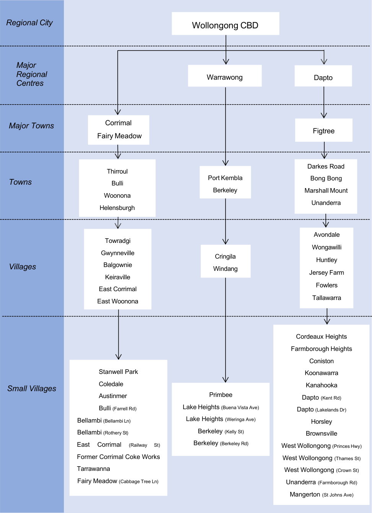

## 4 CENTRES HIERARCHY

Centres vary in size and role depending on their activity mix, scale and location. Wollongong’s Centres Hierarchy provides a framework which classifies and ranks Centres based on the needs, proximity and aspirations of our community.

### 4.1 Objectives

The objectives of the Centres Hierarchy are to:

(a) provide a framework which describes the desired characteristics of Centres;

(b) ensure the size, function and uses of any proposed development within a particular centre is consistent with the role and desired characteristics of that Centre;

(c) facilitate the concentration of jobs, shops, businesses, entertainment, community facilities and (where appropriate) residential development within Centres in order to generate maximum community benefit including: competitive, sustainable environments for business; concentrated investment in public transport, high amenity open space and community facilities; and compact neighbourhoods requiring fewer trips by private vehicle;

(d) provide adequate and appropriate retail development to meet the needs of existing and future workers and residents.

(e) provide greater certainty for investment decision making on retail and other developments.

### 4.2 Development Controls

1\. Development in Centres is to be consistent with the Centres Hierarchy as set out in Figure 1 - Centres Hierarchy and described in Table 1 - Desired characteristics of Centres and Peripheral Sales Precincts.

2\. Retail developments on large sites in Centres are encouraged to be complimented by a range of uses including business, entertainment (where permitted), medium density residential (where permitted), community facilities and publicly accessible open space.

3\. Office premises are to be concentrated in the Regional City Centre E2 Commercial Centre Zone to facilitate agglomeration benefits for commercial activity. Office premises outside the Regional City Centre E2 Commercial Centre Zone are to be limited to a scale appropriate to the function and characteristics of the Centre, as described in Table 1 - Desired characteristics of Centres and Peripheral Sales Precincts, to facilitate a diverse range of uses in lower order centres and preserve the Regional City Centre’s primary commercial function.

4\. Shops within MU1 Mixed Use zoned land are to be limited in scale to ensure they provide a support role to adjoining or nearby E1 Local Centre or E2 Commercial Centre zones.

5\. Specialised retail premises are to be consolidated within existing peripheral sales precincts to facilitate agglomeration benefits for commercial activity and minimise the spread of amenity impacts.

6\. Major retail stores are to be concentrated in the Regional City, Major Regional Centres and Major Town Centres to facilitate the provision of diverse range of uses in lower order centres and preserve the desired characteristics of higher order centres.

7\. The ground floor component of any shop top housing development is to be limited to only the land uses nominated in the LEP definition of shop top housing that are permitted in the relevant land use table.

#### Figure 1 - Centres Hierarchy

> [Picture on page 6: a map, saved as a picture (images/chapter-b4-development-in-centres-and-peripheral-sales-preci-page-6-2.gif, 150 dpi); the street names and other small labels are on the picture.]
> Words printed on the picture (title and legend, copied from the PDF):
> Dapto (Kent Rd)
> Lake Heights (Buena Vista Ave)
> Bulli (Farrell Rd)
> Dapto (Lakelands Dr)
> Lake Heights (Weringa Ave)
> Bellambi (Bellambi Ln)
> Berkeley (Kelly St)
> Bellambi (Rothery St)
> Berkeley (Berkeley Rd)
> East Corrimal (Railway St)
> West Wollongong (Princes Hwy)
> Former Corrimal Coke Works
> West Wollongong (Thames St)
> West Wollongong (Crown St)
> Fairy Meadow (Cabbage Tree Ln)
> Unanderra (Farmborough Rd)
> Mangerton (St Johns Ave)

#### Table 1 - Desired characteristics of Centres and Peripheral Sales Precincts

| Centres | Hierarchy Characteristics |
|---|---|
| Regional City |  |
| Floorspace | Retail floorspace: 110,000m² ~500,000m² total retail, commercial office, civic and entertainment |
| Population catchment | over 200,000 |
| Function | The Regional City is the highest order centre offering the greatest range of government , civic, business, office, retail, health, education, entertainment, arts and cultural, and community functions in the LGA. It is the economic focus of the region, delivering high levels of development and amenity, and attracting high levels of public and private investment. The Regional City’s range of higher order retail, primary employment role and identity as a destination for community and cultural events means it is the most highly visited and vibrant Centre. The Regional City Centre includes a high and medium density residential population which is subservient to the retail, employment and entertainment role of the City Centre. Public investment in community and cultural facilities, active and public transport and the public domain in the Regional City Centre is high. |
| Accessibility | On major public transport network with access to frequent transport by train or bus. Highly accessible for logistics. Highest quality active transport connections to and within the Centre. Developments integrate with and enhance existing active transport infrastructure and prioritise the safety and amenity of people who walk and cycle. |
| Retail uses | The Regional City offers full range of retail uses aimed at attracting a region-wide catchment of visitors as well as catering for the demand of a growing residential population. Retail uses include two or more full-line supermarkets, department stores, one or two discount supermarkets, cinemas, markets, specialty retail shops, fashion, comparison shopping, homewares, convenience shops, fresh food, cafes, restaurants and bars. Retail operation is active seven (7) days a week. An evening economy of restaurants, bars, live music and theatre venues and selected retail stores creates a vibrant and safe public domain at night. |
| Business Uses | The Regional City caters for the largest concentration of commercial office space. A full range of professional businesses is present, from small scale start-ups and co- working spaces to A-Grade commercial offices. |
| Residential Uses | The Regional City caters for high density residential development which supports the retail and business function of the city, without limiting its economic role. This Centre has a key role in providing well serviced and located affordable housing to the community. Diverse housing options are provided, including a range of bedroom numbers and typologies within the scope of the controls. |
| Other Uses | The Regional City Centre provides regionally significant art and culture facilities, as well as a range of entertainment facilities in the form of theatres, music venues and cinemas. |

| Centres | Hierarchy Characteristics |
|---|---|
| Relevant Centres | Wollongong City Centre The retail core of the Wollongong City Centre is concentrated along Crown Street (between the Wollongong Train Station and Corrimal Street) and Keira Street (between Smith Street and Burelli Street). Retail uses with high customer interaction should be concentrated within the ground floor of this core area, in order to provide active streets. Commercial office precincts are located along Burelli Street and on Crown Street (between Church Street and Corrimal Street). Large format commercial office buildings requiring large street facing lobbies and generous forecourts should be located along the southern side of Burelli Street where there is a concentration of large sites, excellent proximity to high quality public open space, public transport and the retail core, and limited residential encroachment. |
| Other DCP references | Chapter D13 of the Wollongong DCP 2009 includes development controls specific to Wollongong City Centre. |
| Strategic plans | The Wollongong City Centre Urban Design Framework (2020) sets the adopted strategic vision for the City Centre |
| Major Regional Centres |  |
| Floorspace | 40,000-80,000m² |
| Population catchment | up to 100,000 |
| Function | Major Regional Centres enable access to key social services and district level community facilities. They offer a wide range of high and low order retail goods and services as well as providing a limited amount of commercial office space. Major Regional Centres offer dense residential living in a compact neighbourhood with excellent access to transport. These Centres have a large amount of development capacity, enabling them to attract investment, grow and evolve. |
| Accessibility | On major public transport network with access to frequent transport by train or bus. Highly accessible for logistics and private vehicles. Active transport connections to and within the Centre. Developments integrate with and enhance existing active transport infrastructure and prioritise the safety and amenity of people who walk and cycle |
| Retail uses | Offer a nearly full range of goods and services to the local resident community. They can be anchored by supermarket(s), major retail development and speciality stores. Some Major Regional Centres include one or more department stores. Restaurants, cafes and bars contribute to active streets and a vibrant evening economy. In Major Regional Centres, retail and entertainment uses are often concentrated in enclosed or semi-enclosed plazas or malls which offer an alternative shopping experience to the high street. In order to ensure a successful and viable Centre, the enclosed and street facing retail venues must be integrated and facilitate pedestrian movement and on street activity. |
| Business Uses | A wide range of businesses servicing the district population. Limited commercial office space. |
| Residential Uses | The Major Regional Centre caters for medium density residential development which supports the retail and business function of the Centre and contributes to greater housing choice for the district population. These Centres have a key role in providing well serviced and located affordable housing to the community. Diverse housing options are provided, including a range of bedroom numbers and typologies within the scope of the controls. |

| Centres | Hierarchy Characteristics |
|---|---|
| Other Uses | The Major Regional Centre provides district scale community facilities and services. District level open spaces are often within or in close proximity to the Centre. Large entertainment facilities such as cinemas are also often located in these Centres. |
| Relevant Centres | Warrawong, Dapto |
| Strategic Plans | Warrawong Town Centre Masterplan (2015) Dapto Town Centre Masterplan (2017) |
| Major Town Centre |  |
| Floorspace | 20,000-40,000m² |
| Population catchment | Up to 50,000 |
| Function | Providing for the major weekly shopping and convenience retail needs of the surrounding population (generally more than one suburb) as well as a large range of specialty retail shops and services. Large community facilities and public recreation provision. Restaurants, cafes and bars contribute to active streets and a vibrant evening economy. |
| Accessibility | On major public transport network with access to frequent transport by train or bus. Highly accessible for logistics and private vehicles. Active transport connections to and within the Centre. Developments integrate with and enhance existing active transport infrastructure and prioritise the safety and amenity of people who walk and cycle. |
| Retail uses | Major Town Centres provide a range of retail, business, entertainment and community uses that serve the needs of people who live or work in the surrounding suburbs. Major Town Centres are generally anchored by at least one or two medium to full line supermarkets and other specialty retail shops. Some Major Town Centres include a department store. Major towns operate daytime and limited evening hours. Restaurants, cafes and bars contribute to active streets and an evening economy appropriate for the surrounding neighbourhood. |
| Business Uses | Services including banks, community services, customer facing professional offices, gyms and medical services. Limited large format commercial office space. |
| Residential Uses | The Major Town Centre caters for medium density residential development which supports the retail and business function of the centre and contributes to greater housing choice for the local population. These Centres have a role in providing well serviced and located affordable housing to the community. Diverse housing options are provided, including a range of bedroom numbers and typologies within the scope of the controls. |
| Other Uses | The Major Town Centre provides local scale community facilities and services, as well as local scale public open space. |
| Relevant Centres | Figtree, Corrimal, Fairy Meadow |
| Strategic Plans | Figtree Town Centre Study (2013) Corrimal Town Centre Plan (2015) |
| Town Centres |  |
| Floorspace | Retail floorspace: 5,000 – 20,000m² |
| Population catchment | Population catchment: 10,000-20,000 (800 metre - 1 km catchment radius) |

| Centres | Hierarchy Characteristics |
|---|---|
| Function | Town Centres provide a range of retail, business, entertainment and community uses that serve the needs of people who live in, work in and visit the local area. The range of retail activities offered in town centres provides for the weekly and daily fresh produce and other convenience needs of the surrounding residential community and may include supermarkets, butcher shops, fruit and vegetable grocery stores, bakeries, newsagent etc. Town centres operate daytime and limited evening hours to ensure compatibility with surrounding residential environment and amenity. Restaurants, cafes and bars contribute to active streets and an evening economy appropriate for the surrounding neighbourhood. New Town Centres* are master planned through the Neighbourhood Plan process. |
| Accessibility | On public transport network with access to transport by train or bus. Accessible for logistics and private vehicles. Active transport connections to and within the Centre. Developments integrate with and enhance existing active transport infrastructure and prioritise the safety and amenity of people who walk and cycle. |
| Retail uses | Generally anchored by a medium to full sized supermarket; May include a fruit and vegetable store, bakery, butcher and a range of services including a pharmacy, hairdressers, postal services, gyms etc. |
| Business Uses | Services including banks, community services, customer facing professional offices and medical services. Limited large format commercial office space. |
| Residential Uses | Limited scope for medium density residential development in the form of shop top housing, within the building envelope controls for the Centre. Residential developments offer diverse housing options for the community, including a range of bedroom numbers and typologies within the scope of the controls. |
| Other Uses | The Town Centre provides local scale public open space. Some well located Town Centres include local scale community facilities. |
| Relevant Centres | Thirroul, Bulli, Woonona, Helensburgh, Port Kembla, Berkeley, Darkes Rd*, Bong Bong*, Marshall Mount*, Unanderra |
| Other DCP references | DCP Chapter D12 – Thirroul DCP Chapter D16 – West Dapto Urban Release Area |
| Strategic Plans | Helensburgh Town Centre Plan and Streetscape Masterplan (2020) Port Kembla 2505 Revitalisation Plan (2018) West Dapto Vision 2018 (Darkes Rd, Bong Bong, Marshall Mount) Unanderra Town Centre Masterplan (2013) |
| Village Centres |  |
| Floorspace | 2,000 - 5,000m² (~5- 30 shops) |
| Population catchment | up to 10,000 (~ catchment radius of 600 – 800m) |

| Centres | Hierarchy Characteristics |
|---|---|
| Function | Village Centres provide a range of small-scale retail, business and community uses that serve the needs of people who live or work in the surrounding neighbourhood providing access to fresh produce and a range of other convenience needs. Village Centres are designed and built to operate in a manner that facilitates a high level of pedestrian accessibility and social connection. They function as an integral part of walkable neighbourhoods and play a particularly important role for those residents in the community who do not have ready access to car transport or public transport to higher order centres. Village centres operate daytime and early evening hours to ensure compatibility with surrounding residential environment and amenity. New Village Centres* are master planned through the Neighbourhood Plan process. |
| Accessibility | On public transport network with access to transport by train or bus. Accessible for logistics and private vehicles. Active transport connections to and within the Centre. Slow through traffic and walkable catchment (5-10 minutes). Developments integrate with and enhance existing active transport infrastructure and prioritise the safety and amenity of people who walk and cycle. |
| Retail uses | Village Centres are served by neighbourhood supermarket and/or mixed business type shop, fruit and vegetable retailers, newsagents, restaurant, café, bakery, butcher and some limited services such as a hairdresser. Individual tenancies are small scale with a smaller floor area than their Town Centre counterparts. Food and Drink Premises with drive through facilities are not permitted in most Village Centres (Wollongong LEP Clause 7.23) |
| Business Uses | Retail provision is prioritised in Village Centres, therefore Business uses are limited. |
| Residential Uses | Village Centres have lower height limits, restricting upper story residential development to traditional shop-top housing, with a small number of apartments above a commercial tenancy. These apartments provide passive surveillance within the Centre, and offer housing diversity and relative affordability in the context of the surrounding neighbourhood. |
| Other Uses | The Village Centre provides local scale public open space in the form of small landscaped plazas or similar. |
| Relevant Centres | Towradgi, Gwynneville, Balgownie, Keiraville, East Corrimal, East Woonona, Cringila, Windang, Avondale*, Wongawilli*, Huntley*, Jersey Farm*, Fowlers*, Tallawarra* |
| Other DCP references | DCP Chapter D16 – West Dapto Urban Release Area |
| Strategic Plans | West Dapto Vision 2018 (Avondale, Wongawilli, Huntley. Jersey Farm, Fowlers) |
| Small Village Centres |  |
| Floorspace | 100 – 2,000m2 |
| Population catchment | 700 – 1,000 dwellings (catchment radius of ~ 400 – 500m) |
| Function | Primarily provide for the daily convenience needs of the surrounding residential population providing access to fresh produce and a range of other convenience needs. |
| Accessibility | These Centres help to create 800m walkable catchments. Active transport connections to and within the Centre. Walkable catchment promotes walking. Developments integrate with and enhance existing active transport infrastructure and prioritise the safety and amenity of people who walk and cycle. |

| Centres | Hierarchy Characteristics |
|---|---|
| Retail uses | Generally, includes neighbourhood supermarket and / or mixed businesses for example a fruit and vegetable store, butcher, bakery, and / or café or restaurant. Small Village Centres operate daytime and early evening hours to ensure compatibility with surrounding residential environment and amenity. Food and Drink Premises with drive through facilities are not permitted in Small Village Centres (Wollongong LEP Clause 7.23) |
| Business Uses | Retail provision is prioritised in Small Village Centres, therefore Business uses are limited. |
| Residential Uses | Village Centres have lower height limits, restricting upper story residential development to traditional shop-top housing, with a small number of apartments above a commercial tenancy. These apartments provide passive surveillance within the Centre, and offer housing diversity and relative affordability in the context of the surrounding neighbourhood. |
| Other uses | The Small Village Centre provides local scale public open space in the form of small landscaped plazas or similar. |
| Relevant Centres | Stanwell Park, Coledale, Austinmer, Bulli (Farrell Road), Bellambi (Bellambi Lane), Bellambi (Rothery Street), Corrimal (Railway Street), Former Corrimal Coke Works, Tarrawanna, Fairy Meadow (Cabbage Tree Lane), Primbee, Lake Heights (Buena Vista Avenue), Lake Heights (Weringa Avenue), Berkeley (Kelly Street), Berkeley (Imperial Drive), Cordeaux Heights, Farmborough Heights, Coniston, Koonawarra, Kanahooka, Dapto (Kent Rd), Dapto (Lakelands Drive), Horsley, Brownsville, West Wollongong |
| Peripheral Sales Precincts |  |
| Population catchment | Peripheral Sales Precincts may have a large or more local trade area, with catchment size depending on the area of zoned land and the focus of uses. Major Precincts can service an LGA wide catchment. Smaller Precincts service a local population, providing urban services such as car mechanics, landscaping and hardware supplies. |
| Function | Peripheral Sales Precincts occur on land zoned E3 Productivity Support. These areas provide a range of facilities and services, light industries, warehouses and offices, as well as large format retail in the form of specialised retail premises. Peripheral Sales Precincts are to be compatible and not compete with land uses in surrounding Centres. These Precincts provide for land uses that meet the needs of the community, business and industry but are not suited to locations in other employment zones. |
| Accessibility | Well suited to locations with convenient vehicular access, including highway locations and on the periphery of centres, and car based centres and shopping malls with access to major transport corridors. Areas where population growth and household formation is strong are well suited locations for these Precincts. Developments integrate with and enhance existing active transport infrastructure and prioritise the safety and amenity of people who walk and cycle. |
| Retail uses | Primarily includes hardware stores, household goods stores, furniture stores and car dealerships The most successful precincts are anchored by a large tenant who provide strong visitation that flows onto surrounding businesses. |
| Residential Uses | Residential Uses are permitted in some peripheral sales precincts in the form of shop- top housing. However, the scale of this use is limited by the height and FSR controls which apply in these areas.. Residential uses are subservient to other uses in these precincts, and land use conflicts must be carefully managed. |

| Centres | Hierarchy Characteristics |
|---|---|
| Relevant Precincts | Woodrow Place Figtree, ^Flinders Street Wollongong, Keira Street Wollongong, Kembla Street Wollongong, ^Northcliffe Drive, Kembla Grange, ^King Street Kemblawarra /Warrawong, ^Mt Ousley Road Fairy Meadow, Princes Highway Corrimal, Princes Highway Helensburgh, Princes Highway Russell Vale, Military Road, Port Kembla, ^Yallah (planned), Princes Highway, Dapto, Princes Highway Unanderra ^major peripheral sales precincts |
