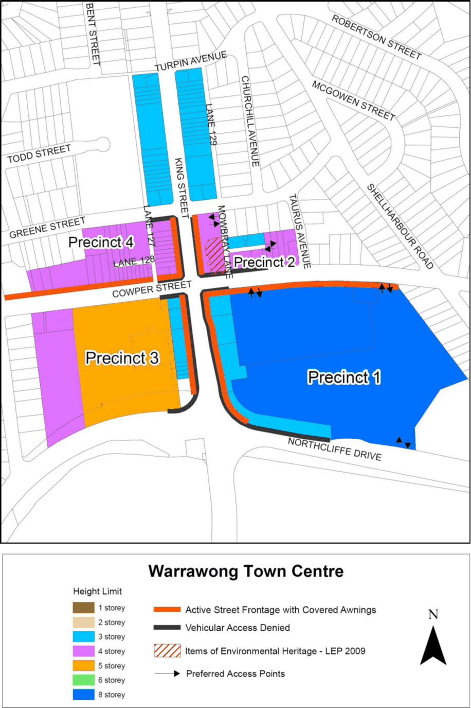

## 6 PLANNING REQUIREMENTS FOR DEVELOPMENT IN THE REGIONAL CITY AND MAJOR REGIONAL CENTRES

### 6.1 Wollongong City Centre

1\. The specific planning requirements for development upon any land within the Wollongong City Centre are contained in Part D (Locality Based/ Precinct Plan) of this DCP.

### 6.2 Warrawong Major Regional Centre

1 The Warrawong Major Regional centre is centred on King Street between Cowper Street to the north and Northcliffe Drive to the south.

#### 6.2.1 General

8\. Any new retail development should be consolidated and contained within the existing Warrawong centre.

9\. Any new development within the Warrawong major regional centre should contribute toward improving physical cohesion, accessibility and environmental amenity.

10\. Greater synergies are to be forged between the Warrawong major regional centre, the Kemblawarra peripheral sales centre and the future planned Griffins Bay special tourism precinct.

#### 6.2.2 Precinct 1

1\. This precinct contains the Warrawong Shopping centre which is generally bounded by King Street, Cowper Street, Northcliffe Drive and residential properties to the east.

> [Picture on page 16: a picture, saved as a picture (images/chapter-b4-development-in-centres-and-peripheral-sales-preci-page-16-1.gif, 150 dpi).]

#### Maximum Building Height

2\. Maximum Height (Max. Number of Storeys) – eight (8) Storeys

#### Front Building Setback to Primary Road (Cowper Street)

3\. For any major alteration and addition to the existing shopping centre, a zero setback is permitted to the primary road frontage (Cowper Street) for the first four (4) storeys where the ground floor level of the building provides an active street frontage and the first, second and third floor levels are provided with a decorative facade treatment, in order to provide visual interest to the building .For any level above the fourth storey, a five (5) metre building line setback shall be provided, off the Cowper Street front property boundary.

#### Secondary Road Setback (King Street)

4\. A zero building line setback is permitted along the King Street frontage for the first four (4) storeys in the building where an active street frontage is provided at ground level and an appropriate decorative facade treatment is provided to the first, second and third floor levels of the building. A minimum five (5) metre building setback will be required for the upper levels of the building, above the fourth storey of the building.

#### Secondary Road Setback (Northcliffe Drive)

5\. A zero building line setback is permitted along the King Street frontage for the first four (4) storeys in the building where an active street frontage is provided and an appropriate decorative facade treatment is provided for the first, second and third levels of the building. A minimum five (5) metre building setback will be required for the upper levels of the building, above the fourth storey of the building.

#### Side and Rear Setbacks

6\. A minimum 10 metre side building line setback is required for the first three (3) levels of the building (i.e. ground floor, first floor and second floor),.off the eastern and south-eastern side property boundaries. A minimum 20 metre side building line setback is required for the upper levels of the (i.e. above the second storey of the building), off the eastern and south-eastern side property boundaries.

#### Car Parking and Access

7\. The main car parking areas should be serviced by appropriate access arrangements to / from Cowper Street and Northcliffe Drive only.

8\. The existing at–grade car parking area in the front building line setback area to King Street shall be restricted to left in / left out movements only and primarily designed to provide car parking for persons with a disability and persons with strollers.

#### 6.2.3 Precinct 2

1\. This precinct is bounded by Cowper Street, Mowbray Lane, Laneway (#130), Taurus Avenue, Montgomery Avenue and King Street, Warrawong.

#### Maximum Building Height

2\. Maximum Height (Max. Number of Storeys) – four (4) storeys

#### Front Building Setback

3\. A zero lot line setback will be permitted to street boundary frontages for the first three (3) storeys of any building.

4\. For any level above three (3) storeys, a five (5) metre front building line setback will be required.

#### Car Parking and Access

5\. The car parking areas to any site within this precinct shall be serviced by direct vehicular access to / from rear lanes only.

6\. The provision of direct vehicular access into and from the car parking area via Cowper Street will not be supported, except where there is no alternate access arrangement and only where traffic impact analysis proves that the proposed access arrangement to / from Cowper Street will maintain satisfactory traffic flow movements and will not pose any unacceptable vehicular conflicts and vehicular / pedestrian conflicts.

#### 6.2.4 Precinct 3

1\. This precinct is bounded by Cowper Street, King Street, Northcliffe Drive and abuts First Avenue South residential properties, Warrawong.

#### Maximum Building Height

2\. Maximum Height (Max. Number of Storeys) – five (5) storeys (except for a Maximum four (4) storey height limit for the western side of the site abutting the First Avenue residential properties)

#### Front Building Setback to Primary Road (Cowper Street)

3\. A zero lot line setback will be permitted for the first three (3) storeys of any building, off the Cowper Street property boundary on the basis that an active street frontage is provided at ground level. For any level above three (3) storeys, a five (5) metre front building line setback, off the Cowper Street property boundary will be required.

#### Secondary Road Building Line Setback (King Street)

4\. A zero building line setback is permitted for the first three (3) storeys of any building, off the King Street property boundary on the basis that an active street frontage is provided at ground level.

5\. For any level above three (3) storeys, a five (5) metre front building line setback, off the King Street property boundary will be required.

#### Rear Setback

6\. A minimum 10 metre building line setback shall be provided to the residential properties to the west of the precinct (fronting First Avenue South).

#### Car Parking and Access

7\. The car parking areas between the existing the sites shall remain physically linked to provide satisfactory vehicular access arrangements between the sites. The co-ordinated access arrangements between these sites shall be achieved by the creation of reciprocal rights of carriageway over the sites, pursuant to section 88B of the Conveyancing Act 1919.

8\. The car parking areas for the sites should gain direct vehicular access to / from Northcliffe Drive and Cowper Street only.

#### 6.2.5 Precinct 4

1\. This precinct is bounded by Cowper Street, King Street, Greene Street and First Avenue South.

#### Maximum Building Height

2\. Maximum Height (Max. Number of Storeys) – four (4) Storeys

#### Building Setback to Streets

3\. A zero lot line setback will be permitted for the first three (3) storeys of any building, off the Cowper Street property boundary. For any level above three (3) storeys, a five (5) metre front building line setback, off the Cowper Street property boundary will be required.

#### Car Parking and Vehicular Access

4\. The car parking areas between the sites shall remain physically linked to provide satisfactory vehicular access arrangements between the sites.

NOTE: parking concessions are available to encourage the linking of surface car parks between adjoining sites – Refer to Access, Parking and Servicing Chapter of Part E of the DCP.

5\. The provision of a co-ordinated access arrangement between the sites shall be achieved by the creation of reciprocal rights of carriageway over the sites, pursuant to section 88B of the Conveyancing Act 1919.

6\. Sites that have legal rights of access to Lane 127 or Lane 128 must use these laneways for access to car parking areas. Direct vehicular access to King Street will be prohibited, at all times.

#### 6.2.6 Precinct 5

1\. This precinct is situated on either side of King Street and is bounded by Turpin Avenue to the north and Montgomery Avenue and Greene Street to the south. This precinct is separated from residential properties by Lane 129 (east) and Lane 127 (west) which run parallel with King Street in a north-south direction.

#### Maximum Building Height

2\. Maximum Height (Max. Number of Storeys) – three (3) Storeys

#### Front Building Setback to Streets

3\. A zero building line setback is permitted to King Street, Turpin Avenue, Greene Street and Montgomery Avenue.

#### Laneway Setback

4\. A 3 metre minimum setback is required for any building, off the rear laneways which must be fully landscaped.

#### Vehicular Access

5\. Car parking areas on the eastern side of King Street shall be restricted to gain direct vehicular access to / from the rear laneway (Lane 129) only. Direct vehicular access to / from King Street is prohibited, at all times. Existing driveway crossovers are to be removed with any redevelopment.

6\. For sites on the western side of King Street existing access arrangements are not desirable due to adverse impacts on King Street. A change is required to remove existing driveway crossovers along the King Street frontage with access provided from the rear laneway (Lane 127) instead. In order for this to occur the rear laneway will need to be constructed. As sites are redeveloped access arrangements will be required to change and construction of the laneway will be required when a redevelopment is of such a scale as to be commensurate with the laneway construction. The cost of laneway construction must be fully met by the developer. For minor development, such as a change of use, Council may decide that construction of the laneway is not warranted. In these instances the linkage of car parking areas on adjacent sites will be required in order that access

points along King Street may be removed. A concession of two (2) car parking spaces will be permitted for any linkage and removal of a driveway crossover.

### 6.3 Dapto Major Regional Centre

1\. The precinct planning controls for the Dapto Regional Centre will be covered in a future update to the DCP.
