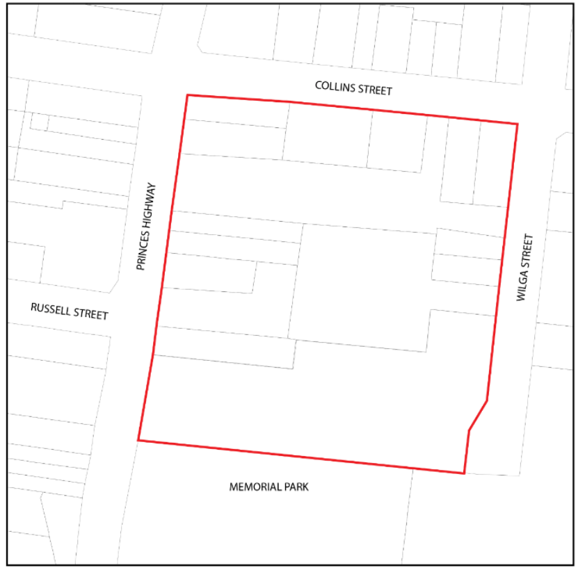
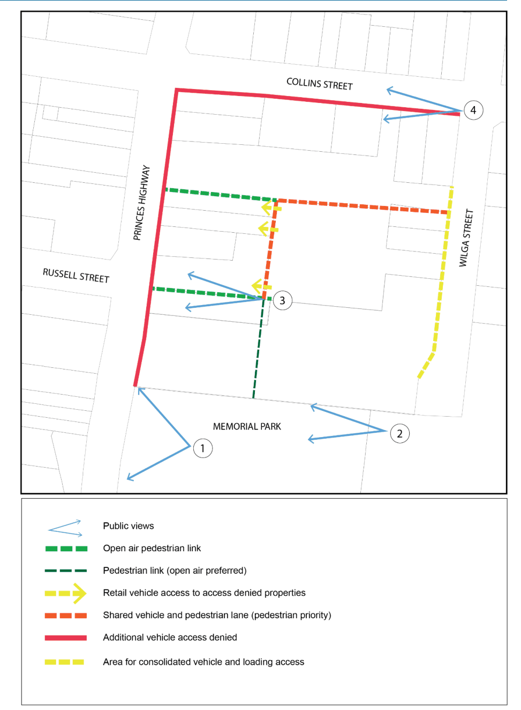
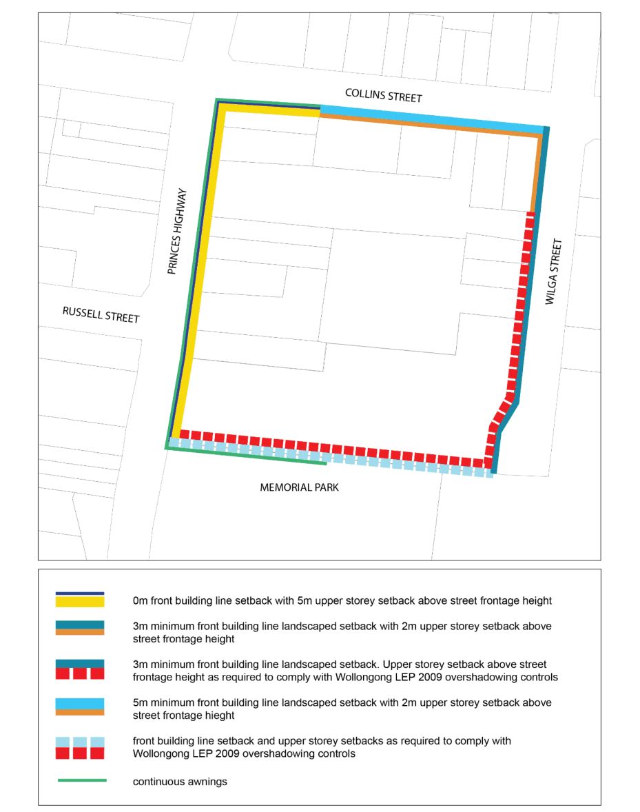
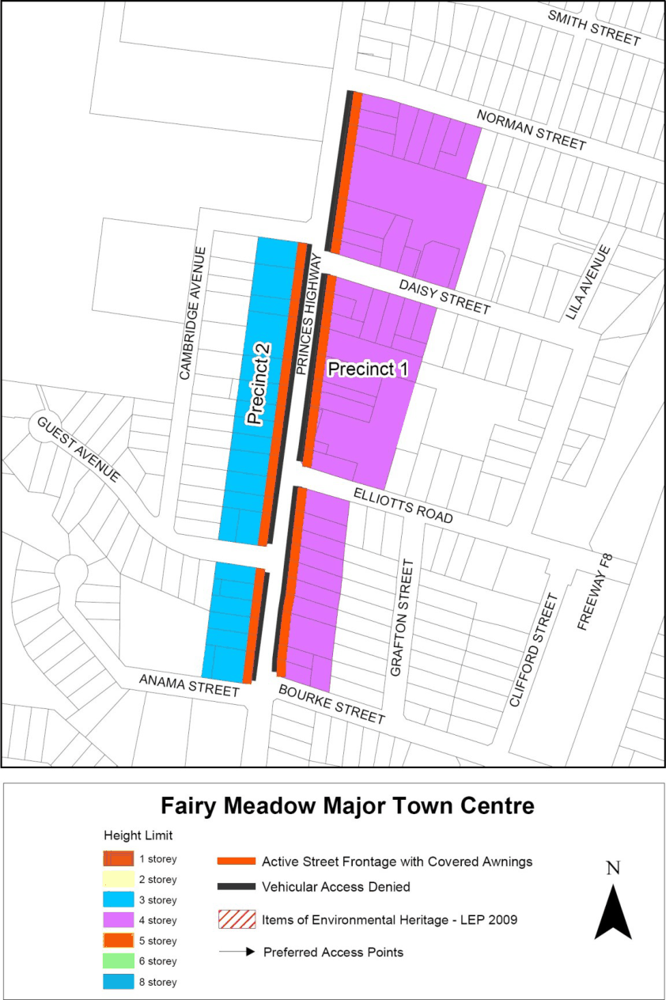
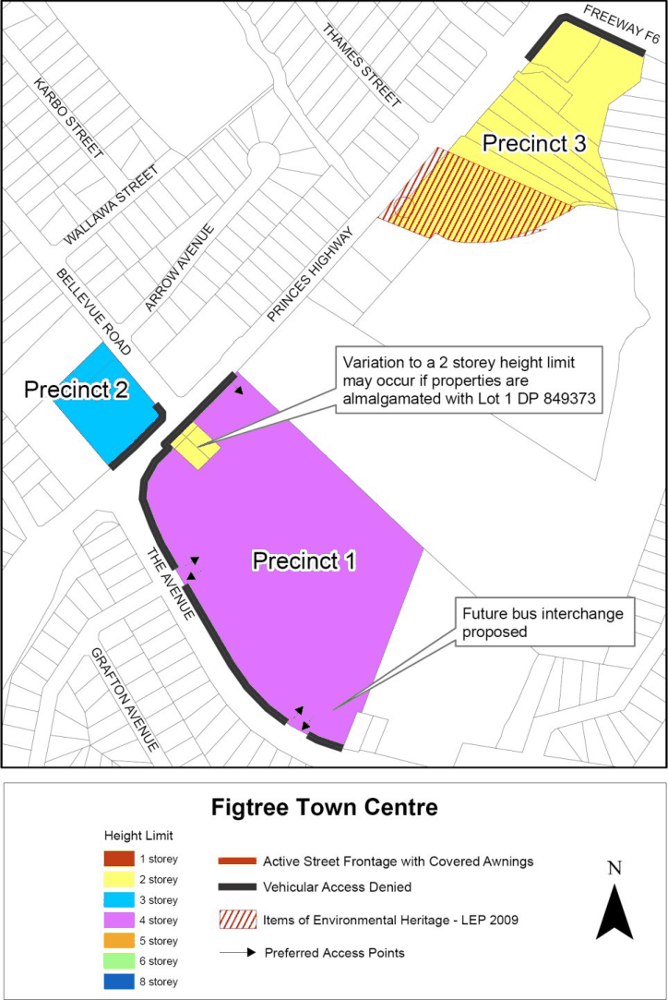

## 7 PLANNING REQUIREMENTS FOR DEVELOPMENT IN THE MAJOR TOWN CENTRES

### 7.1 Corrimal Major Town Centre

The precinct planning controls for Precinct 1 – Wilga Street Block are included at 7.1.1. The precinct planning controls for the remainder of Corrimal Major Town centre will be covered in a future update to the DCP.

#### 7.1.1 Precinct 1 - Wilga Street Block

This precinct is a key site known as the Wilga Street Block. It is located at the north-east end of the Town Centre and is bound by Wilga Street, Collins Street, the Princes Highway and Memorial Park. The controls within this section apply to the Wilga Street Block as illustrated in Figure 2.

> [Picture on page 20: a picture, saved as a picture (images/chapter-b4-development-in-centres-and-peripheral-sales-preci-page-20-15.gif, 150 dpi).]

#### Figure 2 - Wilga Street Block

These precinct controls are informed by:

1\. The Corrimal Town Centre Plan (2015-2025)

2\. The Wilga Street Block Planning Strategy (2024)

#### Objectives

(a) To communicate the expectations and requirements of development within the Wilga Street Block with detailed objectives and controls for development.

(b) To ensure development aligns with the objectives, principles, and recommendations of the Wilga Street Block Planning Strategy.

(c) To guide a place-based development approach through a comprehensive set of planning and design guidelines informed by the future desired character of the Precinct.

(d) To promote design excellence and quality urban design and architectural outcomes across the Wilga Street Block.

These DCP controls have been developed with reference to the recommendations of the Wilga Street Block Planning Strategy, to work in conjunction with provisions within the Wollongong LEP 2009, particularly in relation to land use, building form and access.

#### 7.1.1.1 Desired Future Character

(a) The Wilga Street Block will be a vibrant and flexible mixed-use precinct that strengthens the role and identity of Corrimal Major Town Centre. It will support the growth of the local community, with services and amenities that align with Council’s strategic priorities. The Block will enable safe and high amenity access to Memorial Park, and this interface will foster social interaction and a range of activities. Comfortable streets, lanes and improved active transport connections will support a uniquely walkable environment and minimise the role of cars.

(b) The Princes Highway is the main retail street for Corrimal and already operates as a high street with fine grain retail. Redevelopment of the site will seek to revitalise and enhance the existing character. Pedestrian only traffic with wide footpaths will encourage walkability and activation of shop fronts with no vehicular crossings.

(c) Memorial Park is a critical interface for enhancing the amenity of Wilga Street Block. Activating the edge of the park adjacent to Luke’s Place Playground and the Memorial Outside Ground will provide stronger connections, an increased vibrancy and support visitation and utilisation.

(d) Collins Street is a predominantly residential street with a mixture of single dwellings and low scale medium density housing. On the Wilga Street Block low scale street walls, setbacks for landscaping and articulated façades will assist in managing the transition to a higher density of residential uses, to fit within the local context.

(e) Wilga Street plays a key role in the functioning of the block as primary servicing and vehicle access. Consolidated vehicle entries and servicing, future cycling routes, on street parking and landscaped setbacks would all enhance the amenity of the block and improve connections to surrounding community facilities.

#### 7.1.1.2 Structure and Access

The structure of a block defines how it is experienced by people. It facilitates areas for lot consolidation and development, designates the role of streets and internal movement networks, and determines the provision of, and interface with, the public domain and surrounding context. Figure 2 shows the preferred structure and access framework for the Wilga Street Block.

> [Picture on page 22: a picture, saved as a picture (images/chapter-b4-development-in-centres-and-peripheral-sales-preci-page-22-1.gif, 150 dpi).]

#### Figure 3 - Structure, Access and Views

#### i. Public Views

#### Objectives

(a) Preserve and improve views from the Wilga Street Block to the Illawarra Escarpment and Memorial Park.

(b) Ensure the Illawarra Escarpment remains the dominant feature of the skyline.

(c) Enhance views along streets to the Illawarra Escarpment and Memorial Park.

#### Controls

1\. Nominated public views shown in Figure 3 - Structure, Access and Views are to be protected.

a. Views to the Illawarra Escarpment and Brokers Nose are to be maximised from within Luke’s Place Playground (1)

b. Views to the Escarpment and Brokers Nose are to be maximised from the pedestrian connection between Wilga Street and the Princes Highway (2)

c. A view corridor to Broker’s Nose along Russell Street is to be created via a new open air pedestrian link from the centre of the Block (3). Built form envelopes either side of this link are to maximise this view.

d. Views to the Escarpment and Brokers Nose are to be maximised along the pedestrian footpath on the southern side of Collins Street between Wilga Street and the Princes Highway (4).

2\. The redevelopment of sites with potential to open a blocked view shown in Figure 3: Public Views must restore that view.

3\. Development Applications must include a view analysis demonstrating how views to the Illawarra Escarpment and Broker’s Nose have been maximised from nominated views points as per Figure 2 – Structure, Access and Views. This should consider existing topography, vegetation and surrounding development.

4\. The planning and design of building forms must maximise view corridors between buildings, including tower forms.

#### ii. Lanes and Pedestrian through site links

#### Objectives

(a) Improve pedestrian permeability and access through the Wilga Street Block.

(b) Ensure through site links are safe, well-lit and accessible with a welcoming character.

(c) Maximise low angle (eye-level) views between buildings to allow orientation throughout the Block from street to street and to Memorial Park and to reduce the effects of visual enclosure.

(d) Prioritise pedestrian movement on through site links shared with vehicles.

#### Controls

1\. Open air through-site links are to be an easement on title.

2\. Pedestrian links are to be provided as per Figure 3 -Structure, Access and Views, Appropriate alternatives will be considered where they deliver on objectives (a) to (d) of ii Lanes and Pedestrian through site links.

3\. Pedestrian links are to be consistent with the requirements in 10.2.6 Pedestrian Access of this DCP Chapter (Chapter B4).

4\. Use landscape planting and views to surrounding landscape features to ensure that spaces do not feel enclosed or lacking in connection to the wider area.

5\. Wayfinding signage should support the movement of people through the site and provide direction to key destinations.

#### iii. Vehicle Access

#### Objectives

(a) Pedestrians are prioritised on footpaths and in shared vehicle and pedestrian lanes.

(b) Conflicts between vehicle and pedestrians are minimised.

(c) Vehicle entry points do not dominate the design of buildings or the streetscape character.

(d) Vehicle access within the site maintains pedestrian priority on the street by facilitating rear access to properties denied vehicle access from their front boundary.

#### Controls

1\. Vehicle access is to be consistent with Figure 3 – Structure, Access and Views.

2\. Vehicle access to the Block is to be consolidated and all parking and servicing is to be functional, adequate and discrete.

3\. Vehicle access to properties and carparking is to be provided off internal lanes and Wilga Street rather than primary street frontages to limit conflicts with pedestrian and cyclist activity.

4\. Rear access to denied access properties with no existing access is to be provided from Wilga Street in a consolidated form. Figure 3 – Structure, Access and Views illustrates the desired arrangement.

5\. Opportunities to remove existing vehicle access driveways from access denied locations is encouraged and should be prioritised.

#### iv. Lot Consolidation

Rationalisation of the lots across the Block through lot consolidation will result in a clearer structure, provide increased public benefit and deliver a variety of high-quality building forms.

#### Objectives

(a) Provide for a comprehensive development on the site which implements consistent urban design principles of the highest standard.

(b) Provide for well-planned and well located publicly accessible mid-block connections for active transport and vehicle movement.

(c) Distribute height in order to protect the access of sunlight to open space areas both on the site and in the surrounding area.

#### Controls

1\. Vehicle access and loading areas shall be consolidated to manage traffic generation from the site.

2\. Lot frontages are to provide adequate width to allow buildings to provide for the efficient development of land and high-quality design of buildings.

3\. Lot consolidation must not result in isolated lots, or lots that are not able to redevelop.

#### v. Car Parking Requirements

#### Objectives

(a) Retain public access to parking on the Wilga Street Block to support retail offerings as well as visitation to, and use of, Memorial Park and the Corrimal Town Centre more broadly.

(b) Consolidate and integrate all new carparking to ensure increased useability.

(c) Provide car parking spaces that are adaptable to future uses.

#### Controls

1\. Carparking is to be provided in accordance with the requirements of DCP Chapter E3 Carparking, Access, Servicing/Loading Facilities and Traffic Management.

2\. The quantum of publicly accessible parking currently provided on Lot 5 DP 37769 is to be retained as part of any lot consolidation and or redevelopment of the site.

3\. Car parking spaces are to be integrated into the design of buildings.

4\. Car parking is not to be visible at ground level, or on any level up to street wall height, from any street frontage.

5\. Clear lines of sight and wayfinding to publicly accessible car parking spaces must be provided from surrounding streets, public spaces and uses within the Block.

6\. Access to and location of carparking within the Block should be aligned with the proposed structure as shown in Figure 3 – Structure, Access and Views.

#### 7.1.1.3 Built Form

Built form describes the collection of individual building design elements that contribute to the overall character and performance of the built environment. The Built form interface comprises of the boundary between the activity within the building and the public realm. The way buildings interface with the public domain has a direct influence on the urban character of the city, the accessibility and functionality of the building and the safety, amenity and quality of the public domain. Figure 4 shows the preferred built form interface for the block.

> [Picture on page 25: a picture, saved as a picture (images/chapter-b4-development-in-centres-and-peripheral-sales-preci-page-25-10.gif, 150 dpi).]

#### Figure 4 - Built Form interface

#### i. Front Building Line Setbacks

#### Objectives

(a) Provide space for street tree planting and landscaping.

(b) Provide space for pedestrian movement and staying activities.

(c) Maximise view corridors to significant landscape and built form to enable orientation and way-finding and protect and enhance the Town Centre’s character.

(d) Provide a transition between the building forms on the Block and the street, Memorial Park and surrounding residential areas.

(e) Maintain a consistent building alignment fronting the public domain.

#### Controls

1\. Front building line setbacks are to be provided as shown in Error! Reference source not found..

2\. Where setbacks are to non-residential uses, these should be publicly accessible.

3\. All setbacks should be appropriate for context and the proposed land use. On Collins Street and Wilga Street, where it is expected that there may be a transition from commercial to residential at ground, proposed setbacks will be assessed on merit, with reference to the dominant setback of the street, the setback of the adjacent properties and the land use.

4\. Any area with a setback to Memorial Park is to be designed in consultation with Council.

#### ii. Street frontage heights and upper storey setbacks

Street frontage height means the vertical height in storeys of the part of the building closest to the lot boundary adjoining the public domain (e.g. street or open space).

#### Objectives

(a) Ensure a human scale interface with Memorial Park and the streets.

(b) Ensure a transition in height to surrounding low-scale areas.

(c) Protect the solar amenity of public spaces and streets.

#### Controls

1\. Buildings are to have a one (1) to two (2) storey street frontage height.

2\. Upper storeys are to be setback from the street frontage as shown in Figure 4. A range of upper storey setbacks are required to address different street and park interface conditions.

3\. Laneways and open air pedestrian through site links –a minimum 2m upper storey setback above the street frontage height of the building.

#### iii. Side setbacks

#### Controls

1\. Any new building within this precinct may incorporate a zero side ground floor setback up to street wall height, except where a pedestrian through site link or lane is indicated in Error! Reference source not found..

2\. A minimum 6 metre ground floor setback is required from the rear property boundary, where a site includes or abuts residential uses.

3\. Upper-level side and rear setbacks are required to provide light and air to the street, adjacent open spaces and internal pedestrian links. 0m side or rear setbacks are not permitted above street wall height.

#### iv. Awnings

Awnings are roof structures that project over the footpath They encourage pedestrian activity along streets and, in conjunction with active edges, support and enhance the pedestrian experience.

#### Objectives

(a) Encourage pedestrian activity along streets, adjacent public open space, and within through-site connections to support and enhance the vitality of the Wilga Street Block.

(b) To provide weather projection for passing pedestrians, entries to buildings and outdoor activities such as dining.

#### Controls

1\. Awnings are to be provided to the extent shown in Figure 4.

2\. Refer to 10.2.7 of this Chapter (Chapter B4) for general controls in relation to awnings.

#### v. Active frontages

#### Objectives

(a) Building frontages contribute to the use, activity, safety and interest of Streets and Memorial Park.

(b) Building frontages acknowledge and contribute to the character of streets and Memorial Park as defined under 7.1.1.1 Desired Future Character of the Wilga Street Block.

#### Controls

1\. Development in the locations nominated on the Wollongong LEP 2009 Active Frontages map must comply with Clause 10.2.4 of this DCP Chapter.

2\. Active frontages along Memorial Park:

a. Physical access to building frontages may be concentrated along the western half of the frontage to Memorial Park, where awnings are to be provided in accordance with Figure 4.

b. The eastern half of the building frontage must at a minimum provide visual access to the premises to enable users of the Park to see activity within. Premises along this section of the Park should consider how the layout of future development can be designed in order to maximise visual engagement in order to achieve Objective a of v Active Frontages.

3\. Opaque glazing, signage or graphics that substantially obstruct views into or out of the building do not meet the requirements of an active frontage.

### 7.2 Fairy Meadow Major Town Centre

#### 7.2.1 General

1\. The Fairy Meadow Major Town centre is concentrated on the Princes Highway between Cambridge Avenue / Daisy Street to the north and Guest Avenue to the south.

2\. Any new retail development shall be contained and consolidated within the confines of the existing Fairy Meadow retail and business centre.

3\. Special emphasis should be directed towards the consolidation and the development of a more cohesive built form.

> [Picture on page 28: a picture, saved as a picture (images/chapter-b4-development-in-centres-and-peripheral-sales-preci-page-28-1.gif, 150 dpi).]

#### 7.2.2 Precinct 1

1\. This precinct contains three (3) separate blocks on the eastern side of the Princes Highway and is bounded by the Princes Highway, Norman Street, Daisy Street, Elliotts Road, Grafton Street and Bourke Street.

#### Building Height

2\. Maximum Building Height (Max. Number of Storeys) – four (4) Storeys

#### Front Building Setback

3\. The first two (2) storeys of any building shall be built to the front boundary with the third and fourth levels setback five (5) metres from front boundary.

#### Side and Rear Setbacks

4\. Any new building within this precinct may incorporate a zero side setback. A minimum six (6) metre setback is required from the rear property boundary, where a site abuts a residential property.

#### Car Parking and Access

5\. A voluntary planning agreement may be negotiated with Council towards the payment of monetary contributions for the provision of car parking spaces within a multi-deck car parking facility, in lieu of on-site parking.

6\. Car parking areas shall be provided with access arrangements to / from a secondary road such as Elliotts Roads, Bourke Street or other secondary road. Direct vehicular access to / from the Princes Highway is prohibited, except where a site has no alternate available access.

#### 7.2.3 Precinct 2

1\. This precinct is bounded by the Princes Highway, Cambridge Avenue and Anama Street.

#### Maximum Building Height

2\. Maximum Building Height (Max. Number of Storeys) – four (4) Storeys

#### Front Building Setback

3\. The first two (2) storeys of any building shall be built to the front boundary with the third and fourth levels setback five (5) metres from front boundary.

#### Side and Rear Setbacks

4\. Any new building within this precinct may incorporate a zero side setback. A minimum six (6) metre setback is required from the rear property boundary, where a site abuts a residential property.

#### Car Parking and Access

5\. A voluntary planning agreement may be negotiated with Council towards the payment of monetary contributions for the provision of car parking spaces within a multi-deck car parking facility, in lieu of on-site parking.

6\. Any car parking associated with any building in this precinct should be provided at the rear of the site via a right of carriageway off either Cambridge Avenue or Guest Avenue, wherever possible. Direct vehicular access to / from the Princes Highway will generally not be permitted, except where a site has no alternate available access.

### 7.3 Figtree Major Town Centre

#### 7.3.1 General

1\.   The Figtree Major Town Centre includes the Figtree Shopping Centre on the north-eastern corner of the Princes Highway (Precinct 1) and The Avenue and a small row of traditional strip shops and a McDonalds fast food restaurant along the Princes Highway and Bellevue Road intersection (Precinct 2). The Figtree Centre also includes Precinct 3 which comprises a range of drive food and drink retailing and restaurants and specialised retail premises.

> [Picture on page 30: a picture, saved as a picture (images/chapter-b4-development-in-centres-and-peripheral-sales-preci-page-30-8.gif, 150 dpi).]

#### 7.3.2 Precinct 1 – Figtree Shopping Centre

1\. This precinct is located on the north-east corner of Princes Highway and The Avenue and is comprised of Figtree Shopping Centre and two smaller allotments which front the highway.

#### Maximum Building Height

2\. Maximum Building Height (Maximum Number of Storeys) -

(a) Four (4) Storeys for the Figtree Shopping Centre site

(b) Two (2) Storeys for the two existing small allotments fronting the Princes Highway

3\. A four (4) storey building height limit may apply to the two (2) small existing allotments fronting the Princes Highway (i.e. Lot1, DP 38524 and Lot 2, DP 515091) where these lots are amalgamated with the Figtree shopping centre site known as Lot 1, DP 849373, 130 The Avenue, Figtree.

#### Front Building Setback Requirement

4\. A zero front building line setback is permitted along both the Princes Highway and The Avenue frontages where an active street frontage is provided at ground floor level and decorative façade treatment is provided for the upper levels of the building, above the ground floor level.

5\. A continuous awning should be provided on the front façade of the building along the full length of both Princes Highway and The Avenue frontages of the building. The awning should have a minimum soffit height of 3.3 metres and be setback at least 600mm from the kerb on each road frontage.

6\. Any proposed above ground car parking structure shall be designed behind the active street frontages to the Princes Highway and The Avenue. The carpark must provide a satisfactory pedestrian linkage between the active street frontages and the remainder of the shopping centre.

7\. The horizontal form of the front facades of the centre should also be broken up vertically, in order to strengthen the visual interest to the development.

#### Minimum Side & Rear Setback Requirements

8\. A zero building line setback is permitted, off the eastern and northern side property boundaries.

#### Vehicular Access and Servicing Arrangements

9\. The main car parking areas should be primarily serviced by appropriate access arrangements to / from The Avenue only.

10\. The existing truck loading dock facilities at the north-eastern corner of the building should be retained in order to avoid any relocation to more sensitive parts of the site.

#### 7.3.3 Precinct 2

1\. This precinct is located on the south-western corner of the Princes Highway and Bellevue Road.

#### Maximum Building Height

2\. Maximum Building Height (Max. Number of Storeys) – three (3) storeys

#### Front Building Setback Requirement (Princes Highway & Bellevue Road)

3\. For the property known as Lot 116, DP 719657, a zero lot line setback will be permitted for the first two (2) storeys of any building, off the Princes Highway while the third storey must be setback by five (5) metres. A zero lot line setback will be permitted for all storeys of a building to the Bellevue Road property boundary.

4\. In respect to the properties known as Lots 1 & 2, DP 38848, Bellevue Road, a 10 metre minimum front setback is required.

#### Side and Rear Setbacks

5\. A zero side setback is permitted for any new building.

#### Vehicular Access and Car Parking

6\. The existing car parking area for the property known as Lot 116, DP 719657 shall be retained for any redevelopment of the lot with direct vehicular access restricted to / from Bellevue Road only. Direct vehicular access to Princes Highway will be prohibited, at all times.

7\. The existing front car parking areas for the properties at Lots 1 & 2, DP 38848, Bellevue Road shall be retained.

#### 7.3.4 Precinct 3

#### Maximum Building Height

1\. Maximum Building Height (Max. Number of Storeys) – two (2) storeys

#### Front Building Setback

2\. A 10 metre minimum setback is required from the Princes Highway front property boundary.

#### Side and Rear Setbacks

3\. A minimum five (5) metre side setback is required for any building off the northern (side) boundary of the site, adjoining the freeway exit to the Princes Highway.

4\. A minimum six (6) metre setback is required from the rear property boundary.

#### Car Parking and Access

5\. The car parking areas shall be provided with access arrangements to / from the Princes Highway via the existing traffic signalisation at the intersection of Princes Highway, London Drive and the site. Direct vehicular access to / from the F6 freeway is prohibited, at all times.
