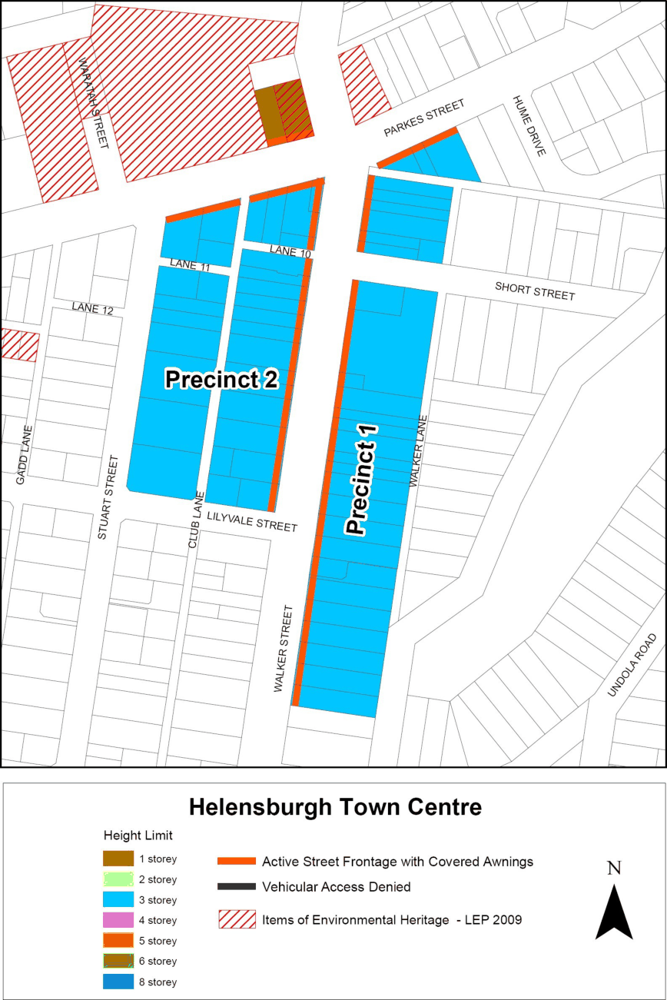
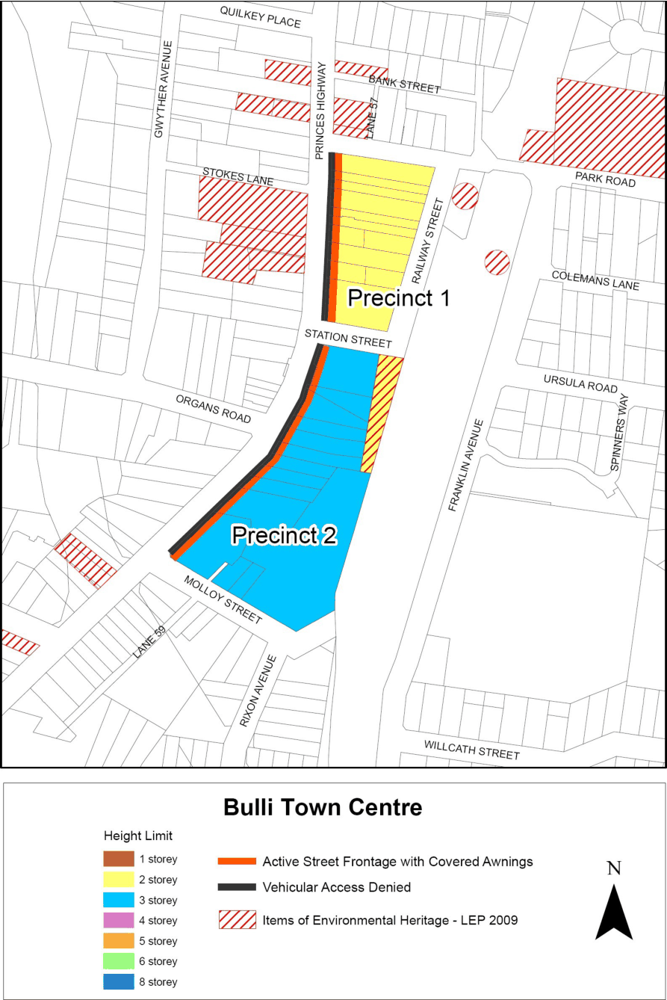
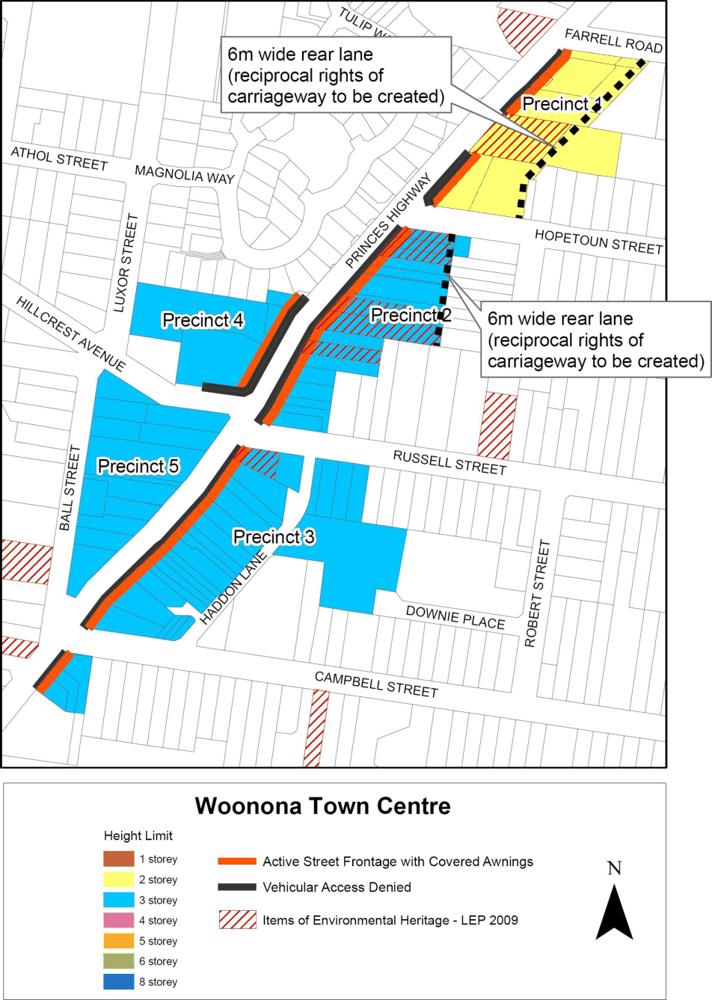
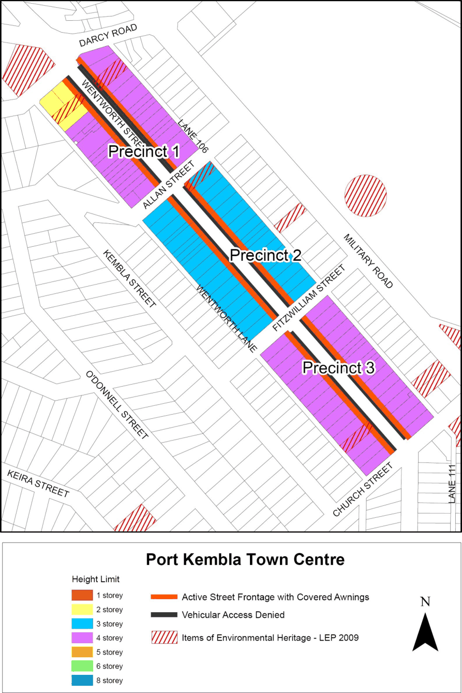
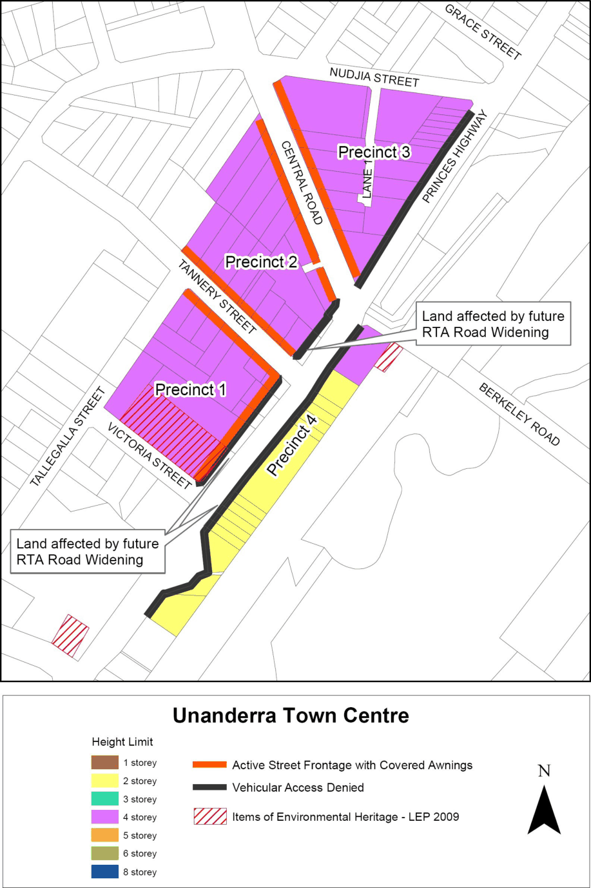
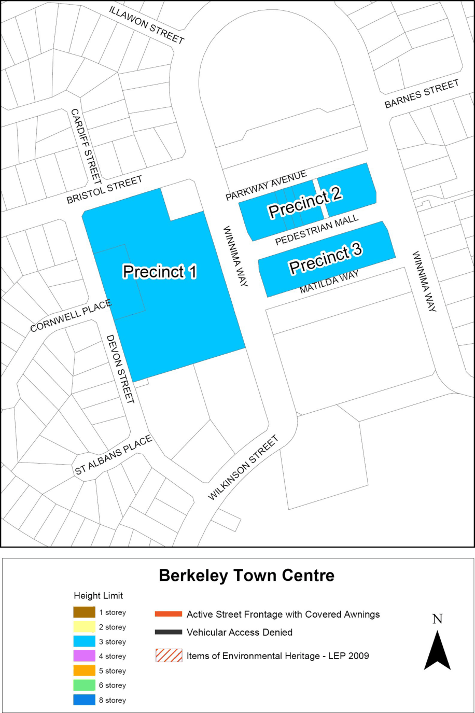

## 8 PLANNING REQUIREMENTS FOR DEVELOPMENT IN THE TOWN CENTRES

### 8.1 Helensburgh Town Centre

#### 8.1.1 General

1\. The Helensburgh Town Centre is concentrated at the intersection of Walker and Parkes Street. The Centre includes a supermarket and a range of specialty retail shops.

2\. The trade area of Helensburgh is primarily confined to the township of Helensburgh and the villages of Otford, Stanwell Tops, Stanwell Park, Coalcliff and Clifton.

3\. The Helensburgh Town Centre should continue to perform a role of providing for the daily and weekly convenience needs of residents in the locality. Any new retail development shall be limited to within the existing precincts.

#### Maximum Building Height

4\. Maximum Building Height (Max. Number of Storeys) – three (3) Storeys

#### Front Building Setback

5\. The first two (2) storeys of any building shall be built to the front boundary with the upper levels setback five (5) metres from front property boundary.

6\. A continuous cantilevered awning shall be provided for any new building fronting either Parkes Street or Walker Street.

#### Side and Rear Setbacks

7\. Any building within this precinct shall incorporate a zero side setback.

8\. A minimum six (6) metre rear building line setback is required

#### Car Parking and Access

9\. Vehicular access to rear car parking areas for buildings located on the eastern side of Walker Street shall be via a shared laneway, off Short Street.

10\. Vehicular access to rear car parking areas for buildings located on the western side of Walker Street shall be via the rear laneway (i.e. Club Lane). Direct vehicular access to / from Walker Street is prohibited, at all times.

> [Picture on page 34: a picture, saved as a picture (images/chapter-b4-development-in-centres-and-peripheral-sales-preci-page-34-1.gif, 150 dpi).]

### 8.2 Thirroul Town Centre

#### 8.2.1 General

1\. The Thirroul Town Centre is concentrated on the Princes Highway and is approximately one kilometre north of the Princes Highway and Lawrence Hargrave Drive intersection. Thirroul retail centre comprises a traditional strip of retail activity extending along Lawrence Hargrave Drive with a small enclosed shopping centre (Thirroul Village Plaza) which includes a 1,240m2 supermarket and approximately 19 specialty retail shops.

2\. Any new retail or business development shall be contained within the existing Centre.

3\. Any new retail or non-retail development should be designed to provide improved physical cohesion, accessibility, environmental amenity and town centre identity.

#### 8.2.2 Site Specific Planning Controls

1\.  The site specific planning controls for Thirroul Town Centre are contained in the Thirroul Locality based DCP /Precinct Plan in Part D of this DCP.

### 8.3 Bulli Town Centre

#### 8.3.1 General

1\. Bulli Town Centre is situated on the Princes Highway approximately one kilometre south of the Princes Highway and Lawrence Hargrave Drive intersection. The Bulli centre is a traditional retail strip centre which is concentrated along the Princes Highway between the Bulli Railway Station to the north and the intersection of the Princes Highway and Park Road to the south.

2\. Any new retail development should be confined to within the existing retail precinct.

3\. A large portion of the Bulli Town Centre is contained within a Heritage Conservation Area identified in LEP. Accordingly, the heritage provisions of the LEP and in this DCP are also relevant to development within the Centre.

#### 8.3.2 Precinct 1

1\. This precinct is bounded by the Princes Highway, Park Road, Railway Street and Station Street. The precinct is contained within the Bulli Heritage Conservation Area.

#### Maximum Building Height

2\. Maximum Building Height (Max. Number of Storeys) – two (2) storeys

#### Front Building Setback

3\. Any building shall be built to the front boundary. A continuous cantilevered awning shall be provided for any new building.

> [Picture on page 36: a picture, saved as a picture (images/chapter-b4-development-in-centres-and-peripheral-sales-preci-page-36-1.gif, 150 dpi).]

#### Side and Rear Setbacks

4\. A zero side setback may be permitted for any building within this precinct.

5\. A minimum six (6) metre rear building line setback is required

#### Car Parking & Access

6\. Vehicular access to rear car parking areas shall be via the rear off Railway Street. Direct vehicular access to / from the Princes Highway is prohibited, at all times except where a lot has no direct

(rear) access to / from Railway Street.

#### 8.3.3 Precinct 2

1\. This precinct is bounded by the Princes Highway, Molloy Street and the railway line.

2\. The precinct includes a large supermarket, two service stations, a funeral home and a brewery restaurant

#### Maximum Building Height

3\. Maximum Building Height (Max. Number of Storeys) – three (3) storeys

#### Front Building Setback

4\. The first two (2) storeys of any building shall be built to the front boundary with the upper third storey to be setback 5 metres of the Princes Highway frontage. A continuous cantilevered awning shall be provided for any new building.

#### Side and Rear Setbacks

5\. A zero side setback may be permitted for any building within this precinct.

6\. A minimum six (6) metre rear building line setback is required from the boundary to the railway line.

#### Car Parking and Access

7\. The access to rear car parking areas shall be via Molloy Street, Station Street, or the access opposite Organs Road. Direct vehicular access to / from the Princes Highway is prohibited, at all times except where alternative access cannot be physically provided by reciprocal rights of carriageway over adjoining properties to service the site from either Molloy Street or Station Street.

### 8.4 Woonona Town Centre

#### 8.4.1 General

1\. The Woonona Town Centre functions as a large neighbourhood centre serving a predominantly residential area to the east and west of the Princes Highway. The role and function of this centre is focussed on providing daily convenience goods and services and only limited capacity to meet weekly shopping needs. The Woonona Town Centre includes a free standing supermarket and a fast food restaurant.

2\. Any new retail or business development in Woonona shall be contained within the confines of the existing Town Centre.

> [Picture on page 38: a picture, saved as a picture (images/chapter-b4-development-in-centres-and-peripheral-sales-preci-page-38-1.gif, 150 dpi).]

#### 8.4.2 Precinct 1

1\. This precinct is bounded by the Princes Highway, Farrell Road and Hopetoun Street. The precinct contains the Bulli Police Station and Court House which is an item of environmental heritage, under the LEP.

#### Maximum Building Height

2\. Maximum Building Height (Max. Number of Storeys) – two (2) storeys

#### Front Building Line Setback

3\. A minimum six (6) metre front building line setback shall be provided for any building in this precinct.

#### Side and Rear Setbacks

4\. The ground floor and first floor levels of any new building upon the site may incorporate a zero side setback and a minimum six (6) metre rear setback.

#### Car Parking and Access

5\. Any car parking areas for development within this precinct shall be provided with direct vehicular access from either Farrell Road or Hopetoun Street. Direct vehicular access to the Princes Highway will not be supported, except where alternative access arrangements are not physically capable of being provided from either Farrell Road or Hopetoun Street.

#### 8.4.3 Precinct 2

1\. This precinct is bounded by the Princes Highway, Hopetoun Street to the north and Russell Street to the south.

#### Maximum Building Height

2\. Maximum Building Height (Max. Number of Storeys) – three (3) storeys

#### Front Building Line Setback

3\. The ground and first floor levels of any new building may incorporate a zero front building line setback. The third storey of any new building shall be setback at least five (5) metres from the front building line.

#### Side and Rear Setbacks

4\. Buildings may have a zero lot line side setback and must have a minimum six (6) metre rear setback.

#### Car Parking and Access

5\. Any car parking area within this precinct shall gain vehicular access from either Hopetoun Street or Russell Street.

6\. In this respect, the creation of a six (6) metre wide rear lane will be required to be provided across the rear of each affected site. The rear lane shall be created as a right of carriageway pursuant to Section 88B of the Conveyancing Act 1919. The creation of reciprocal rights of carriageway will be required in order to ensure all affected properties are burdened and benefited with suitable two – way rear lane access to / from Hopetoun Street.

7\. Additionally, the creation of a six (6) metre wide rear lane will be required over each affected lot within the southern part of this precinct. The rear lane will be required to be created with reciprocal

rights of carriageway under the Conveyancing Act 1919, in order to enable two – way access arrangements for each affected property via Russell Street.

#### 8.4.4 Precinct 3

1\. This precinct is bounded by the Princes Highway, Russell Street, Campbell Street, Haddon Lane and Downie Place. The precinct also contains a small strip of three retail shops on the south-eastern corner of the intersection of the Princes Highway and Campbell Street.

#### Maximum Building Height

2\. Maximum Building Height (Max. Number of Storeys) – three (3) storeys

#### Front Building Line Setback

3\. The ground and first floor levels of any new building may incorporate a zero front building line setback. Upper storeys shall be setback at least five (5) metres from the front building line.

#### Side and Rear Setbacks

4\. Buildings may have a zero lot line side setback and must have a minimum six (6) metre rear setback.

#### Car Parking and Access

5\. Car parking areas within this precinct shall gain vehicular access from Haddon Lane. No direct vehicular access will be permitted to / from the Princes Highway

#### 8.4.5 Precincts 4 & 5

1\. This precinct is bounded by the Princes Highway, Luxor Street, Ball Street and Hillcrest Avenue, Woonona.

#### Maximum Building Height

2\. Maximum Building Height (Max. Number of Storeys) – three (3) storeys

#### Front Building Line Setback

3\. The ground and first floor levels of any new building may incorporate a zero front building line setback. The third storey of any new building shall be setback at least five (5) metres from the front building line.

#### Side and Rear Setbacks

4\. Buildings may have a zero lot line side setback and must have a minimum six (6) metre rear setback.

#### Car Parking and Access

5\. Any car parking area within this precinct shall gain vehicular access from either Hillcrest Avenue, Luxor Street or Ball Street. No direct vehicular access will be permitted to / from the Princes Highway.

### 8.5 Port Kembla Town Centre

#### 8.5.1 General

1\. The Port Kembla Town centre is concentrated along Wentworth Street between Church Street and Jubilee Street.

2\. The future of the Port Kembla Town Centre should be to focus on small based commercial, tourism, arts and cultural based enterprise with some daily convenience retail activities.

3\. Any new retail or business activity shall be restricted to within the existing town centre of Port Kembla. In this respect, commercial premises are encouraged, especially businesses which are directly or indirectly involved in export or import trade associated with the Port Kembla port.

4\. Additionally, mixed use development containing residential apartments and shop top housing are also encouraged to help activate the town, particularly at night-time.

#### 8.5.2 Precincts 1, 2 and 3

1\. Precinct 1 is situated at the northern end of Wentworth Street and is bounded by Wentworth Street, Jubilee Street / Darcy Road and Allan Street. Precinct 1 adjoins the heritage listed Steel Works Hotel and contains the heritage listed old Commonwealth Bank.

2\. Precinct 2 is situated in the central part of Wentworth Street and is bounded by Allan Street to the north and Fitzwilliam Street to the south. Precinct 2 contains the heritage listed “Guinery” Port Kembla Hotel.

3\. Precinct 3 is situated at the southern end of Port Kembla Town Centre on Wentworth Street and is bounded by Fitzwilliam Street to the north and Church Street to the south.

#### Maximum Building Height

4\. Maximum Building Height (Max. Number of Storeys) -

(a) Precinct 1 – four (4) storey height limit applies for sites with a site area of at least 2000 square metres but excluding lots adjoining the heritage item upon Lot 3, Section 6, DP 5868 where a two (2) Storey Height Limit applies;

(b) Precinct 2 – three (3) storeys

(c) Precinct 3 – four (4) storeys

#### Front Building Line Setback

5\. The ground and first floor levels of any new building may incorporate a zero front building line setback. Upper storeys of any new building shall be setback at least four (4) metres from the front building line.

6\. A continuous cantilevered awning shall be provided for any building fronting Wentworth Street.

#### Rear and Side Setbacks

7\. Buildings must have a zero side setback and a minimum six (6) metre rear setback.

> [Picture on page 42: a picture, saved as a picture (images/chapter-b4-development-in-centres-and-peripheral-sales-preci-page-42-1.gif, 150 dpi).]

#### Car Parking and Delivery Truck Loading Area

8\. Developments situated on the northern side of Wentworth Street shall make provision for car parking at the rear of each site, with access arrangements via the rear laneway (Lane 106).

9\. Developments situated on the southern side of Wentworth Street shall make provision for car parking at the rear of each site with access arrangements off Wentworth Lane.

### 8.6 Unanderra Town Centre

#### 8.6.1 General

1\. The Unanderra Town Centre is predominantly located along the Princes Highway between its intersection with Nudjia Road to the north and Victoria Street to the south.

2\. Unanderra Town Centre primarily provides for the weekly and daily convenience needs of the surrounding residential community to the west of the centre as well as the employment population of the Unanderra industrial precinct.

3\. Any new retail development within the Unanderra Town Centre shall be contained within the existing town centre precinct. Additionally, any new retail development should be designed to improve the identity of the centre through a cohesive built form and facilitate consolidation of car parking areas and cross block linkages wherever possible.

> [Picture on page 44: a picture, saved as a picture (images/chapter-b4-development-in-centres-and-peripheral-sales-preci-page-44-1.gif, 150 dpi).]

#### 8.6.2 Precinct 1

1\. This precinct is bounded by the Princes Highway, Tannery Street, Tallegalla Street and Victoria Street and includes the existing supermarket, liquor store in the historic former public school building, a fruit market and retail shops along the Princes Highway and Tannery Street corner. The precinct also contains a single storey retail building on the south-eastern corner of the Tannery Street and Tallegalla Street intersection and a single storey building on the western side of the site. A large at-grade Council car parking area is situated in the centre of the precinct and has access points on Tannery Street, Tallegalla Street and Victoria Street (via the supermarket car parking area).

#### Maximum Building Height

2\. Maximum Building Height (Max. Number of Storeys) – four (4) storeys

#### Front Building Setback to Primary Road (Princes Highway)

3\. The first two (2) storeys of any building shall be built to the front boundary with the third and fourth levels setback five (5) metres from front boundary.

4\. However, any new building proposed upon the properties known as Lot 1, DP 34533, Lots 201 & 202, DP 239051, Princes Highway shall not encroach upon the portion of the land earmarked for future road widening by the relevant acquisition authority.

#### Secondary Road Setbacks

5\. Any new building within this precinct shall incorporate a two (2) metre minimum side setback off the Victoria Street frontage.

6\. A zero building line setback is permitted for the Tannery Street and Tallegalla Street frontages.

#### Car Parking and Access

7\. The existing Council car park is within the central part of this precinct. The access points to / from the car park shall be via Tannery Street (ingress and egress), Victoria Street (ingress and egress) and Tallegalla Street (egress only).

8\. A voluntary planning agreement may be negotiated with Council towards the payment of monetary contributions for the provision of car parking spaces within a multi-deck car parking facility, in lieu of on-site parking.

9\. Direct vehicular access to / from the Princes Highway is prohibited, at all times.

#### 8.6.3 Precinct 2

1\. This precinct is bounded by the Princes Highway, Central Road and Tannery Street. It also includes a small portion of land on the eastern side of the highway adjacent to Unanderra Railway Station. This precinct is characterised by a number of two (2) storey retail and commercial office buildings.

#### Maximum Building Height

2\. Maximum Building Height (Max. Number of Storeys) – four (4) storeys

#### Front Building Setback to Streets

3\. The first two (2) storeys of any building shall be built to the front boundary with the third and fourth levels setback five (5) metres from front boundary.

#### Side and Rear Setbacks

4\. Any building within this precinct shall incorporate a zero side setback.

5\. A minimum six (6) metre rear building line setback is required.

#### Car Parking and Access

6\. The car parking shall be provided at the rear of each site with access via either Tannery Street or Central Road only. Direct vehicular access to / from the Princes Highway will be prohibited where alternative access is available.

7\. Consolidation and linkages between on-site car parking areas is encouraged. To facilitate this, a car parking concession of two spaces is available where a link is made between sites. The provision of legal access arrangement between the sites shall be achieved by the creation of reciprocal rights of carriageway over the sites, pursuant to section 88B of the Conveyancing Act 1919.

8\. In regard to the portion of the precinct located on the eastern side of the highway a voluntary planning agreement may be negotiated with Council towards the payment of a monetary contribution for the funding of a multi-tiered car parking facility upon the existing at-grade Council carpark in Precinct 1 of the Unanderra retail and business centre. Alternatively, car parking shall be provided at the rear of buildings with access via a shared rear laneway accessed via the Princes Highway or adjacent railway land to the north.

#### 8.6.4 Precinct 3

1\. This precinct is bounded by Princes Highway, Central Road, Nudjia Street and a laneway (Lane number 139). This precinct currently includes a fast food restaurant, a number of retail shops, commercial offices, an opportunity shop and the Unanderra Hotel. The precinct is also characterised by a laneway which runs north-south from Nudjia Street and provides rear lane access to the retail shops and commercial offices and Unanderra Hotel at 27 – 33 Central Road, Unanderra.

#### Maximum Building Height

2\. Maximum Building Height (Max. Number of Storeys) – four (4) storeys

#### Front Building Setback

3\. The first two (2) storeys of any building shall be built to the front boundary with the third and fourth levels setback five (5) metres from front boundary to Central Road.

4\. A six (6) metre minimum front building line setback is required for any new building, off the Princes Highway frontage (exclusive of any land required for future road widening purposes).

#### Side and Rear Setbacks

5\. Any building within this precinct shall incorporate a zero side setback.

6\. A minimum three (3) metre rear setback is required off the rear laneway (Lane 139).

#### Car Parking and Access

7\. Car parking areas shall be provided at the rear of each site with access via the rear laneway (Lane 139).

### 8.7 Berkeley Town Centre

#### 8.7.1 General

1\. The Berkeley Town Centre is located on Winnima Way in the residential suburb of Berkeley, approximately 100 metres north of Northcliffe Drive.

2\. This Centre and is primarily orientated towards meeting the daily convenience needs of the surrounding residential population of Berkeley and Lake Heights.

3\. Any new retail or business development within the suburb of Berkeley will be restricted to the E1 Local Centre zoned land contained within the Berkeley Town Centre. No neighbourhood shop will be permitted outside the E1 Local Centre zone in Berkeley except where in the opinion of Council the neighbourhood shop will not pose any adverse retail impact upon the viability of the Berkeley shopping centre and the range of goods and services offered to the surrounding residential population will either be maintained or improved.

#### Maximum Building Height

4\. Maximum building Height (Max. Number of Storeys) - three (3) storeys

#### Front Building Line Setback

5\. The ground and first floor levels of any new building may incorporate a zero front building line setback. The third storey of any building shall be setback at least six (6) metres from the front building line.

#### Side Setback Requirements

6\. Buildings located on the eastern side of Winnima Way must have a zero side setback and a minimum six (6) metre rear setback.

7\. Buildings located on the eastern side of Winnima Way must have a side setback of six (6) metres Vehicular Access and Delivery Truck Loading Area

8\. The car parking for the existing Berkeley shopping centre site upon the site known as Lot 1, DP 218279, bounded by Winnima Way, Bristol Street and Devon Street, Berkeley shall be serviced at least by two (2) separate car parking access arrangements. The first access point to the main car parking area shall be via the south-eastern end of site to / from Winnima Way and the second access point shall be via the northern end of the site to / from Bristol Street. Delivery truck access to the Berkeley shopping centre site shall be via Bristol Street with egress from the site to the Devon Street frontage.

9\. Vehicular access to the eastern part of the Berkeley Town Centre shall be via Parkway Avenue and Matilda Way.

> [Picture on page 48: a picture, saved as a picture (images/chapter-b4-development-in-centres-and-peripheral-sales-preci-page-48-1.gif, 150 dpi).]
