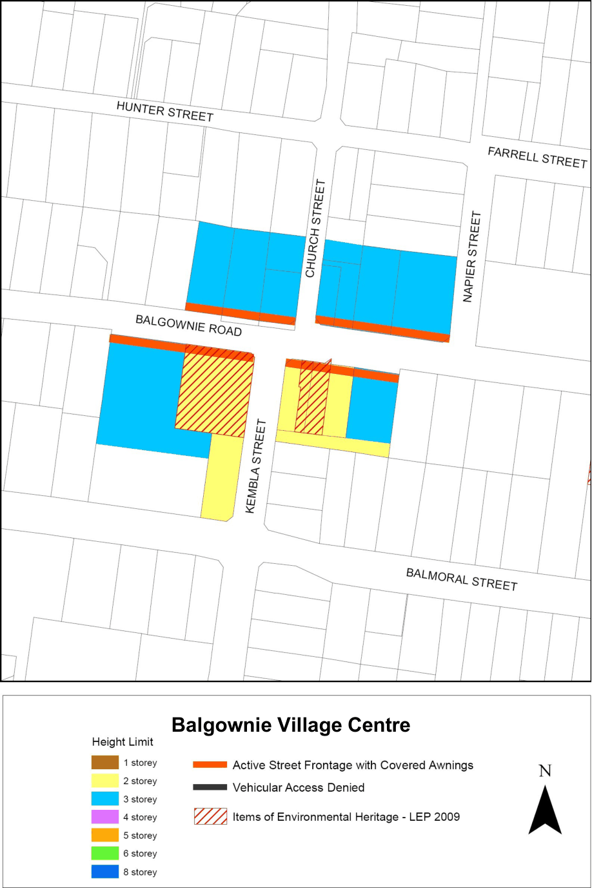

## 9 PLANNING REQUIREMENTS FOR DEVELOPMENT IN THE VILLAGE AND SMALL VILLAGE CENTRES

### 9.1 Stanwell Park Small Village Centre

1\. The Stanwell Park Small Village Centre is situated on Lawrence Hargrave Drive between Station Street and Lower Coast Road.

#### Maximum Building Height

2\. Maximum Building Height (Max. Number of Storeys) – two (2) storeys

#### Front Building Line Setback

3\. The front building line setback requirement for any new building within the Stanwell Park Small Village` Centre shall be 7.5 metres, except for the property known as Lot 17, DP 5275 which may incorporate a zero front setback to both Lawrence Hargrave Drive and Station Street. Additionally, the property known as Lot 22, DP 615441 on the corner of Lawrence Hargrave Drive and Lower Coast Road may incorporate a minimum two (2) metre variable front building line setback to Lawrence Hargrave Drive and a four (4) metre building line setback to the Lower Coast Road.

#### Rear and Side Setbacks

4\. The ground floor and first floor levels of any new building upon the site may have a zero lot line side setback and must have a minimum six (6) metre rear setback.

#### Car parking

5\. The provision of at least two (2) car parking spaces will be required for any retail or commercial office building. This car parking may be provided within the front setback area of the site to Lawrence Hargrave Drive.

6\. The existing car parking area within the Lawrence Hargrave Drive public road reserve (i.e. directly opposite the properties known as Lots 17 – 26, DP 5275 will provide for any additional overflow car parking.

### 9.2 Coledale Small Village Centre

1\. The Coledale Small Village Centre is situated on both sides of Lawrence Hargrave Drive between Cater Street and Northcote Street.

#### Maximum Building Height

2\. Maximum Building Height (Max. Number of Storeys) – two (2) storeys

#### Front Building Line Setback

3\. The ground floor and first floor storey for any new building may incorporate a zero front building line setback to Lawrence Hargrave Drive. For corner sites, a minimum three (3) metre building line setback is required for any secondary street (i.e. Cater Street or Northcote Street).

#### Rear and Side Setbacks

4\. The ground floor and first floor levels of any new building upon the site may have a zero lot line side setback and must have a minimum six (6) metre rear setback.

#### Car parking

5\. The provision of at least two (2) car parking spaces will be required for any new building. Car parking spaces shall be provided at the rear of buildings. Car parking areas for sites on the eastern side Lawrence Hargrave Drive shall be serviced via Lane 37 between Cater Street and Northcote Street. Car parking for properties on the western side of Lawrence Hargrave Drive shall be serviced via the two laneways (Lane 39 and Lane 41) between Cater Street and Northcote Street.

### 9.3 Austinmer Small Village Centre

#### Maximum Building Height

1\. Maximum Building Height (Max. Number of Storeys) – two (2) storeys

#### Front Building Line Setback Requirement

2\. The ground floor and first floor storey for any new building may incorporate a zero front building line setback to Lawrence Hargrave Drive. The third storey of any building shall be setback at least five (5) metres from the front building line.

#### Rear and Side Setbacks

3\. The ground floor and first floor levels of any new building must have a zero side setback and a minimum six (6) metre rear setback.

#### Car Parking

4\. Developments shall make provision for car parking at the rear of each site or in sub-basements. Vehicular access shall be provided from The Grove either directly or via a right of carriageway established along the rear of sites. Where this is not physically possible access may be permitted from Lawrence Hargrave Drive.

### 9.4 East Woonona Village Centre

#### Maximum Building Height

1\. Maximum Building Height (Max. Number of Storeys) – two (2) storeys

### 9.5 Bellambi Small Village Centres

#### Maximum Building Height

1\. Maximum Building Height (Max. Number of Storeys) – two (2) storeys

### 9.6 East Corrimal Village Centre

#### Maximum Building Height

1\. Maximum Building Height (Max. Number of Storeys) – two (2) storeys

### 9.7 Former Corrimal Coke Works Small Village Centre

The controls for the non-residential development at the Former Corrimal Coke Works are included in D19: Former Corrimal Coke Works.

### 9.8 Towradgi Village Centre

#### Maximum Building Height

1\. Maximum Building Height (Max. Number of Storeys) – two (2) storeys

### 9.9 Tarrawanna Small Village Centre

#### Maximum Building Height

1\. Maximum Building Height (Max. Number of Storeys) – two (2) storeys

### 9.10 Gwynneville Village Centre

#### Maximum Building Height

1\. Maximum Building Height (Max. Number of Storeys) – two (2) storeys

#### Car Parking

2\. Developments shall make provision for car parking at the rear of each site.

### 9.11 Balgownie Village

#### 9.11.1 General

1\. The Balgownie Village Centre is located on Balgownie Road bounded by Napier Street, Kembla Street and Foothills Road.

2\. Balgownie Village Centre which provides for a limited range of retail goods and services to the surrounding residential suburb of Balgownie. The trade area of Balgownie covers a radius of approximately one kilometre from the centre.

3\. Retail or business (non-retail) development will only be permitted within the existing Balgownie Centre.

4\. Any new retail or business building must reinforce the identity and local character of the Balgownie Centre.

5\. Preference to providing fresh produce shops and / or a small supermarket, in order to provide for the weekly fresh produce needs of the surrounding residential community.

#### Maximum Building Height

7\. Maximum Building Height (Max. Number of Storeys) – three (3) storeys*

\* The maximum building height for any new development within the Balgownie Town centre shall be generally three (3) storeys. However, the Balgownie Hotel at 141 -143 Balgownie Road and the retail shop building at 135 Balgownie Road are both classified as items of environmental heritage. The Balgownie Hotel is two (2) storeys in height whereas the retail shop building at 135 Balgownie Road is single storey in height. Therefore, any new building upon the properties known as 131, 137 and 139 Balgownie Road shall be restricted to a maximum two (2) storey height limit. Additionally, the property known as Lot 2, DP 742682, 1 Balmoral Street (i.e. directly behind the Balgownie Hotel) shall also be limited to a two (2) storey height limit.

#### Front Building Line Setback

8\. The ground and first floor levels of any new building may incorporate a zero front building line setback. The third storey of any new building shall be setback at least five (5) metres from the front building line.

#### Side and Rear Setbacks

9\. Buildings may have a zero lot line side setback and must have a minimum six (6) metre rear setback.

#### Car Parking and Delivery Truck Loading Area

10\. Development in the northern part of Balgownie Village Centre shall make provision for car parking at the rear of sites with access arrangements preferably off either Church Street or Napier Street.

11\. Development in the southern part of Balgownie Village Centre involving the properties known as 125 – 139 Balgownie Road shall make provision for car parking at the rear of sites. The creation of reciprocal rights of carriageway will be required over the five (5) adjoining sites in the event of any new development or major alterations and additions to existing buildings, in order to guarantee rear lane access to rear car parking areas from Kembla Street.

> [Picture on page 53: a picture, saved as a picture (images/chapter-b4-development-in-centres-and-peripheral-sales-preci-page-53-1.gif, 150 dpi).]

### Balgownie Village Centre

### 9.12 Keiraville Village Centre

#### Maximum Building Height

1\. Maximum Building Height (Max. Number of Storeys) – two (2) storeys

### 9.13 Cordeaux Heights Village Centre

#### Maximum Floor Space Ratio (FSR) and Maximum Building Height

1\. Maximum FSR - 0.5:1

2\. Maximum Building Height (Max. Number of Storeys) – two (2) storeys

### 9.14 Farmborough Heights Small Village Centre

#### Maximum Building Height

1\. Maximum Building Height (Max. Number of Storeys) – two (2) storeys

#### Car Parking

2\. Re-development of this centre site shall make provision for car parking at the rear of buildings.

### 9.15 Koonawarra Small Village Centre

#### Maximum Building Height

1\. Maximum Building Height (Max. Number of Storeys) – two (2) storeys

#### Front Building Line Setback

2\. The ground and first floor levels of any new building upon Lot 157, DP 239048 may incorporate a zero front building line setback to Fowlers Road and Koonawarra Place.

#### Rear and Side Setbacks

3\. The ground floor and first floor levels of any new building upon the site may incorporate a zero lot line side setback.

4\. A minimum 5.5 metre rear building line setback is required, in order to enable the provision for rear garages for any residential units in the building.

#### Car Parking and Delivery Truck Loading Zone Requirement

5\. The existing car parking areas within the Koonawarra Place public road reserve (i.e. fronting the southern and eastern part of the site) shall be retained for car parking. Any redevelopment of the site shall make provision for a suitable truck loading / unloading area at the rear of the site, to cater for a large rigid truck.

### 9.16 Kanahooka Small Village Centre

#### Maximum Building Height

1\. Maximum Building Height (Max. Number of Storeys) – two (2) storeys

#### Front Building Line Setback

2\. Any new retail building or mixed use building within the Kanahooka Small Village Centre shall be setback a minimum 9 metres from the front property boundary. The front setback area (i.e. between the front property and the building alignment) may be used for car parking and a delivery truck loading area.

#### Rear and Side Setbacks

3\. The ground floor and first floor levels of any new building may incorporate zero lot line rear and side setbacks, subject to full compliance with the requirements of the Building Code of Australia.

4\. The sill height of any rear or side facing windows on any first floor storey of a building must be a minimum 1.5 metre height above the floor level, in order to prevent any direct overlooking impacts upon the rear private courtyard areas of the abutting residential properties in Lakeside Drive and Palmer Avenue.

#### Car Parking and Delivery Truck Loading Zone Requirements

5\. The front car parking areas for the properties known as Lots 704 -706, DP 518125, Lakeside Drive, Kanahooka shall remain linked to ensure that the existing separate ingress and egress access arrangement from the car parking areas of the centre are maintained. If development consent is ultimately granted for any new building on each of the subject lots, a condition of consent is likely to be imposed requiring the creation of reciprocal rights of carriageway over each subject lot, in order to guarantee vehicular access between the adjoining properties in the Kanahooka retail centre and to guarantee that existing separate ingress and egress arrangement are maintained in the future.

6\. Additionally, the provision of a delivery truck loading / unloading zone to cater for a small rigid truck will be required for any redevelopment of the sites within the Kanahooka village centre.

### 9.17 Brownsville Small Village Centre

#### Maximum Building Height

1\. Maximum Building Height (Max. Number of Storeys) – two (2) storeys

#### Front Building Line Setback

2\. The front building line setback (off Brownsville Avenue) for any new building shall be 7.5 metres.

#### Rear and Side Setbacks

3\. The minimum side and rear setback for any new building is four (4) metres. The southern side setback shall also take into account the right-of-carriageway shown on Deposited Plan 560853.

#### Vehicular Access

4\. The car parking area shall be serviced by a separate vehicular entry point at the northern part of the site and a separate vehicular exit point at the southern end of the site.

### 9.18 Horsley Small Village Centre

1\.   The precinct planning controls for the Horsley village centre will be included in a future update to the DCP.

### 9.19 Coniston Small Village Centre

#### Maximum Building Height

1\. Maximum Building Height (Max. Number of Storeys) – two (2) storeys

#### Front Building Line Setback

2\. A zero front building line setback is permitted.

#### Rear and Side Setbacks

3\. A zero side boundary setback is permitted except for properties that directly abut residential properties in which case a three (3) metre minimum side setback is required.

4\. A minimum 6 metre rear building line setback is required.

#### Car Parking, Vehicular Access and Delivery Truck Loading Zone Requirements

5\. Car parking shall be provided at the rear of properties with vehicular access primarily provided via Bridge Street, wherever possible.

6\. Additionally, the public car parking spaces on the eastern side of Gladstone Avenue may cater for car parking overflow.

### 9.20 Cringila Village Centre

#### Maximum Building Height

1\. Maximum Building Height (Max. Number of Storeys) – three (3) storeys

#### Front Building Line Setback

2\. A zero front building line setback is permitted.

#### Rear and Side Setbacks

3\. A zero side boundary setback is permitted except for properties that directly abut residential properties in which case a three (3) metre minimum side setback is required.

4\. A minimum six (6) metre rear building line setback is required.

#### Car Parking and Delivery Truck Loading Zone Requirements

5\. In order to create a consistent uniform building edge to Lake Avenue and protect pedestrian safety, car parking areas shall be located at the rear of properties and vehicular access crossings to Lake Avenue are to be avoided wherever practicable. Vehicular access is not permitted directly from Lake Avenue where alternate access is available from a side street (such as Merritt Avenue, Birmingham Street and Bethlehem Street). This will require the creation of reciprocal rights of carriageway pursuant to section 88B of the Conveyancing Act 1919 in order to facilitate legal access from side streets to allotments within the middle of street blocks.

### 9.21 Primbee Small Village Centre

#### Maximum Building Height

1\. Maximum Building Height (Max. Number of Storeys) – two (2) storeys

#### Front Building Line Setback

2\. A zero front building line setback is permitted.

#### Rear and Side Setbacks

3\. A zero side boundary setback is permitted except for properties that directly abut residential properties in which case a three (3) metre minimum side setback is required.

4\. A minimum six (6) metre rear building line setback is required.

### 9.22 Windang Village Centre

#### 9.22.1 General

1\. The Windang Village Centre is located on the eastern side of Windang Road generally between Boronia Avenue and the bridge to Lake Illawarra. This centre includes a small supermarket and a number of specialty retail shops including take away food shops, retail liquor outlet and a bait and tackle shop.

2\. Additionally, a small number of specialty retail shops exist on the western side of Windang Road, including a newsagent, take away shop, retail bait and tackle shop and a hairdresser shop.

3\. The trade area of Windang is generally restricted to the residential community of the Windang peninsula, including residents and tourists within the two caravan parks along the peninsula.

4\. Any new retail development (including any neighbourhood shop) shall be restricted to land within the business zone and should provide goods which provide for the daily or weekly convenience needs of the surrounding resident population and tourists.

#### Maximum Building Height

5\. Maximum Building Height (Max. Number of Storeys) – two (2) storeys

#### Front Building Line Setback

6\. The ground and first floor levels of any new building shall incorporate a zero front building line setback. The third storey of any new building shall be setback at least five (5) metres from the front building line.

#### Rear and Side Setbacks

7\. Buildings may have a zero lot line side setback and must have a minimum six (6) metre rear setback.

#### Vehicular Access

8\. The properties on the eastern side of Windang Road legally described as, 231 Windang Road (Lot 301, 772080) and 235 Windang Road (Lot 1, DP 1125633) shall retain legal access to the rear car parking areas via the battle-axe handle off Acacia Street which is permitted by a right of carriageway burdening 231 Windang Road in favour of 235 Windang Road. No alternate access is permitted to these properties or their associated car parking areas from Kurrajong Street.

9\. Additionally, the property on the eastern side of Windang Road known as Lots 1 – 5, SP 46024 (Lot 101, DP 599558), 239 Kurrajong Street shall retain the car parking at the rear of the site with access via the battle-axe handle off Kurrajong Street. Alternate access via Acacia Street may be permitted where appropriate legal arrangements are made.
