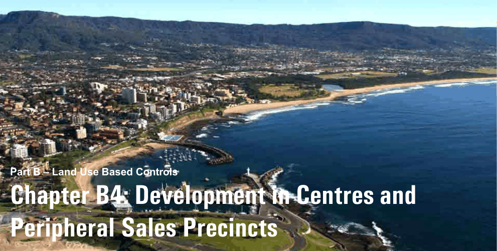

# Wollongong Development Control Plan 2009 - Chapter B4 Development in Centres and Peripheral Sales Precincts

> This chapter is split into 19 section file(s), one per numbered heading, in the order they appear in the PDF.

Source PDF: [WDCP-Chapter-B4-Development-in-Centres-and-Peripheral-Sales-Precincts.pdf](https://planfortomorrow.sharepoint.com/sites/Planfortomorrow/Shared%20Documents/00%20NSW-Planning-Resources/dcp/wollongong-development-control-plan-2009/chapter-b4-development-in-centres-and-peripheral-sales-precin/WDCP-Chapter-B4-Development-in-Centres-and-Peripheral-Sales-Precincts.pdf)

> [Picture on page 1: a picture, saved as a picture (images/chapter-b4-development-in-centres-and-peripheral-sales-preci-page-1-1.gif, 150 dpi).]

#### Part B – Land Use Based Controls

Chapter B4: Development in Centres and

### Peripheral Sales Precincts

| Contents |  | 9 | PLANNING REQUIREMENTS FOR DEVELOPMENT IN THE VILLAGE AND SMALL VILLAGE CENTRES ................. 49 |
|---|---|---|---|
| 1 | INTRODUCTION ............................................................... 3 | 9.1 | Stanwell Park Small Village Centre .................................. 49 |
| 2 | OBJECTIVES .................................................................... 3 | 9.2 | Coledale Small Village Centre ........................................... 49 |
| 3 | DEFINITIONS ................................................................... 4 | 9.3 9.4 | Austinmer Small Village Centre ........................................ 50 East Woonona Village Centre ........................................... 50 |
| 4 | CENTRES HIERARCHY..................................................... 4 | 9.5 | Bellambi Small Village Centres ......................................... 50 |
| 4.1 | Objectives .......................................................................... 4 | 9.6 | East Corrimal Village Centre ............................................ 50 |
| 4.2 | Development Controls ........................................................ 5 | 9.7 | Former Corrimal Coke Works Small Village Centre ............ 50 |
| 5 | ECONOMIC IMPACT ASSESSMENT ............................ 13 | 9.8 | Towradgi Village Centre .................................................. 51 |
| 5.1 | Development Controls ......................................................13 | 9.9 9.10 | Tarrawanna Small Village Centre ..................................... 51 Gwynneville Village Centre............................................... 51 |
| 6 | PLANNING REQUIREMENTS FOR DEVELOPMENT IN THE REGIONAL CITY AND MAJOR REGIONAL CENTRES ...................................................................... 15 | 9.11 9.12 | Balgownie Village ............................................................ 51 Keiraville Village Centre ................................................... 54 |
| 6.1 | Wollongong City Centre ....................................................15 | 9.13 | Cordeaux Heights Village Centre ...................................... 54 |
| 6.2 | Warrawong Major Regional Centre ...................................15 | 9.14 | Farmborough Heights Small Village Centre ....................... 54 |
| 6.3 | Dapto Major Regional Centre ............................................20 | 9.15 9.16 | Koonawarra Small Village Centre ..................................... 54 Kanahooka Small Village Centre ...................................... 54 |
| 7 | PLANNING REQUIREMENTS FOR DEVELOPMENT IN THE MAJOR TOWN CENTRES .................................... 20 | 9.17 | Brownsville Small Village Centre ...................................... 55 |
| 7.1 7.2 7.3 | Corrimal Major Town Centre ............................................20 Fairy Meadow Major Town Centre ...................................27 Figtree Major Town Centre ...............................................30 | 9.18 9.19 9.20 9.21 | Horsley Small Village Centre ............................................ 55 Coniston Small Village Centre .......................................... 56 Cringila Village Centre ...................................................... 56 Primbee Small Village Centre ........................................... 56 |
| 8 | PLANNING REQUIREMENTS FOR DEVELOPMENT IN THE TOWN CENTRES .................................................. 32 | 9.22 | Windang Village Centre .................................................... 57 |
| 8.1 8.2 | Helensburgh Town Centre ................................................32 Thirroul Town Centre .......................................................35 | 10 | GENERAL DESIGN REQUIREMENTS FOR RETAIL AND BUSINESS PREMISES DEVELOPMENTS ................... 58 |
| 8.3 | Bulli Town Centre ............................................................35 | 10.1 | Objectives ....................................................................... 58 |
| 8.4 | Woonona Town Centre .....................................................37 | 10.2 | Development Controls ...................................................... 58 |
| 8.5 | Port Kembla Town Centre ................................................41 | 11 | GENERAL DESIGN REQUIREMENTS FOR RETAIL SHOPPING |
| 8.6 | Unanderra Town Centre ...................................................43 |  | CENTRES ....................................................................... 65 |
| 8.7 | Berkeley Town Centre ......................................................47 | 11.1 11.2 | Objectives ....................................................................... 65 Development Controls...................................................... 65 |

#### 13.7 Access Arrangements on Arterial and Sub-Arterial Roads . 74

<!-- sections -->
## Sections

1. [12 GENERAL BUILDING DESIGN REQUIREMENTS FOR](01-12-general-building-design-requirements-for.md)
2. [1 INTRODUCTION](02-1-introduction.md)
3. [2 OBJECTIVES](03-2-objectives.md)
4. [3 DEFINITIONS](04-3-definitions.md)
5. [4 CENTRES HIERARCHY](05-4-centres-hierarchy.md)
6. [5 ECONOMIC IMPACT ASSESSMENT](06-5-economic-impact-assessment.md)
7. [6 PLANNING REQUIREMENTS FOR DEVELOPMENT IN THE REGIONAL CITY AND MAJOR REGIONAL CENTRES](07-6-planning-requirements-for-development-in.md)
8. [7 PLANNING REQUIREMENTS FOR DEVELOPMENT IN THE MAJOR TOWN CENTRES](08-7-planning-requirements-for-development-in.md)
9. [8 PLANNING REQUIREMENTS FOR DEVELOPMENT IN THE TOWN CENTRES](09-8-planning-requirements-for-development-in.md)
10. [9 PLANNING REQUIREMENTS FOR DEVELOPMENT IN THE VILLAGE AND SMALL VILLAGE CENTRES](10-9-planning-requirements-for-development-in.md)
11. [10 GENERAL DESIGN REQUIREMENTS FOR RETAIL AND BUSINESS PREMISES DEVELOPMENTS](11-10-general-design-requirements-for-retail.md)
12. [11 GENERAL DESIGN REQUIREMENTS FOR RETAIL SHOPPING](12-11-general-design-requirements-for-retail.md)
13. [12 GENERAL BUILDING DESIGN REQUIREMENTS FOR FAST FOOD](13-12-general-building-design-requirements-for.md)
14. [13 PERIPHERAL SALES (BULKY GOODS) PRECINCTS](14-13-peripheral-sales-bulky-goods-precincts.md)
15. [1 General](15-1-general.md)
16. [2 Development Controls](16-2-development-controls.md)
17. [1 General](17-1-general.md)
18. [1 General](18-1-general.md)
19. [14 WORKS IN THE PUBLIC DOMAIN](19-14-works-in-the-public-domain.md)
