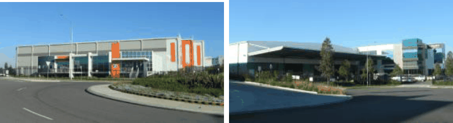
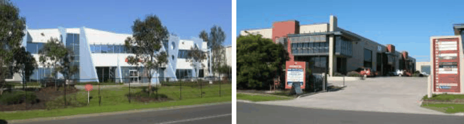
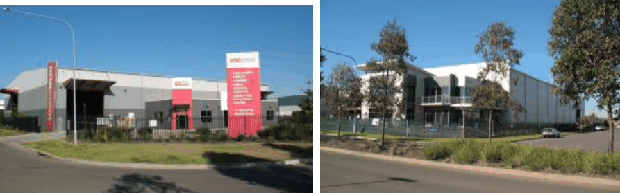

## 4 BUILDING DESIGN / FAÇADE TREATMENT

#### 4.1.1 Objectives

(a) To achieve a high standard of industrial development by promoting visually attractive buildings and through the use of high quality external finishes.

(b) To encourage a range of architectural design elements and innovative roof forms for industrial buildings, in order to improve the visual interest and attractiveness of such buildings.

(c) To promote functional, safe and environmentally friendly industrial development.

#### 4.1.2 Development Controls

1\. The external front façade of all buildings fronting public roads shall be of a high quality glass, decorative finished concrete or face brick construction. This external façade treatment shall incorporate a minimum 6 metre return around the sides of the building. Alternatively, colorbond wall materials may be used for up 50% of the total front façade of the building with the remaining 50% of the façade being of a glass, decorative finished concrete or face brick construction.

2\. The maximum reflectivity of any glazing shall not exceed 20%, in order to minimise any potential glare impacts.

3\. The submission of a schedule of proposed external building materials and finishes is required with the Development Application.

4\. Large unrelieved expanses of walls or building mass are required to be broken up through building articulation, vertical and horizontal modulation and / or alternative architectural enhancements, in order to provide visual interest to the building.

5\. Other architectural elements or treatments may include (but are not limited to) the following:

(a) Varied building materials and external finishes on the building façade;

(b) Roof forms and parapets to create an interesting skyline;

(c) Vertical fin walls;

(d) Sun shading devices; and

(e) Public art works on the building and in front of the building.

6\. Any proposed building on a dual road frontage lot will be required to be designed to incorporate varied architectural features for both road frontages with the building being orientated towards the major road frontage.

7\. Buildings located on corner allotments shall be designed to address both street frontages in terms of façade treatment and articulation of the building and the roofline form. Any building on a corner lot must incorporate architectural corner features to add visual interest to the building.

8\. Where blank walls on street frontages are unavoidable for new buildings, the building shall feature decorative wall elements and / or vertical fin elements to provide visual interest.

9\. The placement of roller shutters, loading docks and other building openings shall wherever possible be provided at the rear or side of the building.

10\. Showroom display areas, ancillary offices and other low – scale elements should be, wherever practicable, located at the front of the building and constructed of glass, decorative finished concrete or face brick materials.

11\. The main entry to the building shall be easily identifiable from the road and directly accessible from the front of the building or driveway in the case of a multi-unit complex.

12\. Large floor plate buildings must provide an open face to the public domain, especially at road level.

13\. Buildings should incorporative decorative roof elements and avoid bulky roof forms.

14\. Roofing materials should be constructed of low reflective materials and / or finishes wherever possible.

15\. All roofing shall be provided with adequate guttering and downpipes which discharge to an open grated surface inlet pit for subsequent discharge to Council’s stormwater drainage system or as parted of a Water Sensitive Urban Design solution.

16\. All rooftop or exposed structures including plant rooms, air conditioning, ventilation and exhaust systems are to be suitably screened and integrated with the building in order to guarantee an integrated appearance.

17\. All building construction shall comply with the requirements of the Building Code of Australia and in particular, fire egress and fire safety requirements.

18\. Natural lighting must be incorporated into the design for large-scale factory or warehouse distribution buildings.

> [Picture on page 6: a picture, saved as a picture (images/chapter-b5-industrial-development-page-6-23.gif, 150 dpi).]

Figure 1: (Top Left: Warehouse distribution building with varied architectural elements, varied external finishes and ancillary offices located on the front façade of the building)

Figure 2: (Top Right: Factory / Warehouse distribution building with ancillary offices to the side of the building, providing strong vertical modulation and visual interest to the building)

> [Picture on page 7: a picture, saved as a picture (images/chapter-b5-industrial-development-page-7-1.gif, 150 dpi).]

Figure 3: (Top Left: Two storey ancillary offices with strong vertical fin wall projections in front of a factory / warehouse building)

Figure 4: Top Right: Two storey ancillary offices on the front façade of a warehouse distribution building and vertical architectural elements along the building)

> [Picture on page 7: a picture, saved as a picture (images/chapter-b5-industrial-development-page-7-6.gif, 150 dpi).]

Figure 5: (Top Left: Factory / warehouse distribution building with horizontal colour banding on the building elevations with advertising signage matching the key vertical front façade element)

Figure 6: (Top Right: Warehouse distribution building with two-storey ancillary offices on the front facade)
