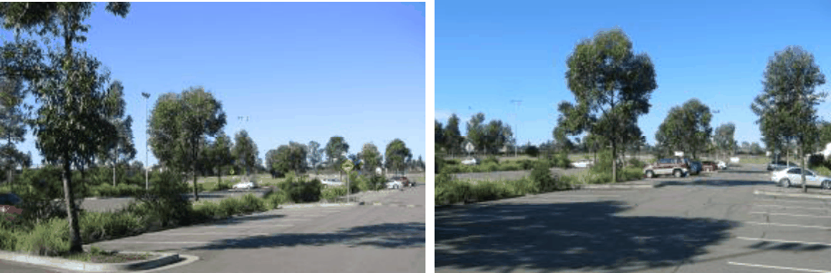

## 7 CARPARKING REQUIREMENTS

### 7.1 Objectives

(a) To ensure adequate provision is made for on-site car parking for employee’s and visitor’s vehicles.

(b) To encourage the provision of car parking areas that are integrated with the form and arrangement of buildings on-site.

(c) To provide disabled car parking in accordance with the Access part of this DCP and the relevant Australian Standard.

(d) To ensure car parking areas are attractive by requiring landscaping of all car parking areas.

(e) To ensure opportunities for cycling to work are provided by encouraging the provision of bicycle parking areas and associated facilities within industrial developments.

(f) To ensure car parking areas are integrated with the landscape design of the development site, in order to screen the car parking from the public road frontage as much as possible.

### 7.2 Development Controls

1\. Car parking is to be provided in accordance with the requirements of the Car Parking, Access, Servicing / Loading Facilities and Traffic Management chapter in Part E of this DCP.

2\. All car parking required by Council shall be provided 100% on-site.

3\. The use of stacked car parking spaces is generally not permitted, except where the development is for a purpose built facility and the proponent can provide appropriate evidence that any stacked car parking spaces will be used only by employees and that appropriate documentary evidence is provided which outlines the management procedures that will be put in place by the specific organisation to guarantee the effective use of any stacked parking arrangement.

4\. All developments shall provide a minimum of one (1) disabled car parking space which is clearly marked and located in close proximity to the main entrance to the building. For developments involving 50 or more car parking spaces, at least 2% or part thereof of these spaces shall be dedicated as disabled car parking spaces and located in close proximity to the main entrance to the building.

5\. All car parking areas including access roadways shall be constructed of hard-standing, all weather-material with parking bays and manoeuvring areas clearly line marked.

6\. The provision of bicycles is required in accordance with requirements of the Car Parking, Access, Servicing / Loading Facilities and Traffic Management chapter in Part E of this DCP and should be designed to encourage increased use of bicycles as a means of transportation to the workplace. The provision of bicycle storage facilities and showering / change rooms for staff is required to be shown on the architectural plans submitted with the Development Application.

> [Picture on page 10: a picture, saved as a picture (images/chapter-b5-industrial-development-page-10-1.gif, 150 dpi).]

Figure 7: Landscaping within car park providing shading for vehicles and visual relief of car parking areas.
