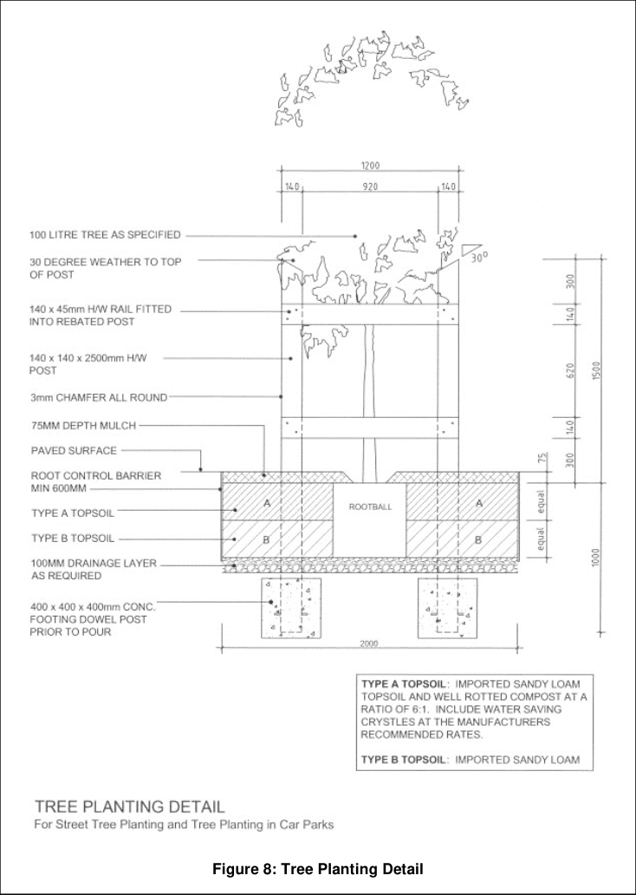

## 9 LANDSCAPING REQUIREMENTS

### 9.1 Objectives

(a) To use landscaping to improve the appearance of industrial developments.

(b) To ensure that landscaping is provided to enhance the streetscape environment and amenity of industrial areas.

(c) To screen unsightly land uses and outdoor storage areas.

### 9.2 Development Controls

1\. Landscaping is required to be integrated with the overall development and should be used to improve the streetscape appearance of industrial development and associated car parking and loading areas.

2\. A minimum 10% of the site area is required to be landscaped. The majority of such landscaping should be provided within the front property building line setback area and the side property boundaries.

3\. Where an existing site has less than 10% landscaping for the total site area, Council will seek to achieve the provision of 10% landscaping on any unused portion of the land or within surplus car parking areas.

4\. The provision of dense landscaping within the front property boundary to public roads is required in order to visually soften the bulk of large developments when viewed from the public road.

5\. A minimum 5 metre set back from the front boundary is to be provided for landscaping along the full length of the property with frontage to an arterial or sub- arterial road. A 3 metre minimum deep dense landscaped area is required along the full length of the property frontage to a collector or local road.  This area is to be a mulched planted area and must include trees planted at a minimum rate of one tree per 25m².

6\. Trees are to be planted at a rate of 1 tree per 10 car spaces. Tree species shall be selected top provide at least a 4 - 6 metre canopy spread at maturity. A minimum 1.5 metre wide landscape strip is required to be provided after every fifth parking space. Trees shall be a minimum 100 Litre size and shall be planted in minimum two (2) cubic metres of planting medium. Trees are to be protected by the use of such devices as bollards, kerbs and/or tree guards.

7\. No structures, basement car parks, driveways, hard paving, are permitted within the landscaped setbacks.

8\. Car parking areas which adjoin public roads or adjoining non – industrial land uses are to be visually screened by dense landscaping.

9\. The planting of low shrubs to a maximum mature height of 1 metre is recommended along any pedestrian footpath area, in order to provide adequate pedestrian safety, particularly at night-time.

10\. Parking and circulation areas are to be delineated by planter beds at the ends of parking bays.

11\. Planter beds shall be a minimum width of 1.5 metres and shall be contained by a 150mm concrete kerb.

12\. All car parking spaces shall contain concrete wheel stops.

13\. Retaining wall heights are to be generally restricted up to a maximum height of 2.5m. Where walls exceed 2.5metres, the wall is to be terraced with a minimum 1.5m mulched planted area, which is to be planted with tall shrubs to provide adequate visual screening.

14\. Pedestrian and vehicular movement is to be clearly separated by use of design devices such as change in paving, kerb, bollards, line marking. Pedestrian paths are to be minimum 1.5 metres in width.

15\. Fencing forward of the front building alignment to be palisade type maximum height 1.8m. Gates where possible are to be sliding type gates, to prevent conflicts with access to and within the site.

16\. An external shaded seating area for meal breaks is to be provided.

17\. Contrasting paving is required at driveway thresholds. Large expanses of car parking are to be broken up by the use of contrasting paving.

18\. Fire hydrants, electricity substations, sprinkler tanks and / or waste collection and storage facilities must not be located within the front landscaped area.

19\. A fully automatic irrigation system is required in all car park planter beds. Tree root barriers should be installed around the edge of planter beds to reduce future maintenance.

#### 9.2.1 Landscape Plan

1\. The submission of a scaled and dimensioned Landscape Plan is required for all applications. This Landscape Plan must be prepared by a Landscape Architect or Designer with appropriate qualifications.  A Landscape Architect is a person eligible for corporate membership of the Australian Institute of Landscape Architects.  A Landscape Designer must be eligible for membership of the Australian Institute of Landscape Design and Management.  The Landscape Plan, which is to be scaled at 1:100 or 1:200 must indicate:

(a) Existing site information, north point, site boundaries, dimensions, trees and vegetation, including trees on neighbouring properties that will be effected by the development.

(b) Proposed buildings/structures, underground/overhead services, easements, right-of-ways, roadways, car parks, footpaths.

(c) Location of external building structures i.e. Retaining walls including levels on the top and bottom of the walls, fences, materials, heights and finishes.

(d) Basic design levels to AHD of both hard and soft landscape areas including existing and proposed contours, spot heights, areas of cut and fill and finished levels.

(e) Proposed surface treatment of all landscape areas (eg paving, driveways, mulched planted areas, edging, turf, water).

(f) Each plant identified and catalogued in a plant schedule describing mature height and spread, quantity, proposed container size and staking.  The plant schedule should be divided into trees, shrubs and ground covers.

(g) Construction or detail drawings, sections and elevations for outdoor structures, garden beds and planting, paving, edging, tree protection and retaining walls.

(h) Design details for special situations e.g. erosion, creek bank stabilisation.

(i) Location and details of lighting.

(j) Location of proposed drainage (both surface and sub-surface).  The landscape and drainage plans must be compatible.

(k) Specification notes for soil preparation, plant material, tree protection etc.

(l) Details of minimum 12 months maintenance schedule.

(m) Provide taps or an irrigation system to ensure that all landscape works are adequately watered, the location of which is to be included on the landscape plan.

(n) Design measures to minimise crime risk including but not limited to: provision of external lighting to pathways, driveways and outdoor areas; shrubs higher than 1m to be setback from the edge of pathways; types of trees that have sufficiently high canopy when fully grown so that pedestrian vision is not impeded.

#### 9.2.2 Arborist Report

1\. An Arborist Report is required in relation to any significant tree on the subject site (other than an exempt tree) and trees on neighbouring properties that will be affected by the development, if it is 3 metres or more in height, or has a trunk diameter of 200mm or more at a height of 1 metre from the ground, or has a branch spread of 3 metres or more.

2\. The Arborist Report is to be prepared by a qualified Arborist, which is a person who is eligible for membership as a ‘Consulting Arborist’ with the National Arborist Association of Australia or the Institute of Australian Consulting Arboriculturists, and who has attained a Level 5 Certificate of Horticulture / Arboriculture or equivalent.  The report must identify trees on the site survey plan by number and provide details of the following:

(a) Genus and species of each tree;

(b) Health, amenity value and S.U.L.E. (Safe Useful Life Expectancy) rating of each tree;

(c) Impact of the development on each tree;

(d) Impact of retaining trees on the proposed development;

(e) The Tree Protection Zone (TPZ) required for each tree proposed to be retained;

(f) Any root barriers necessary, type and their location; and

(g) Any branch or root pruning which may be required for the trees.

3\. The following table, from British Standard BS5837 (1991), is provided as a guide to developers of suitable development setbacks from existing trees.

Table 3: Protection of trees: minimum distances for protective fencing around trees

| Tree age | Tree vigour | Trunk dia. Mm | Min. distance m |
|---|---|---|---|
| Young | Normal | <200 | 2.0 |
| (age less than 1/3 life |  | 200 to 400 | 3.0 |
| expectancy) |  | >400 | 4.0 |
| Young | Low | <20 200 to 400 >400 | 3.0 4.5 6.0 |
| Middle age | Normal | <250 | 3.0 |
| (1/3 to 2/3’s life |  | 250 to 500 | 4.5 |
| expectancy) |  | >500 | 6.0 |
| Middle age | Low | <250 250 to 500 >500 | 5.0 7.5 10.0 |

| Tree age | Tree vigour | Trunk dia. Mm | Min. distance m |
|---|---|---|---|
| Mature | Normal | <350 350 to 750 >750 | 4.0 6.0 8.0 |
| Mature and over | Low | <350 | 6.0 |
| mature |  | 350 to 750 >750 | 9.0 12.0 |

Note 1:  It should be emphasised that this table relates to distances from the centre of tree to protective fencing.  Other considerations, particularly the need to provide adequate space around the tree including allowances for future growth and also working space around the tree will usually indicate that the structure should be further away.

Note 2:  With appropriate precautions, temporary site works can occur within the protected area e.g. for access or scaffolding.

4\. Trees proposed for industrial sites are to be suitable species that fulfil the following criteria: medium sized, hardy, long lived, pollution resistant, drought resistant, not prone to failing or dropping limbs.  In addition trees must be true to type, of good health and vigour, free from pests and disease, free from injury, be self supporting (tree must not be tied to stakes) and meet the NATSPEC  criteria.  Refer to Table 4. for NATSPEC criteria. and Table 5. for the schedule of suitable species for industrial zones.

5\. Site landscaping must be integrated with the stormwater management controls.  In particular, the location and nature of on site stormwater detention basins should not conflict with landscaping areas and objectives.

6\. Existing trees on site and on adjacent properties are to be surveyed and accurately plotted with levels and extent of canopy. This information is to be indicated on the Landscape Plan and clearly show whether the trees are to be retained or removed.  If the proposed development impacts on significant trees an Arborist Report must be submitted that has been completed by a qualified Arborist.

7\. The developer is to provide street trees to street frontages of the development site.  Trees to be minimum container size 100L and must be true to type, of good health and vigour, free from pests and disease, free from injury, be self supporting (tree must not be tied to stakes) and meet the following NATSPEC criteria in Table 4:

#### Table 4: NATSPEC Criteria

|  | Height (m) | Calliper (mm) | Minimum Rootball |
|---|---|---|---|
|  |  | 300mm above ground level | Diameter (mm) |
| Thin Stemmed 100L | 3 | 40 | 500 |

Tree

Thick Stemmed 100L Tree

2.5

50

500

8\. Street trees to be planted in mulched, edged areas minimum dimensions 1.2m x 1.2m, including root control barriers to back of kerb and to foot path alignment, and a robust timber tree guard to protect tree from damage, or as per conditions of consent.

9\. Suitable street trees for industrial areas in the Wollongong Local Government area can be obtained from Chapter E6 Landscaping in the DCP.

> [Picture on page 16: a picture, saved as a picture (images/chapter-b5-industrial-development-page-16-12.gif, 150 dpi).]

Figure 8: Tree Planting Detail

.

10\. Trees must be planted and adequately established (minimum 12 months) to the satisfaction of WCC Manager of City Works.

#### Definitions

Landscape area - Is any part of the site which is not occupied by any building, basement or hard surface such as driveways, parking areas or paved areas.

S.U.L.E.  – Safe Useful Life Expectancy - The S.U.L.E. rating system, based on Barrell 2001, rates existing trees on their safe useful life expectancy, and are determined in view of both the current state of health and age of the tree.

Tree - Is a perennial plant with a self-supporting stem or trunk, when mature, and for the purpose of this DCP means any tree (other than an exempt tree) including the roots of that tree, if it is 3 metres or more in height, or has a trunk diameter of 200mm or more at a height of 1 metre from the ground, or has a branch spread of 3 metres or more.

Tree Protection Zone - The Tree Protection Zone (TPZ) defines the optimal distance from the trunk of a tree that should be maintained free of development and construction activity.
