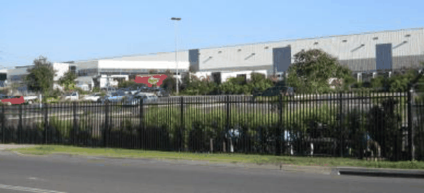

## 13 FENCING

### 13.1 Objectives

(a) To ensure that fencing does not detract from the overall streetscape and visual amenity of the surrounding locality.

(b) To provide appropriate security for the development and any outdoor storage areas.

### 13.2 Development Controls

1\. All fencing in industrial developments shall be constructed of palisade or decorative open style metal type fencing with a maximum 2.4 metre height.

2\. The use of sheet metal fencing or chain wire fencing on the front property boundary is not permitted.

3\. In cases where residential land uses abut the common side or rear property boundary, timber paling, colorbond or decorative masonry fencing may be permitted in order to provide appropriate visual relief to the residential property. A maximum 2.2 metre fence height (ie at any point) will be permitted along the common property boundary between an industrial site and an abutting residential property.

4\. All front entry gates shall be constructed to swing inwards into the site or slide across the frontage, at all times.

5\. Masonry retaining walls along the street frontage shall be restricted to 600mm in height. Palisade or other decorative open metal type fencing may be erected on top of the masonry wall provided the total height of the masonry wall and fence is a maximum 2.4 metres in height.

> [Picture on page 20: a picture, saved as a picture (images/chapter-b5-industrial-development-page-20-13.gif, 150 dpi).]

#### Figure 9: Palisade fencing
