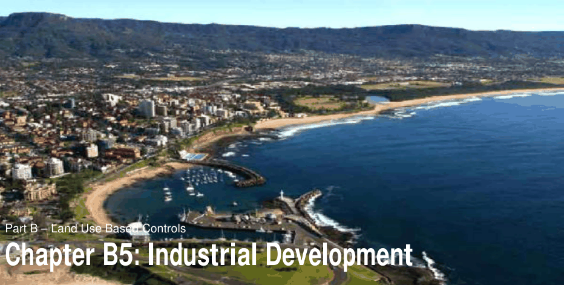

# Wollongong Development Control Plan 2009 - Chapter B5 Industrial Development

> This chapter is split into 30 section file(s), one per numbered heading, in the order they appear in the PDF.

Source PDF: [Wollongong-DCP-2009-Chapter-B05-Industrial-Development.pdf](https://planfortomorrow.sharepoint.com/sites/Planfortomorrow/Shared%20Documents/00%20NSW-Planning-Resources/dcp/wollongong-development-control-plan-2009/chapter-b5-industrial-development/Wollongong-DCP-2009-Chapter-B05-Industrial-Development.pdf)

> [Picture on page 1: a picture, saved as a picture (images/chapter-b5-industrial-development-page-1-1.gif, 150 dpi).]

Part B – Land Use Based Controls

### Chapter B5: Industrial Development

> The PDF's contents list (page numbers of the printed document) is not repeated here - see Sections below.

i

| 20 | ADVERTISING STRUCTURES / SIGNS | 25 |
|---|---|---|
| 20.1 | Development Controls | 25 |
| 21 | STORMWATER DRAINAGE REQUIREMENTS & FLOOD STUDY REQUIREMENTS | 25 |
| 21.1 | Objectives | 25 |
| 21.2 | Development Controls | 25 |
| 22 | RIPARIAN CORRIDOR MANAGEMENT | 26 |
| 22.1 | Development Controls | 26 |
| 23 | UTILITY INFRASTRUCTURE SERVICES | 26 |
| 23.1 | Development Controls | 26 |

| 24 | SUBDIVISION OF INDUSTRIAL LAND 27 |
|---|---|
| 24.1 | Development Controls 27 |
| 25 | ROAD DESIGN & CONSTRUCTION REQUIREMENTS - ROAD TYPES AND CHARACTERISTICS FOR PUBLIC ROADS 28 |
| 25.1 | Road infrastructure construction works 29 |

<!-- sections -->
## Sections

1. [26 RESTRICTED ACCESS TO ARTERIAL OR SUB-](01-26-restricted-access-to-arterial-or-sub.md)
2. [28 STRATA SUBDIVISION OF MULTI-UNIT FACTORY /](02-28-strata-subdivision-of-multi-unit-factory.md)
3. [1 INTRODUCTION](03-1-introduction.md)
4. [2 OBJECTIVES](04-2-objectives.md)
5. [3 FACTORY / WAREHOUSE DISTRIBUTION CENTRE BUILDING DESIGN REQUIREMENTS](05-3-factory-warehouse-distribution-centre.md)
6. [4 BUILDING DESIGN / FAÇADE TREATMENT](06-4-building-design-fa-ade-treatment.md)
7. [5 ENERGY AND WATER EFFICIENCY](07-5-energy-and-water-efficiency.md)
8. [6 SAFETY AND SECURITY](08-6-safety-and-security.md)
9. [7 CARPARKING REQUIREMENTS](09-7-carparking-requirements.md)
10. [8 LOADING DOCK FACILITIES, VEHICULAR ACCESS AND MANOEUVRING REQUIREMENTS](10-8-loading-dock-facilities-vehicular-access.md)
11. [9 LANDSCAPING REQUIREMENTS](11-9-landscaping-requirements.md)
12. [10 OUTDOOR STORAGE AREAS](12-10-outdoor-storage-areas.md)
13. [11 SHIPPING CONTAINER STORAGE FACILITIES](13-11-shipping-container-storage-facilities.md)
14. [12 MOTOR VEHICLE REPAIR WORKSHOPS](14-12-motor-vehicle-repair-workshops.md)
15. [13 FENCING](15-13-fencing.md)
16. [14 USE OF FACTORY / WAREHOUSE UNITS](16-14-use-of-factory-warehouse-units.md)
17. [15 ABRASIVE BLASTING INDUSTRY](17-15-abrasive-blasting-industry.md)
18. [16 INDUSTRIAL DEVELOPMENT ADJOINING A RESIDENTIAL ZONE](18-16-industrial-development-adjoining-a.md)
19. [17 RETAILING IN INDUSTRIAL AREAS](19-17-retailing-in-industrial-areas.md)
20. [18 YALLAH INDUSTRIAL ESTATE](20-18-yallah-industrial-estate.md)
21. [19 JARDINE STREET INDUSTRIAL ESTATE](21-19-jardine-street-industrial-estate.md)
22. [20 ADVERTISING STRUCTURES / SIGNS](22-20-advertising-structures-signs.md)
23. [21 STORMWATER DRAINAGE REQUIREMENTS & FLOOD STUDY REQUIREMENTS](23-21-stormwater-drainage-requirements-and.md)
24. [22 RIPARIAN CORRIDOR MANAGEMENT](24-22-riparian-corridor-management.md)
25. [23 UTILITY INFRASTRUCTURE SERVICES](25-23-utility-infrastructure-services.md)
26. [24 SUBDIVISION OF INDUSTRIAL LAND](26-24-subdivision-of-industrial-land.md)
27. [25 ROAD DESIGN & CONSTRUCTION REQUIREMENTS - ROAD TYPES AND CHARACTERISTICS FOR PUBLIC ROADS](27-25-road-design-and-construction.md)
28. [26 RESTRICTED ACCESS TO ARTERIAL OR SUB-ARTERIAL ROADS](28-26-restricted-access-to-arterial-or-sub.md)
29. [27 STREET LIGHTING](29-27-street-lighting.md)
30. [28 STRATA SUBDIVISION OF MULTI-UNIT FACTORY / WAREHOUSE DISTRIBUTION CENTRE COMPLEXES](30-28-strata-subdivision-of-multi-unit-factory.md)
