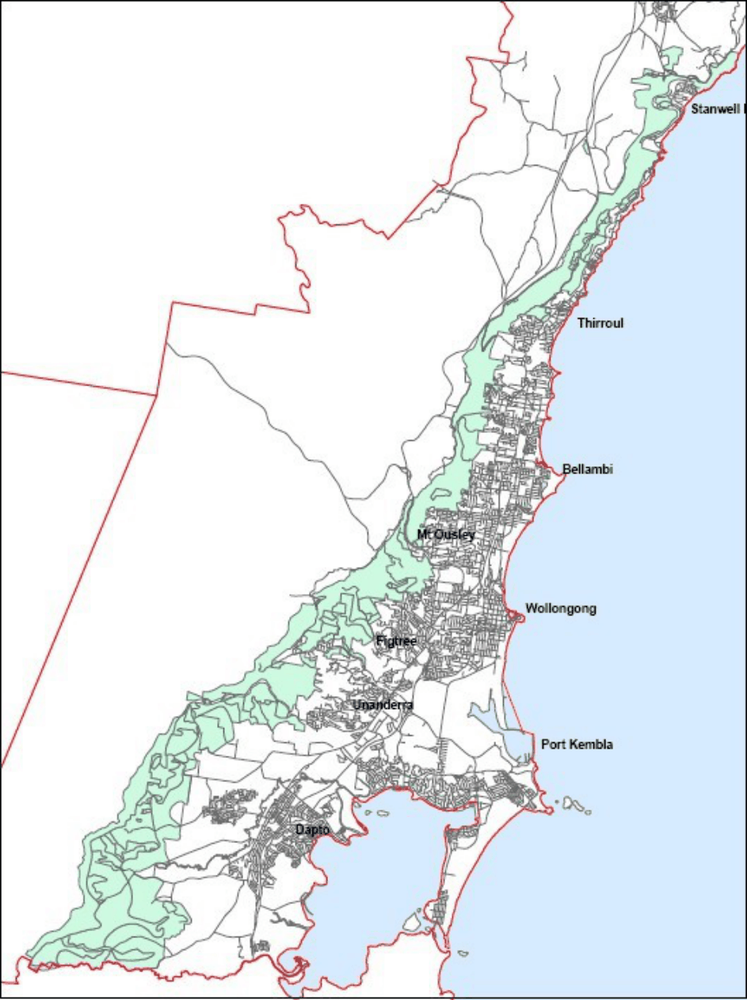

## 2 OBJECTIVES

1\. The key objectives of this part of the DCP are to:

(a) Protect and maintain the visual character and high scenic environmental quality of the Illawarra Escarpment;

(b) Protect and conserve the cultural heritage of the Illawarra Escarpment, including places of Aboriginal cultural heritage significance;

(c) Protect and conserve items of environmental heritage, including former coal mines and villages;

(d) Ensure development is designed to minimise any potential visual impact upon the escarpment, when viewed from key vantage points throughout the LGA;

(e) Ensure development is consistent with the principles of Ecologically Sustainable Development, especially inter-generational equity; bearing in mind the unique environmental characteristics of each specific locality within the escarpment area;

(f) Ensure that development is restricted to legally cleared sites within the escarpment slope and foothill areas only and any such development is well designed to minimise potential bush fire, land instability, flooding and or drainage hazard risks;

(g) Ensure that any new development makes provision for adequate water supplies and an environmentally acceptable wastewater treatment system and stormwater drainage;

(h) Ensure access roads to development are designed to minimise any adverse visual impact on the escarpment and to ameliorate any potential soil erosion or land instability impacts;

(i) Ensure that electricity and telecommunications infrastructure is provided in a cost effective but environmentally sensitive manner; and

(j) Facilitate land owners to enter into Biodiversity Stewardship Agreements to manage land for conservation outcomes and create offset sites to generate biodiversity credits.

_______________________________________________________________________________

#### Figure 1: Illawarra Escarpment in the City of Wollongong Local Government Area

> [Picture on page 4: a picture, saved as a picture (images/chapter-b6-development-in-the-illawarra-escarpment-page-4-2.gif, 150 dpi).]

_______________________________________________________________________________
