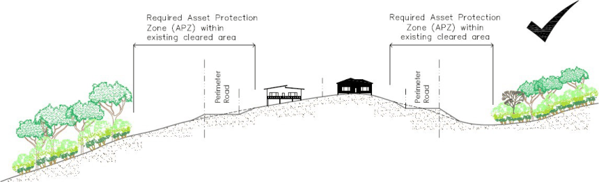

## 10 SUBDIVISION REQUIREMENTS

### 10.1 Site Analysis

#### 10.1.1 Objectives

(a) To ensure site analysis is the first step in the design of any proposed subdivision within the Illawarra Escarpment.

(b) To ensure any proposed subdivision takes into account a range of natural constraints including slope, topographical, landform, bush fire hazard risk, geotechnical constraints and / or any man – made constraints.

(c) To ensure any proposed subdivision retains significant remnant trees or other vegetation, especially foreground screening vegetation and any building envelopes are located below visually dominant ridge lines, in order to maintain the scenic environmental quality of the locality.

(d) To ensure a proposed subdivision is designed to mitigate against any potential adverse impact upon any endangered ecological community or threatened flora or fauna species.

(e) To ensure that subdivision design takes into account any identified Aboriginal archaeological site or culturally significant heritage site.

#### 10.1.2 Development Controls

1\. Site analysis should be the first step in the design of any subdivision.

2\. The site analysis should consider both the natural and human-made constraints. In this respect, the following factors should be taken into consideration as part of the subdivision design:

(a) The slope and orientation of the subject site;

(b) Site constraints such as topography / landform, geotechnical issues, flood prone land, bush fire hazard, acid sulphate soils, threatened flora or fauna species or endangered ecological communities;

(c) Retention of special features such as significant remnant trees or other vegetation, views to / from the site, protection of visually dominant ridge lines, scenic environmental quality of the site and surrounding locality, protection of riparian vegetation;

(d) Archaeological conservation and cultural heritage issues;

(e) Availability of reticulated water and sewerage, electricity supplies and telecommunications;

(f) Provision of suitable stormwater drainage line;

(g) The relationship of the proposed subdivision layout with the existing subdivision pattern and character of the surrounding locality;

(h) Solar access and daylight access for future dwellings in the subdivision; and

(i) Road layout and access arrangements taking into account the surrounding local road network in the locality and the topographical constraints of the site whist minimising any potential visual impact upon the scenic environmental quality of the escarpment.

### 10.2 Minimum Allotment Subdivision Size

#### 10.2.1 Objective

(a) To ensure any proposed subdivision complies with minimum subdivision allotment size requirements under Wollongong Local Environmental Plan 2009.

#### 10.2.2 Development Controls

1\. Any proposed subdivision shall be in accordance with the minimum subdivision allotment size requirement under Wollongong Local Environmental Plan 2009 and the relevant Lot Size Map applying to the subject site.

### 10.3 Subdivision Layout and Building Envelopes

#### 10.3.1 Objectives

(a) To ensure the subdivision layout and associated building envelopes for future dwellings are designed to suit the natural landform and topography of the site.

(b) To ensure building envelopes within subdivisions are located to the rear of any landform bench and behind any foreground screening protection, in order to maintain the high scenic environmental quality of the locality, when viewed from key viewing locations identified within each specific escarpment precinct.

#### 10.3.2 Development Controls

1\. The subdivision layout and associated building envelopes must be designed to suit the natural landform, rather than altering the landform to accommodate the subdivision and any future dwelling and other out buildings.

2\. Any proposed subdivision must be sited below the sight lines from the key viewing locations `within the specific escarpment precinct as identified in Appendix 1. In this respect, building envelopes are to be contained within areas identified as a Development Opportunity Envelope following visual assessment (Refer to Section 5). The building envelope should be located at the rear of any landform bench and behind any foreground screening vegetation, in order to minimise any adverse local or regional visual impacts, when viewed from key viewing locations.

3\. Driveways, roads and drainage works must be designed and sited to have minimum visual impact and minimum impact on the natural landform.

> [Picture on page 10: a picture, saved as a picture (images/chapter-b6-development-in-the-illawarra-escarpment-page-10-35.gif, 150 dpi).]

Figure 2: Subdivision layout with Perimeter Road and Asset Protection Zones (APZ)

4\. Building envelopes must be sited having regard to any existing remnant vegetation, landscape features, topographical and slope constraints.

5\. The proposed building envelope shall be restricted to legally cleared areas of the site only.

6\. The building envelope should ensure all ancillary outbuildings such as garages or sheds and other ancillary structures are consolidated within the surrounding curtilage of the dwelling house on each lot. This will assist in ameliorating any potential adverse visual impact from the development upon the escarpment.

7\. The building envelope shall exclude any required building line setback and any easements truncating the site.

8\. The creation of Asset Protection Zones (APZ) as per the requirements of the “Planning for Bush Fire Protection guidelines 2019” must not be achieved by the removal of remnant vegetation. Any APZ must be restricted only to legally cleared portions of the land within the subject site. Therefore, a lower subdivision lot yield may be realised, notwithstanding the indicative minimum subdivision lot size requirement contained in the WLEP 2009 Lot Size Map.

9\. The removal of remnant vegetation within the escarpment will generally not be permitted, except in exceptional circumstances where a proposed access road requires the removal of a very limited number of trees (but not foreground screening trees) to accord with the requirements of the “Planning for Bush Fire Protection guidelines 2019”. Any such tree clearing will be restricted to parts of the site which are below key view sight lines for the specific precinct. The clearing of foreground screening trees or remnant vegetation on ridgelines or the escarpment upslope will not be supported. Therefore a redesign of the subdivision layout plan will be required to ensure the protection of foreground screening trees, or remnant vegetation on ridgelines, knolls and upper escarpment slopes.

10\. The building envelope and the proposed location of the private access road shall be shown on the required site plan and / or subdivision plan accompanying the Development Application. The site plan / subdivision plan shall show all existing easements or other restrictions on the use of the land and also include natural contour levels (at 2 metre intervals) of the subject site.

11\. A tree survey plan shall also be provided in support of any Development Application where tree clearing is proposed, to enable the provision of suitable vehicular access to a lot. Any tree survey plan should identify the extent of remnant vegetation on the site and must specifically identify the tree species and number of trees proposed to be removed. The tree survey plan must also show natural contour levels at 2 metre contour intervals, to assist Council in assessing the suitability of the proposed access arrangement and whether the proposed limited tree removal is acceptable.

12\. In the event that Council ultimately supports a proposed subdivision, a condition of consent will be imposed requiring a restriction on the use of land pursuant to the provisions of Section 88B of the Conveyancing Act 1919 which shows the building envelope for each lot within the subdivision, as well as any new easements or restrictions.

### 10.4 Access Road Requirements

#### 10.4.1 Objectives

(a) To ensure all allotments have direct access to a dedicated public road or access via a private access handle to a dedicated public road.

(b) To ensure all roads are designed to avoid aligning with ridgelines or other visually dominant parts of a site and should be positioned behind foreground screening vegetation.

(c) To minimise the visual impact of access roads by restricting the extent of vegetation clearing, especially with regard to foreground vegetation and by limiting the colour finishes on roads.

(d) To ensure all access roads, bridges and culverts are designed to cater for a range of vehicle types, including bush fire fighting trucks and other emergency vehicles.

#### 10.4.2 Development Controls

1\. All allotments shall have direct access to a dedicated public road or access via a private access handle or right of carriageway to a dedicated public road. Access handles for battleaxe allotments must be retained in the private ownership of either one allotment or a number of allotments with reciprocal rights of carriageway created pursuant to Section 88B of the Conveyancing Act 1919. No more than three (3) battleaxe lots may be serviced by a shared private access road or reciprocal rights of carriageway.

2\. All lots must be provided with an all-weather vehicular access road with direct access to and from a

dedicated public road.

3\. All public or private access roads / rights of carriageway should be designed to avoid aligning with ridgelines and should be positioned behind screening vegetation.

4\. The colour finish of any private access road or right of carriageway shall be of muted bushland or earthen tones such as dark greys, dark greens or browns. Light grey and white coloured finish surfaces are not permitted.

5\. The maximum length of a private access road or shared right of carriageway (i.e. for up to 3 dwellings /

lots) shall be 600 metres, as measured from the nearest public road to the identified building envelope for each lot. This requirement shall be shown on the subdivision plan accompanying the Development Application.

6\. A minimum vertical clearance of 4 metres is along the access road required from any overhanging obstruction, such as tree canopies / branches.

7\. The minimum road pavement width of a shared private access road for up to three (3) battle axe allotments shall generally be 4 metres except where the access is greater than 200 metres in which case, a six (6) metre road pavement width is required.

8\. A loop road shall be provided around any building envelope dwelling upon land within the escarpment or alternatively, a turning circle with a minimum 12 metre outer radius shall be provided on the site, in close proximity to the building envelope for a future dwelling house.

9\. Within bush fire hazard areas, access to allotments shall be in accordance with the requirements of the NSW Rural Fire Service “Planning for Bush Fire Protection 2019”, including the provision for satisfactory access and manoeuvring of fire fighting vehicles.

10\. The maximum gradient for a sealed road shall not exceed 15 degrees and the maximum gradient for an unsealed road shall not exceed 10 degrees. The maximum cross fall of any road shall not exceed 10 degrees.

11\. Any bridge or culvert structure over a creek or natural drainage line shall be designed and constructed to cater for a minimum 15 tonne emergency fire fighting truck.

### 10.5 Road Design and Construction Requirements

#### 10.5.1 Objective

(a) To ensure all subdivisions are designed to provide satisfactory public and private access roads for all types of vehicles, especially fire fighting trucks and other emergency vehicles.

#### 10.5.2 Development Controls

1\. The minimum road design and construction requirements for public roads and private access roads shall be in accordance with Table 1 below:

#### Table 1: Road type characteristics and construction requirements

| ROAD TYPE | MINIMUM ROAD CARRIAGEWAY WIDTH (m) | MINIMUM VERGE WIDTH EACH SIDE (m) | MINIMUM TOTAL ROAD RESERVE WIDTH(m) |
|---|---|---|---|
| Public Road servicing | 7.5 metres 3.5 metres with 14.5 metres upright kerbing |  |  |
| less than 30 dwellings |  |  |  |
| / lots |  |  |  |
| Cul-de-sac | 7.5 metres with a 3.5 metres with 14.5 metres minimum 12 metre upright kerbing wide cul-de-sac bulb |  |  |
| (Public Road) |  |  |  |
| Minor Public Road / | 6 metres 3.5 metres with 13 metres roll- over kerbing |  |  |
| Access Way servicing a |  |  |  |
| maximum 10 dwellings / |  |  |  |
| lots |  |  |  |

| ROAD TYPE | MINIMUM ROAD CARRIAGEWAY WIDTH (m) | MINIMUM VERGE WIDTH EACH SIDE (m) | MINIMUM TOTAL ROAD RESERVE WIDTH(m) |
|---|---|---|---|
| Private Access Road | 4 metres NA 6 metres (ie where the access (ie where the access handle is less than road is less than 200 metres in length) 200 metres in length) or 4 metres but enlarged 8 metres to 6 metres (ie with 20 metre long passing bays) at every (ie where the access 200 metre interval road is greater than along the access road 200 metres in length / ROW, to enable fire and requires passing fighting trucks to bays) access the lot(s), whilst also allowing resident vehicles to exit the site during bush fire emergencies |  |  |
| /Right of Carriageway |  |  |  |
| Battle – axe handle |  |  |  |
| servicing a maximum |  |  |  |
| of 3 dwellings / lots |  |  |  |

#### Additional Requirements:

(1) Refer to Council’s Subdivision Policy for general subdivision design and the construction requirements for roads, stormwater drainage, utility services and other infrastructure.

(2) Road carriageways must be widened at bends to allow for wider vehicular travel paths (Austroads Turning Templates).

(3) Roads should be designed to provide visual interest in the streetscape through kerbs (where appropriate), landscaping and paving treatments. The road design should be compatible with the existing road pattern in the locality.

(4) The minimum spacing of staggered intersections in a local road network should be 20 metres.

### 10.6 Requirement for Upgrading of Poorly Constructed or Unformed Public Roads

#### 10.6.1 Objective

(a) To ensure all lots have suitable, safe and efficient access to and from public roads and that all road and stormwater drainage infrastructure works are properly constructed.

#### 10.6.2 Development Control

1\. All allotments in a subdivision must gain direct access to / from a properly formed public road. In areas where the subdivision fronts a poorly constructed or unformed public road, the subdivision will be subject to the construction of full kerb and gutter, stormwater drainage, full or half road construction and sealing in addition to the provision of nature strips with a 3% cross fall to the roadway.

### 10.7 Servicing Arrangements

#### 10.7.1 Objectives

(a) To ensure the provision of infrastructure servicing / utilities is carried out in accordance with the requirements of Council and the relevant infrastructure servicing authority.

(b) To maximise the opportunities for shared (common) trenching and to reduce constraints on landscaping within road reserve verges.

#### 10.7.2 Development Controls

1\. Consultation with infrastructure servicing authorities is recommended at an early stage in the planning process to ensure that all allotments can be appropriately serviced by electricity supplies, telecommunications and whether or not Sydney Water will be able to provide reticulated water supplies and / or sewerage services to the subdivision.

2\. The submission of documentary evidence from Sydney Water is required at the time of Development Application lodgement which indicates whether reticulated water supplies and / or reticulated sewage supplies may be provided to the subdivision.

3\. Documentary evidence is required from an electricity infrastructure provider which confirms the requirements for the provision of electricity supplies to the subdivision.

4\. The subdivision plan should provide details of the location of any required electricity sub-stations.

5\. Telecommunication services are to be provided to all proposed lots. The submission of documentary evidence from a telecommunications carrier will be required for any approved subdivision prior to the release of the Engineering Construction Certificate.

6\. Where a subdivision is approved, a condition of consent will be imposed requiring the submission of a Notice of Requirements from Sydney Water Corporation to Council prior to the release of the Engineering Construction Certificate for the proposed subdivision. Additionally, a separate condition of consent will be imposed requiring the submission of a Section 73 certificate from Sydney Water Corporation prior to the release of the final Subdivision Certificate.

7\. Conditions of consent will be imposed requiring the submission of documentary evidence from an electricity provider and telecommunications carrier that satisfactory arrangements have been made for the provision of electricity supplies and telecommunications to the subdivision.

### 10.8 Subdivision upon Bush Fire Prone Land

#### 10.8.1 Objectives

(a) To ensure any subdivision upon land classified as bush fire prone land is designed to minimise the potential bush fire hazard risk.

(b) To ensure any subdivision upon bush fire prone land is designed to provide an efficient and safe road network which minimises potential bottle-necks.

(c) To ensure any subdivision upon bush fire prone land is designed to minimise the siting of future dwellings away from ridge tops and other steeply sloping land, especially upslope lands, within saddles or narrow ridge crests.

(d) To provide accessible public refuge areas, wherever practicable.

(e) To ensure each subdivision upon bush fire prone land is designed to provide satisfactory asset protection zone (APZ) separation distances from the bush fire hazard and guarantee that future dwellings are capable of achieving conformity with the “deemed-to-satisfy” requirements of the Building Code of Australia.

#### 10.8.2 Development Controls

1\. Any proposed subdivision upon land classified as bush fire prone land will require the lodgement of an Integrated Development Application under Section 91 of the Environmental Planning and Assessment Act 1979 since the formal concurrence of the NSW Rural Fire Service (RFS) will be required pursuant to the requirements of Section 100B of the Rural Fires Act 1997. The Integrated Development Application will be referred to the RFS Headquarters to determine whether a Bush Fire Safety Authority will be issued under Section 100B of the Rural Fires Act 1997.

2\. Any proposed subdivision upon bush fire prone land is required to comply with the requirements of the NSW Rural Fire Service publication titled “Planning for Bush Fire Protection 2019”. A bush fire impact assessment report will be required to be submitted with a Development Application which proves that the proposed subdivision fully complies with requirements of the “Planning for Bush Fire Protection 2019”. The bush fire impact assessment report shall be prepared by a suitably qualified and experienced

consultant.

3\. The bush fire impact assessment report shall be prepared by a suitably qualified and experienced consultant. Refer to the Bush Fire Management chapter in Part E of the DCP.
