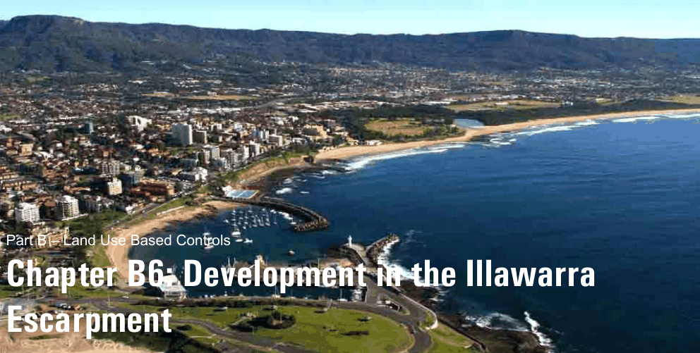

# Wollongong Development Control Plan 2009 - Chapter B6 Development in the Illawarra Escarpment

> This chapter is split into 13 section file(s), one per numbered heading, in the order they appear in the PDF.

Source PDF: [Wollongong-DCP-2009-Chapter-B6-Development-in-the-Illawarra-Escarpment.pdf](https://planfortomorrow.sharepoint.com/sites/Planfortomorrow/Shared%20Documents/00%20NSW-Planning-Resources/dcp/wollongong-development-control-plan-2009/chapter-b6-development-in-the-illawarra-escarpment/Wollongong-DCP-2009-Chapter-B6-Development-in-the-Illawarra-Escarpment.pdf)

> [Picture on page 1: a picture, saved as a picture (images/chapter-b6-development-in-the-illawarra-escarpment-page-1-1.gif, 150 dpi).]

Part B – Land Use Based Controls

### Chapter B6: Development in the Illawarra Escarpment

> The PDF's contents list (page numbers of the printed document) is not repeated here - see Sections below.

11.8 Dwelling houses and other buildings upon bush fire prone land ...................................................................................................... 15 12 GENERAL REQUIREMENTS ........................................................................................................................................................ 16

12.1 Fencing ........................................................................................................................................................................................ 16

12.2 Landscaping ................................................................................................................................................................................. 16

12.3 Stormwater Drainage / Flooding .................................................................................................................................................... 17

12.4 Water Supply ............................................................................................................................................................................... 17

12.5 Wastewater Management / Treatment Systems ........................................................................................................................... 18

12.6 Waste Management ...................................................................................................................................................................... 18

12.7 Riparian Corridor Management ..................................................................................................................................................... 19

12.8 BASIX (Residential Building Sustainability) ................................................................................................................................... 19 13 REFERENCES .............................................................................................................................................................................. 19 Appendix 1: Key View Point Locations for Each Precinct within the Illawarra Escarpment .................................................... 20 Precinct 1 – Marshall Mount / Calderwood Precinct ............................................................................................................................... 20 Precinct 2 – West Dapto Bowl ............................................................................................................................................................... 20 Precinct 3 – The Heights ........................................................................................................................................................................ 21 Precinct 4 – Mt Kembla ......................................................................................................................................................................... 22 Precinct 5 – Mount Keira ....................................................................................................................................................................... 22 Precinct 6 – Balgownie Valley ................................................................................................................................................................ 23 Precinct 7 – Coastal Ridges ................................................................................................................................................................... 23 Precinct 8 – Cliff Coast ......................................................................................................................................................................... 24 Precinct 9 – Stanwell Precinct ............................................................................................................................................................... 25 Precinct 10 – Maddens Plains ................................................................................................................................................................ 25

#### Document Control

|  | Document ID: Wollongong DCP 2009 – B6 Development in the Illawarra Escarpment |  |  |
|---|---|---|---|
| Rev No | Adoption Date | In force date | Revision Details |
| 1 | 15/12/2009 | 01/03/2010 | Adopted |
| 2 | 03/04/2023 | 01/07/2023 | Amended |

<!-- sections -->
## Sections

1. [1 INTRODUCTION](01-introduction.md)
2. [2 OBJECTIVES](02-objectives.md)
3. [3 DEFINITIONS](03-definitions.md)
4. [4 ESCARPMENT PRECINCTS WITHIN THE CITY OF WOLLONGONG LOCAL GOVERNMENT AREA](04-escarpment-precincts-within-the-city-of.md)
5. [5 VISUAL IMPACT ASSESSMENT](05-visual-impact-assessment.md)
6. [6 ABORIGINAL HERITAGE](06-aboriginal-heritage.md)
7. [7 HERITAGE (EUROPEAN)](07-heritage-european.md)
8. [8 THREATENED SPECIES IMPACT ASSESSMENT](08-threatened-species-impact-assessment.md)
9. [9 GEOTECHNICAL / LAND INSTABILITY ISSUES](09-geotechnical-land-instability-issues.md)
10. [10 SUBDIVISION REQUIREMENTS](10-subdivision-requirements.md)
11. [11 DWELLING AND OUTBUILDING DESIGN REQUIREMENTS](11-dwelling-and-outbuilding-design.md)
12. [12 GENERAL REQUIREMENTS](12-general-requirements.md)
13. [13 REFERENCES](13-references.md)
