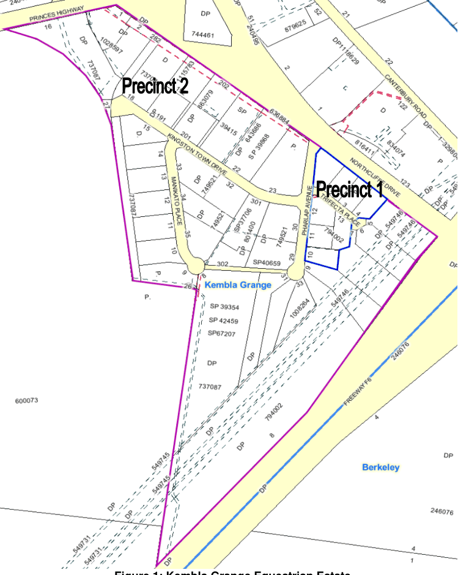

## 6 ANIMAL BOARDING OR TRAINING ESTABLISHMENTS –

### HORSE BREEDING OR TRAINING ESTABLISHMENTS

### 6.1 General

1\. “Animal boarding or training establishment” means a building or place used for the breeding, boarding, training, keeping or caring of animals for commercial purposes (other than for the agistment of horses) and includes any associated riding school or ancillary veterinary hospital.”

### 6.2 Minimum Site Area

#### 6.2.1 Objective

(a) To permit horse breeding or training establishments upon certain sized rural and non-urban landholdings, to minimise potential land use conflicts with rural residential and other rural land uses in a particular locality.

#### 6.2.2 Development Controls

1\. The minimum site area for any horse breeding or training establishment shall be 3000m2.

2\. Notwithstanding this, the minimum site area for any horse breeding or training facility within the landholdings known as Lots 1- 13, DP 794002, bounded Trifecta Place and Phar Lap Avenue in the Kembla Grange Equestrian Estate (as per Precinct 1 in the map below) may be less than

3000m2 provided the facility is conducted by the occupants of each rural residential dwelling only, for their own private recreation purposes.

> [Picture on page 16: a picture, saved as a picture (images/chapter-b7-development-in-rural-zones-page-16-1.gif, 150 dpi).]

#### Figure 1: Kembla Grange Equestrian Estate

### 6.3 Maximum Number of Horses – Kembla Grange Equestrian Estate

#### 6.3.1 Objective

(a) To restrict the number of horses within any horse boarding, breeding or training establishment within the Kembla Grange Equestrian Estate, in order to maintain the amenity of the locality.

#### 6.3.2 Development Controls

1\. The maximum number of horses for any animal boarding, breeding or training establishment within the Kembla Grange Equestrian Estate shall be restricted to rate of not more than 1 horse

per 250m2 of the site area.

### 6.4 Minimum Setback Requirements for Horse Stables & Shelters

#### 6.4.1 Objective

(a) To ensure horse stables and shelters are appropriately setback from common property boundaries, in order to maintain the amenity and character of the surrounding locality.

#### 6.4.2 Development Controls

1\. Any horse stable or horse shelter shall be setback from property boundaries and adjoining land uses in accordance with Table 4 below.

#### Table 4: Minimum Setback Requirements for Horse Stables & Shelters

| Land Use | Minimum Setback Requirement |
|---|---|
| Front Building Line Setback to Primary Road | 10 metres(1) |
| Secondary Road Frontage | 5 metres |
| Side and Rear Building Line Setback | 5 metres |
| Adjoining Dwelling not associated with the facility | 10 metres |

Note(1): Council may vary the front building line setback requirement for a horse stable upon the landholdings known as Lots 1- 13, DP 794002, bounded Trifecta Place and Phar Lap Avenue in the Kembla Grange Equestrian Estate subject to an absolute 6 metre minimum front building line being provided.

### 6.5 Horse Stable, Exercise Yard & Shelter Requirements

#### 6.5.1 Objectives

(a) To ensure horse stables and shelters are well designed and constructed to provide suitable all weather protection for horses.

(b) To ensure horse stables and shelters are sympathetic to the rural landscape and the scenic environmental amenity of the locality.

(c) To ensure horse breeding and training establishments provide suitable exercise training yards.

#### 6.5.2 Development Controls

1\. Each horse should be provided with a suitable horse stable and exercise training yard.

2\. The minimum size for any horse stable should be 3.7 metres wide and 3.7 metres deep. The height of any horse stable should be a minimum of 2.75 metres up to 3.4 metres, depending upon the height of the horse.

3\. The roof of the stable shall provide all weather protection and should incorporate appropriate guttering and down pipes to convey stormwater into rainwater tanks and into appropriately designed stormwater drainage systems or drinking troughs.

4\. The walls of the horse stable should be of a masonry construction for a height of at least 1.2 metres with either masonry or solid galvanised iron sheeting provided for the upper wall panelling. Any concrete masonry blocks should be reinforced with vertical steel rods and the

cores filled with concrete. Some form of window or air passage between the roof and the walls is needed for cross-ventilation purposes.

5\. The wall height shall range between 2.75 metres up to 3.4 metres high, depending upon the height of the intended horse. The external walls of the stable shall be appropriately sealed and waterproofed. The internal walls of the stable should be lined with plywood sheeting or rubber material to prevent injury to horses and to also protect the walls from pawing or kicking.

6\. The doors of any horse stable shall be at least 1.2 metres wide and 2.4 metres high with no protrusions which may cause potential injury to the horse. Any latches to the doors should be strong and have no protrusions which may injure the horse.

7\. The floor of any horse stable must be constructed of an impervious material which is graded towards the doorway to permit drainage and with no low spots where urine can collect.

8\. A 100mm thick reinforced concrete slab is the preferred flooring method. Clean bedding such as straw or sawdust should be provided daily to prevent any foot or leg problems caused by the horse standing on concrete.

9\. Feeders and water troughs should be raised to a height of 1.05 metres aboveground and placed within a corner of the stable. The feeders and water troughs should be smooth finished and free of any protrusions.

10\. Any horse shelters shall be constructed to fulfil the same requirements as a horse stable regarding walls, floor and roofing but should be provided without any doors, in order to allow free passage of horses to / from the shelter, at all times.

11\. The external finishes of any horse stable or horse stable shall be painted in a muted green, light brown or grey colour, in order to maintain the rural character of the surrounding locality.

### 6.6 Horse Paddocks

#### 6.6.1 Objectives

(a) To ensure horse paddocks are of a sufficient size and are provided with appropriate feed and shade trees.

(b) To ensure horse paddocks are properly fenced (both internally and externally) to minimise any injury to horses and to encourage rotational grazing of the paddocks.

#### 6.6.2 Development Controls

1\. The minimum paddock size for each horse should be 2,000m2 with a preferable size of 1 hectare or more.

2\. Any horse paddock must contain a horse shelter as well as shade trees.

3\. Horse paddocks should be internally fenced, wherever possible to allow for the rotational use of the grazing area, in order to minimise any potential overgrazing.

4\. Supplementary feed must be provided, where necessary.

5\. Post and rail fencing for horse paddocks is preferred. The use of wire or barb wire is not recommended because of its tendency to cause injury to horses. Electric fences are suitable but should be supported with some type of sight barrier (eg a painted tin lid) attached to the electric wire, in order to improve the visibility of the electric fence.

### 6.7 Liquid & Solid Waste Collection and Treatment

#### 6.7.1 Objective

(a) To ensure all horse boarding, breeding or training establishments have appropriate liquid and solid waste collection and treatment systems.

#### 6.7.2 Development Controls

1\. All liquid wastes are to be led to a settling pond area, prior to discharge into any watercourse, stormwater drainage system or Sydney Water Corporation sewerage system. The settling pond area shall have a minimum capacity of 1.5% of the total site area with a maximum depth of 1.2 metres. Any pond overflow shall meet the water quality criteria set out in the ANZECC guidelines for the particular receiving waterway.

2\. All solid manure should be removed regularly and placed in a suitable waste storage bin. The solid waste storage bin should be a large metal bin with a flanged-fitting metal lid which is water-proof and prevents access to flies and / or vermin. This bin should be emptied and disinfected weekly.

3\. The full details of the proposed liquid and solid waste treatment process including the settling pond area are to be submitted with the Development Application for an animal boarding or training establishment.

4\. In the event that the proposal is ultimately supported, a condition of consent may be imposed requiring an appropriate water sampling program to be implemented to monitor the water quality of any waters discharging from the settling pond.

5\. The sampling regime is likely to involve quarterly sampling and sampling after each heavy rainfall event. The sampling of the water at a registered NATA laboratory should include the following parameters:-

(a) pH;

(b) Suspended solids;

(c) Dissolve Oxygen;

(d) Total Phosphorous;

(e) Ammonia;

(f) Total Nitrogen; and

(g) Faecal Coliforms.

6\. The preparation of an annual environmental management plan may also be required for any approved horse boarding, breeding or training facility which outlines the performance of the settling pond bearing in mind the sampling regime.
