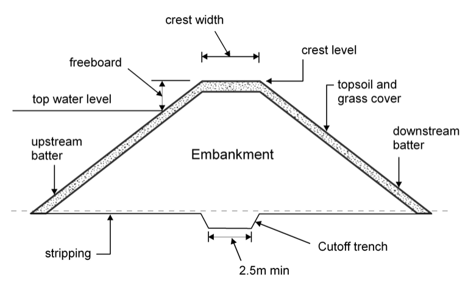
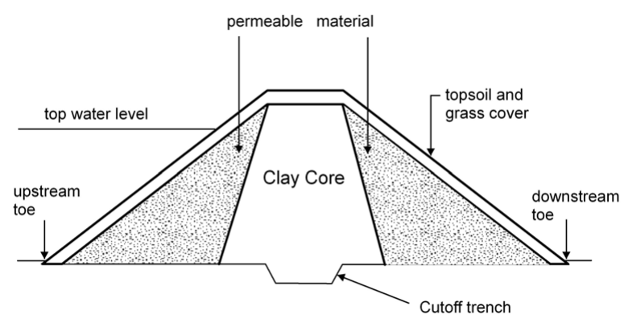
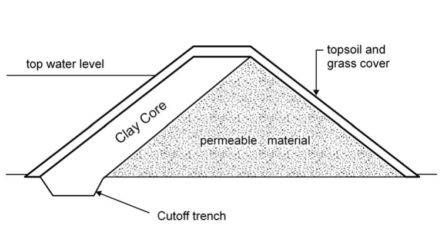
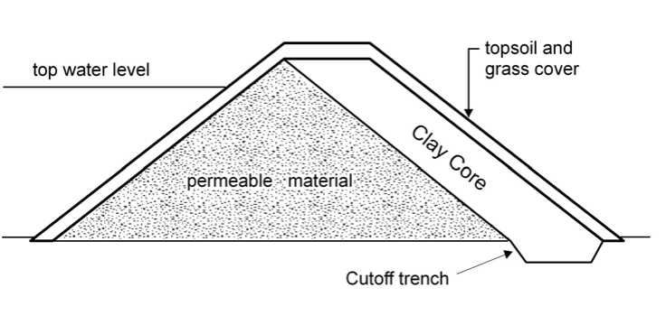

## 12 CONSTRUCTION OF FARM DAMS

### 12.1 General

1\. The construction of any dam requires formal development consent, under Wollongong Local Environmental Plan 2009.

2\. Licensing may also be required from the NSW Department of Water & Energy under the Water Management Act 2000.

3\. The NSW Department of Water & Energy uses the Strahler stream ordering method to determine the order of any watercourse. The Strahler system is explained as follows:

(a) Starting at the top of a catchment, any watercourse that has no other watercourses

flowing into it is classed as a 1st order watercourse

(b) Where two 1st order watercourses join, the watercourse becomes a 2nd order watercourse;

(c) If a 2nd order watercourse is joined by a 1st order watercourse it remains as a 2nd order watercourse;

(d) Where two or more 2nd order watercourses join, they form a 3rd order watercourse;

(e) A 3rd order watercourse does not become a 4th order watercourse until it is joined by

another 3rd order watercourse and so on.

### 12.2 Integrated Development – Licensing approval required from

### NSW Department of Water & Energy

1\. The lodgement of an Integrated Development application pursuant to Section 91 of the Environmental Planning and Assessment Act 1979 is required if licensing approval is also necessary from the NSW Department of Water & Energy under the Water Management Act 2000 for a dam (or extension to an existing dam) involving any of the following circumstances:

(a) The dam exceeds the total Maximum Harvestable Right Dam Capacity (MHDRC) for the subject property; or

(b) The dam is located on a 3rd order watercourse, 4th order watercourse or greater order watercourse; or

(c) The dam is located on either a 1st order or 2nd order watercourse that has a permanent flow; or

(d) The dam is an off-stream structure that is neither a harvestable rights dam nor a special exempt dam under the Farm Dams Policy; or

(e) The dam intercepts groundwater from the groundwater table or perched water table in the underlying soil strata; or

(f) The dam is fed from a spring with a permanent flow.

#### 12.2.1 Licensing Exemptions for Dams under the Water Management Act 2000

1\. The separate licensing from the NSW Department of Water & Energy is not required for any farm dam built on hillsides and minor streams which capture up to a maximum 10% of the average regional rainfall runoff from the property. The total capacity of all dams on a property allowed under the harvestable right is called the Maximum Harvestable Right Dam Capacity (MHRDC). The MHRDC is based on 10% of the average regional rainfall runoff of the property taking into account the local evaporation rates and periods between rainfall replenishments.

2\. Licensing is also not required for any farm dam with a capacity of up to 1 megalitre in size on a small property where the MHRDC is less than 1 megalitre but where the property was approved for subdivision before 1 January 1999.

3\. Farm dams constructed prior to 1 January 1999 are also exempted from licensing requirements.

#### 12.2.2 Other Dams Exempt from Harvestable Right Calculations but require

#### consent from the NSW Department of Water & Energy

1\. The following dams are exempt from the Harvestable Right Calculations but may still require the formal consent from the NSW Department of Water & Energy:

(a) Dams for the control or prevention of soil erosion (gully control structures) - where no water is reticulated or pumped from the dam and the size of the dam structure is the minimum required to fulfil the erosion control function;

(b) Dams for flood detention and flood mitigation purposes – provided no water is reticulated or pumped from these dams and the dams are used as temporary water storages during and immediately after flood events;

(c) Dams for the capture, containment and recirculation of drainage and / or effluent – dams which are designed to best management practice or are required by regulation to prevent the contamination of a water source;

(d) Dams endorsed by the Department of Water & Energy for specific environmental management purposes – any such dam requires written exemption from the NSW Department of Water & Energy prior to the commencement of any dam works;

(e) Dams without a catchment – The main types of dams in this category include Turkey nest dams and ring tanks which are designed primarily for the storage of water and are generally replenished by pumping from rivers and / or the groundwater table. However, the pumping of water from rivers and / or the groundwater table requires separate formal approval from the NSW Department of Energy & Water.

### 12.3 Construction requirements for dams

#### 12.3.1 Objectives

(a) To ensure all dams are properly designed and constructed to guarantee the long term structural integrity of the dam wall embankment and spillway structure.

(b) To ensure all dams provide suitable spillway structures, to achieve an adequate freeboard within the dam and to ameliorate any potential overtopping of the dam wall.

(c) To minimise any potential downstream run-off impacts upon the watercourse and / or downstream properties from the dam spillway structure.

(d) To ensure any dam with a dam wall height of 5 metres or more and / or a storage capacity of greater than 50 megalitres is referred to the NSW Dams Safety Committee for appropriate review.

#### 12.3.2 Embankment

1\. The slope of the upstream embankment batters generally must be no steeper than the ratio of 3 horizontal to 1 vertical, while the downstream batter must be no steeper than 2.5 horizontal to 1 vertical. However, if the dam is within 100 metres of a dwelling and is not fenced, then the upstream batter must not be steeper than 6 horizontal to 1 vertical. Further, the slope of the dam embankments may also be contingent upon the proposed embankment height and the material to be used in the dam embankment as well as the intended storage depth and capacity of the dam.

> [Picture on page 33: a picture, saved as a picture (images/chapter-b7-development-in-rural-zones-page-33-1.gif, 150 dpi).]

#### Figure 2: Dam Cross-section

#### 12.3.3 Clay Core for Embankment

1\. A clay core may be required if there is insufficient material at the excavation area to build a homogeneous clay embankment. The clay core is designed to provide an impermeable barrier and the balance of the rock or earth material is used to provide the structural stability of the dam. The clay core can be located between more permeable material or it may be constructed at either the water (upstream) or non-water (downstream) face.

> [Picture on page 33: a picture, saved as a picture (images/chapter-b7-development-in-rural-zones-page-33-9.gif, 150 dpi).]

#### Figure 3: Central Clay core

> [Picture on page 34: a picture, saved as a picture (images/chapter-b7-development-in-rural-zones-page-34-1.gif, 150 dpi).]

#### Figure 4: Upstream Clay core

> [Picture on page 34: a picture, saved as a picture (images/chapter-b7-development-in-rural-zones-page-34-3.gif, 150 dpi).]

#### Figure 5: Downstream Clay core

#### 12.3.4 Crest Width

1\. The width of the dam crest shall be a minimum of 3 metres for a 3 metre high dam wall. The crest width of the dam should increase in width by 0.5 metres for every metre greater than 3 metres in height.

#### 12.3.5 Freeboard

1\. The freeboard is the height of the embankment above top water level (or spillway level). The minimum freeboard for a dam wall shall be 1 metre. The freeboard should increase by 10% every additional metre above a 3 metre wall height.

#### 12.3.6 Spillway Structure

1\. A spillway structure is required all on dams to enable surplus runoff to pass around the dam wall, in order to prevent any water overtopping of the dam wall. The spillway structure must be designed to divert any surplus water above the freeboard level.

2\. The spillway structure must be a minimum of 3 metres in width increasing in size, depending upon the size of the dam and the catchment. The width of the outlet should not be less than the width of the inlet width to the dam.

3\. The spillway structure is not to direct flows onto the downstream toe of the embankment. The spillway structure may be either turfed, concrete – lined, cut into stable rock or made of gabions, depending upon the size of the dam catchment and the nature of the geology of the site.

4\. The spillway cut batter should have a maximum steepness of 2.5 horizontal: 1 vertical.

5\. A small diameter pipe is required to be installed through the embankment where spring flows or small flows of long duration occur to ensure that the spillway does not erode.

#### 12.3.7 Cut-off Trench

1\. All dams are required to include a cut-off trench. The cut-off trench is to be constructed along the entire length of the base of the dam embankment at a minimum width of 2 metres or 1.5 times the height of the dam, whichever is the largest. The trench should be excavated at least 1 metre into impervious soil and backfilled and compacted with impervious material.

2\. The cut-off trench is used to prevent leakage caused by water escaping beneath the embankment.

#### 12.3.8 Downstream run-off from spillway structure

1\. Any downstream runoff from the spillway structure must be controlled in order to minimise any adverse run-off or scouring impacts upon downstream neighbouring properties.

### 12.4 Dams Safety Committee requirements

1\. Any Development Application for a dam with a dam wall height of 5 metres or more and / or a storage capacity of greater than 50 megalitres will be required to be referred to the NSW Dams Safety Committee for the Committee’s determination as to whether the dam will be prescribed under the Dams Safety Act 1978.
