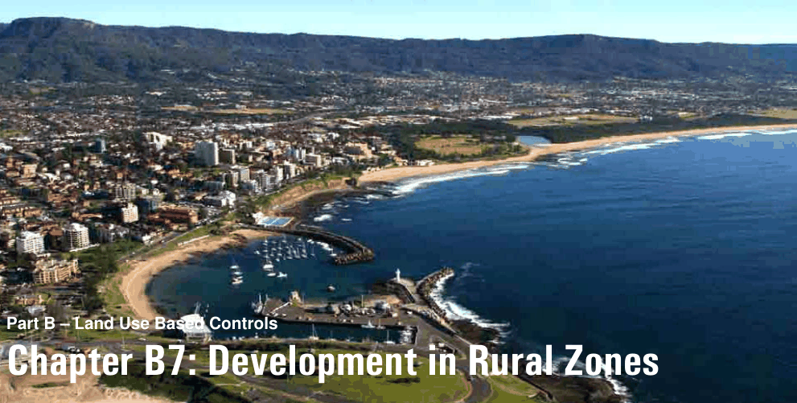

# Wollongong Development Control Plan 2009 - Chapter B7 Development in Rural Zones

> This chapter is split into 16 section file(s), one per numbered heading, in the order they appear in the PDF.

Source PDF: [Wollongong-DCP-2009-Chapter-B07-Development-in-Rural-Zones.pdf](https://planfortomorrow.sharepoint.com/sites/Planfortomorrow/Shared%20Documents/00%20NSW-Planning-Resources/dcp/wollongong-development-control-plan-2009/chapter-b7-development-in-rural-zones/Wollongong-DCP-2009-Chapter-B07-Development-in-Rural-Zones.pdf)

> [Picture on page 1: a picture, saved as a picture (images/chapter-b7-development-in-rural-zones-page-1-1.gif, 150 dpi).]

#### Part B – Land Use Based Controls

### Chapter B7: Development in Rural Zones

> The PDF's contents list (page numbers of the printed document) is not repeated here - see Sections below.

i

### 8.3 Design and External Appearance of Intensive Livestock

#### Agricultural Enterprises

22

### Figures

<!-- sections -->
## Sections

1. [9 INTENSIVE HORTICULTURE](01-9-intensive-horticulture.md)
2. [10 ROADSIDE STALLS](02-10-roadside-stalls.md)
3. [11 AQUACULTURE – POND BASED OR TANK-BASED](03-11-aquaculture-pond-based-or-tank-based.md)
4. [12 CONSTRUCTION OF FARM DAMS](04-12-construction-of-farm-dams.md)
5. [1 INTRODUCTION](05-1-introduction.md)
6. [2 OBJECTIVES](06-2-objectives.md)
7. [3 RURAL SUBDIVISION REQUIREMENTS](07-3-rural-subdivision-requirements.md)
8. [4 REQUIREMENTS FOR DWELLING – HOUSES, SECONDARY](08-4-requirements-for-dwelling-houses.md)
9. [5 AGRICULTURAL LAND USES](09-5-agricultural-land-uses.md)
10. [6 ANIMAL BOARDING OR TRAINING ESTABLISHMENTS –](10-6-animal-boarding-or-training.md)
11. [7 ANIMAL BOARDING OR TRAINING ESTABLISHMENTS - DOG BOARDING, BREEDING OR TRAINING ESTABLISHMENT](11-7-animal-boarding-or-training.md)
12. [8 INTENSIVE LIVESTOCK AGRICULTURE](12-8-intensive-livestock-agriculture.md)
13. [9 INTENSIVE HORTICULTURE](13-9-intensive-horticulture.md)
14. [10 ROADSIDE STALLS](14-10-roadside-stalls.md)
15. [11 AQUACULTURE – POND BASED OR TANK-BASED](15-11-aquaculture-pond-based-or-tank-based.md)
16. [12 CONSTRUCTION OF FARM DAMS](16-12-construction-of-farm-dams.md)
