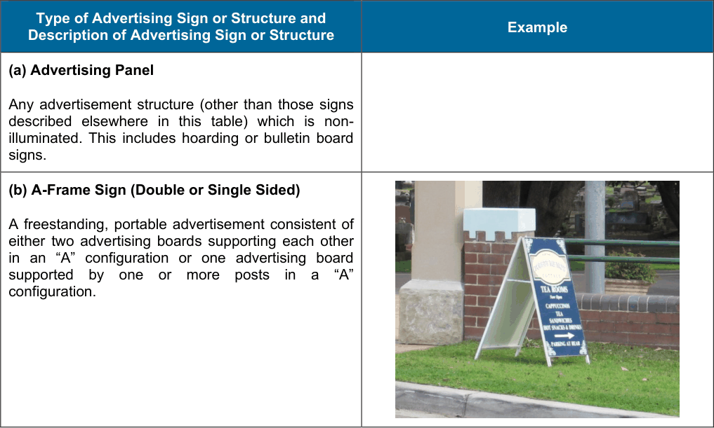
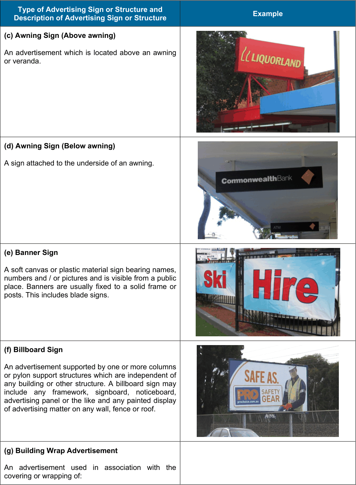
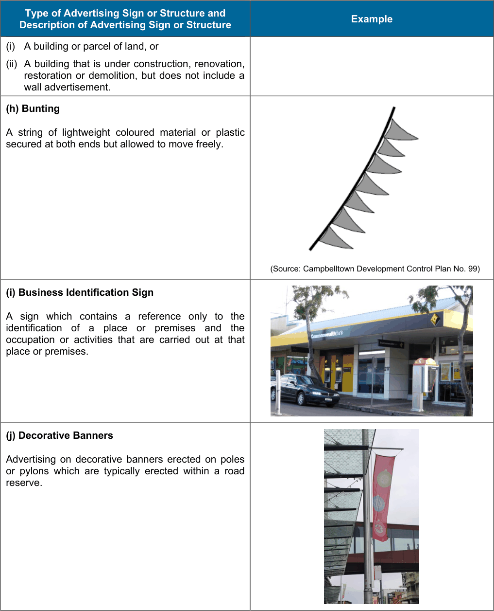
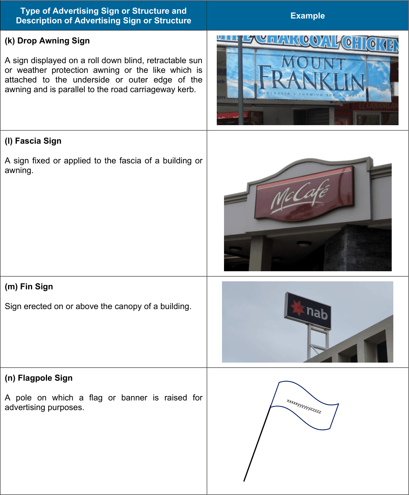
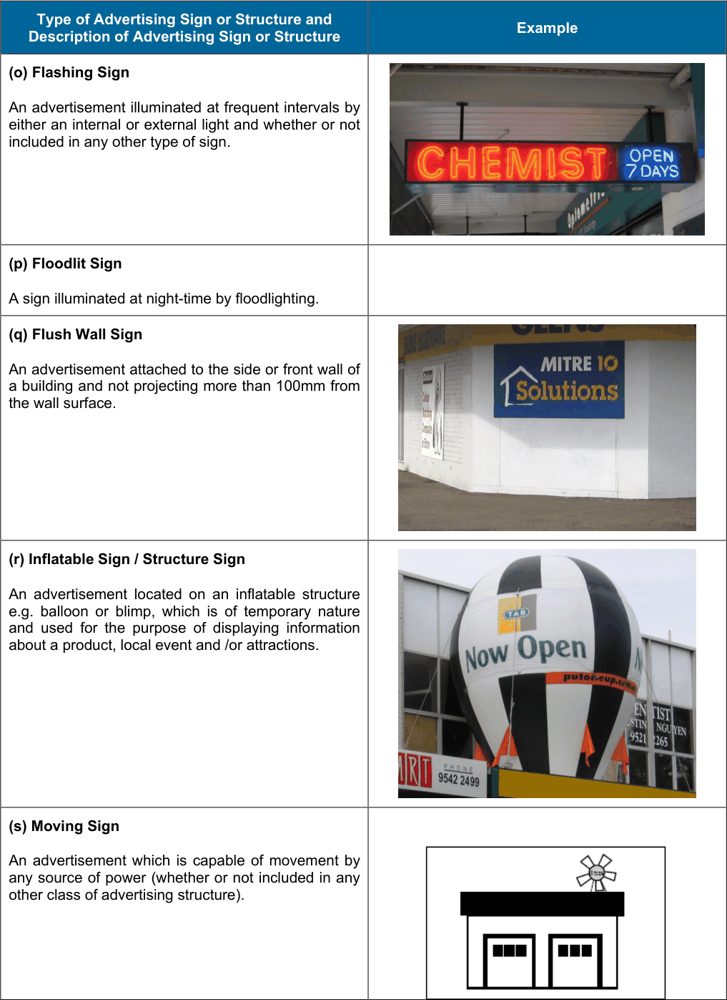
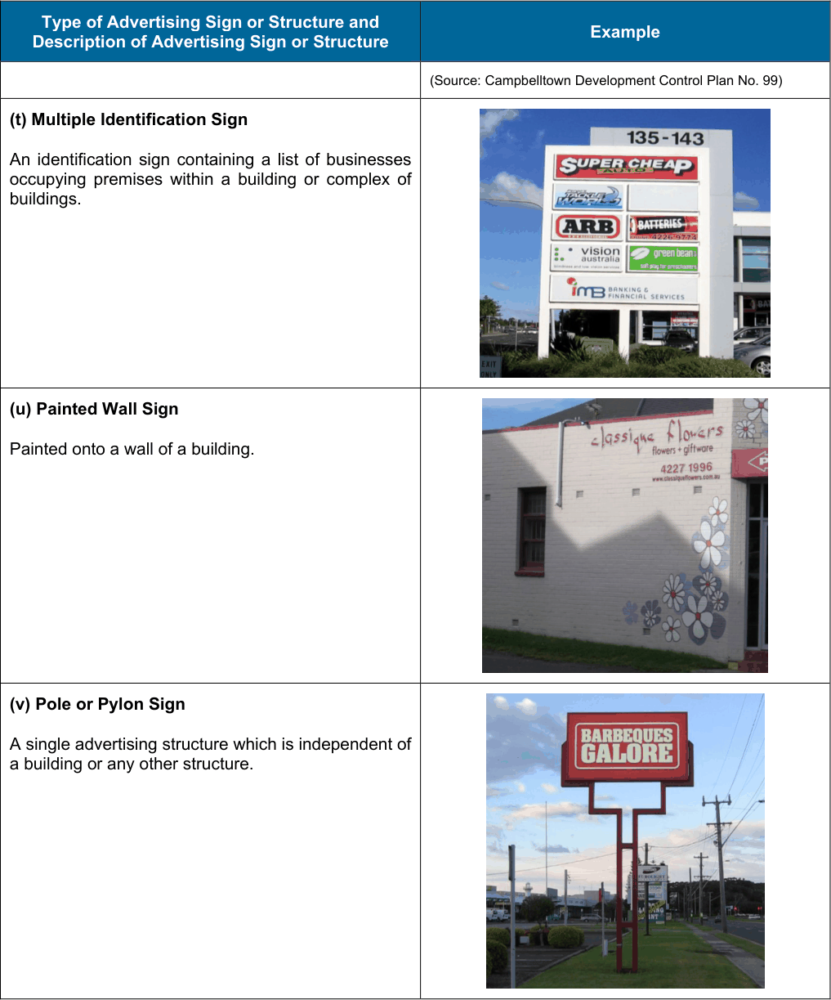
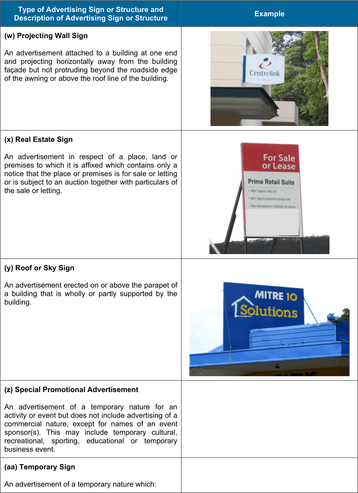
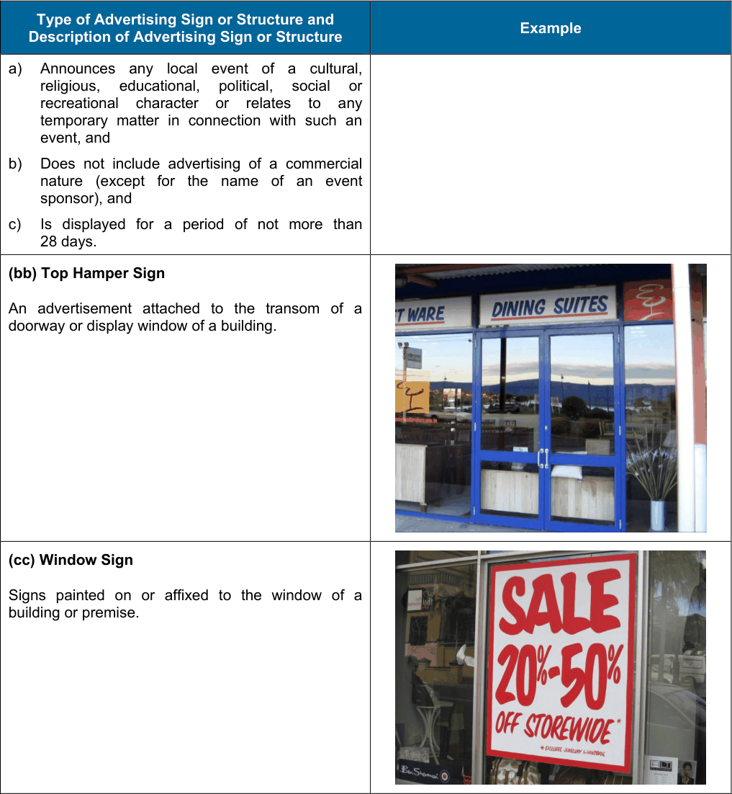

## 3 TYPES OF ADVERTISING SIGNS AND STRUCTURES

1\. The main types of advertising signs and structures are listed and described in Table 1 below.

#### Table 1: Types of Advertising Signs and Structures

> [Picture on page 4: a picture, saved as a picture (images/chapter-c1-advertising-signage-and-structures-page-4-16.gif, 150 dpi).]

Type of Advertising Sign or Structure and

#### Description of Advertising Sign or Structure

#### Example

(a) Advertising Panel

Any advertisement structure (other than those signs described elsewhere in this table) which is non-illuminated. This includes hoarding or bulletin board signs.

(b) A-Frame Sign (Double or Single Sided)

A freestanding, portable advertisement consistent of either two advertising boards supporting each other in an “A” configuration or one advertising board supported by one or more posts in a “A” configuration.

> [Picture on page 5: a picture, saved as a picture (images/chapter-c1-advertising-signage-and-structures-page-5-1.gif, 150 dpi).]

Type of Advertising Sign or Structure and

#### Description of Advertising Sign or Structure

#### Example

(c) Awning Sign (Above awning)

An advertisement which is located above an awning or veranda.

(d) Awning Sign (Below awning)

A sign attached to the underside of an awning.

(e) Banner Sign

A soft canvas or plastic material sign bearing names, numbers and / or pictures and is visible from a public place. Banners are usually fixed to a solid frame or posts. This includes blade signs.

(f) Billboard Sign

An advertisement supported by one or more columns or pylon support structures which are independent of any building or other structure. A billboard sign may include any framework, signboard, noticeboard, advertising panel or the like and any painted display of advertising matter on any wall, fence or roof.

(g) Building Wrap Advertisement

An advertisement used in association with the covering or wrapping of:

> [Picture on page 6: a picture, saved as a picture (images/chapter-c1-advertising-signage-and-structures-page-6-1.gif, 150 dpi).]
> Words printed on the picture (title and legend, copied from the PDF):
> (Source: Campbelltown Development Control Plan No. 99)

Type of Advertising Sign or Structure and

#### Description of Advertising Sign or Structure

#### Example

(i) A building or parcel of land, or

(ii) A building that is under construction, renovation, restoration or demolition, but does not include a wall advertisement.

(h) Bunting

A string of lightweight coloured material or plastic secured at both ends but allowed to move freely.

(i) Business Identification Sign

A sign which contains a reference only to the identification of a place or premises and the occupation or activities that are carried out at that place or premises.

(j) Decorative Banners

Advertising on decorative banners erected on poles or pylons which are typically erected within a road reserve.

> [Picture on page 7: a picture, saved as a picture (images/chapter-c1-advertising-signage-and-structures-page-7-1.gif, 150 dpi).]
> Words printed on the picture (title and legend, copied from the PDF):
> xxxxxyyyyyyzzzzz

Type of Advertising Sign or Structure and

#### Description of Advertising Sign or Structure

#### Example

(k) Drop Awning Sign

A sign displayed on a roll down blind, retractable sun or weather protection awning or the like which is attached to the underside or outer edge of the awning and is parallel to the road carriageway kerb.

(l) Fascia Sign

A sign fixed or applied to the fascia of a building or awning.

(m) Fin Sign

Sign erected on or above the canopy of a building.

(n) Flagpole Sign

A pole on which a flag or banner is raised for advertising purposes.

> [Picture on page 8: a picture, saved as a picture (images/chapter-c1-advertising-signage-and-structures-page-8-1.gif, 150 dpi).]

Type of Advertising Sign or Structure and

#### Description of Advertising Sign or Structure

#### Example

(o) Flashing Sign

An advertisement illuminated at frequent intervals by either an internal or external light and whether or not included in any other type of sign.

(p) Floodlit Sign

A sign illuminated at night-time by floodlighting.

(q) Flush Wall Sign

An advertisement attached to the side or front wall of a building and not projecting more than 100mm from the wall surface.

(r) Inflatable Sign / Structure Sign

An advertisement located on an inflatable structure e.g. balloon or blimp, which is of temporary nature and used for the purpose of displaying information about a product, local event and /or attractions.

(s) Moving Sign

An advertisement which is capable of movement by any source of power (whether or not included in any other class of advertising structure).

> [Picture on page 9: a picture, saved as a picture (images/chapter-c1-advertising-signage-and-structures-page-9-1.gif, 150 dpi).]
> Words printed on the picture (title and legend, copied from the PDF):
> (Source: Campbelltown Development Control Plan No. 99)

Type of Advertising Sign or Structure and

#### Description of Advertising Sign or Structure

#### Example

(t) Multiple Identification Sign

An identification sign containing a list of businesses occupying premises within a building or complex of buildings.

(u) Painted Wall Sign

Painted onto a wall of a building.

(v) Pole or Pylon Sign

A single advertising structure which is independent of a building or any other structure.

> [Picture on page 10: a picture, saved as a picture (images/chapter-c1-advertising-signage-and-structures-page-10-1.gif, 150 dpi).]

Type of Advertising Sign or Structure and

#### Description of Advertising Sign or Structure

#### Example

(w) Projecting Wall Sign

An advertisement attached to a building at one end and projecting horizontally away from the building façade but not protruding beyond the roadside edge of the awning or above the roof line of the building.

(x) Real Estate Sign

An advertisement in respect of a place, land or premises to which it is affixed which contains only a notice that the place or premises is for sale or letting or is subject to an auction together with particulars of the sale or letting.

(y) Roof or Sky Sign

An advertisement erected on or above the parapet of a building that is wholly or partly supported by the building.

(z) Special Promotional Advertisement

An advertisement of a temporary nature for an activity or event but does not include advertising of a commercial nature, except for names of an event sponsor(s). This may include temporary cultural, recreational, sporting, educational or temporary business event.

(aa) Temporary Sign

An advertisement of a temporary nature which:

> [Picture on page 11: a picture, saved as a picture (images/chapter-c1-advertising-signage-and-structures-page-11-1.gif, 150 dpi).]
> Words printed on the picture (title and legend, copied from the PDF):
> 28 days.

Type of Advertising Sign or Structure and

#### Description of Advertising Sign or Structure

#### Example

a) Announces any local event of a cultural, religious, educational, political, social or recreational character or relates to any temporary matter in connection with such an event, and

b) Does not include advertising of a commercial nature (except for the name of an event sponsor), and

c) Is displayed for a period of not more than

(bb) Top Hamper Sign

An advertisement attached to the transom of a doorway or display window of a building.

(cc) Window Sign

Signs painted on or affixed to the window of a building or premise.
