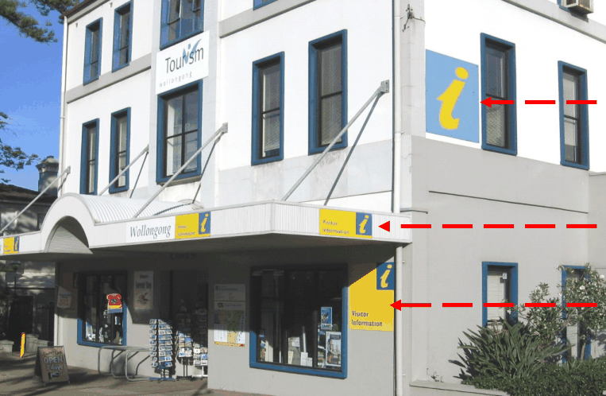

## 5 LOCAL ENVIRONMENTAL PLAN & BUSINESS IDENTIFICATION SIGNAGE

1\. The permissibility for the display of advertisements and the erection of advertising structures is subject to the provisions of the relevant LEP applying to the site.

2\. The relevant LEP also contains Exempt and Complying Development provisions. Exempt development is a form of self-assessed development which can take place without the need for Council approval.

3\. Business identification signage is classified as Exempt Development under the relevant LEP applying to the site where such signage complies with the requirements for the relevant type of signage. Where a proposed business identification sign does not comply with the specific Exempt Development requirements for the particular type of sign, then the proposed sign will be subject to the lodgement of a formal Development Application with Council.

4\. Types of business identification signs are highlighted on Figure 1.

Flush wall sign

Awning façade sign

Flush wall sign

> [Picture on page 15: a picture, saved as a picture (images/chapter-c1-advertising-signage-and-structures-page-15-4.gif, 150 dpi).]

Figure 1: Business Identification Signs
