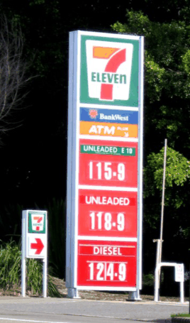

## 12 BUSINESS IDENTIFICATION SIGNAGE FOR SERVICE

> [Picture on page 23: a picture, saved as a picture (images/chapter-c1-advertising-signage-and-structures-page-23-20.gif, 150 dpi).]

### STATIONS

1\. The following types of business identification signs will be permitted for service stations:

(a) Fascia signs;

(b) Top hamper signs;

(c) A pole / pylon sign;

(d) A wall sign; and

(e) Entry / Exit signage.

2\. Only one (1) pole or pylon sign will be permitted along the public road frontage.

3\. The maximum height of the pole or pylon sign shall be 8 metres for sites located within a business or industrial zone.

4\. The maximum height of the pole or pylon sign for sites located within a rural zone shall be 2 metres.

5, The face of the pole or pylon sign should include a display of the current fuel pricing for the service station operation
