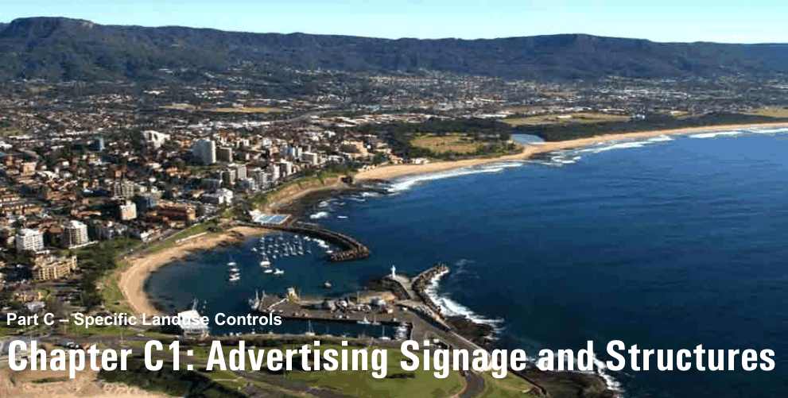
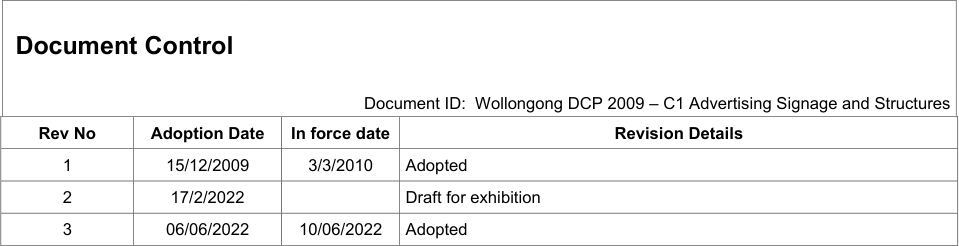

# Wollongong Development Control Plan 2009 - Chapter C1 Advertising Signage and Structures

> This chapter is split into 13 section file(s), one per numbered heading, in the order they appear in the PDF.

Source PDF: [Wollongong-DCP-2009-Chapter-C01-Advertising-Signage-and-Structures.pdf](https://planfortomorrow.sharepoint.com/sites/Planfortomorrow/Shared%20Documents/00%20NSW-Planning-Resources/dcp/wollongong-development-control-plan-2009/chapter-c1-advertising-signage-and-structures/Wollongong-DCP-2009-Chapter-C01-Advertising-Signage-and-Structures.pdf)

> [Picture on page 1: a picture, saved as a picture (images/chapter-c1-advertising-signage-and-structures-page-1-1.gif, 150 dpi).]

#### Part C – Specific Landuse Controls

### Chapter C1: Advertising Signage and Structures

> The PDF's contents list (page numbers of the printed document) is not repeated here - see Sections below.

> [Picture on page 2: a picture, saved as a picture (images/chapter-c1-advertising-signage-and-structures-page-2-2.gif, 150 dpi).]
> Words printed on the picture (title and legend, copied from the PDF):
> Document ID:  Wollongong DCP 2009 – C1 Advertising Signage and Structures

#### Document Control

| Rev No | Adoption Date | In force date | Revision Details |
|---|---|---|---|
| 1 | 15/12/2009 | 3/3/2010 | Adopted |
| 2 | 17/2/2022 |  | Draft for exhibition |
| 3 | 06/06/2022 | 10/06/2022 | Adopted |

<!-- sections -->
## Sections

1. [1 INTRODUCTION](01-introduction.md)
2. [2 OBJECTIVES](02-objectives.md)
3. [3 TYPES OF ADVERTISING SIGNS AND STRUCTURES](03-types-of-advertising-signs-and.md)
4. [4 STATE ENVIRONMENTAL PLANNING POLICY (INDUSTRY AND EMPLOYMENT)](04-state-environmental-planning-policy.md)
5. [5 LOCAL ENVIRONMENTAL PLAN & BUSINESS IDENTIFICATION SIGNAGE](05-local-environmental-plan-and-business.md)
6. [6 LODGEMENT OF A DEVELOPMENT APPLICATION](06-lodgement-of-a-development-application.md)
7. [7 PROHIBITED ADVERTISING SIGNS AND STRUCTURES](07-prohibited-advertising-signs-and.md)
8. [8 GENERAL REQUIREMENTS FOR ADVERTISING SIGNS AND STRUCTURES](08-general-requirements-for-advertising.md)
9. [9 SPECIFIC CONTROLS FOR ADVERTISING SIGNS AND STRUCTURES](09-specific-controls-for-advertising-signs.md)
10. [10 LOCATION OF CERTAIN NAMES AND LOGOS](10-location-of-certain-names-and-logos.md)
11. [11 MULTI-OCCUPANCY BUILDINGS](11-multi-occupancy-buildings.md)
12. [12 BUSINESS IDENTIFICATION SIGNAGE FOR SERVICE](12-business-identification-signage-for.md)
13. [13 ADVERTISING SIGNS ON HERITAGE BUILDINGS](13-advertising-signs-on-heritage-buildings.md)
