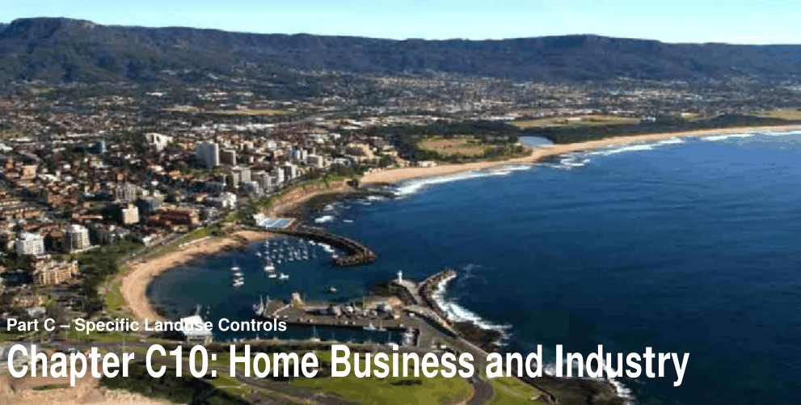

# Wollongong Development Control Plan 2009 - Chapter C10 Home Business and Industry

> This chapter is split into 9 section file(s), one per numbered heading, in the order they appear in the PDF.

Source PDF: [Wollongong-DCP-2009-Chapter-C10-Home-Business-and-Industry.pdf](https://planfortomorrow.sharepoint.com/sites/Planfortomorrow/Shared%20Documents/00%20NSW-Planning-Resources/dcp/wollongong-development-control-plan-2009/chapter-c10-home-business-and-industry/Wollongong-DCP-2009-Chapter-C10-Home-Business-and-Industry.pdf)

> [Picture on page 1: a picture, saved as a picture (images/chapter-c10-home-business-and-industry-page-1-1.gif, 150 dpi).]

#### Part C – Specific Landuse Controls

### Chapter C10: Home Business and Industry

### Contents

<!-- sections -->
## Sections

1. [5 DEVELOPMENT APPLICATION LODGEMENT](01-5-development-application-lodgement.md)
2. [7 HOME INDUSTRY](02-7-home-industry.md)
3. [1 INTRODUCTION](03-1-introduction.md)
4. [2 OBJECTIVES](04-2-objectives.md)
5. [3 DEFINITIONS](05-3-definitions.md)
6. [4 CAR PARKING REQUIREMENTS](06-4-car-parking-requirements.md)
7. [5 DEVELOPMENT APPLICATION LODGEMENT](07-5-development-application-lodgement.md)
8. [6 FUTURE EXPANSION OR ENLARGEMENT OF A HOME](08-6-future-expansion-or-enlargement-of-a.md)
9. [7 HOME INDUSTRY](09-7-home-industry.md)
