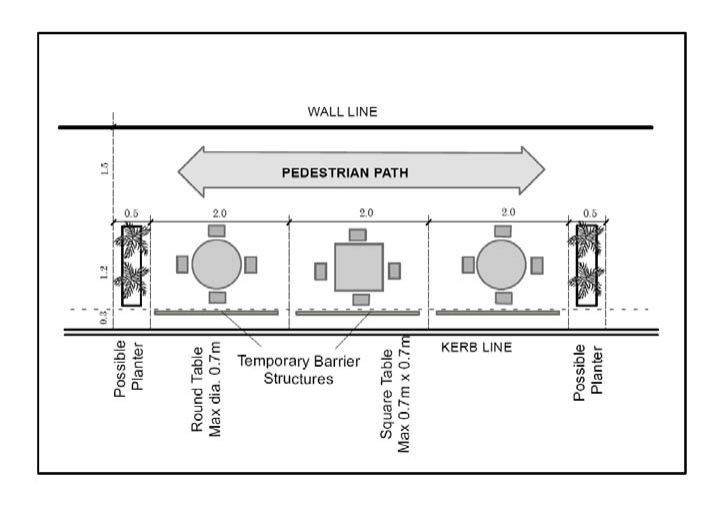

## 3 OUTDOOR RESTAURANTS

### 3.1 Approval Process

1\. The proposed use of any public road reserve (footway) area for the purposes of an outdoor restaurant will require the lodgement of a Development Application, prior to the commencement of any such use.

2\. In the event that formal development consent is ultimately granted for the proposed outdoor (footway) restaurant pursuant to the provisions of the Environmental Planning & Assessment Act 1979, a condition of the consent will be imposed requiring the separate lodgement of an application with Council in accordance with the requirements of Section 125(a) of the Roads Act

1993\. If the outdoor restaurant is proposed upon a classified road, the formal concurrence from the NSW Roads & Traffic Authority will also be required as part of the Roads Act application.

3\. All costs associated with the lodgement of the Development Application and the separate application for licensing under the Roads Act shall be met by the intended licensee.

4\. In the event that the Development Application and the separate Road Act 1993 license are ultimately approved for the proposed outdoor restaurant, the proprietor of the business to which the outdoor restaurant relates will be required to provide appropriate insurance coverage to indemnify Council against any public liability claim that may arise from the use of the footpath

area. The public liability risk insurance policy will be required to be maintained throughout the life of the outdoor dining operation and shall have a minimum $10 Million public liability insurance coverage, at all times. A Certificate of Currency must be submitted to Council annually. Requirements for insurance coverage may also change on an annual basis depending on advice from Council’s Insurance Broker.

5\. Any Roads Act licence approval for an outdoor restaurant activity will be subject to a limited 12 month trial period initially. Council at this time will re-assess the performance of the operation and whether pedestrian movement along the road reserve (footpath) area was satisfactorily maintained in the opinion of Council, throughout the initial 12 month period in order to determine as to whether a further licence will be granted.

6\. Under the Roads Act 1993, the maximum term in which Council may grant a license for the use of a part of the road reserve (footpath) for the purposes of an outdoor restaurant is 7 years.

7\. Any licence approval will also be subject to a condition requiring that any damage caused to Council’s footpaths shall be rectified at the full cost by the operator. Any such repair work will be undertaken in accordance with the requirements of Council’s City Works Division. The failure by the business operator to adhere to undertake any repair work in accordance with the requirements of Council’s City Works Division may result in the licence being cancelled immediately and / or penalty infringement notices being imposed.

8\. The rental fee for the use of a part of the footpath for the purposes of an outdoor restaurant shall be at the market value and will be determined through independent valuation.

### 3.2 Location & Access Requirements for Outdoor Dining Areas

1\. The area available for outdoor (footway) restaurant will be determined by the available width of the public road reserve (footpath) area and any existing or proposed street furniture or landscaping.

2\. Outdoor restaurants will only be approved on the kerbside of the footway.

3\. Outdoor restaurants should be generally restricted to directly in front of the premises to which the outdoor restaurant relates to. In certain circumstances, Council may permit an outdoor restaurant not directly in front of the premises to which it relates where the adjoining land use is not a food or beverage related business and where in the opinion of Council, the proposed location will not pose any significant adverse amenity impacts upon adjoining land uses or for the use of the remaining footway area, within the immediate vicinity of the proposed outdoor dining area.

4\. The creation of outdoor seating on both sides of the pedestrian footway area will generally not be supported, except in exceptional circumstances where:-

(a) It can be demonstrated that pedestrian movement through the centre of the footway is safe for all pedestrians and in particular the frail aged, children and persons with visual or mobility impairment or

(b) The pedestrian footway is purpose built and safely directs all pedestrians including persons with a visual or mobility impairment towards the centre of the footway such as Crown Street mall.

5\. Outdoor restaurants will only be acceptable in situations where:-

(a) The public space is wide enough to accommodate the outdoor dining area whilst still maintaining a clear 1.5 metre wide pathway of travel for all pedestrians, including those who use mobility aids along the full length of the proposed licence area;

(b) The ground surface of the outdoor restaurant area is suitably constructed and sufficiently level to accommodate the required number of table and seating and enable the area to be used safely and without inconvenience to pedestrians or vehicles; and

(c) There is no unreasonable hazard to pedestrians, diners or vehicular traffic.

6\. Any proposal for an outdoor restaurant must guarantee a continuous 1.5 metre wide unobstructed pedestrian path of travel along the footway and be exclusive of any obstruction or street fixtures (eg seats, bench, tree, rubbish bin, electricity pole etc), in order to provide continuous unobstructed access for pedestrians including pedestrians using wheelchairs or other mobility aids.

7\. The placement of outdoor seating shall be on the kerbside of the footway area and not directly adjacent to the building line of the building.

8\. Outdoor restaurants shall be located a minimum distance of 600 millimetres from the kerb edge, in order to provide a suitable safety buffer for passengers to alight from and access parked motor vehicles.

9\. No furniture is permitted within 3 metres of any bus stop or taxi stand to allow for adequate pedestrian circulation and queuing.

10\. The outdoor dining area is to remain visible from the main food premises at all times, to maintain staff surveillance over the dining area.

11\. Outdoor seating arrangements shall not obstruct access to public infrastructure or utilities such as fire hydrants, access holes, inspection chambers, telephone and electricity underground cables, water service pipes and the like.

12\. All outdoor dining areas are to be setback to maintain unobstructed vehicular sight lines in accordance with Part 5 of the AustRoads Guide to Traffic Engineering Practice.

13\. Outdoor seating shall be prohibited adjacent to any bus stop, taxi stand or any disabled parking space within the adjoining road reserve.

14\. Outdoor dining areas or outdoor trading areas shall be clearly defined by way of a suitable framed barrier, tactile markers and / or pavement line marking in order to clearly delineate the licence area boundaries. The barrier or marked treatment to delineate the approved licence area will be subject to Council approval as part of the licence approval under the Roads Act 1993.

Figure 1 shows the required location and setback requirements for outdoor seating upon a footway area (ie outdoor restaurant seating is located on the kerbside rather than abutting the building line).

> [Picture on page 6: a picture, saved as a picture (images/chapter-c12-outdoor-restaurant-and-footpath-trading-street-v-page-6-1.gif, 150 dpi).]

#### Figure 1: Location and Minimum Setback Requirements for Outdoor Seating

15\. As part of the Development Application, the applicant is required to submit a site plan (ie at an accurate 1:50 or 1:100 scale) which shows the proposed outdoor restaurant table and seating arrangement in relation to the business shopfront and the proposed setback distance to both the pedestrian footway and the road carriageway.

### 3.3 Outdoor Furniture

1\. The placement of outdoor furniture (tables, chairs, planter boxes etc) must take into account suitable access arrangements for people with a disability, particularly patrons using wheelchairs and people with a vision impairment disability. Therefore, suitable manoeuvring arrangements are provided around tables and chairs for patrons using wheelchairs.

2\. All outdoor furniture including tables, chairs, planter boxes, barriers and menu boards shall be contained within the boundaries of the outdoor dining area.

3\. The business operator is responsible for ensuring patrons maintain their outdoor furniture within the boundaries of the license area. The licence holder is to ensure that all staff routinely supervise patrons, in order to ensure that all tables and chairs are contained wholly within the confines of the licensed area, at all times.

Note: The failure of the business operator to ensure all approved tables and chairs are contained within the boundaries of the licensed outdoor dining area may result in Council issuing Penalty Infringement Notice(s) to seek compliance with this requirement. Council may also take such breaches into account as part of its annual license review of the outdoor restaurant.

4\. Outdoor furniture or structures shall not be permanently fastened to the footway without the formal approval of Council.

5\. A single style of furniture (seats, tables and umbrellas etc) shall be used by the food establishment, in order to maintain a cohesive visual pattern.

6\. All furniture must be of a high structural and aesthetic quality. Seats and tables may be of timber, aluminium, stainless steel or powder coated construction. The use of moulded plastic furniture is not acceptable.

7\. All furniture must be suitable for use in a corrosive coastal environment.

8\. All furniture must be well maintained in the interest of public safety.

9\. All furniture must be waterproof and weather resistant and be easily cleaned.

10\. Planter boxes may be installed to assist in the delineation of the boundaries of the licensed area and to help maintain safe pedestrian access for visually impaired pedestrians. The maximum height of any planter box shall be 1 metre above footpath level. Groundcovers or shrubs within the planter box must be maintained by the business operator to prevent any intrusion into the pedestrian footway area.

11\. The design of any planter box must also be flush with the pavement surface, in order to minimise any potential trip hazards for people with a vision impairment disability.

#### 3.3.1 Umbrellas and Other Shade Structures

1\. Umbrellas and other shade structures are to be positioned wholly within the outdoor dining area and shall not encroach upon the airspace of the remaining pedestrian footway so to prevent any potential cause of injury to pedestrians.

2\. Umbrellas or other shade structures are to appropriately secured or anchored to withstand all wind conditions.

3\. Umbrellas must not overhang any road carriageway and must have a minimum clearance height of 2.1 metres.

4\. New fixed building awnings or drop down blinds may be supported subject to a minimum clearance height of 3 metres from the footpath.

#### 3.3.2 Heating Devices

1\. Heating devices are to be positioned wholly within the defined outdoor dining area and satisfactorily secured to prevent any injury to patrons or pedestrians.

2\. All heating devices are to comply with the requirements of Australian Standard AS 1596 (Storage and Handling) and must be appropriately certified.

3\. Any heating device must be contained wholly within the designated outdoor dining area and be placed away from any entrance / exit point or tables and chairs. All heating devices shall also be setback a minimum distance of 500 mm from the boundaries of the licenced outdoor dining area, in order to prevent any potential hazards for all patrons, especially patrons with a vision impairment disability.

### 3.4 Tactile Ground Surface Indicators (TGSIS) Delineating the

### Boundaries of the Outdoor Restaurant Area

1\. Tactile Ground Surface Indicators (TGSIs) are used to warn people who are blind or vision impaired that they are approaching a hazardous situation.

2\. In the event that the outdoor restaurant is ultimately approved, a condition of consent will be imposed requiring the installation of Tactile Ground Surface Indicators (TGSIs) around the

perimeter of the approved outdoor restaurant seating area. In this regard, all outdoor restaurant furniture must be restricted to within the approved outdoor restaurant seating area, as delineated by the TGSIs.

Note: Australian Standard AS 1428.4 specifies technical details such as size, location and luminance contrast for TGSIs.

### 3.5 Lighting of Outdoor Dining Areas

1\. The provision of suitable lighting is required for any night-time outdoor dining area in order to maintain suitable safety and security for patrons.

### 3.6 Car Parking

1\. The provision of additional car parking spaces may be required, depending upon the number of seats associated with the proposed outdoor dining area and / or where Council is of the view that there is a lack of on-street car parking available to cater for the increased patronage to the subject business.

### 3.7 Hours of Operation

1\. The hours of operation of the outdoor dining area or outdoor trading activity will be restricted by Council to the hours of operation of the main business to which the outdoor activity relates. Council may further restrict the hours of operation of any outdoor dining area where in the opinion of Council, there is a potential for adverse noise or amenity impacts on surrounding sensitive land uses such as residential dwellings in the immediate locality.

### 3.8 Advertising

#### 3.8.1 Footpath Advertising Signage

1\. Only one (1) advertising sign will be allowed per licence area. The sign must relate to the business to which the outdoor dining area relates. No third party or general advertising is permitted.

2\. The advertising sign will only be permitted within the approved licence boundaries of the outdoor dining area. A-frame signage will not be permitted.

3\. The maximum size of an advertising sign shall be 900mm x 600mm. The sign must be located so that pedestrian access is unimpeded, at all times. The advertising sign must be situated contained within the boundaries of the outdoor trading area and be a minimum of 500mm distance away from the pavement tactile marking, which delineates the licence boundaries of the outdoor dining area.

4\. The advertising sign must be located at least 600mm from the kerb where there is parallel parking or at least 750mm from the kerb where there is perpendicular or angled parking.

5\. Each sign shall be of a rigid construction or where made of fabric shall have a frame capable of withstanding strong winds commonly occurring in the locality to prevent any blow over.

6\. Details of the proposed advertising signage are to be included with the Development Application for the proposed outdoor dining area operation or alternatively, a separate Activity Application in accordance with Section 68 Part E2 of the Local Government Act 1993 will be required for the advertising sign. Landowner’s consent will be required to be obtained for the Development Application or the Activity Application. In most cases, Council will be the owner of the land.

7\. The advertising sign will also require annual licensing under the Roads Act 1993. The licensee of the outdoor dining area will be responsible for the annual licensing renewal of the sign. Upon licensing of the sign, Council will issue a registration disc for affixing onto the approved sign. The registration disc must be affixed to the approved sign at the time of installation of the sign.

### 3.9 Operational Management

#### 3.9.1 General Operational Requirements

1\. The day to day management of the outdoor dining area is the responsibility of the licensed operator.

2\. The licensee of an outdoor dining area shall ensure a copy of the Development Consent & the current licence under the Roads Act 1993 is prominently displayed on the front window of the business to which the outdoor dining area relates. This will enable Council officers to check the approval without any disruption to the business.

3\. Council will provide the licensee of the outdoor dining area with appropriate Council tags to identify the exact number of approved tables and chairs. The Council tags will be required to be affixed to each approved table and chair to allow easily identification by Council officers as to the approved status of each table and chair. The licensee shall also ensure that the Council tags are affixed to replacement tables and chairs upon their commencement of service.

Note: In the event that additional tables or chairs are installed without approval, the licensee may be issued with a Penalty Infringement Notice(s) in order to seek the removal of the unauthorised tables and chairs. This breach may also result in the cancellation of the licence.

#### 3.9.2 Amplified Music

1\. The use of amplified music to an outdoor dining area will generally only be permitted between

9.00 am to 6.00 pm weekdays and 10.00 am to 4.00 pm on weekends and public holidays for restaurants within or in close proximity to any residential area.

2\. Music is generally protected by copyright. Accordingly, if an outdoor restaurant proposes to use pre-recorded music, then appropriate licensing may be required to be obtained.

3\. Recorded music is generally protected by two types of copyright, so if any recorded music is proposed, appropriate licensing may need to be obtained from both APRA and the Phonographic Performance Company of Australia (PPCA).

Note: Further information concerning licensing requirements may be obtained from Australian Performing Rights Association (APRA) via telephone number (02) 9935 7900 or via the website at: www.apra.com.au.

The Phonographic Performance Company of Australia (PPCA) may also be contacted via telephone number (02) 8569 1111 or via the website at: www.ppca.com.au/licensing.htm for licensing requirements for recorded music.

#### 3.9.3 Outdoor Dining Area Cleanliness

1\. The outdoor dining area (chairs, tables and other fixtures) must be maintained in a clean and tidy condition, at all times.

2\. Only ‘assistance animals’ in accordance with the Disability Discrimination Act 1992 will be allowed within any outdoor dining area.

3\. The management and staff of the food establishment are responsible for undertaking regular litter patrols within a minimum 50 metre radius of the outdoor dining area to collect and dispose of any litter.

4\. The management and staff of any outdoor dining area are also responsible for the immediate removal and cleaning up of any broken glass, spills (especially oil or fat spills) or the like from the footpath.

#### 3.9.4 Removal of Non-fastened furniture at the end of each Trading Day

5\. Any outdoor furniture (not permanently fastened to the footway) is to be removed from the outdoor dining area by the business operator upon the completion of each trading day.
