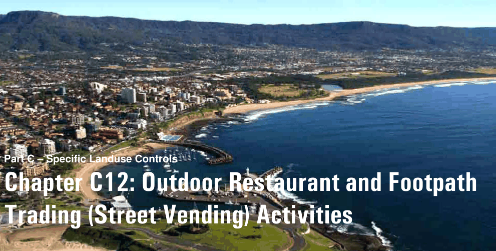

# Wollongong Development Control Plan 2009 - Chapter C12 Outdoor Restaurant and Footpath Trading (Street Vending) Activities

> This chapter is split into 7 section file(s), one per numbered heading, in the order they appear in the PDF.

Source PDF: [Wollongong-DCP-2009-Chapter-C12-Outdoor-Restaurant-and-Footpath-Trading-Street-Vending.pdf](https://planfortomorrow.sharepoint.com/sites/Planfortomorrow/Shared%20Documents/00%20NSW-Planning-Resources/dcp/wollongong-development-control-plan-2009/chapter-c12-outdoor-restaurant-and-footpath-trading-street-ven/Wollongong-DCP-2009-Chapter-C12-Outdoor-Restaurant-and-Footpath-Trading-Street-Vending.pdf)

> [Picture on page 1: a picture, saved as a picture (images/chapter-c12-outdoor-restaurant-and-footpath-trading-street-v-page-1-1.gif, 150 dpi).]

#### Part C – Specific Landuse Controls

### Chapter C12: Outdoor Restaurant and Footpath Trading (Street Vending) Activities

### Contents

<!-- sections -->
## Sections

1. [1 Figure 1: Location and Minimum Setback Requirements for](01-figure-1-location-and-minimum-setback.md)
2. [3 PART A OUTDOOR RESTAURANTS](02-3-part-a-outdoor-restaurants.md)
3. [4 PART B OUTDOOR TRADING ACTIVITIES / STREET](03-4-part-b-outdoor-trading-activities-street.md)
4. [1 INTRODUCTION](04-1-introduction.md)
5. [2 OBJECTIVES](05-2-objectives.md)
6. [3 OUTDOOR RESTAURANTS](06-3-outdoor-restaurants.md)
7. [4 OUTDOOR TRADING ACTIVITIES / STREET VENDING](07-4-outdoor-trading-activities-street.md)
