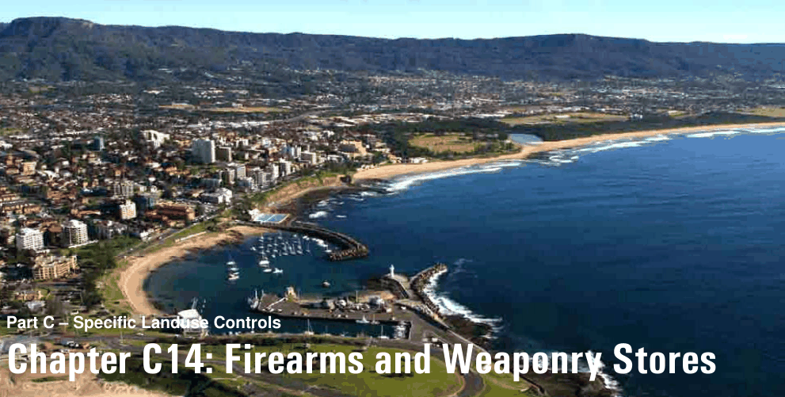

# Wollongong Development Control Plan 2009 - Chapter C14 Firearms and Weaponry Stores

> This chapter is split into 4 section file(s), one per numbered heading, in the order they appear in the PDF.

Source PDF: [Wollongong-DCP-2009-Chapter-C14-Firearms-and-Weaponry-Stores.pdf](https://planfortomorrow.sharepoint.com/sites/Planfortomorrow/Shared%20Documents/00%20NSW-Planning-Resources/dcp/wollongong-development-control-plan-2009/chapter-c14-firearms-and-weaponry-stores/Wollongong-DCP-2009-Chapter-C14-Firearms-and-Weaponry-Stores.pdf)

> [Picture on page 1: a picture, saved as a picture (images/chapter-c14-firearms-and-weaponry-stores-page-1-1.gif, 150 dpi).]

#### Part C – Specific Landuse Controls

### Chapter C14: Firearms and Weaponry Stores

### Contents

<!-- sections -->
## Sections

1. [3 DEVELOPMENT CONTROLS](01-3-development-controls.md)
2. [1 INTRODUCTION](02-1-introduction.md)
3. [2 OBJECTIVES](03-2-objectives.md)
4. [3 DEVELOPMENT CONTROLS](04-3-development-controls.md)
