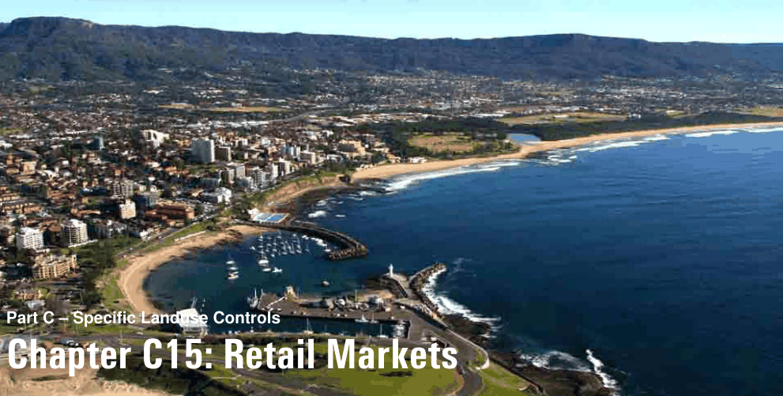

# Wollongong Development Control Plan 2009 - Chapter C15 Retail Markets

> This chapter is split into 18 section file(s), one per numbered heading, in the order they appear in the PDF.

Source PDF: [Wollongong-DCP-2009-Chapter-C15-Retail-Markets.pdf](https://planfortomorrow.sharepoint.com/sites/Planfortomorrow/Shared%20Documents/00%20NSW-Planning-Resources/dcp/wollongong-development-control-plan-2009/chapter-c15-retail-markets/Wollongong-DCP-2009-Chapter-C15-Retail-Markets.pdf)

> [Picture on page 1: a picture, saved as a picture (images/chapter-c15-retail-markets-page-1-1.gif, 150 dpi).]

#### Part C – Specific Landuse Controls

### Chapter C15: Retail Markets

### Contents

<!-- sections -->
## Sections

1. [18 MINIMUM INFORMATION REQUIRED TO BE LODGED](01-18-minimum-information-required-to-be.md)
2. [1 INTRODUCTION](02-1-introduction.md)
3. [2 OBJECTIVES](03-2-objectives.md)
4. [3 RETAIL IMPACT ASSESSMENT](04-3-retail-impact-assessment.md)
5. [4 HOURS OF OPERATION](05-4-hours-of-operation.md)
6. [5 CAR PARKING REQUIREMENTS](06-5-car-parking-requirements.md)
7. [6 MARKETS HELD ON PUBLIC LAND](07-6-markets-held-on-public-land.md)
8. [7 SALE OF GOODS](08-7-sale-of-goods.md)
9. [8 FOOD STALLS /MOBILE FOOD VANS](09-8-food-stalls-mobile-food-vans.md)
10. [9 AMUSEMENT DEVICES](10-9-amusement-devices.md)
11. [10 ACCESSIBILITY TO THE EVENT BY PEOPLE WITH A](11-10-accessibility-to-the-event-by-people.md)
12. [11 COPYRIGHT ISSUES – LIVE OR PRE-RECORDED MUSIC](12-11-copyright-issues-live-or-pre-recorded.md)
13. [12 FUNDRAISING MARKET EVENTS](13-12-fundraising-market-events.md)
14. [13 PUBLIC LIABILITY INSURANCE](14-13-public-liability-insurance.md)
15. [14 INCIDENT REPORTING](15-14-incident-reporting.md)
16. [15 EMERGENCY RESPONSE PLAN](16-15-emergency-response-plan.md)
17. [16 GROUND MAINTENANCE](17-16-ground-maintenance.md)
18. [17 MINIMUM INFORMATION REQUIRED TO BE LODGED WITH A](18-17-minimum-information-required-to-be.md)
