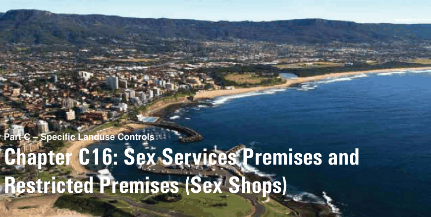

# Wollongong Development Control Plan 2009 - Chapter C16 Sex Services Premises and Restricted Premises (Sex Shops)

> This chapter is split into 9 section file(s), one per numbered heading, in the order they appear in the PDF.

Source PDF: [Wollongong-DCP-2009-Chapter-C16-Sex-Services-Premises-and-Restricted-Premises-Sex-Shops.pdf](https://planfortomorrow.sharepoint.com/sites/Planfortomorrow/Shared%20Documents/00%20NSW-Planning-Resources/dcp/wollongong-development-control-plan-2009/chapter-c16-sex-services-premises-and-restricted-premises-sex/Wollongong-DCP-2009-Chapter-C16-Sex-Services-Premises-and-Restricted-Premises-Sex-Shops.pdf)

> [Picture on page 1: a picture, saved as a picture (images/chapter-c16-sex-services-premises-and-restricted-premises-se-page-1-1.gif, 150 dpi).]

#### Part C – Specific Landuse Controls

Chapter C16: Sex Services Premises and

### Restricted Premises (Sex Shops)

#### Contents

<!-- sections -->
## Sections

1. [6 PLANNING CONTROLS](01-6-planning-controls.md)
2. [7 LEGAL ACTION](02-7-legal-action.md)
3. [1 INTRODUCTION](03-1-introduction.md)
4. [2 OBJECTIVES](04-2-objectives.md)
5. [3 DEFINITIONS](05-3-definitions.md)
6. [4 PLANNING AND REGULATORY POWERS - OTHER AUTHORITIES](06-4-planning-and-regulatory-powers-other.md)
7. [5 RELEVANT LEGISLATION](07-5-relevant-legislation.md)
8. [6 PLANNING CONTROLS](08-6-planning-controls.md)
9. [7 LEGAL ACTION](09-7-legal-action.md)
