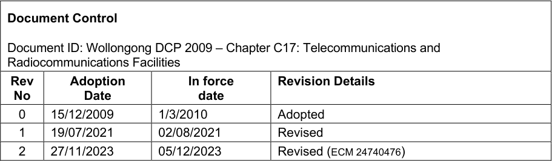

## 1 INTRODUCTION

#### 1

## 2 PURPOSE

#### 1

## 3 LAND TO WHICH THIS CHAPTER APPLIES

#### 1

#### 4 DEVELOPMENT TO WHICH THIS CHAPTER APPLIES 1

## 5 OBJECTIVES

#### 1

## 6 RELEVANT LEGISLATION, CODES AND STATE GOVERNMENT GUIDELINE

#### 2

## 7 DESIGN AND SITING CONTROLS

#### 2

### 7.1 Facility Health Controls

#### 2

### 7.2 Design and Construction

#### 2

### 7.3 Co-location

#### 3

### 7.4 Location

#### 3

### 7.5 Heritage

#### 4

## 8 DEVELOPMENT APPLICATION INFORMATION REQUIREMENTS

#### 4

## 9 CONDITIONS OF DEVELOPMENT CONSENT

#### 5

#### ACRONYMS AND DEFINITIONS

#### 6

> [Picture on page 1: a picture, saved as a picture (images/chapter-c17-telecommunications-and-radiocommunications-facil-page-1-36.gif, 150 dpi).]

#### Document Control

Document ID: Wollongong DCP 2009 – Chapter C17: Telecommunications and Radiocommunications Facilities

| Rev No | Adoption Date | In force date | Revision Details |
|---|---|---|---|
| 0 | 15/12/2009 | 1/3/2010 | Adopted |
| 1 | 19/07/2021 | 02/08/2021 | Revised |
| 2 | 27/11/2023 | 05/12/2023 | Revised (ECM 24740476) |

i
