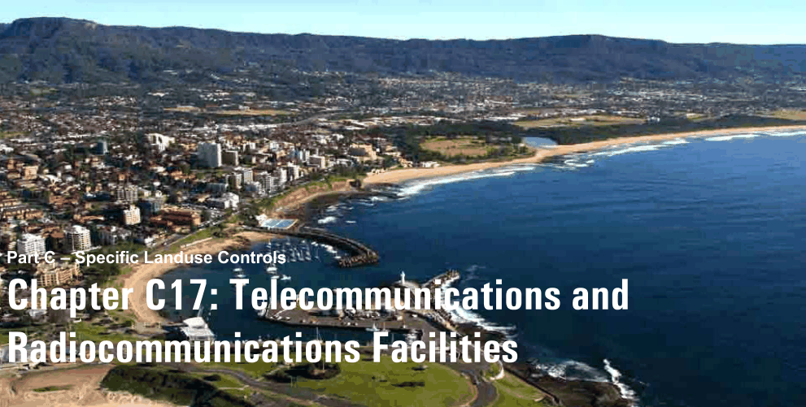

# Wollongong Development Control Plan 2009 - Chapter C17 Telecommunications and Radiocommunications Facilities

> This chapter is split into 10 section file(s), one per numbered heading, in the order they appear in the PDF.

Source PDF: [Wollongong-DCP-2009-Chapter-C17-Telecommunications-and-Radiocommunications-Facilities.pdf](https://planfortomorrow.sharepoint.com/sites/Planfortomorrow/Shared%20Documents/00%20NSW-Planning-Resources/dcp/wollongong-development-control-plan-2009/chapter-c17-telecommunications-and-radiocommunications-facilit/Wollongong-DCP-2009-Chapter-C17-Telecommunications-and-Radiocommunications-Facilities.pdf)

> [Picture on page 1: a picture, saved as a picture (images/chapter-c17-telecommunications-and-radiocommunications-facil-page-1-1.gif, 150 dpi).]

#### Part C – Specific Landuse Controls

### C17:

### Contents

<!-- sections -->
## Sections

1. [9 CONDITIONS OF DEVELOPMENT CONSENT](01-9-conditions-of-development-consent.md)
2. [1 INTRODUCTION](02-1-introduction.md)
3. [2 PURPOSE](03-2-purpose.md)
4. [3 LAND TO WHICH THIS CHAPTER APPLIES](04-3-land-to-which-this-chapter-applies.md)
5. [4 DEVELOPMENT TO WHICH THIS CHAPTER APPLIES](05-4-development-to-which-this-chapter.md)
6. [5 OBJECTIVES](06-5-objectives.md)
7. [6 RELEVANT LEGISLATION, CODES AND STATE GOVERNMENT GUIDELINE](07-6-relevant-legislation-codes-and-state.md)
8. [7 DESIGN AND SITING CONTROLS](08-7-design-and-siting-controls.md)
9. [8 DEVELOPMENT APPLICATION INFORMATION REQUIREMENTS](09-8-development-application-information.md)
10. [9 CONDITIONS OF DEVELOPMENT CONSENT](10-9-conditions-of-development-consent.md)
