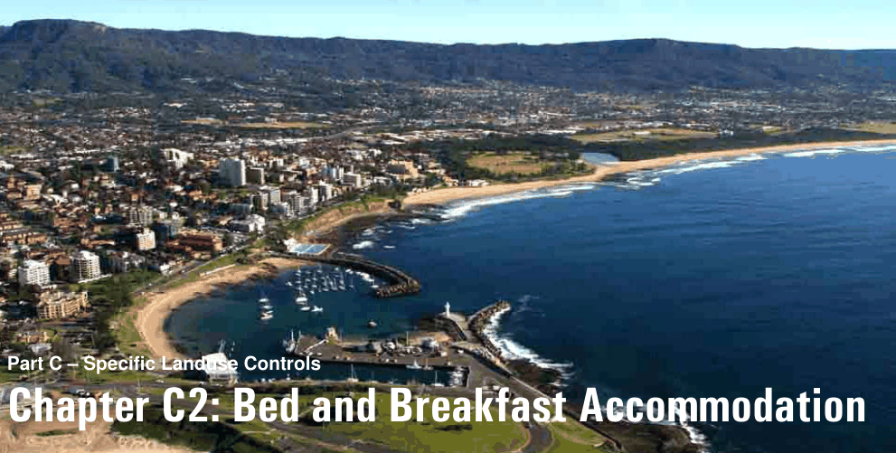

# Wollongong Development Control Plan 2009 - Chapter C2 Bed and Breakfast Accommodation

> This chapter is split into 5 section file(s), one per numbered heading, in the order they appear in the PDF.

Source PDF: [Wollongong-DCP-2009-Chapter-C02-Bed-and-Breakfast-Accommodation.pdf](https://planfortomorrow.sharepoint.com/sites/Planfortomorrow/Shared%20Documents/00%20NSW-Planning-Resources/dcp/wollongong-development-control-plan-2009/chapter-c2-bed-and-breakfast-accommodation/Wollongong-DCP-2009-Chapter-C02-Bed-and-Breakfast-Accommodation.pdf)

> [Picture on page 1: a picture, saved as a picture (images/chapter-c2-bed-and-breakfast-accommodation-page-1-1.gif, 150 dpi).]

#### Part C – Specific Landuse Controls

### Chapter C2: Bed and Breakfast Accommodation

### Contents

<!-- sections -->
## Sections

1. [4 DEVELOPMENT CONTROLS](01-4-development-controls.md)
2. [1 INTRODUCTION](02-1-introduction.md)
3. [2 OBJECTIVES](03-2-objectives.md)
4. [3 DEFINITIONS](04-3-definitions.md)
5. [4 DEVELOPMENT CONTROLS](05-4-development-controls.md)
