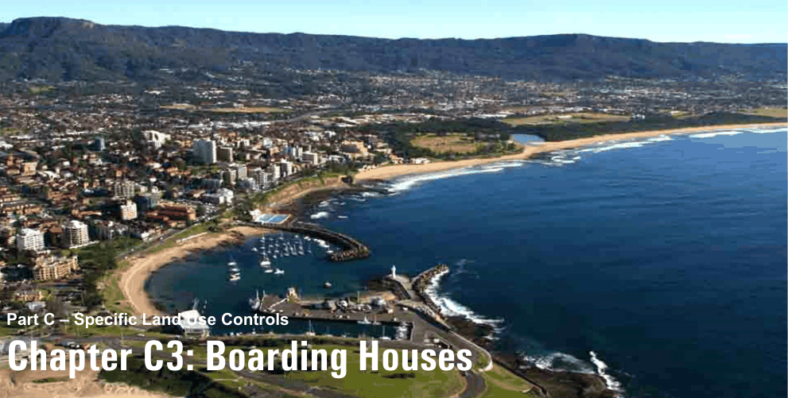

# Wollongong Development Control Plan 2009 - Chapter C3 Boarding Houses

> This chapter is split into 17 section file(s), one per numbered heading, in the order they appear in the PDF.

Source PDF: [Wollongong-DCP-2009-Chapter-C03-Boarding-Houses.pdf](https://planfortomorrow.sharepoint.com/sites/Planfortomorrow/Shared%20Documents/00%20NSW-Planning-Resources/dcp/wollongong-development-control-plan-2009/chapter-c3-boarding-houses/Wollongong-DCP-2009-Chapter-C03-Boarding-Houses.pdf)

> [Picture on page 1: a picture, saved as a picture (images/chapter-c3-boarding-houses-page-1-1.gif, 150 dpi).]

#### Part C – Specific Land Use Controls

### Chapter C3: Boarding Houses

| Contents |  |  |
|---|---|---|
| 1 | INTRODUCTION | 2 |
| 2 | OBJECTIVES | 2 |
| 3 | DEVELOPMENT CONTROLS FOR BOARDING HOUSES | 2 |
| 3.1 | Location of Boarding Houses | 2 |
| 3.2 | Minimum Lot Sizes | 3 |
| 3.3 | Setbacks | 3 |
| 3.4 | Landscaping | 3 |
| 4 | MINIMUM FACILITIES FOR BOARDING HOUSES – Building Code of Australia | 4 |
| 4.1 | Class 1(b) Boarding Houses | 4 |
| 4.2 | Class 3 Boarding Houses | 4 |
| 5 | GENERAL BOARDING HOUSE CONTROLS | 4 |
| 6 | MANAGEMENT PLAN | 6 |
| 7 | FIRE SAFETY | 7 |
| 8 | SWIMMING POOLS | 7 |
| SCHEDULE 1 - BOARDING HOUSE MANAGEMENT PLAN TEMPLATE |  | 8 |
| 1 | INTRODUCTION | 8 |
| 1.1 | General Details | 8 |
| 1.2 | Management Arrangements | 8 |
| 1.3 | Lease Agreements | 8 |
| 2 | FIRE SAFETY | 8 |
| 3 | HOUSE RULES | 9 |
| 4 | FURNITURE AND FACILITIES | 9 |
| 5 | CLEANING AND MAINTENANCE | 9 |
| 6 | WASTE AND RECYCLING | 10 |
| 7 | PARKING STATEMENT | 10 |
| 8 | EMERGENCY EVACUATION PLAN | 10 |
| 9 | COMPLAINTS HANDLING | 10 |

i

### Document Control

Document ID: Wollongong DCP 2009 – C3: Boarding Houses

| Revision No | Adoption Date | In Force Date | Revision Details |
|---|---|---|---|
| 1 | 15/12/2009 | 3/3/2010 | Adopted chapter as part of DCP. |
| 2 | 14/3/2016 | 30/3/2016 | Revisions to align with state legislation |
| 3 | 8/8/2022 | 22/8/2022 | Revision to align with state legislation |

<!-- sections -->
## Sections

1. [1 INTRODUCTION](01-introduction.md)
2. [2 OBJECTIVES](02-objectives.md)
3. [3 DEVELOPMENT CONTROLS FOR BOARDING HOUSES](03-development-controls-for-boarding-houses.md)
4. [4 MINIMUM FACILITIES FOR BOARDING HOUSES – BUILDING CODE OF AUSTRALIA](04-minimum-facilities-for-boarding-houses.md)
5. [5 GENERAL BOARDING HOUSE CONTROLS](05-general-boarding-house-controls.md)
6. [6 MANAGEMENT PLAN](06-management-plan.md)
7. [7 FIRE SAFETY](07-fire-safety.md)
8. [8 SWIMMING POOLS](08-swimming-pools.md)
9. [1 INTRODUCTION](09-1-introduction.md)
10. [2 FIRE SAFETY](10-2-fire-safety.md)
11. [3 HOUSE RULES](11-3-house-rules.md)
12. [4 FURNITURE AND FACILITIES](12-4-furniture-and-facilities.md)
13. [5 CLEANING AND MAINTENANCE](13-5-cleaning-and-maintenance.md)
14. [6 WASTE AND RECYCLING](14-6-waste-and-recycling.md)
15. [7 PARKING STATEMENT](15-7-parking-statement.md)
16. [8 EMERGENCY EVACUATION PLAN](16-8-emergency-evacuation-plan.md)
17. [9 COMPLAINTS HANDLING](17-9-complaints-handling.md)
