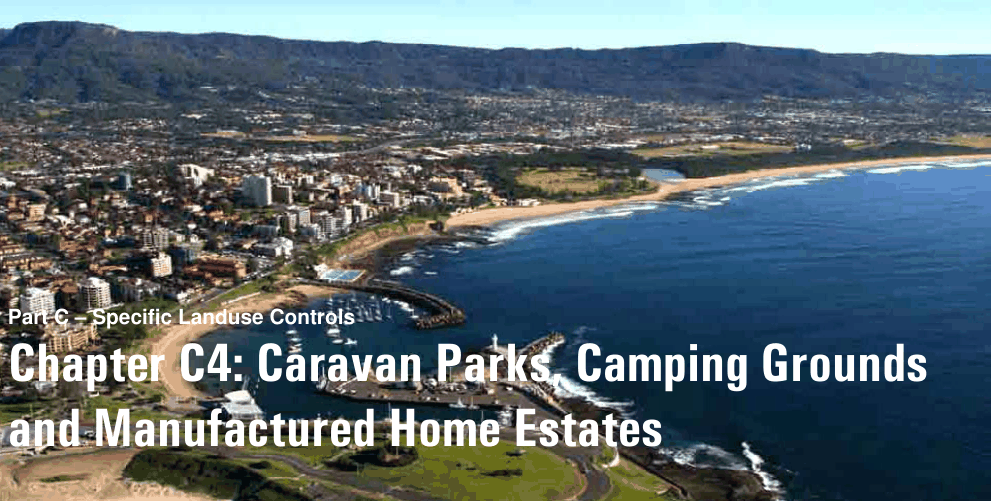

# Wollongong Development Control Plan 2009 - Chapter C4 Caravan Parks, Camping Grounds and Manufactured Home Estates

> This chapter is split into 7 section file(s), one per numbered heading, in the order they appear in the PDF.

Source PDF: [Wollongong-DCP-2009-Chapter-C04-Caravan-Parks,-Camping-Grounds-and-Manufactured-Home-Estates.pdf](https://planfortomorrow.sharepoint.com/sites/Planfortomorrow/Shared%20Documents/00%20NSW-Planning-Resources/dcp/wollongong-development-control-plan-2009/chapter-c4-caravan-parks-camping-grounds-and-manufactured-hom/Wollongong-DCP-2009-Chapter-C04-Caravan-Parks%2C-Camping-Grounds-and-Manufactured-Home-Estates.pdf)

> [Picture on page 1: a picture, saved as a picture (images/chapter-c4-caravan-parks-camping-grounds-and-manufactured-ho-page-1-1.gif, 150 dpi).]

#### Part C – Specific Landuse Controls

### Chapter C4: Caravan Parks, Camping Grounds and Manufactured Home Estates

> The PDF's contents list (page numbers of the printed document) is not repeated here - see Sections below.

i

<!-- sections -->
## Sections

1. [1 INTRODUCTION](01-introduction.md)
2. [2 OBJECTIVES](02-objectives.md)
3. [3 DEFINITIONS](03-definitions.md)
4. [4 STATUTORY APPROVAL PROCESS](04-statutory-approval-process.md)
5. [5 DEVELOPMENT CONTROLS – MANUFACTURED HOME ESTATES](05-development-controls-manufactured-home.md)
6. [6 DEVELOPMENT CONTROLS - CARAVAN PARKS & CAMPING GROUNDS](06-development-controls-caravan-parks-and.md)
7. [7 INFORMATION TO BE SUBMITTED WITH A DEVELOPMENT](07-information-to-be-submitted-with-a.md)
