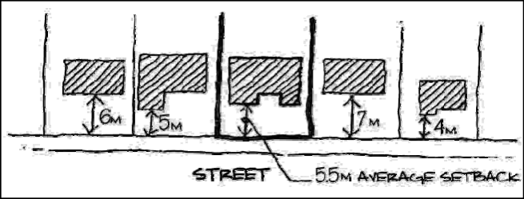
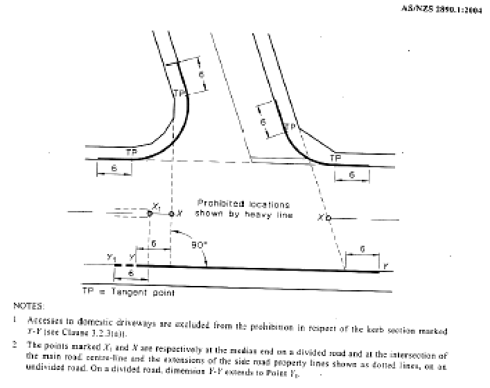
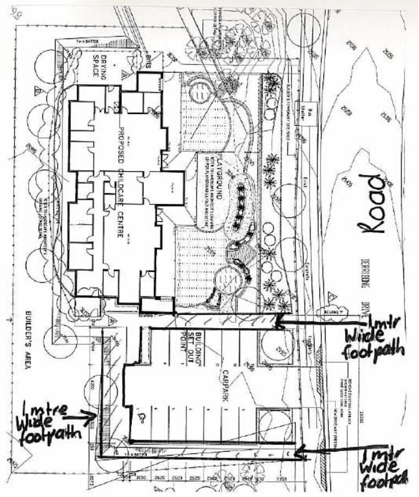

## 7 PLANNING AND DESIGN CRITERIA

### 7.1 Maximum Capacity of Centre and Staffing Levels

#### 7.1.1 Objectives:

(a) To minimise the impact of child care centres on residential amenity in terms of traffic generation/movement, traffic noise and noise from children and to achieve a building that is compatible with the character of existing surrounding residential development;

(b) To ensure that child care centres are consistent with the Children’s Services Regulation 2004 in respect of maximum numbers of child care places and child/staff ratios; and

(c) To ensure that the area per person using the child care centre is consistent with the provisions of the Building Code of Australia (BCA).

#### 7.1.2 Controls:

1\. In residential zones, the maximum capacity of a child care centre shall be restricted of up to 49 children.

2\. In residential zones, child care centres should be designed to ensure the scale, height and form of the building is compatible with existing residential development in the surrounding locality.

3\. In non-residential zones, Council may accept a maximum capacity of greater than 49 children. NOTE: DoCS states that the maximum number of children under 6 years of age to be in attendance at one time is 90 of whom:

(a) No more than 30 may be under the age of  2 years, and;

(b) No more than 60 may be between 2 years and 6 years.

Council is unlikely to support a centre with more than 90 children since a centre of this size is considered inconsistent with a number of objectives outlined in clause 2 of this chapter in this DCP, namely, objectives (b), (c), (d), (e) and (f).

4\. The required (DoCS determined) minimum ratio of primary contact staff to children under care shall be in accordance with the minimum ratio requirements contained in the Children’s Services Regulation 2004. In this regard, the number and age of children and ratio of staff to children must be clearly identified in the Development Application.

5\. All Development Applications for child care centres are required to be supported by sufficient written justification that the proposed number of children within each age group is consistent with the current and projected future needs of the locality within which the centre is proposed to be located.

6\. The proposed number of full and part time staff and the role of each staff member is required to be submitted with the application.  This information is required to assess a number of aspects of the proposed development such as the amount of open space required and the number of car parking spaces that are required.

7\. In all cases, the floor area per person must comply with the relevant provision of the BCA.  This must be taken into account with the above threshold criteria as per DoCS requirements.

### 7.2 Location and Site Selection

#### 7.2.1 Objectives

(a) To ensure child care centres are located upon sites of high environmental quality only, in order to minimise any potential adverse health and safety risks to young children and staff; and

(b) To impose minimum separation distances between any new child care centre and range of land uses which may cause potential adverse health or safety risks to young children, through the application of the “precautionary principle”.

#### 7.2.2 Development Controls

1\. Child care centres will not be supported upon a site within a 90 metre straight line distance from any designated road (arterial or sub-arterial road), given relatively high traffic flow volumes associated with such roads and potential adverse air pollution and / or noise emission impacts upon young children.

2\. Any new child care centre will not be permitted within a 500 metre radius from any service station.

3\. Any new child care centre will not be permitted within a 500 metre radius from any industry or warehouse distribution facility involving the use or storage of any dangerous goods as listed under the Dangerous Goods Code.

4\. As a precautionary approach, new child care centres must not be located within a 400 metre radius from any existing or approved telecommunications or radio-communications tower or base station or a high voltage electricity transmission line (ie with a voltage of 33 kilovolts or more).

5\. Child care centres will not be permitted within a 500 metre radius of any of the following industries / activities, due to potential adverse air or noise emission impacts upon the child care centre:

(a) Extractive industries;

(b) Intensive agriculture;

(c) Agricultural spraying activities; or

(d) Waste transfer depot or landfill site.

6\. Where a child care centre is proposed upon a known or potentially contaminated site, the applicant will be required to submit to a site contamination investigation report and a remediation action plan with the Development Application in accordance with the requirements of the Contaminated Land Management Policy Guidelines contained in Part E of this DCP.

7\. Child care centres will generally not be supported within any industrial zoned land, due to concerns over environmental quality and land use conflicts.

8\. Child care centres are prohibited within a 150 metre radius of any existing or approved medical clinic or facility providing drug treatment and / or drug counselling services.

9\. Child care centres are prohibited within a 150 metre radius of any existing or approved sex service premises, restricted premises or a gun shop.

10\. Child care centres will not be supported within any mixed use development where the centre is independent of the other land use in the building. However, a mixed use development involving a ground floor work based child care centre which is ancillary to an upper level commercial office building may be considered where it is satisfactorily demonstrated that the centre is ancillary to the principal commercial office development above and will be restricted only to the care of young children whose parents work in the commercial offices above the centre. Any such centre must provide satisfactory car parking either at- grade or within the first basement car parking level directly below the child care centre with appropriate security lift access only for staff and parents with children in the centre to the secured car parking level. Any ground floor work based child care centre must include all internal and outdoor play area as per the requirements contained in this chapter of the DCP.

### 7.3 Building Design, Appearance and Neighbourhood Character

#### 7.3.1 Objectives

(a) To ensure that child care centres are designed to be compatible with the existing or future planned character of the surrounding locality in terms of siting, scale, building form, height and external appearance.

(b) To ensure that the external appearance of any new child care centre is of a high visual quality and which enhances the streetscape character of the building.

#### 7.3.2 Development Controls

1\. Any new child care centre must comply with the relevant maximum floor space ratio and height controls for the site as set out in Wollongong Local Environmental Plan 2009.

2\. The design of the child care centre should relate to the slope and topography of the site, in order to restrict cut and fill earthworks. However, any land re-shaping works will be restricted to a maximum 1 metre cut and a maximum 1 metre fill and must not result in any potential adverse overland run-off problems to adjoining properties.

3\. The minimum site area required for a child care centre within a residential zone or B4 Mixed Use

zone is 800m2. However, a larger site area may be necessary for a larger sized child care centre to achieve compliance with other child care centre design requirements in this DCP and licensing requirements of NSW DoCS.

4\. A minimum 20 metre road frontage width is required for a child care centre (ie as measured at the front building line setback), except in the case of a corner allotment in which case, a minimum 24 metre road frontage to the primary road is required.

5\. Child care centres should be single storey in height. However, a maximum two storey height limit applies for child care centres. In the case of a two storey building, the ground floor of the building must include the main child care centre component (including children’s indoor play areas, toilet

facilities, sleeping areas, staff offices and other ancillary rooms etc) with the upper storey of the building used only for the purposes of storage and staff training facilities.

6\. For any two storey building, child proof barriers at the bottom of the stairs will be a required to prevent any child entering the stairway.

7\. The front setback of the building shall be determined by means of site analysis. The setback must be the average of the existing setbacks of the two properties on either side of the site. (Refer to Figure 1 below). However, an absolute 5.5 metre minimum front building line setback is required for any child care centre in a residential zone or B4 Mixed Use zone. The absolute minimum front building line setback for a centre upon a rural zoned site shall be 10 metres.

> [Picture on page 9: a picture, saved as a picture (images/chapter-c5-child-care-centres-page-9-10.gif, 150 dpi).]

Site analysis showing how the average setback of abutting development could be used to determine front setbacks for new development.

Figure 1: Front Setback Analysis

8\. A minimum 6 metre rear building line setback is required for any new child care centre building in a residential zone or the B4 Mixed Use zone.

9\. A minimum 3 metre rear setback is required for any outdoor play area, off the common property boundary with any adjoining residential property, in order to maintain the amenity and privacy of the adjoining property occupants.

10\. A minimum 2 metre side building line setback is required for any new child care centre in a residential zone or the B4 Mixed Use zone, except where no openings are provided to the subject boundary in which case a minimum 900 millimetre setback may be permitted.

11\. In residential zones, the building should be designed so that it is consistent with the prevailing streetscape character of the surrounding locality in terms of its scale, building form / massing, height and external appearance. The roof design of a building should also be compatible with surrounding properties with respect to height, pitch, building materials and colour.

12\. An external finishes board showing proposed building materials and colour palettes is to be provided for all development applications for child care centres.

13\. Child care centres should incorporate architectural elements to help articulate facades and minimise large expanses of blank walls (maximum 30% on any street elevation).

14\. A child care centre on a corner allotment should present to both street frontages and incorporate architectural features to emphasise the corner address.

15\. The front door and at least two windows to a building must face the street.  The street number of a building must be visible from the street (daylight and at night) and made of a reflective material to allow visitors and emergency vehicles to easily identify the location of the building.

### 7.4 Indoor Areas

#### 7.4.1 Objectives

(a) To provide attractive and functional indoor spaces which provide positive experiences and developmental growth for children;

(b) To provide indoor spaces which are safe and functional and enable adequate staff supervision of children, at all times;

(c) To ensure that child care centres comply with the provisions of Children’s Services Regulation 2004 and to encourage the use of best practice principles for the design internal spaces within child care centres; and

(d) To ensure that facilities comply with the requirements of a food business, where the provision of food is intended.

#### 7.4.2 General Design Requirements

1\. The building should be designed to achieve optimal solar access opportunities into the playroom areas of the centre and to maximise the use of natural ventilation and light within each room of the facility.

2\. The provision of external window shades is recommended for any westward facing windows in any building.

3\. The use of safety glass and safety markers (permanent motif or other decorative treatment on or etched into the glass of sufficient magnitude to be readily apparent) at child and adult height is required for all child care centres.

4\. All doors and windows within a child care centre must be provided with insect screens, to minimise the number of mosquitoes and flies entering the building.

5\. Fluorescent light tubes are not recommended for internal lighting as they can flicker, hum, cause glare and headaches, emit UV radiation and so forth.  Building design should take advantage of natural lighting.  Energy efficient compact fluorescent light bulbs with softer toned colours do not have the undesirable characteristics of fluorescent light tubes.  No rooms are to require constant artificial lighting during the day to maintain adequate light levels.  Indoor lighting should comply with Australian Standards (AS1680 suite of Standards).

#### 7.4.3 Indoor Play Areas

1\. The indoor play areas of a centre must have at least 3.25 square metres of unencumbered indoor space per licensed child that is exclusively for the use of the children.

For the purposes of this calculation, the unencumbered indoor play space area excludes hallways, door swing areas, cot rooms, kitchen, toilet or shower areas located in the building, staff and administration areas or other ancillary storage facilities.

2\. Child care centres catering for over 30 places and not more than 39 places must have separate indoor play areas for 0-3 years and 3-6 years. Child care centres involving 40 places and over must provide separate indoor play areas for children aged 0-2 years, 2-3 years and 3-6 years. This requirement is designed to ensure the safety of all children and to provide a quality learning environment for each relevant age group.

3\. The windows of indoor play areas are to be located with a northern orientation and shall receive at least three hours of sunlight between the hours of 9.00 am and 3.00 pm for June 21.

4\. Each playroom area should have a separate entry point. The entry point to each playroom area should not cross over with another playroom entry point.

5\. Each playroom has its own storeroom/cupboard and bed storage.

#### 7.4.4 Staff Respite Room & Private Consultation Room

1\. The child care centre must have:

(a) A room or an area that is used only for administration of the service and for private consultation between staff and parents; and

(b) A room or an area located away from the areas used by children to be used for respite of staff.

#### 7.4.5 Sleeping Room

1\. A sleeping room(s) must be provided in the child care centre for children under 2 years of age.

2\. An individual cot must be provided for each child under the age of 2 years.  The cots must be located in separate cot room(s) with a maximum number of 6 cots per room.  The cot room must be designed to provide adequate ventilation, visual access/supervision of each cot, doors to prevent noise, door widths to allow for a cot to be moved through the doorway in an emergency and a separation between cots of at least 800 millimetres to prevent cross infection.

#### 7.4.6 Toilet and Washing Facilities

1\. All child care centres must have suitable toilet facilities, hand washing and bathing facilities that are safe and appropriate to the ages of the children at the centre.

2\. A centre based children’s facility must provide toilet facilities in accordance with the requirements of the Building Code of Australia for Class 9b buildings (early childhood centres).

3\. The toilet and washroom facilities should be directly accessible to and visible from each play area and outdoor play space.

4\. The floor of the toilet and washing area should be washable and with a non-slip finish and graded.

5\. The hand wash basins should be mounted between 570mm and 600mm high.

6\. The toilet and washing facility must be naturally ventilated and mechanically ventilated.

#### 7.4.7 Nappy Change Area

1\. A nappy change area and facilities are required in child care centres catering for children under the age of 3 years in accordance with Children’s Services Regulations.  Additionally, the nappy change area must:

(a) Be adjacent to the sleep room and have adequate ventilation and visibility;

(b) Be separated from the kitchen/bottle preparation area by an airlock; and

(c) Ensure suitable storage (within the staff person’s reach) for towels, soap, nappies etc.

2\. The toilet and washing facility must be naturally ventilated and mechanically ventilated.

3\. The nappy change area must have separate hand washing facilities, bathing facilities and 1 happy change mat for every 5 children under 3 years of age. Thermostatic controlled hot water must be provided to all sinks.

#### 7.4.8 Bottle Preparation Area

1\. A bottle preparation area is required in child care centres catering for children under the age of 3 years.  The bottle preparation area must be separated from the nappy change area by an airlock, or placed away from the nappy change area.  The bottle preparation area must:

(a) Be adjacent to the play room and have adequate ventilation and visibility;

(b) Contain a double sink for hand washing and food preparation with temperature controlled water;

(c) Provide suitable storage (out of reach of children/in reach of staff) for disinfectants, food preparation utensils, cups, plates etc;

(d) Be inaccessible to children; and

(e) Have bench space adequate for food preparation, a microwave oven, bar fridge, sterilising units and draining areas for toys and equipment to drain after the disinfecting procedure.

#### 7.4.9 Kitchen Area

1\. The provision of a separate kitchen area is required within the child care centre for safe food preparation. The kitchen area must be constructed in accordance with the Children’s Services Regulation 2004, Food Act 2003 and the Australian Standard AS 4674 -2004 Design, Construction and Fit-out of Food Premises. The kitchen must be separate from any play room, toilet and washing area or sleeping room.

2\. The kitchen area must be equipped with a stove or microwave, refrigerator, a suitable waste disposable & recyclable container facility, sink and a hot and cold water supply.

3\. The kitchen must have a door, half-gate or other barrier to prevent any unsupervised entry by children into the kitchen.

4\. Kitchen areas should include lockable cupboards and shelving so as to prevent children from gaining access to any harmful substance or equipment.

5\. Where it is intended to serve food from the Child Care Centre, a food business is required to be registered with Council and notified to the NSW Food Authority (www.foodnotify.nsw.gov.au).

#### 7.4.10 Rest Area

1\. A suitable quiet rest area is required to be provided in a child care centre for the care of a child who becomes unwell. This rest area should have a sofa bed, stretcher or mattress and in an easily supervised area.

#### 7.4.11 First Aid Kit

1\. Each child care centre must be equipped with a suitable first aid kit. The first aid kit must be kept in a locked cupboard and the key to the cupboard must be kept in a position in close proximity to the cupboard so it is readily accessible to all staff.

#### 7.4.12 Energy Efficient Appliances

1\. The use of energy efficient appliances is recommended for any new child care centre or any existing centre undergoing major upgrading or renovations.

#### 7.4.13 Hot Water Outlets

1\. Hot water from any outlet used by children at the centre (eg bath, basin or shower) must be regulated to keep the temperature of water from the outlet below 43.5 degrees Celsius, in order to prevent a child from being scalded.

2\. In new child care centres, solar hot water systems or other energy efficient hot water systems should be installed.

### 7.5 Outdoor Areas

#### 7.5.1 Objectives

(a) To provide generous outdoor play areas which allow a variety of experiences for children including learning play, active and quiet time and other developmental experiences;

(b) To provide outdoor spaces which are safe, secure and functional and enable adequate staff supervision of children, at all times; and

(c) To ensure minimum noise transmission and other nuisances to the surrounding area.

#### 7.5.2 Development Controls

1\. In accordance with best practice principles, outdoor spaces are to provide for a variety of experiences through the provision of different spaces within the outdoor area.  These different areas are to be:

(a) Open areas for activities such as running;

(b) Quiet areas; and

(c) Active areas.

2\. A centre must have at least 7 square metres of useable outdoor play space for each child aged 0 to 6 years (i.e. each licensed child care place) that is exclusively for the use of children.

3\. Outdoor play areas should have a separate sandpit for each designated age group and a variety of ground surfaces such as sand, grass, soil, soft fall, hard surfaces and mounding. The outdoor play areas shall provide both natural shading as well as incorporate appropriate artifical shade screen structures The heat absorption qualities and texture of materials must be suitable, with surfaces such as bitumen (due to surface temperature exceeding 45 degrees in summer) being avoided.  Soft impact surfaces should be supplied under play equipment.  Non–slip hard paving should be used for play with wheeled toys, access to the building, and use under verandahs and covered areas.

4\. Outdoor play spaces are to be:

(a) Located away from the main entrance of the child care centre, car parking areas or vehicle circulation areas.  A child care centre must separate the car parking area and any outdoor play area with a safety fence and gates.

(b) Safe in relation to the location of roads.  Where the outdoor play space adjoins a road, details of fencing designed to minimise potential impact from motor vehicle accidents must be provided with the development application.  Measures might include erection of an Armco barrier or similar. Landscaping should be provided to absorb emissions and noise from vehicles.

(c) Integrated with indoor space and provide direct and easy access between those areas.

(d) Of a design and layout to enable clear lines of sight to all areas of the outdoor space to allow direct staff supervision from other areas of the child care centre.

(e) Orientated to take advantage of natural sunlight and shade, with the most desirable orientation being north and north east.

(f) Located away from existing and potential noise and environmental pollution sources.

(g) Located away from the living/bedroom windows of surrounding dwellings where it is a predominantly residential area.

(h) Inaccessible from public areas outside the child care centre, except in the case of an emergency evacuation or centre deliveries such as sand replacement, unless as a security system is in place which grants access, in the form of a swipe card for example, only to authorised persons, such as families and other authorised visitors.

(i) Located away from areas where objects can be projected down onto play areas and designed to ensure it is not overlooked by the adjoining property, including balconies.

(j) Adequately fenced on all sides. Any fences to the street must be see–through to encourage passive visual surveillance of the street and enhance the vibrancy of the area.

(k) Designed with an outdoor storage area for the storage of outdoor equipment without being part of the outdoor play area and without inhibiting supervision of children (no less than 12m in size).

(l) Provided with an impermeable roof structure to provide protection from inclement weather (or transition area).  This should be 2.5sqm per licensed place or 10% of the total site, with a minimum width of 4m.

(m) A minimum of one (1) sandpit is required within the outdoor play area for each designated age group. The minimum depth of a sandpit must be 600mm.

(n) A physical division, in the form of a low level fence (1 metre high) or a similar structure, is to be maintained between the play spaces provided for children under the age of three years, and children over the age of three years to ensure that younger children have access to adequate spaces and equipment.  Where the service offers more than 49 places, the playground should be separated into three age groups – 0-2 years, 2-3 years and 3-5 years.

5\. Outdoor play spaces are to be adequately shaded in accordance with Shade for Child Care Services published by the NSW Cancer Council, guidelines provided by the NSW Health Department and Australian Standards in relation to the provision of shade structures in play areas.  The following solar protection measures should be taken as a minimum:

(a) 50% of all outdoor areas should be shaded during the hours of 10.00am to 3.00pm Eastern Summer Time which may be provided by trees, awnings or other structures to the satisfaction of Council;

(b) Sandpits (with a cover) are to be provided with year round full protective shade;

(c) Outdoor teaching areas are to be provided with year round protective shade;

(d) Outdoor eating areas are to be provided with year round shade.

6\. All play areas and play equipment should comply with the Playground Safety Standard AS4685:2004 (Part 1-6).

7\. Suitably sized rainwater tanks are required for new child care centres based on water requirements and plumbed for these purposes. The lid to any such rainwater tank must be locked to prevent any accidental entry by children.

8\. Provision should be made at the service to ensure that water containers, which could constitute a drowning hazard, are safely covered or are inaccessible to children.

9\. Mosquito breeding must be minimised by ensuring that drains and gutters are cleared and/or covered, on-site water pooling is eliminated and dark, damp areas (eg between fences and garden sheds) are clear of vegetation and clutter.

### 7.6 Car Parking, Access and Pedestrian Safety

#### 7.6.1 Objectives

(a) To ensure a safe environment for pedestrians, motorists and cyclists in and around child care centres;

(b) To ensure that vehicular access arrangements into and from the car parking area do not detrimentally affect the traffic flow or safety of roads in the surrounding road network; and

(c) To ensure that suitable parking arrangements are provided on-site for staff, parents, visitors and emergency or service vehicles.

#### 7.6.2 Development Controls

1\. A car parking and traffic impact assessment study must accompany any Development Application for a new child care centre or in circumstances where an existing centre proposes an increase in the total number of children or a change in the mix of 0- 2, 2-3 and 3 -6 year aged children within the centre is proposed. The car parking and traffic impact assessment study must be prepared by a suitably qualified and experienced traffic consultant.

2\. The car parking and traffic impact assessment study should address a range of matters including (but not necessarily limited to) the following:

(a) Existing prevailing traffic conditions, including AADT traffic volumes on key roads in the locality;

(b) The likely traffic generation rate of the proposed centre, taking into account the size and location of the centre, the intended catchment area of the centre and the proximity of the centre to public transport services;

(c) The current level of service for key intersections in the locality of the site;

(d) The predicted level of service for key intersections in the locality of the site;

(e) The likely impact of the proposed development on existing traffic flows upon the local road network;

(f) The suitability of the proposed access arrangements into / from the car parking area in the centre, taking in account current and future anticipated traffic conditions;

(g) Any pedestrian and traffic safety issues;

(h) Car parking requirements for the proposed centre;

(i) Written justification for any variation to the parking requirements (if any proposed); and

(j) Recommended road upgrading works (including footpath improvements) required to satisfactorily cater for the development.

3\. Parking and access must comply with the car parking requirements contained in Part E of this DCP and Australian Standard AS2890.1.

4\. Parking should be provided on-site at a rate of one (1) space for each member of staff present at any one time plus one (1) visitor space for each 6 children or part there of.

5\. All parking (staff and visitor) is to be provided in the one location, preferably adjacent to the entrance of the centre.  Any increase in staff or children may require additional car parking.  Any change to the ages of children that affects staffing ratios will require a variation to consent and a revised number of parking spaces.

6\. The car parking area must also provide at least one (1) parking bay for service vehicles and emergency vehicles (ie ambulance).

7\. Where an attached residence is proposed, under cover parking spaces should be provided for the use of residents at the following rate: 1 space for dwellings less than 125 square metres or 2 spaces for dwellings greater than 125 square metres.

8\. All Child Care Centres should make provision for a minimum of three (3) parking spaces (ie with unobstructed car parking dimensions of 3.2m x 5.5m), located at the entrance to the Centre for people with mobility issues or parents with young children requiring the use of strollers.  At least, one (1) of these spaces is to be a designated disabled person’s parking space.

9\. The car parking area is to be designed to ensure:

(a) The safe drop off and collection of children;

(b) Direct and safe pedestrian access to and from the entrance of the centre;

(c) Safe movement and parking of all staff, parent, visitor and service vehicles; and

(d) Forward access to and from the car park.

10\. The use of tandem or stacked parking will not be supported.

11\. Drive-through car parking layouts are not supported, since such layouts often result in the queuing of vehicles back onto the road carriageway, during peak drop off and pick up periods.

12\. The vehicular and pedestrian access points to / from the centre are to be appropriately signposted.

13\. The car parking area shall be suitably line marked and delineated by appropriate signage and pavement line marking. This shall include the line-marking and signposting of disabled car parking spaces, staff parking arrangements, emergency and service vehicle parking bays.

14\. Parking spaces and vehicle access points are to be located to ensure the safe movement of children to and from the centre.  Pedestrian access must be segregated from car park access way with clearly defined paths and fencing (ie min. 1000mm – max.1200 mm height) between the facility and the road reserve and between the car park and the facility entry. This fencing must not obstruct sight distance between pedestrians and vehicles.

15\. Pedestrian safety measures (eg pedestrian crossings and refuges etc) may be required to be installed, if the child care centre site is situated on a main collector road and is characterised by relatively high traffic volumes, especially during peak drop off / pick up periods.

16\. All vehicles entering and leaving the site shall be able to do so in a forward direction.  The need to reverse vehicles within the site should be minimised.

17\. New child care centres will not be permitted upon sites on or directly opposite intersections.

18\. For existing child care centres on or opposite an intersection, driveways will not be permitted in the locations shown by heavy lines in Figure 2 in AS2890.1:2004, driveways shall not be permitted within 6m of the front property boundary on the intersecting street (note: this equates to approximately 10m from the kerb return of the intersecting street).

> [Picture on page 17: a picture, saved as a picture (images/chapter-c5-child-care-centres-page-17-5.gif, 150 dpi).]

#### Figure 2: Australian Standard for Driveways

19\. A suitable waste disposal and recycling bin storage area is required. This storage area shall be positioned to enable direct access by a private garbage truck contractor. On-site waste collection should be undertaken outside the opening hours of centre, especially during peak drop off or pick up periods, in order to minimise any potential vehicular or pedestrian conflicts.

20\. The gradient of the driveway is to be no greater than specified in AS2890.1:2004 in the Australian Standard.  The maximum change in gradient is to be 12.5%.

Figure 3 illustrates a good example of parking provided for a child care centre.

> [Picture on page 18: a picture, saved as a picture (images/chapter-c5-child-care-centres-page-18-1.gif, 150 dpi).]

#### Figure 3: Example of Parking Provisions

### 7.7 Signage and Outdoor Lighting

#### 7.7.1 Objectives

(a) To ensure that the entrance to the centre is clearly identifiable during both day and night; and

(b) To ensure any signage associated with the child care centre does not dominate the building or the streetscape.

(c) To ensure child care centre have adequate outdoor lighting for safety and security for all users, whilst minimising any potential amenity or glare impacts upon surrounding properties in the immediate locality.

#### 7.7.2 Development Controls

1\. Advertising shall be limited to not more than one (1) sign per child care centre which is to be displayed wholly upon the centre site.

2\. The single advertising sign shall have a maximum area of 0.5 square metres and serve only to identify the name and contact details of the child care centre and the hours of operation.

3\. Outdoor lighting should be installed within the car parking area and pathways leading towards the entry and at the entry to the child care centre.

4\. The outdoor lighting shall be designed and constructed to minimise any potential adverse amenity or glare impacts upon adjoining properties.  The type of lighting to be installed must be in accordance with the requirements of Australian Standard AS 1158.

### 7.8 Swimming Pools

#### 7.8.1 Objective

(a) To minimise any potential water safety risk for children within a child care centre.

#### 7.8.2 Development Controls

1\. Child care centres will not be allowed on sites with existing swimming pools (unless the pool existed on the premises before 6 November 1996). Any such swimming pool must be fenced in accordance with the Swimming Pools Act 1992.

2\. For any swimming pool installed on or after 6 November 1996, Council will only support the proposed establishment and operation of a child care centre where written evidence is provided with the Development Application which indicates that the swimming pool will be removed, prior to the operation of the child care centre. If the Development Application is ultimately approved, a “Deferred Commencement” consent may be issued requiring the removal of the swimming pool, prior to the consent becoming operative for the child care centre.

### 7.9 Fencing and Gates

#### 7.9.1 Objectives

(a) To provide secure fencing to prevent children escaping the centre and to restrict entry by unauthorised visitors.

(b) To provide outdoor spaces which are safe and secure for children and the centre staff.

#### 7.9.2 Development Controls

1\. Double (i.e. two consecutive) gates or a door and a gate must be provided at the entrance of the centre for the purpose of preventing the children from leaving the premises unsupervised;

2\. Side (behind the building setback) and rear unscaleable fencing shall be at least 1.8 metres in height.  Solid front fences and walls shall be a maximum of 1.2m above ground level in height;

3\. Fences shall be constructed of materials compatible with the proposed building and shall minimise opportunities for graffiti and be in character with the surrounding property fences in the locality. However, a 1.8 metre high lapped and capped timber fencing or palisade fencing with brick infill supports is recommended.

4\. Extruded aluminium panel, metal sheet or chain wire fencing will not be supported.

5\. Gates shall be the same height as the fence, self closing, see-through and be secure. All gates must be fitted with a child-proof locks and latches and must capable of being permanently locked.

6\. The height and type of fencing and gates for the facility shall be shown on the required landscape plan.

### 7.10 Landscaping and Vegetation

#### 7.10.1 Objectives

(a) To ensure that landscaping is aesthetically pleasing to children as well as safe and functional;

(b) To use landscaping to protect the visual and acoustic privacy of adjoining properties;

(c) To provide screening for car parking and outdoor playing areas;

(d) To use landscaping to visually reduce the bulk and scale of the new development, as well as enhance the streetscape;

(e) To use drought tolerant plants and use rainwater from a rainwater tank for the watering of plants; and

(f) To retain existing vegetation where possible and plant species native to the area.

#### 7.10.2 Development Controls

1\. An Arborist’s report must be provided with the Development Application for any existing trees on the subject site or adjoining properties.  The report must include an assessment of all existing trees, especially the trees proposed to be removed as a result of the development. The report should also provide any recommendations in relation to the retention of specific trees on-site as well as necessary tree protection measures.

2\. A 1.5 metre minimum landscaped strip along the street frontage must be incorporated into the landscape plan.  Low shrubs and ground covers should be used so as not to impede vehicular sight lines.

3\. A 1.5 metre landscape strip must be provided along the side and rear boundaries to protect the visual and acoustic privacy of adjoining properties and to provide buffer screen planting around the car parking and outdoor playing areas. In addition, the play area must incorporate suitable small shade tree planting and low shrubs in raised garden beds.

4\. Landscaping in the outdoor play area(s) must not include any of the types of plants listed below:

(a) Plants known to produce toxins;

(b) Plant with high allergen properties;

(c) Plants with profuse scented flowers or known to attract high numbers of bees, spiders or insects;

(d) Plant species which produce small nuts or fruits;

(e) Plant species with thorns or spiky foliage and branches; or

(f) Any weed or noxious plant species.

5\. A deep soil zone is required to allow for tree and shrub planting to provide shade, screening, amenity and encourage bird life. The zone is to have a minimum width of 3 metres located along the rear boundary of the property or be 7% of the total site area located where existing trees are to be retained elsewhere on the site. The minimum 1.5 metre deep landscape strip required in sub-clause 3 may be included in the 3 metre wide deep soil zone.

6\. Low branching trees in pedestrian traffic areas or within outdoor play areas must be avoided.

7\. Areas likely to be subject to high water demand are to be fitted with a water efficient drip irrigation system.  Irrigation should use rainwater collected from an on-site rainwater tank. However, any rainwater tank must be designed to prevent opening the tank lid and to prevent access into the tank by inquisitive children.

8\. A detailed landscape plan (minimum scale 1:100) based on the Arborist’s report must be prepared by a suitably qualified landscape professional and submitted with all development applications for child care centres.  It must contain the following:

(a) Trees to be retained and means of protection;

(b) Proposed trees to be removed;

(c) Proposed building materials for all paved and hard standing areas;

(d) Proposed height and type of fencing and gates to be used in the centre (must be child-proof);

(e) Details of the proposed location, size at maturity and names of all plants proposed to be planted within the site;

(f) Location of outdoor play areas / play equipment & consideration of the effects of outdoor play on the compaction and erosion of soil and vegetation (raised garden beds are an effective method of avoiding this problem);

(g) Separation of outdoor space into active and quiet areas;

(h) Separation of outdoor space according to age ranges, including the locations of low fencing or other structures which divide the outdoor spaces;

(i) Outdoor spaces which include a variety of surfaces such as grass, sand, soft porous paving and the like.  Surfaces shall comply with Australian Standards;

(j) Size of plants at maturity, container sizes, quantities, staking and spacing; and

Details of all surfaces and edge treatments;

(k) Details of the location of a cold water tap within the outdoor play area.

### 7.11 Stormwater Drainage

#### 7.11.1 Objective

(a) To provide for the controlled flow of stormwater drainage from child care centres into Council’s stormwater drainage system.

#### 7.11.2 Development Controls

1\. All child care developments must meet the stormwater drainage requirements of Council’s Drainage Design Code and On-site Detention Code contained in Part E of this DCP.  A general stormwater drainage concept plan together with calculations is required to be submitted with the Development Application.

2\. For rearward sloping sites, a stormwater drainage easement will be required to be created over downstream properties. In this regard, written documentary evidence will be required to be submitted with the Development Application which proves that satisfactory arrangements have been made with the downstream property owners for the construction of stormwater drainage pipes from the site over the downstream properties as well as the creation of suitable a drainage easement.

### 7.12 Soil Erosion and Sediment Control Measures

#### 7.12.1 Objectives

(a) To minimise soil erosion and eutrophication impacts from construction activity.

#### 7.12.2 Development Controls

1\. A soil erosion and sedimentation control plan shall be submitted with the Development Application for any proposal which involves disturbance of the soil surface and/or vegetation of the site, or the placement of any fill upon the site. The soil erosion and sedimentation control plan shall identify recommended soil erosion and sediment control measures to be used, during any excavation or construction phase of the development.

2\. The soil erosion and sedimentation control plan shall be prepared in accordance with the requirements of Chapter E22: Soil Erosion and Sediment Control in this DCP.

### 7.13 Visual and Acoustic Privacy

#### 7.13.1 Objectives

(a) To ensure that child care centres are designed and operated so that the privacy and amenity of surrounding properties is maintained and protected from overlooking and noise; and

(b) To protect the visual and acoustic privacy needs of children using the child care centres, staff and other users.

#### 7.13.2 Development Controls

1\. Where a site might be affected by external noise sources, the child care centre shall be designed to minimise any impact on the children and staff.  Design elements may include double glazing, insulated walls, locating sleep rooms, playrooms and playground away from the noise source, and solid fencing.  The inside noise level (LAeq, 1 hour) in a naturally ventilated, windows open condition (that is  windows open up to 5% of the floor area or attenuated ventilation open to 5% of the floor area) should not exceed 40dB(A). Assessments should take background noise levels into account.

2\. An acoustic report (may be required where in the opinion of Council, the proposed child care centre may cause potential adverse noise impacts upon an adjoining property. The report must be prepared by a suitably qualified and experienced acoustical consultant (preferably a member of the Association of Australian Acoustical Consultants or the Australian Acoustic Society).

3\. The acoustic report should address a range of matters, including (but not necessarily limited to) the following:

(a) Identify the current LA90 background noise level at the boundary of the closest adjoining property to the subject site;

(b) Predict the likely LA1 maximum and LA10 maximum average noise emission levels likely to arise from outdoor play areas and internal areas of the centre, based upon the total number of children proposed in the centre;

(c) Recommend what specific noise attenuation measures to be incorporated into the design of the centre in order to address the potential noise emission impacts upon any adjoining property; and

(d) Certify in the report that the development is capable of operating without causing any nuisance to adjoining properties and is also able to operate without any undue noise disturbance from external sources.

4\. A minimum 3 metre setback is required for any active outdoor play area away from any living area or bedroom of any adjoining dwelling and away from external noise sources.

5\. Fencing 1.8m high with acoustic properties satisfactory to Council (i.e. brick, masonry, lapped timber fencing) shall be constructed on all rear and side boundaries adjacent to play areas. Landscaping should be provided along the side boundaries to provide privacy and noise attenuation measures.

6\. No public address systems should be installed at the centre.

7\. New child care centres should be designed so as to minimise any potential overlooking impact into windows of habitable rooms or rear private courtyard areas of adjoining properties. The placement of windows in new buildings must be designed so as not to be directly opposite windows in any existing adjoining dwelling.

### 7.14 Accessibility & Mobility for People With A Disability

#### 7.14.1 Objectives

(a) To ensure that all new child care centres and major alterations and additions to existing child care centres are designed to make adequate provision for access and mobility for all people to and within the centre, including people with a disability and parents with young children in strollers.

#### 7.14.2 Development Controls

1\. Any new child care centre development or major alterations and additions to an existing child care centre must provide a continuous path of travel from the disabled car parking spaces into and within every room and outdoor playground area used by children in the centre.

2\. Any new child care centre or major alterations and additions to an existing child care centre shall comply with the requirements of the Building Code of Australia (Part C), Part E of this DCP (Access & Facilities for People with a Disability) and the relevant Australian Standards, namely:

(a) AS1428.1 (2001) Design for Access and Mobility - General Requirements for Access - New Building Work;

(b) AS1428.2 (1992) Design for Access and Mobility - Enhanced and Additional Requirements - Building and Facilities;

(c) AS1428.4 (2002) Design for Access and Mobility - Tactile Ground Surface Indicators for the Orientation of People with a Vision Impairment;

(d) AS1428.3 (1992) Design for Access and Mobility - Requirements for Children and Adolescents with Physical Disabilities; and

(e) Any other relevant Australian Standard,

To achieve compliance with the requirements of the Disability Discrimination Act 1992.

3\. In the case of minor alterations and additions to an existing child care centre, accessibility is not to be made worse by the proposed works.

### 7.15 Safety and Security

#### 7.15.1 Objective

a) To ensure that building design and facilities are safe and secure for children, staff and other users.

#### 7.15.2 Development Controls

1\. Child care centres are to provide natural surveillance of access points and are to incorporate windows on the front façade to ensure visibility and natural surveillance;

2\. Entry to a child care centre is to be limited to one secure point, which is to be:

(a) Appropriately located to allow ease of access;

(b) Adequately sign posted;

(c) Well lit;

(d) Accessible by pedestrians and motorists, with priority given to pedestrians;

(e) Safe from pedestrian and vehicle transition areas;

(f) Visible from the street with a direct access path;

(g) Of a sufficient size to prevent congestion, taking into consideration the capacity of the child care centre;

(h) Monitored through natural surveillance;

(i) Provided with a covered area (minimum 5sqm) over the door; and

(j) Incorporate a transitional space, which is to be adequately fenced and separated from the entrance.

3\. Entry into the child care centre is not to be through any outdoor play area used by children for child safety and security reasons.

4\. The Building Code of Australia specifies the relevant standards which apply to centre based child care services.  These are technical requirements relating to structural considerations, fire resistance, access and egress, services and equipment and health and amenity.  They are mandatory and the applicant is advised to take the Building Code of Australia requirements into

consideration early in the design planning.  Building Code of Australia compliance is necessary in order to be granted a construction certificate.

5\. Dangerous substances such as detergents and cleaning materials are to be securely stored in a separate cleaner’s room with self closing lockable doors.

### 7.16 Emergency Evacuation

#### 7.16.1 Objective

(a) To ensure that child care centres are designed and constructed in accordance with relevant legislation and have emergency evacuation plans that ensure the safe evacuation of occupants.

#### 7.16.2 Development Controls

1\. Prior to the issue of an Occupation Certificate for the child care centre, a “Fire Safety and Evacuation Plan” complying with AS3745 must be prepared by a suitably qualified person and submitted with the development application.  The emergency evacuation plan shall consider:

(a) The mobility of children and how this is to be accommodated during an evacuation;

(b) The location of a safe congregation area, away from the evacuated building, busy roads, other hazards and evacuation points of other residents or tenants within the building or surrounding buildings;

(c) The supervision of children during the evacuation and at the safe congregation area with regard to the capacity of the child care centre and the child: staff ratios; and

(d) Fire safety measures shall be provided or incorporated into the design of a child care centre in compliance with the Building Code of Australia.

### 7.17 Hours of Operation

#### 7.17.1 Objective

(a) To provide reasonable hours of operation for child care centres whilst maintaining the amenity of residents within the surrounding residential development.

#### 7.17.2 Development Controls

1\. For any child care centre within a residential area or adjoining a residential area, the hours of operation shall generally be limited to 7.00 am to 6.00 pm, Monday to Friday.  Operating hours outside these times will be considered on their merits. Where an application proposes operating hours outside these times, a noise impact assessment report must be submitted with the Development Application.

2\. The noise impact assessment report must be prepared by a suitably qualified and experienced acoustic consultant. The report must satisfactorily demonstrate that the hours of operation will not adversely impact upon any adjoining residential neighbours and must recommend appropriate noise mitigation measures which may be necessary, in order to maintain the amenity of surrounding residential properties.

3\. Should an operator wish to change the hours or days of operation of a child care centre, a Section 96 application to modify the development consent must be submitted.

### 7.18 Waste Management

#### 7.18.1 Objective

(a) To minimise the volume of waste generated during both the construction and operational phases of the development through appropriate waste minimisation strategies including recycling of materials.

#### 7.18.2 Development Controls

1\. The provision of a suitable waste and recycling storage facility is required for any proposed child care centre. This facility should be located adjacent to the access way for the car parking area and be serviced by a waste contractor outside the hours of operation of the child care centre, especially the peak drop off and pick up periods.

2\. The proposed waste and recycling storage facility should be designed in accordance with the Waste Management chapter in Part E of this DCP.
