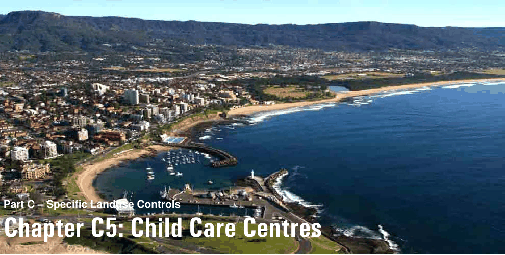

# Wollongong Development Control Plan 2009 - Chapter C5 Child Care Centres

> This chapter is split into 16 section file(s), one per numbered heading, in the order they appear in the PDF.

Source PDF: [Wollongong-DCP-2009-Chapter-C05-Child-Care-Centres.pdf](https://planfortomorrow.sharepoint.com/sites/Planfortomorrow/Shared%20Documents/00%20NSW-Planning-Resources/dcp/wollongong-development-control-plan-2009/chapter-c5-child-care-centres/Wollongong-DCP-2009-Chapter-C05-Child-Care-Centres.pdf)

> [Picture on page 1: a picture, saved as a picture (images/chapter-c5-child-care-centres-page-1-1.gif, 150 dpi).]

#### Part C – Specific Landuse Controls

### Chapter C5: Child Care Centres

### Contents

<!-- sections -->
## Sections

1. [3 RELATIONSHIP OF THIS PART OF THE DCP TO](01-3-relationship-of-this-part-of-the-dcp-to.md)
2. [91 of the Environmental Planning and Assessment Act 1979](02-91-of-the-environmental-planning-and.md)
3. [4 REGULATORY PROCESS – DEVELOPMENT CONSENT](03-4-regulatory-process-development-consent.md)
4. [6 DEVELOPMENT APPLICATIONS FOR ADDITIONS](04-6-development-applications-for-additions.md)
5. [7 PLANNING AND DESIGN CRITERIA](05-7-planning-and-design-criteria.md)
6. [1 INTRODUCTION](06-1-introduction.md)
7. [2 OBJECTIVES](07-2-objectives.md)
8. [3 RELATIONSHIP OF THIS PART OF THE DCP TO](08-3-relationship-of-this-part-of-the-dcp-to.md)
9. [4 REGULATORY PROCESS – DEVELOPMENT CONSENT AND](09-4-regulatory-process-development-consent.md)
10. [5 KEY STEPS IN THE APPROVAL PROCESS](10-5-key-steps-in-the-approval-process.md)
11. [6 DEVELOPMENT APPLICATIONS FOR ADDITIONS AND](11-6-development-applications-for-additions.md)
12. [7 PLANNING AND DESIGN CRITERIA](12-7-planning-and-design-criteria.md)
13. [8 BUSHFIRE PRONE LAND – INTEGRATED DEVELOPMENT](13-8-bushfire-prone-land-integrated.md)
14. [9 COMBINED CHILD FACILITY AND DWELLING (DUAL USE)](14-9-combined-child-facility-and-dwelling.md)
15. [10 OUT-OF-SCHOOL HOURS (OOSH) CARE](15-10-out-of-school-hours-oosh-care.md)
16. [11 HOME BASED CHILD CARE](16-11-home-based-child-care.md)
