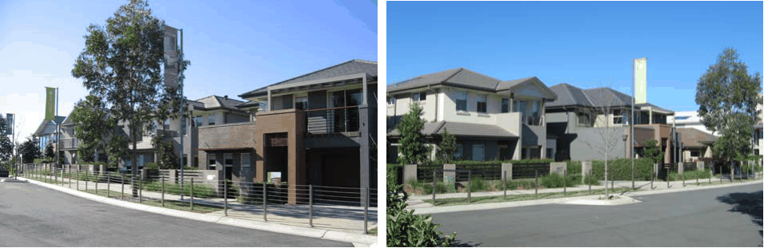

## 5 LOCATION OF EXHIBITION HOMES OR EXHIBITION VILLAGES

1\. The location of exhibition homes or exhibition villages should be adjacent to major arterial or sub-arterial roads and accessed via collector roads.

2\. Exhibition homes or villages should not be established within any existing residential estate, except where the exhibition home or village is proposed within a new stage of the residential

estate and is serviced by a separate road network not associated with any of the existing residential housing stages. Therefore, exhibition homes or villages will generally not be supported in cul-de-sacs or minor roads, particularly where there is potential for adverse amenity impacts to occur upon existing or future adjoining residential dwellings.

> [Picture on page 4: a picture, saved as a picture (images/chapter-c7-exhibition-villages-and-exhibition-homes-page-4-5.gif, 150 dpi).]

Figures 1 and 2: Examples of Exhibition homes with strong architectural elements (horizontal and vertical articulation) and varied external finishes
