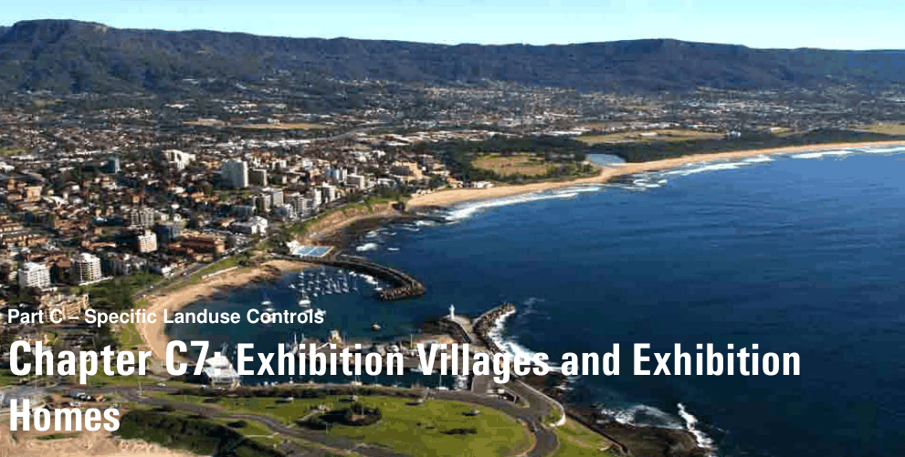

# Wollongong Development Control Plan 2009 - Chapter C7 Exhibition Villages and Exhibition Homes

> This chapter is split into 13 section file(s), one per numbered heading, in the order they appear in the PDF.

Source PDF: [Wollongong-DCP-2009-Chapter-C07-Exhibition-Villages-and-Exhibition-Homes.pdf](https://planfortomorrow.sharepoint.com/sites/Planfortomorrow/Shared%20Documents/00%20NSW-Planning-Resources/dcp/wollongong-development-control-plan-2009/chapter-c7-exhibition-villages-and-exhibition-homes/Wollongong-DCP-2009-Chapter-C07-Exhibition-Villages-and-Exhibition-Homes.pdf)

> [Picture on page 1: a picture, saved as a picture (images/chapter-c7-exhibition-villages-and-exhibition-homes-page-1-1.gif, 150 dpi).]

#### Part C – Specific Landuse Controls

### Chapter C7: Exhibition Villages and Exhibition

### Homes

### Contents

<!-- sections -->
## Sections

1. [3 USE OF DWELLING HOUSES AS EXHIBITION HOMES 1](01-3-use-of-dwelling-houses-as-exhibition.md)
2. [6 CARPARKING AND ACCESS ARRANGEMENTS END](02-6-carparking-and-access-arrangements-end.md)
3. [10 BUSINESS IDENTIFICATION SIGNAGE FOR](03-10-business-identification-signage-for.md)
4. [1 INTRODUCTION](04-1-introduction.md)
5. [2 OBJECTIVES](05-2-objectives.md)
6. [3 USE OF DWELLING HOUSES AS EXHIBITION HOMES](06-3-use-of-dwelling-houses-as-exhibition.md)
7. [4 ANCILLARY ACITIVITIES ASSOCIATED WITH AN EXHIBITION](07-4-ancillary-acitivities-associated-with-an.md)
8. [5 LOCATION OF EXHIBITION HOMES OR EXHIBITION VILLAGES](08-5-location-of-exhibition-homes-or.md)
9. [6 CARPARKING AND ACCESS ARRANGEMENTS](09-6-carparking-and-access-arrangements.md)
10. [7 DESIGN AND BUILDING GUIDELINES ENCOURAGING](10-7-design-and-building-guidelines.md)
11. [8 HOURS OF OPERATION](11-8-hours-of-operation.md)
12. [9 TIME LIMITED CONSENT](12-9-time-limited-consent.md)
13. [10 BUSINESS IDENTIFICATION SIGNAGE FOR EXHIBITION](13-10-business-identification-signage-for.md)
