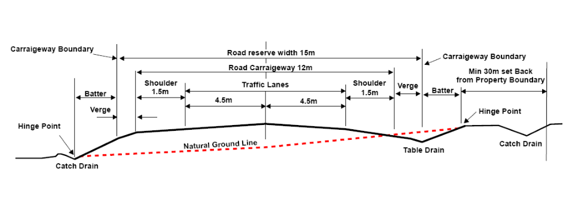

## 5 ACCESS ROAD REQUIREMENTS

### 5.1 General

1\. The main internal access road reserve for an extractive industry operation should be at least 15 metres wide with a minimum road carriageway width of 12 metres.

2\. The internal access road reserve associated with the extractive industry operation shall be setback at least:

(a) 30 metres from any property boundary;

(b) 40 metres from any environmentally sensitive area, including any natural watercourse or drainage line and habitat of any threatened flora or fauna species or endangered ecological community; and

(c) 250 metres from any residence not associated with the extraction industry operation.

Figure 1 below shows the minimum road carriageway design and setback requirements for internal access roads.

However, the actual location of an internal haulage road may vary depending upon existing topographical, environmental or other physical constraints and the nature and value of the underlying extractive material resource.

3\. The design of an internal haulage road should take into consideration the following matters:

(a) Cross –sectional characteristics of internal access arrangements;

(b) Horizontal and vertical alignment characteristics;

(c) Pavement and drainage proposals;

(d) Satisfactory vehicle grades not exceeding 6%; and

(e) Other road construction parameters.

4\. The actual road design for internal access roads (including haulage roads) and connection to the intersection with public roads shall be in accordance with the following guidelines:

(a) Austroad: Guide to Traffic Engineering Practice;

(b) NSW Roads & Traffic Authority’s Road Design Code;

(c) NSW Roads & Traffic Authority’s Guide to Traffic Generating Developments; and / or

(d) Other designs approved by Council and / or the NSW Roads & Traffic Authority (depending on the classification of the connecting public road).

> [Picture on page 5: a picture, saved as a picture (images/chapter-c8-extractive-industries-page-5-19.gif, 150 dpi).]

#### Figure 1: Road Carriageway Design & Setback Requirements

### 5.2 Traffic Impact Assessment Report

1\. The preparation of a traffic impact assessment report (ie prepared by a suitably qualified and experienced traffic engineer) will be required for any proposed extraction industry operation.

2\. The traffic impact assessment report shall address a range of matters / issues including (but not necessarily limited to) the following:

(a) Estimated average and maximum hourly, daily and weekly truck movements (ie laden and unladen truck movements), based upon the truck type and size proposed for the operation;

(b) Proposed truck routes (for both laden and unladen trucks) and possible alternative routes or other alternative transport modes such a rail transport;

(c) The physical condition of existing roads and / or bridges on the proposed truck routes to / from the site;

(d) The traffic generation impact of both laden and unladen truck movements along the proposed truck routes to / from the site;

(e) Potential road safety impacts upon other road users arising from the additional truck movements occurring along the proposed truck routes to / from the site, taking into account the location of any schools, bus stops etc;

(f) Assessment of sight distances for trucks entering / exiting the site and at other key intersections along the proposed truck routes to / from the site;

(g) Recommended additional road upgrading and / or traffic management works to improve sight distances at key intersections and along the road and general road improvement works such as road widening and / or the provision of safer overtaking lanes etc; and

(h) Recommended restrictions on the type or number of trucks operating from the extractive industry operation and / or the hours of truck movement to / from the site.
