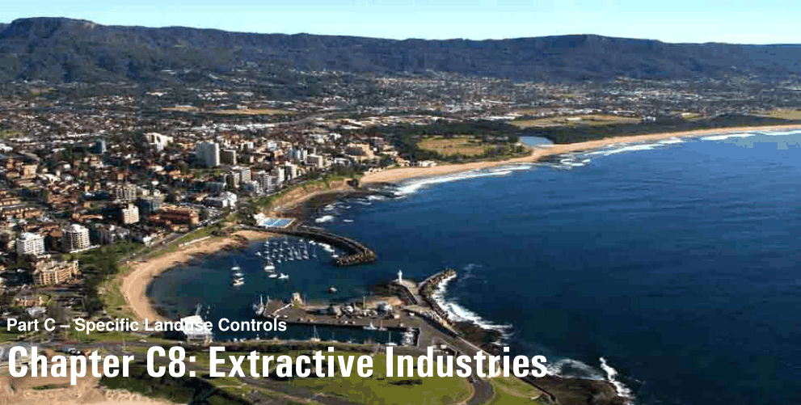

# Wollongong Development Control Plan 2009 - Chapter C8 Extractive Industries

> This chapter is split into 19 section file(s), one per numbered heading, in the order they appear in the PDF.

Source PDF: [Wollongong-DCP-2009-Chapter-C08-Extractive-Industries.pdf](https://planfortomorrow.sharepoint.com/sites/Planfortomorrow/Shared%20Documents/00%20NSW-Planning-Resources/dcp/wollongong-development-control-plan-2009/chapter-c8-extractive-industries/Wollongong-DCP-2009-Chapter-C08-Extractive-Industries.pdf)

> [Picture on page 1: a picture, saved as a picture (images/chapter-c8-extractive-industries-page-1-1.gif, 150 dpi).]

#### Part C – Specific Landuse Controls

### Chapter C8: Extractive Industries

### Contents

<!-- sections -->
## Sections

1. [2 OBJECTIVES](01-2-objectives.md)
2. [5 ACCESS ROAD REQUIREMENTS](02-5-access-road-requirements.md)
3. [7 WATER RESOURCE AND WATER QUALITY ISSUES 6](03-7-water-resource-and-water-quality-issues.md)
4. [15 DEVELOPMENT APPLICATION REQUIREMENT - SITE](04-15-development-application-requirement-site.md)
5. [1 INTRODUCTION](05-1-introduction.md)
6. [2 OBJECTIVES](06-2-objectives.md)
7. [3 DEFINITIONS](07-3-definitions.md)
8. [4 MINIMUM SETBACK REQUIREMENTS](08-4-minimum-setback-requirements.md)
9. [5 ACCESS ROAD REQUIREMENTS](09-5-access-road-requirements.md)
10. [6 SOIL AND WATER MANAGEMENT](10-6-soil-and-water-management.md)
11. [7 WATER RESOURCE AND WATER QUALITY ISSUES](11-7-water-resource-and-water-quality-issues.md)
12. [8 AIR QUALITY ISSUES](12-8-air-quality-issues.md)
13. [9 NOISE IMPACT ASSESSMENT – BLASTING AND NOISE](13-9-noise-impact-assessment-blasting-and.md)
14. [10 ECONOMIC ISSUES](14-10-economic-issues.md)
15. [11 CUMULATIVE ISSUES](15-11-cumulative-issues.md)
16. [12 JUSTIFICATION OF THE PROPOSED DEVELOPMENT](16-12-justification-of-the-proposed.md)
17. [13 STAGING OF EXTRACTION](17-13-staging-of-extraction.md)
18. [14 PROGRESSIVE REHABILITATION OF EXTRACTION SITE](18-14-progressive-rehabilitation-of-extraction.md)
19. [15 DEVELOPMENT APPLICATION REQUIREMENT - SITE PLAN &](19-15-development-application-requirement-site.md)
