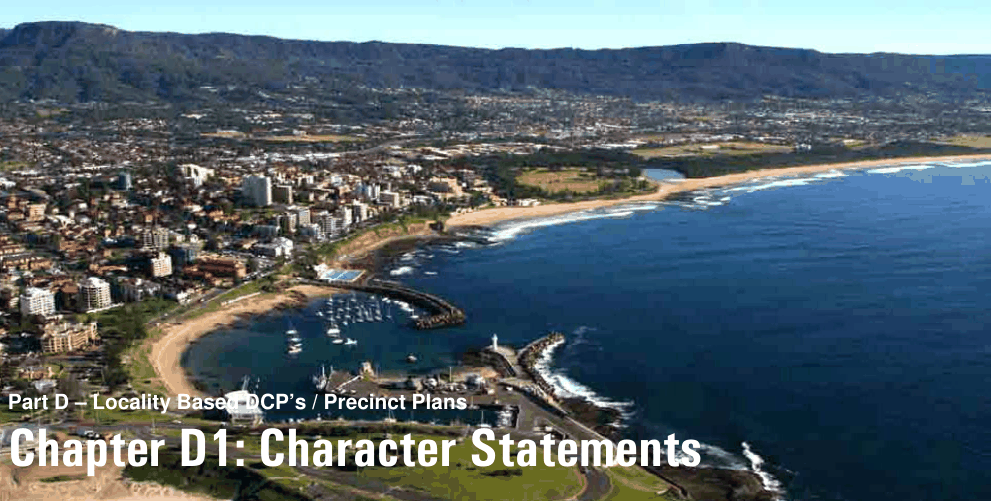

# Wollongong Development Control Plan 2009 - Chapter D1 Character Statements

> This chapter is split into 64 section file(s), one per numbered heading, in the order they appear in the PDF.

Source PDF: [Wollongong-DCP-2009-Chapter-D01-Character-Statements.pdf](https://planfortomorrow.sharepoint.com/sites/Planfortomorrow/Shared%20Documents/00%20NSW-Planning-Resources/dcp/wollongong-development-control-plan-2009/chapter-d1-character-statements/Wollongong-DCP-2009-Chapter-D01-Character-Statements.pdf)

> [Picture on page 1: a picture, saved as a picture (images/chapter-d1-character-statements-page-1-1.gif, 150 dpi).]

#### Part D – Locality Based DCP’s / Precinct Plans

### Chapter D1: Character Statements

> The PDF's contents list (page numbers of the printed document) is not repeated here - see Sections below.

i

| 3.55 | Koonawarra | 42 |
|---|---|---|
| 3.56 | Dapto | 42 |
| 3.57 | Horsley | 43 |
| 3.58 | Cleveland | 44 |
| 3.59 | Penrose | 44 |
| 3.60 | Avondale | 45 |
| 3.61 | Marshall Mount | 46 |
| 3.62 | Haywards Bay | 46 |
| 3.63 | Yallah | 47 |

ii

<!-- sections -->
## Sections

1. [1 AIMS AND OBJECTIVES](01-aims-and-objectives.md)
2. [2 WHAT IS CHARACTER?](02-what-is-character.md)
3. [3.1 Helensburgh](03-3-1-helensburgh.md)
4. [3.2 Lilyvale](04-3-2-lilyvale.md)
5. [3.3 Otford](05-3-3-otford.md)
6. [3.4 Stanwell Tops](06-3-4-stanwell-tops.md)
7. [3.5 Stanwell Park](07-3-5-stanwell-park.md)
8. [3.6 Darkes Forest](08-3-6-darkes-forest.md)
9. [3.7 Maddens Plain](09-3-7-maddens-plain.md)
10. [3.8 Coalcliff](10-3-8-coalcliff.md)
11. [3.9 Clifton](11-3-9-clifton.md)
12. [3.10 Scarborough](12-3-10-scarborough.md)
13. [3.11 Wombarra](13-3-11-wombarra.md)
14. [3.12 Coledale](14-3-12-coledale.md)
15. [3.13 Austinmer](15-3-13-austinmer.md)
16. [3.14 Thirroul](16-3-14-thirroul.md)
17. [3.15 Bulli](17-3-15-bulli.md)
18. [3.16 Woonona](18-3-16-woonona.md)
19. [3.17 Russell Vale](19-3-17-russell-vale.md)
20. [3.18 Corrimal](20-3-18-corrimal.md)
21. [3.19 East Corrimal](21-3-19-east-corrimal.md)
22. [3.20 Bellambi](22-3-20-bellambi.md)
23. [3.21 Tarrawanna](23-3-21-tarrawanna.md)
24. [3.22 Fern Hill](24-3-22-fern-hill.md)
25. [3.23 Towradgi](25-3-23-towradgi.md)
26. [3.24 Balgownie](26-3-24-balgownie.md)
27. [3.25 Mount Pleasant](27-3-25-mount-pleasant.md)
28. [3.26 Mount Ousley](28-3-26-mount-ousley.md)
29. [3.27 Fairy Meadow](29-3-27-fairy-meadow.md)
30. [3.28 Keiraville](30-3-28-keiraville.md)
31. [3.29 Mount Keira](31-3-29-mount-keira.md)
32. [3.30 Gwynneville](32-3-30-gwynneville.md)
33. [3.31 North Wollongong](33-3-31-north-wollongong.md)
34. [3.32 Wollongong City Centre](34-3-32-wollongong-city-centre.md)
35. [3.33 West Wollongong](35-3-33-west-wollongong.md)
36. [3.34 Mangerton](36-3-34-mangerton.md)
37. [3.35 Mount Saint Thomas](37-3-35-mount-saint-thomas.md)
38. [3.36 Coniston](38-3-36-coniston.md)
39. [3.37 Cringila](39-3-37-cringila.md)
40. [3.38 Port Kembla & Spring Hill](40-3-38-port-kembla-and-spring-hill.md)
41. [3.39 Lake Heights](41-3-39-lake-heights.md)
42. [3.40 Berkeley](42-3-40-berkeley.md)
43. [3.41 Warrawong](43-3-41-warrawong.md)
44. [3.42 Primbee](44-3-42-primbee.md)
45. [3.43 Windang](45-3-43-windang.md)
46. [3.44 Unanderra](46-3-44-unanderra.md)
47. [3.45 Figtree](47-3-45-figtree.md)
48. [3.46 Cordeaux Heights](48-3-46-cordeaux-heights.md)
49. [3.47 Farmborough Heights](49-3-47-farmborough-heights.md)
50. [3.48 Kembla Grange](50-3-48-kembla-grange.md)
51. [3.49 Mount Kembla Village & Kembla Heights](51-3-49-mount-kembla-village-and-kembla-heights.md)
52. [3.50 Wongawilli](52-3-50-wongawilli.md)
53. [3.51 Dombarton & Avon](53-3-51-dombarton-and-avon.md)
54. [3.52 Brownsville](54-3-52-brownsville.md)
55. [3.53 Kanahooka](55-3-53-kanahooka.md)
56. [3.54 Koonawarra](56-3-54-koonawarra.md)
57. [3.55 Dapto](57-3-55-dapto.md)
58. [3.56 Horsley](58-3-56-horsley.md)
59. [3.57 Cleveland](59-3-57-cleveland.md)
60. [3.58 Penrose](60-3-58-penrose.md)
61. [3.59 Avondale](61-3-59-avondale.md)
62. [3.60 Marshall Mount](62-3-60-marshall-mount.md)
63. [3.61 Haywards Bay](63-3-61-haywards-bay.md)
64. [3.62 Yallah](64-3-62-yallah.md)
