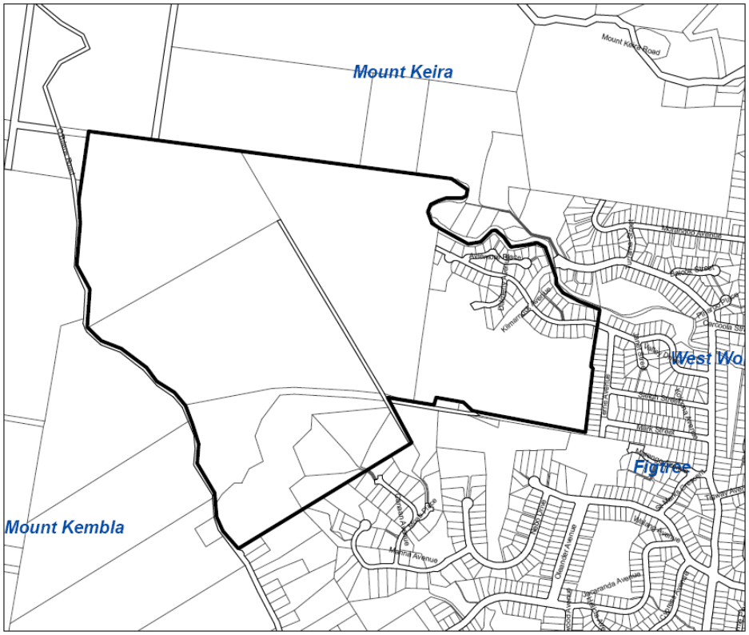

## 2 LAND TO WHICH THIS PLAN APPLIES

3\. This Precinct Plan applies to Lot 2 DP 206753 and Lots 31 and 34 DP 939374 off Valley Drive, Mount Keira and Lots 18 to 21 DP 939374 and unnumbered lot off O'Briens Road, Mount Keira, as depicted in Figure 1 below.

> [Picture on page 3: a picture, saved as a picture (images/chapter-d10-mount-keira-valley-drive-page-3-15.gif, 150 dpi).]

#### Figure 1: Land to which this Precinct Plan applies
