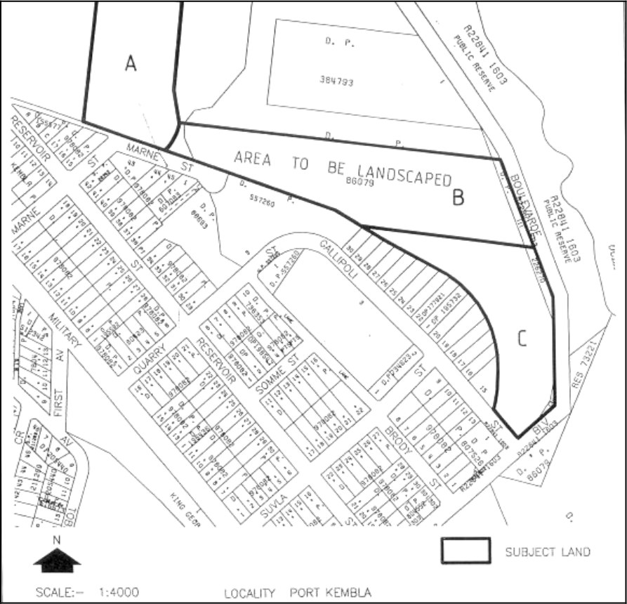

## 2 LAND TO WHICH THIS PLAN APPLIES

1\. This plan applies to Lot 1, DP 852309, Lot 51, DP 1002696, Gloucester Boulevarde, Port Kembla as shown in Figure 1 below.

> [Picture on page 3: a picture, saved as a picture (images/chapter-d11-port-kembla-gloucester-bvde-page-3-14.gif, 150 dpi).]

#### Figure 1: Land to which this DCP applies
