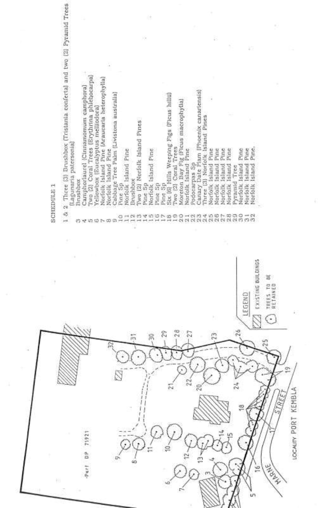

## 4 DEVELOPMENT CONTROLS

(a) Any re-development of the subject land, especially Areas A & B will require an appropriate site contamination impact assessment. Refer to the requirements of the Contaminated Land Management chapter in Part E of the DCP.

(b) Development consent shall not be given to the subdivision of the land until the applicant has prepared a landscape plan for Area B on the map accompanying this plan, and has given a written undertaking to the Council to complete the landscaping within an agreed period of time.

(c) Any subdivision or development of the land in Lot 51, DP 1002696 will require the provision for a public access way (ie at the applicant’s expense), between Areas B and C on the map accompanying this plan.

(d) A plan of subdivision of the land shall provide for the levelling of the surface of Area C on the map accompanying this plan in an even gradient from the rear property boundaries of the residential lots in Gallipoli Street to Gloucester Boulevarde.

(d) The height of residential development in Area C shall be in accordance with height controls contained in Wollongong Local Environmental Plan 2009 (Height of Buildings map) and the Residential Development chapter contained in Part B of the DCP.

(e) Roof pitches of residential development on Area C shall be no greater than 20°.

(f) The trees in Area A and listed in the schedule accompanying this plan shall be retained.  Any Development Application for Area A shall include a tree survey accurately indicating the location, height, spread and botanical name of all trees on the site and identify any proposed to be removed.

> [Picture on page 5: a picture, saved as a picture (images/chapter-d11-port-kembla-gloucester-bvde-page-5-1.gif, 150 dpi).]
